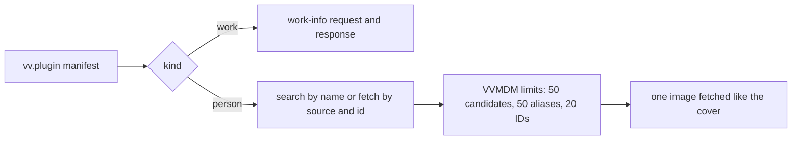

# Person plugins: the contract

A person plugin is a work-info plugin module whose manifest says
`"kind": "person"`; it searches a site for people and fetches one person by an
external ID. The manifest rules are in
[`person_plugin.go`](../../internal/domain/person_plugin.go), the run in
[`run.go`](../../internal/wasmplugin/run.go), the registry row in
[`work_info_plugins.go`](../../internal/store/work_info_plugins.go), and the author's contract in
[Write a work-info plugin](../how-to/work-info-plugins.md#person-plugins).

The diagram shows how one kind field steers a run of the shared runtime.

## Person plugins extend contract 1

`kind` and `sources` are manifest fields of contract `1`, `fetch` gains a
`source`, and the fetch response gains a `person` object; everything else
about a module stays as for a work-info plugin.

The owner sees the accepted sources in the manifest before approving, and
inspection never runs the module
([work-info-plugins.md](work-info-plugins.md#inspection-never-runs-the-module)).
An older VVMDM ignores `kind` and fails the run on the `person` response with
`plugin_failed`, which the owner fixes by uploading the module again.

| Rejected | Why |
| --- | --- |
| Contract `2` for person plugins | Contract `2` would also have to describe work-info plugins, which do not change |
| Sources returned by a `describe` operation | The approval would show values that unapproved code produced |

## A person plugin declares both operations

A person plugin's `operations` are exactly `search` and `fetch`, and a search
candidate is an external ID (`source` and `id`) with a name. Fetching a
candidate and fetching by a person's stored external ID are therefore the same
request, and a screen never needs a branch for a plugin that cannot search.
A candidate whose `source` the manifest does not declare fails the run, so a
fetch is only ever asked for a declared source.

## The requested ID survives the limits

VVMDM puts the request's `(source, id)` first in the fetched person's external
IDs, then keeps the plugin's other distinct IDs up to 20 in all. A person found
by name keeps the ID it was fetched by, so the next lookup can go by ID, even
when the plugin leaves that ID out or returns 20 others.

## The person's image is fetched like the cover

After a successful fetch, VVMDM fetches the one `image` URL with the run's
HTTP client, outside the request count, the way it fetches a work's cover
([work-info-plugins.md](work-info-plugins.md#vvmdm-fetches-the-cover-and-applies-it-as-an-uploaded-image)).
A refused address fails the run with `blocked_address`, and an image that
cannot be fetched is dropped while the rest of the person is kept.

## Person plugins share the work-info plugin registry

A person plugin is a `work_info_plugins` row whose `kind` column is `person`,
with its `sources` stored as a JSON array; upload, approval, settings, last
run and deletion stay the same, and the list tells the kinds apart by `kind`.
The manifest name stays the identity across both kinds, so a module named like
an existing plugin replaces it whatever its kind and takes the new kind and
sources. Rows uploaded before person plugins keep `kind` `work`: the migration
does not inspect stored modules again, so a person module uploaded to an older
VVMDM runs as a work-info plugin until the owner uploads it again.

A work-info search or fetch with a person plugin, and a person search with a
work-info plugin, answer `409 plugin_kind_mismatch` before the module runs.

| Rejected | Why |
| --- | --- |
| A `person_plugins` table with its own endpoints | It would copy the registry's store, approval, settings and last-run code |
| Renaming `WorkInfoPlugin*` to `Plugin*` now | It touches every plugin file, the API and the SPA without changing behaviour |
| Refusing a replacement of another kind | The owner would have to delete the plugin first, and a replacement already revokes approval |

## Automatic lookups are a switch on the plugin row

`auto_lookup` decides whether work-info fetches may call a person plugin. It
is on for a new person plugin, because approval is already the owner's consent,
and a same-name replacement keeps it. The owner sets it with
`PUT /api/work-info-plugins/{id}/auto-lookup`; it does not affect fetching from
a person's page, and the API reports it as `false` for a work-info plugin.

| Rejected | Why |
| --- | --- |
| A manifest setting | Settings are values passed to the plugin, and the plugin would have to declare one |
| Off by default | The lookup during a work-info fetch is meant to happen without a further step |

## The person page fetches by a stored ID the server picks

`POST /api/people/{id}/plugin-fetches` with only `pluginId` sends the person's
first stored external ID, in the stored `(source, value)` order, whose source
the plugin declares, and answers `409 person_external_id_missing` before the
module runs when there is none. With a search candidate's `source` and `id` it
fetches that ID. The rule is
[`PersonFetchID`](../../internal/domain/person_plugin_apply.go), so the page
offers a name search only after the `409`, and a person with an accepted ID
never sees candidates.

The result is kept for 10 minutes, bound to the person and to the plugin's
digest and generation, in the store and under the image budget of work-info
fetches ([work-info-plugins.md](work-info-plugins.md)). Its image is served
from `GET /api/people/{id}/plugin-fetches/{fetchId}/image`. The result keeps
only the profile values valid with each other, the ones the comparison shows,
so an apply can select only a value the owner saw. The run rechecks the
source against the plugin it executes and answers `400 invalid_request` when a
replaced plugin no longer declares it.

| Rejected | Why |
| --- | --- |
| The page picks the ID and always sends it | The rule would live in Go and in TypeScript |

## A fetched person applies per item and only fills

`POST /api/people/{id}/plugin-fetches/{fetchId}/apply` takes the items the
owner selected: `image`, `aliases`, `externalIds` and one `profile.<field>`
per profile field. The apply rechecks the plugin's approval, digest and
generation inside its transaction, as a work-info apply does, and answers
`409 work_info_fetch_stale` without writes when the plugin changed since the
fetch.

| Item | Rule |
| --- | --- |
| A profile field | Fills the field only when it is empty |
| `image` | Becomes the face, after the commit, only when the person has none |
| `aliases` | Appends the aliases the person does not have; those over 50 are skipped as `too_many` |
| `externalIds` | Appends the IDs the person does not have; those over 20 are skipped as `too_many`, and an ID another person holds is skipped as `taken` with that person's name |

A value that would make the person invalid is skipped as `invalid`, and the
rest applies. A `taken` ID never merges the two people: the owner merges them
on the people screens when they are one person. The rules are
[`FillPersonItems`](../../internal/domain/person_plugin_apply.go), which a
lookup from a work-info fetch applies too, and the write is
[`ApplyPersonPluginFetch`](../../internal/store/person_plugin_apply.go).

| Rejected | Why |
| --- | --- |
| Replace stored values with fetched ones | The owner's edits would be lost to a site's values without a choice per field |
| Merge the person holding a `taken` ID | A wrong ID on a site would merge two people the owner keeps apart |

## The settings page lists each kind in its own section

The Plugins settings page reads the one plugin list and shows person plugins
in a `Person plugins` section after `Work-info plugins`, with the same row,
approval prompt and menu. Each section has its own `Add plugin`; the upload
is one endpoint and the manifest decides the kind, so the toast names the
other section when the row lands there. The automatic lookup switch is a
`Switch` on approved person rows only, because a plugin that is not approved
never runs. The video page's fetch dialog offers work-info plugins only.

| Rejected | Why |
| --- | --- |
| A kind badge on rows in one list | The owner would read every row to find the plugins that fetch people |
| The switch as a row menu item | Its state would be hidden until the menu opens |

## The person page compares a fetched person before applying it

`Fetch info…` on the person page opens a dialog with the steps of the video's
fetch dialog: plugin, candidates when needed, comparison, result. Its first
`Fetch` sends only `pluginId`, and the dialog shows the `Name` field,
prefilled with the person's name, only after the server answers
`409 person_external_id_missing`; a chosen candidate's `source` and `id` are
then sent with the fetch. The response of the apply replaces the page's person
in memory, so the page shows the filled fields without reading it again.

The comparison, [`PersonCompare`](../../web/src/credits/person/pluginFetch/PersonCompare.tsx),
draws a selectable row only for an item the apply would write: an empty
profile field the result fills, a face for a person without one, and aliases
or external IDs the person does not have. A fetched value the person already
has sits behind one `Kept as now (N)` fold, without a checkbox, because the
apply keeps the stored value. The rows are computed by
[`compareRows`](../../web/src/credits/person/pluginFetch/personCompareRows.ts),
and the work-info comparison reuses the piece for its person lookups.

| Rejected | Why |
| --- | --- |
| One row per profile field with `Same as now` | Kept values would fill the dialog, and their checkboxes would select nothing the apply writes |
| A `Measurements` or `Career` row | One checkbox would select several apply items |
