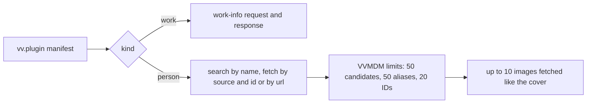
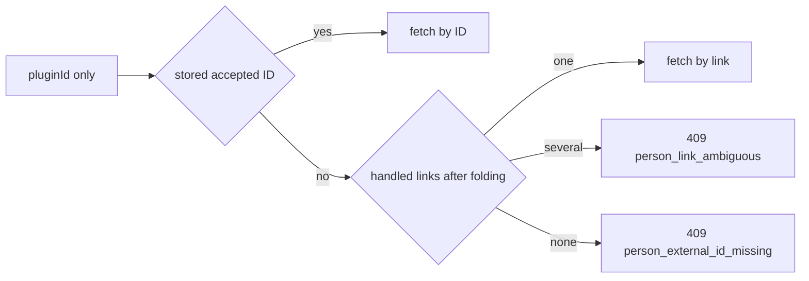

# Person plugins: the contract

A person plugin is a work-info plugin module whose manifest says
`"kind": "person"`; it searches a site for people and fetches one person by an
external ID or by a link under the domains it declares. The manifest rules are in
[`person_plugin.go`](../../internal/domain/person_plugin.go), the run in
[`run.go`](../../internal/wasmplugin/run.go), the registry row in
[`work_info_plugins.go`](../../internal/store/work_info_plugins.go), and the author's contract in
[Write a work-info plugin](../how-to/work-info-plugins.md#person-plugins).

The diagram shows how one kind field steers a run of the shared runtime.

## Person plugins extend contract 1

`kind`, `sources` and `domains` are manifest fields of contract `1`, `fetch`
gains a `source` or a `url`, and the fetch response gains a `person` object;
everything else about a module stays as for a work-info plugin.

The owner sees the accepted sources and the link domains in the manifest
before approving, and
inspection never runs the module
([work-info-plugins.md](work-info-plugins.md#inspection-never-runs-the-module)).
An older VVMDM ignores `kind` and fails the run on the `person` response with
`plugin_failed`, which the owner fixes by uploading the module again.

| Rejected | Why |
| --- | --- |
| Contract `2` for person plugins | Contract `2` would also have to describe work-info plugins, which do not change |
| Sources or domains returned by a `describe` operation | The approval would show values that unapproved code produced |
| URL patterns instead of domains | The owner could not read at approval which links the plugin receives, and the plugin parses the link itself anyway |

## A person plugin declares both operations

A person plugin's `operations` are exactly `search` and `fetch`, and a search
candidate is an external ID (`source` and `id`) with a name. Fetching a
candidate and fetching by a person's stored external ID are therefore the same
request, and a screen never needs a branch for a plugin that cannot search.
A candidate whose `source` the manifest does not declare fails the run, so a
fetch is only ever asked for a declared source.

## The requested ID survives the limits

VVMDM puts the request's `(source, id)` first in the fetched person's external
IDs, then keeps the plugin's other distinct IDs up to 20 in all. A person found
by name keeps the ID it was fetched by, so the next lookup can go by ID, even
when the plugin leaves that ID out or returns 20 others. A fetch by link has no
request ID, so the person keeps only the plugin's IDs; once the owner applies
one the plugin accepts, the next fetch goes by that ID.

## The person's images are fetched like the cover

A fetch result carries `images`, a list of URLs, because a site often shows
several photos of one person and the owner picks the face. After a successful
fetch, VVMDM fetches the first 10 distinct valid URLs one after another with
the run's HTTP client, outside the request count, the way it fetches a work's
cover
([work-info-plugins.md](work-info-plugins.md#vvmdm-fetches-the-covers-and-applies-one-as-an-uploaded-image)).
A refused address fails the run with `blocked_address`, and an image that
cannot be fetched is dropped while the rest of the person is kept. Ten images
at the 4 MiB limit fit the fetch budget below on their own.

| Rejected | Why |
| --- | --- |
| Keeping `image` beside `images` | The maintainer asked for no compatibility with older modules, and two fields would need a rule for which wins |

## Person plugins share the work-info plugin registry

A person plugin is a `work_info_plugins` row whose `kind` column is `person`,
with its `sources` stored as a JSON array; upload, approval, settings, last
run and deletion stay the same, and the list tells the kinds apart by `kind`.
The manifest name stays the identity across both kinds, so a module named like
an existing plugin replaces it whatever its kind and takes the new kind and
sources. Rows uploaded before person plugins keep `kind` `work`: the migration
does not inspect stored modules again, so a person module uploaded to an older
VVMDM runs as a work-info plugin until the owner uploads it again.

A work-info search or fetch with a person plugin, and a person search with a
work-info plugin, answer `409 plugin_kind_mismatch` before the module runs.

| Rejected | Why |
| --- | --- |
| A `person_plugins` table with its own endpoints | It would copy the registry's store, approval, settings and last-run code |
| Renaming `WorkInfoPlugin*` to `Plugin*` now | It touches every plugin file, the API and the SPA without changing behaviour |
| Refusing a replacement of another kind | The owner would have to delete the plugin first, and a replacement already revokes approval |

## The person page fetches by a key the server picks

`POST /api/people/{id}/plugin-fetches` with only `pluginId` picks the key in
this order, all before the module runs:

1. The person's first stored external ID, in the stored `(source, value)`
   order, whose source the plugin declares
   ([`PersonFetchID`](../../internal/domain/person_plugin_apply.go)).
2. The person's one link the plugin handles, after folding
   ([`PersonFetchLinks`](../../internal/domain/person_plugin_links.go)).
   Several such links answer `409 person_link_ambiguous` with them as
   `links`, in stored order, so the owner picks one.
3. Otherwise `409 person_external_id_missing`, and the dialog offers the name
   search.

With a search candidate's `source` and `id` it fetches that ID, and with
`link` it fetches that link; the three forms exclude each other. The page's
first fetch sends only `pluginId`, and a name search is always one press
away, so the owner can pick another candidate when the stored ID or link
points at the wrong person.

The result is kept for 10 minutes, bound to the person and to the plugin's
digest and generation, in the store and under the image budget of work-info
fetches ([work-info-plugins.md](work-info-plugins.md)). Its images are
served by index from `GET /api/people/{id}/plugin-fetches/{fetchId}/images/{index}`,
and the result tells their number as `imageCount` and the link it ran with as
`link`. The result keeps
only the profile values valid with each other, the ones the comparison shows,
so an apply can select only a value the owner saw. The run rechecks the
source and the link against the plugin it executes and answers
`400 invalid_request` when a replaced plugin no longer declares them.

| Rejected | Why |
| --- | --- |
| The page picks the ID or the link and always sends it | The rule would live in Go and in TypeScript |
| A lookup endpoint the page calls before every fetch | One request more on every fetch for a choice needed only when several links match |
| Fetching every handled link and comparing the results | Up to 20 runs of 30 seconds each before the owner sees anything |

## A link fetch is the fetch operation with a url

A plugin that declares `domains` accepts `fetch` with a `url` in place of
`source` and `id`, and answers the same `person` object, so a link fetch is
one run and compares and applies as a fetch by ID does. A link matches when it
is an `http` or `https` URL whose host, lowercased, is a declared domain or
ends with `.` and one, so `www.example.com` matches `example.com`
([`LinkMatchesDomains`](../../internal/domain/person_plugin_links.go)). A
`link` the owner typed that no domain matches answers
`400 person_link_unsupported`, and one that is not an `http` or `https` URL
answers `400 invalid_request`, both without a run. A missing, private or
silent page fails the run as any fetch does and writes nothing.

Folding keeps the first stored of the links that differ only in scheme, host
case or a trailing slash. Query strings and fragments stay, since some sites
carry the person in one of them, and the plugin handles path case and
tracking parameters itself.

| Rejected | Why |
| --- | --- |
| A `resolve` operation that maps a link to an ID, then a fetch by ID | Two runs of up to 30 seconds for a person the plugin had already loaded in the first |
| Requiring a declared source's ID in a link fetch's result | A site without a stable ID could never be fetched by link |
| Exact host match only | Most sites serve a person's page under `www.` and a bare host |
| Dropping query strings or fragments when folding | A link whose ID is a query parameter or a fragment would fold into another person's |
| Searching a link the plugin does not handle as a name | A URL as a search query finds nothing, and the owner would not learn why |

## A fetched person applies per item, and a profile value may replace

`POST /api/people/{id}/plugin-fetches/{fetchId}/apply` takes what the owner
selected: `items`, with `image` and one `profile.<field>` per profile field
other than links, and the lists `aliases`, `externalIds` and `links`, each
value one the result carries. An alias may be the fetched name, since a site
often lists the person under a name the owner does not have yet. The rule is
[`Select`](../../internal/domain/person_plugin_apply.go), and a selection
naming a list as an item, or a value the result lacks, is
`400 invalid_request`. The apply rechecks the plugin's approval, digest and
generation inside its transaction, as a work-info apply does, and answers
`409 work_info_fetch_stale` without writes when the plugin changed since the
fetch.

| Item | Rule |
| --- | --- |
| A profile field | Writes the fetched value, replacing a stored one |
| `image` | The image at the request's `imageIndex` becomes the face after the commit, replacing a stored one |
| `aliases` | Appends the chosen aliases the person does not have; those over 50 are skipped as `too_many` |
| `externalIds` | Appends the chosen IDs the person does not have; those over 20 are skipped as `too_many`, and an ID another person holds is skipped as `taken` with that person's name |
| `links` | Appends the chosen links the person does not have; those over 20 are skipped as `too_many` |

A value that would make the person invalid is skipped as `invalid`, and the
rest applies. A `taken` ID never merges the two people: the owner merges them
on the people screens when they are one person. The rules are
[`FillPersonItems`](../../internal/domain/person_plugin_apply.go), and the
write is
[`ApplyPersonPluginFetch`](../../internal/store/person_plugin_apply.go).

A replacement is the owner's choice per item: the comparison leaves every row
that would replace a stored value unchecked, so a stored edit is lost only to
a row the owner checked.

| Rejected | Why |
| --- | --- |
| Fill only, never replace | The owner could not correct a wrong or outdated value from the site without retyping it |
| Replacing aliases, external IDs and links | A list replaced by a site's would drop names, IDs and links the owner added |
| One checkbox per list | A site's list often holds one wrong alias or link, and the owner could only take or leave all of them |
| Merge the person holding a `taken` ID | A wrong ID on a site would merge two people the owner keeps apart |

## The settings page lists each kind in its own section

The Plugins settings page reads the one plugin list and shows person plugins
in a `Person plugins` section after `Work-info plugins`, with the same row,
approval prompt and menu. Each section has its own `Add plugin`; the upload
is one endpoint and the manifest decides the kind, so the toast names the
other section when the row lands there. The video page's fetch dialog offers
work-info plugins only.

A person plugin's row and its approval prompt list the link domains it
declares right after the ID sources it accepts, in manifest order, so the
owner compares both keys at a glance before approving. A domain is shown
whole and wraps inside itself rather than being shortened, because the owner
approves exactly the sites it names; a plugin without domains shows nothing
for them.

| Rejected | Why |
| --- | --- |
| A kind badge on rows in one list | The owner would read every row to find the plugins that fetch people |

## The person page compares a fetched person before applying it

`Fetch info…` on the person page opens a dialog with the steps of the video's
fetch dialog: plugin, candidates when needed, comparison, result. Its first
`Fetch` sends only `pluginId`. The dialog shows the `Name` field, prefilled
with the person's name, after the server answers
`409 person_external_id_missing`, or when the owner presses `Search by name`,
which the plugin step and a comparison fetched by a stored key offer; a chosen
candidate's `source` and `id` are then sent with the fetch. Under the field,
the person's name and aliases each search at a press, since a site may list the
person under any of them. Every comparison has `Back` to the plugin step, and
to the matches after a name search, so another plugin or candidate is one step
away. The response of the apply replaces the page's person
in memory, so the page shows the filled fields without reading it again.

The page holds no link-matching rule; it follows the server's answers:

| Answer or input | What the dialog does |
| --- | --- |
| `409 person_link_ambiguous` | The plugin step lists `links` as candidate rows, each its path over its host; a row press sends that `link`, and the submit button stays disabled while the rows are the action. `Back` from the comparison returns to the rows |
| A `Name` value that parses as an `http` or `https` URL | The submit button reads `Fetch`, a line under the field says so, and the value is sent as `link` instead of searched |
| `400 person_link_unsupported` | The field keeps the value; the reason, with the plugin's domains, stands under it until the next edit, and nothing is searched |
| A result with `link` | The comparison's source line names that link instead of the first external ID |

After a stale apply, `Fetch again` resends the `link`, or the candidate, the
dialog sent, and only `pluginId` when the server picked the key, so a picked
link is not asked for twice.

The comparison, [`PersonCompare`](../../web/src/credits/person/pluginFetch/PersonCompare.tsx),
is in the order the owner decides:

| Part | Content | Starts |
| --- | --- | --- |
| `Face` | The person's face, or `No change` without one, then each fetched image, as one radio group | On the stored face; on the first image for a person without one |
| `Fills empty fields` | The fetched value of each empty profile field, and aliases or external IDs the person does not have | Checked |
| `Differs from now` | A stored profile value, struck through when checked, an arrow and the fetched one | Unchecked |
| `Adds to lists` | Aliases, the fetched name among them, external IDs and links the person does not have, each a toggle, and a count of those the person has | Pressed |
| `Same as now (N)` | Values equal to the stored ones, folded, without checkboxes | Folded |

`Fills empty fields`, `Differs from now` and `Adds to lists` each have
`Select all` or `Clear` when they hold more than one choice. Each row is one apply item, with its label in
a fixed column so values line up down the dialog; below `sm` a row stacks its
label over its values, which keep the now, arrow and fetched order on one line.
The rows are computed by
[`compareRows`](../../web/src/credits/person/pluginFetch/personCompareRows.ts),
and the parts are the video's comparison's
([`compareParts`](../../web/src/player/workInfoFetch/compareParts.tsx)), so
both dialogs read the same.

A page opened at `/people/{id}?fetch=1`, as a video's fetch result links its
linked people, opens `Fetch info…` once and drops the parameter.

| Rejected | Why |
| --- | --- |
| One table of every field with `Now` and `Fetched` columns | Empty `Now` cells filled half the table, and a `Replaces current` mark squeezed into the label column overlapped the values |
| The face as a checkbox row | Several images compete for one face, and a checkbox cannot say which |
| One row per profile field with `Same as now` | Equal values would fill the dialog, and their checkboxes would select nothing the apply writes |
| Replacement rows checked like filling rows | One `Apply selected` would overwrite the owner's edits with every differing site value |
| A `Measurements` or `Career` row | One checkbox would select several apply items |

## Work-info fetches do not look people up

A work-info fetch links its people and fills their empty profile fields and
missing faces from the work's own values, and the person page fetches each
person from a person plugin. The fetch result lists the people the apply
linked, each a link to its page's `Fetch info…`; a person a fetch created
carries the work's external IDs, so that fetch goes by ID without a search.

| Rejected | Why |
| --- | --- |
| Looking the people up during the work-info fetch, then showing each result inside the video's comparison | Five lookups took up to 2.5 minutes one at a time, the comparison changed while the owner read it, and a person's rows nested in a role row were hard to read and to choose |
| An automatic lookup switch on person plugins | Without lookups nothing reads it |
