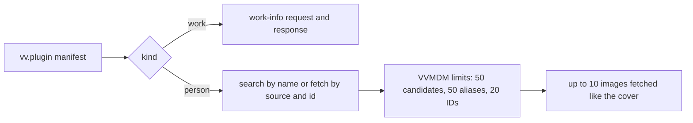
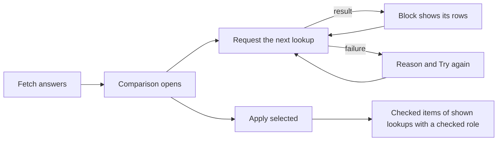

# Person plugins: the contract

A person plugin is a work-info plugin module whose manifest says
`"kind": "person"`; it searches a site for people and fetches one person by an
external ID. The manifest rules are in
[`person_plugin.go`](../../internal/domain/person_plugin.go), the run in
[`run.go`](../../internal/wasmplugin/run.go), the registry row in
[`work_info_plugins.go`](../../internal/store/work_info_plugins.go), and the author's contract in
[Write a work-info plugin](../how-to/work-info-plugins.md#person-plugins).

The diagram shows how one kind field steers a run of the shared runtime.

## Person plugins extend contract 1

`kind` and `sources` are manifest fields of contract `1`, `fetch` gains a
`source`, and the fetch response gains a `person` object; everything else
about a module stays as for a work-info plugin.

The owner sees the accepted sources in the manifest before approving, and
inspection never runs the module
([work-info-plugins.md](work-info-plugins.md#inspection-never-runs-the-module)).
An older VVMDM ignores `kind` and fails the run on the `person` response with
`plugin_failed`, which the owner fixes by uploading the module again.

| Rejected | Why |
| --- | --- |
| Contract `2` for person plugins | Contract `2` would also have to describe work-info plugins, which do not change |
| Sources returned by a `describe` operation | The approval would show values that unapproved code produced |

## A person plugin declares both operations

A person plugin's `operations` are exactly `search` and `fetch`, and a search
candidate is an external ID (`source` and `id`) with a name. Fetching a
candidate and fetching by a person's stored external ID are therefore the same
request, and a screen never needs a branch for a plugin that cannot search.
A candidate whose `source` the manifest does not declare fails the run, so a
fetch is only ever asked for a declared source.

## The requested ID survives the limits

VVMDM puts the request's `(source, id)` first in the fetched person's external
IDs, then keeps the plugin's other distinct IDs up to 20 in all. A person found
by name keeps the ID it was fetched by, so the next lookup can go by ID, even
when the plugin leaves that ID out or returns 20 others.

## The person's images are fetched like the cover

A fetch result carries `images`, a list of URLs, because a site often shows
several photos of one person and the owner picks the face. After a successful
fetch, VVMDM fetches the first 10 distinct valid URLs one after another with
the run's HTTP client, outside the request count, the way it fetches a work's
cover
([work-info-plugins.md](work-info-plugins.md#vvmdm-fetches-the-cover-and-applies-it-as-an-uploaded-image)).
A refused address fails the run with `blocked_address`, and an image that
cannot be fetched is dropped while the rest of the person is kept. Ten images
at the 4 MiB limit fit the fetch budget below on their own.

A lookup from a work-info fetch fetches only the first image, since it fills
the face of a person who has none and its images share one fetch's budget.

| Rejected | Why |
| --- | --- |
| Keeping `image` beside `images` | The maintainer asked for no compatibility with older modules, and two fields would need a rule for which wins |
| Fetching every image of a lookup | Five lookups of 10 images would not fit one fetch's budget |

## Person plugins share the work-info plugin registry

A person plugin is a `work_info_plugins` row whose `kind` column is `person`,
with its `sources` stored as a JSON array; upload, approval, settings, last
run and deletion stay the same, and the list tells the kinds apart by `kind`.
The manifest name stays the identity across both kinds, so a module named like
an existing plugin replaces it whatever its kind and takes the new kind and
sources. Rows uploaded before person plugins keep `kind` `work`: the migration
does not inspect stored modules again, so a person module uploaded to an older
VVMDM runs as a work-info plugin until the owner uploads it again.

A work-info search or fetch with a person plugin, and a person search with a
work-info plugin, answer `409 plugin_kind_mismatch` before the module runs.

| Rejected | Why |
| --- | --- |
| A `person_plugins` table with its own endpoints | It would copy the registry's store, approval, settings and last-run code |
| Renaming `WorkInfoPlugin*` to `Plugin*` now | It touches every plugin file, the API and the SPA without changing behaviour |
| Refusing a replacement of another kind | The owner would have to delete the plugin first, and a replacement already revokes approval |

## Automatic lookups are a switch on the plugin row

`auto_lookup` decides whether work-info fetches may call a person plugin. It
is on for a new person plugin, because approval is already the owner's consent,
and a same-name replacement keeps it. The owner sets it with
`PUT /api/work-info-plugins/{id}/auto-lookup`; it does not affect fetching from
a person's page, and the API reports it as `false` for a work-info plugin.

| Rejected | Why |
| --- | --- |
| A manifest setting | Settings are values passed to the plugin, and the plugin would have to declare one |
| Off by default | The lookup during a work-info fetch is meant to happen without a further step |

## The person page fetches by a stored ID the server picks

`POST /api/people/{id}/plugin-fetches` with only `pluginId` sends the person's
first stored external ID, in the stored `(source, value)` order, whose source
the plugin declares, and answers `409 person_external_id_missing` before the
module runs when there is none. With a search candidate's `source` and `id` it
fetches that ID. The rule is
[`PersonFetchID`](../../internal/domain/person_plugin_apply.go). The page's
first fetch sends only `pluginId`, and a name search is always one press away,
so the owner can pick another candidate when the stored ID points at the wrong
person.

The result is kept for 10 minutes, bound to the person and to the plugin's
digest and generation, in the store and under the image budget of work-info
fetches ([work-info-plugins.md](work-info-plugins.md)). Its images are
served by index from `GET /api/people/{id}/plugin-fetches/{fetchId}/images/{index}`,
and the result tells their number as `imageCount`. The result keeps
only the profile values valid with each other, the ones the comparison shows,
so an apply can select only a value the owner saw. The run rechecks the
source against the plugin it executes and answers `400 invalid_request` when a
replaced plugin no longer declares it.

| Rejected | Why |
| --- | --- |
| The page picks the ID and always sends it | The rule would live in Go and in TypeScript |

## A fetched person applies per item, and a profile value may replace

`POST /api/people/{id}/plugin-fetches/{fetchId}/apply` takes what the owner
selected: `items`, with `image` and one `profile.<field>` per profile field
other than links, and the lists `aliases`, `externalIds` and `links`, each
value one the result carries. An alias may be the fetched name, since a site
often lists the person under a name the owner does not have yet. The rule is
[`Select`](../../internal/domain/person_plugin_apply.go), and a selection
naming a list as an item, or a value the result lacks, is
`400 invalid_request`. The apply rechecks the plugin's approval, digest and
generation inside its transaction, as a work-info apply does, and answers
`409 work_info_fetch_stale` without writes when the plugin changed since the
fetch.

| Item | Rule |
| --- | --- |
| A profile field | Writes the fetched value, replacing a stored one |
| `image` | The image at the request's `imageIndex` becomes the face after the commit, replacing a stored one |
| `aliases` | Appends the chosen aliases the person does not have; those over 50 are skipped as `too_many` |
| `externalIds` | Appends the chosen IDs the person does not have; those over 20 are skipped as `too_many`, and an ID another person holds is skipped as `taken` with that person's name |
| `links` | Appends the chosen links the person does not have; those over 20 are skipped as `too_many` |

A value that would make the person invalid is skipped as `invalid`, and the
rest applies. A `taken` ID never merges the two people: the owner merges them
on the people screens when they are one person. The rules are
[`FillPersonItems`](../../internal/domain/person_plugin_apply.go), which a
lookup from a work-info fetch applies too, but only filling empty profile
fields and a missing face; the write is
[`ApplyPersonPluginFetch`](../../internal/store/person_plugin_apply.go).

A replacement is the owner's choice per item: the comparison leaves every row
that would replace a stored value unchecked, so a stored edit is lost only to
a row the owner checked.

| Rejected | Why |
| --- | --- |
| Fill only, never replace | The owner could not correct a wrong or outdated value from the site without retyping it |
| Replacing in work-info lookups too | Their rows sit inside a video's comparison, where a checked role row would replace a person's values without a look at each |
| Replacing aliases, external IDs and links | A list replaced by a site's would drop names, IDs and links the owner added |
| One checkbox per list | A site's list often holds one wrong alias or link, and the owner could only take or leave all of them |
| Merge the person holding a `taken` ID | A wrong ID on a site would merge two people the owner keeps apart |

## The settings page lists each kind in its own section

The Plugins settings page reads the one plugin list and shows person plugins
in a `Person plugins` section after `Work-info plugins`, with the same row,
approval prompt and menu. Each section has its own `Add plugin`; the upload
is one endpoint and the manifest decides the kind, so the toast names the
other section when the row lands there. The automatic lookup switch is a
`Switch` on approved person rows only, because a plugin that is not approved
never runs. The video page's fetch dialog offers work-info plugins only.

| Rejected | Why |
| --- | --- |
| A kind badge on rows in one list | The owner would read every row to find the plugins that fetch people |
| The switch as a row menu item | Its state would be hidden until the menu opens |

## The person page compares a fetched person before applying it

`Fetch info…` on the person page opens a dialog with the steps of the video's
fetch dialog: plugin, candidates when needed, comparison, result. Its first
`Fetch` sends only `pluginId`. The dialog shows the `Name` field, prefilled
with the person's name, after the server answers
`409 person_external_id_missing`, or when the owner presses `Search by name`,
which the plugin step and a comparison fetched by a stored ID offer; a chosen
candidate's `source` and `id` are then sent with the fetch. Under the field,
the person's name and aliases each search at a press, since a site may list the
person under any of them. Every comparison has `Back` to the plugin step, and
to the matches after a name search, so another plugin or candidate is one step
away. The response of the apply replaces the page's person
in memory, so the page shows the filled fields without reading it again.

The comparison, [`PersonCompare`](../../web/src/credits/person/pluginFetch/PersonCompare.tsx),
is in the order the owner decides:

| Part | Content | Starts |
| --- | --- | --- |
| `Face` | The person's face, or `No change` without one, then each fetched image, as one radio group | On the stored face; on the first image for a person without one |
| `Fills empty fields` | The fetched value of each empty profile field, and aliases or external IDs the person does not have | Checked |
| `Differs from now` | A stored profile value, struck through when checked, an arrow and the fetched one | Unchecked |
| `Adds to lists` | Aliases, the fetched name among them, external IDs and links the person does not have, each a toggle, and a count of those the person has | Pressed |
| `Kept as now (N)` | Values equal to the stored ones, folded, without checkboxes | Folded |

`Fills empty fields`, `Differs from now` and `Adds to lists` each have
`Select all` or `Clear` when they hold more than one choice. Each row is one apply item, with its label in
a fixed column so values line up down the dialog; below `sm` a row stacks its
label over its values, which keep the now, arrow and fetched order on one line.
The rows are computed by
[`compareRows`](../../web/src/credits/person/pluginFetch/personCompareRows.ts).
The work-info comparison reuses the piece for its person lookups without
replacement: the face is offered only to a person without one, every stored
value is kept, and a person the apply creates is not offered the fetched name,
which the work's entry names already.

| Rejected | Why |
| --- | --- |
| One table of every field with `Now` and `Fetched` columns | Empty `Now` cells filled half the table, and a `Replaces current` mark squeezed into the label column overlapped the values |
| The face as a checkbox row | Several images compete for one face, and a checkbox cannot say which |
| One row per profile field with `Same as now` | Equal values would fill the dialog, and their checkboxes would select nothing the apply writes |
| Replacement rows checked like filling rows | One `Apply selected` would overwrite the owner's edits with every differing site value |
| A `Measurements` or `Career` row | One checkbox would select several apply items |

## A work-info fetch plans one lookup per person

The fetch result carries `personLookups`, planned by the server: for each
fetched person, the first of the person's fetched external IDs that an
approved person plugin with automatic lookups accepts, taking plugins in list
order (name, then file name). The rule is
[`PlanPersonLookups`](../../internal/domain/person_lookup.go).

| Case | Plan |
| --- | --- |
| Only unaccepted IDs, or only a name | No lookup |
| Two accepted IDs | One lookup, for the first |
| Entries with the same plugin and ID that matched the same person, or none | One shared lookup |
| An entry whose match is ambiguous | No lookup, since the apply links it to no one |
| A distinct lookup after the first 5 | None; the entry is `lookupLimited` |

Only IDs from the work-info result enter the plan, so an ID a lookup returns
never starts another lookup. Five lookups at the 30-second run limit already
keep the page waiting up to 2.5 minutes, one run at a time.

| Rejected | Why |
| --- | --- |
| Running the lookups inside the fetch request | One request could last three minutes, and one failure would hold up the whole result |
| Running them in the background with polling | A page nobody reads would hold the single run slot |
| Sharing a lookup by plugin and ID alone | Two entries sharing an ID can match two different people, and one comparison could not tell them apart |
| An owner-set priority between plugins | The Issue asks for no ordering control |

## Lookup results stay with the fetch

`POST /api/videos/{id}/work-info-fetches/{fetchId}/person-lookups/{index}`
runs one planned lookup and keeps its person and image in the fetch's
in-memory entry, which they expire with. A second request answers the kept
result without running; a failed lookup keeps nothing and may be requested
again. The lookup runs only on the plugin approval, digest and generation the
plan saw, and answers `409 plugin_changed` otherwise; turning automatic
lookups off after the fetch does not stop it.

Person page results share the store and its image budget of a cover, 7
people's images and 5 lookup images at 4 MiB, 52 MiB, so one fetch with every
image fits and is never evicted by its own lookups.

| Rejected | Why |
| --- | --- |
| Keeping the 32 MiB budget | A fetch with a cover and 7 images fills it, so its first lookup image would evict it |
| A separate budget for person page results | The eviction would need an order between two budgets |
| Sending the result back with the apply | The apply would trust the client instead of what the plugin returned |

## A lookup applies only through a selected role

`applyWorkInfoFetch` takes `personLookups: [{index, items, aliases, externalIds, links}]` with the selection of
the person page's apply. A lookup fills the person its entries' role links in
the same apply, only when that is the person they matched at fetch time, or a
person the apply creates for entries that matched none; selecting its items
without one of those roles is `400 invalid_request`. The lookup's profile
fields and image are used before the work-info ones, in the apply's
transaction, and its face after the commit
([`applyPersonLookups`](../../internal/store/person_lookup_apply.go)).

| Skip reason | When |
| --- | --- |
| `invalid`, `too_many`, `taken` | As on the person page |
| `stale` | The lookup's plugin was replaced, revoked or deleted since it ran |
| `person_changed` | The entry now links another person, such as the target of a merge or a new person after a deletion |

| Rejected | Why |
| --- | --- |
| Applying to whoever the entry links at apply time | A face fetched for a person merged away would land on the merge target |
| A lookup item that links its entry on its own | A role the owner left unselected would gain a person |
| Work-info profile first | The person plugin is the source the owner chose for people |

## The work-info comparison shows each lookup under its person

When the work-info fetch answers, the video page's comparison opens and
requests the planned lookups one after another, in plan order, each after the
previous one answers;
[`usePersonLookups`](../../web/src/player/workInfoFetch/usePersonLookups.ts)
keeps that queue, and `Try again` on a failed lookup joins it. Each lookup is
a block inside its first entry's role row, under the chips and fill lines,
and draws `PersonCompare` without its column headings; each of its cells
keeps its `Now` or `Fetched` label, since the block sits inside one column. A
later role row sharing the lookup, and an entry over the limit, get a
one-line note instead of a block. The placement and the apply's
`personLookups` are computed by
[`lookupRules.ts`](../../web/src/player/workInfoFetch/lookupRules.ts).

A looked-up person keeps the fill line of its work-info profile, worded
`Fills what the lookup leaves empty`, because the apply fills the person's
still-empty fields from that profile after the lookup's items, and does so
when the lookup failed or was left out too. An entry over the limit keeps
`Fills only empty fields`.

A lookup's items are enabled while one of its entries' role rows is checked,
because they apply only through that role. A role row whose people are all on
the video becomes selectable, and is checked once, when a lookup of one of
its entries has something to apply. `Apply selected` does not wait for the
lookups: a lookup still running is left out, and a toast counts it when a
checked role row links it or its role row could not be chosen yet. A lookup
that answers `plugin_changed` says so without `Try again`. The apply holds
the fetch while it runs, so a lookup answering `work_info_fetch_stale` then
does not mark the result stale; when the apply fails without
`work_info_fetch_stale`, the server has restored the fetch and those lookups
are requested again.

| Rejected | Why |
| --- | --- |
| Requesting every lookup at once | The runtime runs one module at a time, so the rest would answer `plugin_busy` |
| Disabling `Apply selected` until the last lookup answers | Five lookups can take 2.5 minutes, and the work information is ready after one run |
| A top-level comparison row per person | A performer's birth date would sit beside the video's title |
