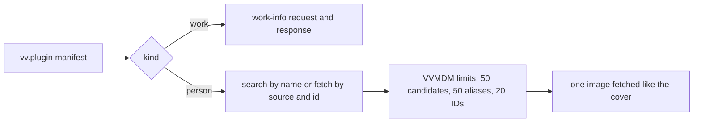

# Person plugins: the contract

A person plugin is a work-info plugin module whose manifest says
`"kind": "person"`; it searches a site for people and fetches one person by an
external ID. The manifest rules are in
[`person_plugin.go`](../../internal/domain/person_plugin.go), the run in
[`run.go`](../../internal/wasmplugin/run.go), and the author's contract in
[Write a work-info plugin](../how-to/work-info-plugins.md#person-plugins).

The diagram shows how one kind field steers a run of the shared runtime.

## Person plugins extend contract 1

`kind` and `sources` are manifest fields of contract `1`, `fetch` gains a
`source`, and the fetch response gains a `person` object; everything else
about a module stays as for a work-info plugin.

The owner sees the accepted sources in the manifest before approving, and
inspection never runs the module
([work-info-plugins.md](work-info-plugins.md#inspection-never-runs-the-module)).
An older VVMDM ignores `kind` and fails the run on the `person` response with
`plugin_failed`, which the owner fixes by uploading the module again.

| Rejected | Why |
| --- | --- |
| Contract `2` for person plugins | Contract `2` would also have to describe work-info plugins, which do not change |
| Sources returned by a `describe` operation | The approval would show values that unapproved code produced |

## A person plugin declares both operations

A person plugin's `operations` are exactly `search` and `fetch`, and a search
candidate is an external ID (`source` and `id`) with a name. Fetching a
candidate and fetching by a person's stored external ID are therefore the same
request, and a screen never needs a branch for a plugin that cannot search.
A candidate whose `source` the manifest does not declare fails the run, so a
fetch is only ever asked for a declared source.

## The requested ID survives the limits

VVMDM puts the request's `(source, id)` first in the fetched person's external
IDs, then keeps the plugin's other distinct IDs up to 20 in all. A person found
by name keeps the ID it was fetched by, so the next lookup can go by ID, even
when the plugin leaves that ID out or returns 20 others.

## The person's image is fetched like the cover

After a successful fetch, VVMDM fetches the one `image` URL with the run's
HTTP client, outside the request count, the way it fetches a work's cover
([work-info-plugins.md](work-info-plugins.md#vvmdm-fetches-the-cover-and-applies-it-as-an-uploaded-image)).
A refused address fails the run with `blocked_address`, and an image that
cannot be fetched is dropped while the rest of the person is kept.
