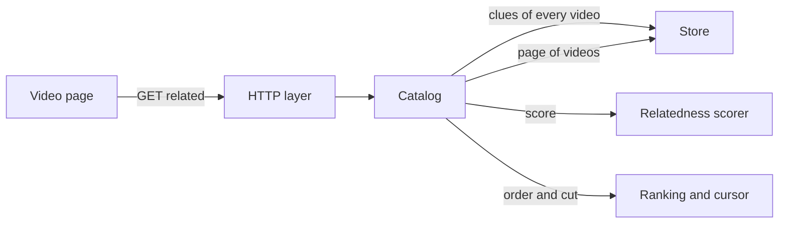
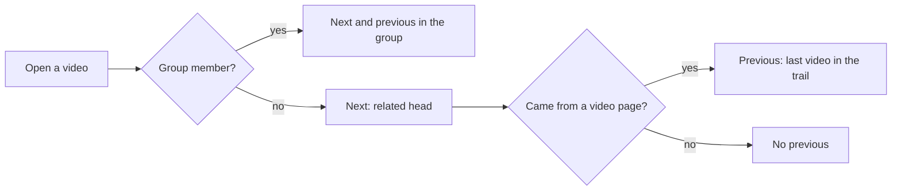

# Related videos and the previous and next video

The video page lists every other video the viewer may see, ordered by how
close it is to the open video, and its next video is the head of that list; the
ranking lives in
[`internal/domain/relatedness.go`](../../internal/domain/relatedness.go).

The diagram shows how one page of the related list is built.

## Closeness score

A video's place in the list is the sum of five clues compared with the open
video, highest first; on a tie the video added later comes first, then the
larger id.

The weights let content beat location: a video in another folder with the same
tags outranks one that only shares the folder, and the folder still outranks a
partial tag match.

| Clue | Points | How it is measured |
| --- | --- | --- |
| Video fingerprint | 40 | Share of scenes that have a similar scene anywhere in the other video, without lining up times |
| Tags | 30 | Tags on both videos divided by tags on either; confirmed, tentative and folder-name tags count alike, with no weight for rare tags |
| Title and file name | 25 | Shared words divided by all words, after dropping digits and symbols |
| Same directory | 20 | Both representative locations sit directly in the same directory |
| Date added | 5 | Full within one day, halving every 30 days after that |

| Case | Points from the clue |
| --- | --- |
| No fingerprint, fewer than 3 comparable frames, or only flat frames | Fingerprint 0 |
| Either video has no tags | Tags 0 |
| Kana and kanji, which have no spaces | Compared by pairs of characters |
| No clue in common | Only the date; the video sits at the end |

At exactly two thirds of the tags in common, the tag points (20) equal the
folder points, so the date decides between those two videos.

| Rejected | Why |
| --- | --- |
| Fingerprint distance by time, as for versions | A cut or re-ordered copy shares scenes at other times and would score 0 |
| Weighting rare tags higher | The requirement counts every tag the same |

## Replaceable scorer

The points come from one `RelatedScorer`, and the store, the catalog and the
API see only the resulting number.

Changing a clue, a weight or the whole method replaces or edits that one type;
the catalog takes another scorer through `CatalogOptions.Scorer`.

## Paging without duplicates

The list has no length limit; the page reads 30 rows at a time and asks for
the next page when its last row comes near.

A page starts strictly after the cursor `score.addedAt.id` of the last row
returned. A score depends only on the two videos, so adding, deleting or
publishing another video never moves a row already shown, and no row appears
twice. The page also skips any id it already holds.

| Rejected | Why |
| --- | --- |
| Offset paging | An added or deleted video shifts every later offset, which repeats or skips rows |

## Previous and next video

The next video (› and the one after playback ends) is the head of the related
list, and ‹ returns to the video watched just before.

The page carries a trail of the video ids it came through in the navigation
state, so opening a video by URL or from a list has no ‹. Before showing ‹ the
page fetches that video, and a deleted video or one the guest may not see hides
it. Going back drops the video from the trail, so ‹ again goes one further
back. Group members keep the group's order for both arrows
([017 folder groups](../../specs/017-folder-groups/ui-design.md)).

## Excluded videos

The open video, the other versions of its bundle and the members of its group
(the `Up next` list) never appear in the related list, and a guest sees only
public videos.
