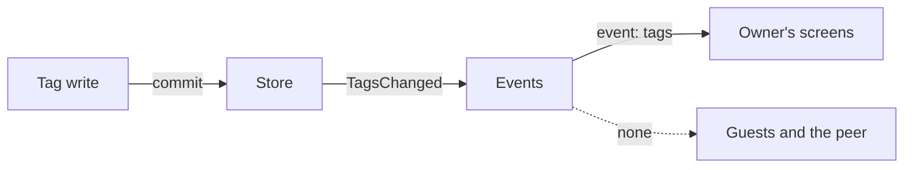
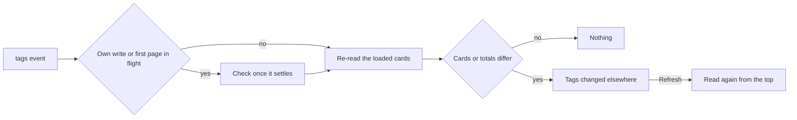
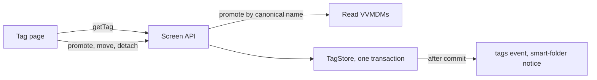

# Tag organizing

The owner organizes the tag vocabulary on the tag screens; the writes live in
[`internal/store`](../../internal/store) and reach the screens through
`/api/events`.

The diagram shows how a committed tag write reaches an open tag list.

## Tag-list change notice

A committed write that can change the rows of the tag list publishes
`domain.TagsChanged`, and `/api/events` sends it to owners as `event: tags`
with `{}` ([`events.go`](../../internal/httpapi/events.go)). The event
carries no rows; a screen that receives it re-reads what it shows.

| Write | Sends `tags` |
| --- | --- |
| Tag create, rename, delete, merge, confirm, reject, batch | Yes |
| Synonym add, remove, promote, move and detach | Yes |
| Tag kind create, rename, delete, card-first; a tag's kind set or cleared | Yes |
| A video's tag attached, detached, confirmed or rejected, by the owner, the external API, work-info apply, a group turned into a tag, or automatic tagging and its undo | Yes |
| Tentative tags created by the external API or work-info apply | Yes |
| A fileless video with tags deleted or merged into a file video | Yes |
| Interests picked during setup that create, confirm or classify a tag | Yes |
| A scan that changes folder names, so folder-derived counts | No |
| A rolled-back write | No |

Several changes before a subscriber's next write become one event, as
`candidates` does, and nothing is replayed after a reconnect. Guests and the
peer credential receive none. A paired node's `tags` events are not forwarded;
its tag changes reach the screen only when it reloads on `peerItems`, which
fires when the set of connected peer links changes, not while a link stays
connected.

| Rejected | Why |
| --- | --- |
| Reusing the all-folders `smartFolder` event | It also fires for people, favorites and watch state, and reaches guests |
| A vocabulary revision returned by every write | Every write path, including scans that change folder-derived counts, would have to bump it in its transaction |
| Sending it on every video change | A scan changes thousands of videos; the list's continuation check already catches a list that changed under paging |

## The tag list

`/tags` ([`TagsPage.tsx`](../../web/src/tags/TagsPage.tsx)) is a `ListPage`
of tag cards read 100 at a time for the criteria in the URL (`q`,
`tentative`, `unused`, `kind`, `sort`). The kind filter under the title and
the strip of tentative, kindless and unused counts apply those criteria. Every
count in them is of the whole vocabulary, not of the search: a kind's count is
its `tagCount`, `All` is the list's `totalAll`, and the three tallies come from
one `GET /api/tags/tallies`, each equal to the list's `total` for that filter
alone. Reading them in one request rather than as three one-row pages matters
on a paired node, where every tag list request reads each link's whole tag
list ([peer-library.md](peer-library.md#vocabulary-by-name)). The kinds and
the tallies are read again with every first page, so `Refresh` also drops a
kind deleted elsewhere. A `tags` event re-reads neither: the counts follow
the list, as the cards do. The cards are drawn a row at a time near the viewport
([library-ui.md](library-ui.md#no-virtual-scrolling)).

### Selection and bulk actions

Cards are selected as on the library: a check, Shift for a range from the
previously changed card, a press on a card while anything is selected, and
Escape to clear. There are no drawn boxes, because the cards fill the grid.
`Select all` takes the loaded cards or every card the criteria match; the
second first reads every matching card from the top in pages of 200, and when
a loaded card is no longer among them, it says the list changed and reads the
list again instead of selecting. The selection bar
merges the selection into one tag, sets or clears its kind, confirms it, and
rejects or deletes it after a dialog that counts the affected tags and videos
([`useTagBulkActions.tsx`](../../web/src/tags/useTagBulkActions.tsx)).

| Rule | Why |
| --- | --- |
| A selection over 20,000 (`MaxTagBatch`) disables every action with the limit's reason, and `Select all` offers no matching set over it | Batch requests are atomic and refuse more; stopping before the request keeps the owner's selection instead of failing it |
| An action that cannot apply to the selection, such as `Confirm` with no tentative tag, stays in place disabled with its reason | The bar does not move as the selection changes |
| A result is applied to the shown cards, and only the tags it changed leave the selection | The cards stay where the owner is working; the rest of the selection is what still needs the action |
| Ids in `notFoundIds` were merged or deleted elsewhere: the list says so and reads again from the top, keeping the selected tags that are still loaded | The shown cards are stale, and guessing which of them moved would show a wrong list |
| Each action runs as one of the list's own writes ([change notice](#the-change-notice)) | Its own `tags` event must not report the change as made elsewhere |

### Back from a tag page

Opening a card keeps the list in memory: the loaded cards, the cursor, the
totals, the search text and the scroll position, under the criteria
([`tagListSnapshot.ts`](../../web/src/api/tagListSnapshot.ts)). Back to the
same criteria shows those cards at that position without reading them, then
runs the change check below. Only one list is kept, as the library keeps one
snapshot, and a first page read from the server drops it. Any tag or kind write through the screen API drops it, so Back after
a write on the tag page reads the list again from the top with the same
criteria: a merge, detach or kind change can move cards across pages.

### The change notice

A `tags` event does not reload the list; the list re-reads the cards it has
loaded and says so only when something differs
([`useTagListChanges.ts`](../../web/src/tags/useTagListChanges.ts)).

| Rule | Why |
| --- | --- |
| The check reads the loaded cards again with the same criteria, in pages of 200 (`MaxTagPageLimit`), and compares each card's names, count, kind and tentative state and the two totals | A synonym added elsewhere to a card past the first page changes neither the first page nor the totals |
| A difference shows one `FloatingNotice` over the cards and moves nothing; `Refresh` reads the list again from the top | The list must not move under the owner's pointer |
| An event during the list's own write, or while a first page loads, is checked once that settles | Own writes are applied to the shown cards first, so the later check matches them; a timer would hide other writes or report the list's own |
| A check whose criteria were replaced by a newer read is dropped, and a new first page clears the notice | The newer read already shows the current rows |

## The tag page

`/tags/:id` ([`TagPage.tsx`](../../web/src/tags/TagPage.tsx)) is a
`RecordEditorPage` for one tag: the title with `Rename`, `Confirm` and
`Reject…` on a tentative tag or `Delete…` on a confirmed one, the names, the
kind, the merge into another tag and a shelf of its videos with the top bar's
search, filter and sort
([library-ui.md](library-ui.md#video-shelves-on-tag-person-and-organization-pages)).
Every control acts at once; there is no save.

| Rule | Why |
| --- | --- |
| The page reads its tag with `getTag` on open, not from the list's cards | It opens from its URL without the list |
| A `tags` event reads the tag again in place; during the page's own write, once the write settles | One tag's page has no positions to keep, so updating it moves nothing |
| Each read of the tag also reads the videos it shows again in place, and so does a change of its count | The count leaves fileless videos out, so deleting or merging away one that the shelf shows leaves the count as it was |
| One write runs at a time; the pressed control shows a spinner and the others are `aria-disabled` | Two writes from one stale page could undo each other |
| `tag_not_found`, `tag_synonym_not_found` or `tag_not_tentative` shows the reason under the header and reads the tag again; a tag that is gone shows `This tag no longer exists` instead of the page | The owner acted on a tag that changed elsewhere, and retrying would apply to what they no longer see |
| Merging, rejecting or deleting returns to the list the card was opened from, with its criteria; Back does too | The tag is gone, and the write dropped the list's snapshot, so the list reads its criteria again from the top |
| `Move to another tag…` offers only tags this node holds | A move names its target by id, and a remote id answers 404 |
| A detached name's new tag is linked from the notice under the header | The new tag has no videos and would otherwise be found only by searching the list |
| Adding a name that is another tag asks before merging that tag into this one | The add would remove the other tag from the list |

## Reading one tag and synonym operations

The tag page reads one tag (`getTag`) and changes one synonym at a time with
three owner-only screen operations under `/api/tags/{id}/synonyms/`:
`promote`, `move` and `detach`. The rules are in
[internal/domain/tag_synonym.go](../../internal/domain/tag_synonym.go), the
writes in
[internal/store/tag_synonym_operations.go](../../internal/store/tag_synonym_operations.go)
and the handlers in
[internal/httpapi/tag_synonyms.go](../../internal/httpapi/tag_synonyms.go).

The diagram shows where each operation writes.

### Each operation changes one named synonym

A synonym is a `tag_names` row with `canonical = 0`; each operation rewrites
the rows of one synonym in one transaction and adds no table.

| Operation | Names | Explicit attachments | Tentative state |
| --- | --- | --- | --- |
| `promote` | The synonym becomes the canonical name; the old canonical name becomes a synonym | Unchanged | The tag is confirmed |
| `move` | The synonym leaves the source and becomes a synonym of `targetId` | Stay on the source | The target is confirmed; the source is unchanged |
| `detach` | The synonym leaves the source and becomes the canonical name of a new tag | The new tag has none | The new tag is confirmed, with no kind; the source is unchanged |

"Make this tag a synonym of another tag" is the existing merge with the other
tag as the target, so it has no operation of its own.

| Rejected | Why |
| --- | --- |
| `PATCH /api/tags/{id}` renaming to the tag's own synonym swaps the names | A canonical-name rename is also the peer's by-name write and the external API's `rename_tag`; a second meaning changes them all |
| Replacing a tag's whole synonym list in one request | A list written from a stale screen silently undoes changes made elsewhere; one named synonym fails cleanly when it is gone |
| Adding the operations to the external API and MCP | The operations serve the screen; an external contract change is its own versioned decision |

### A stale request changes nothing

The transaction re-reads the source, the name and the target, and any error
leaves every row as it was.

| Status | `code` | When |
| --- | --- | --- |
| 400 | `invalid_request` with a tag-name reason | `name` breaks the tag-name rule |
| 400 | `invalid_request` with `move_same_tag` | `targetId` equals the source |
| 404 | `tag_not_found` | The source or target is missing, or its id is a remote id |
| 409 | `tag_synonym_not_found` | `name` is not a synonym of the source now, its canonical name included |

The screen never offers a move to the source itself, so such a request is a
client error, as `merge_same_tag` is for a merge.

| Rejected | Why |
| --- | --- |
| Applying the part that still applies | The owner acted on a tag that changed elsewhere; a silent partial change hides that |
| Treating a move to the source as a no-op | It hides a client bug the screen cannot produce |

### Attachments stay with the tag id

Explicit attachments (`video_tags`) belong to the tag id and stay with the
source on a move or detach. Folder-derived tags follow the name: a video under
a folder named like the moved or detached synonym is tagged by the tag that
holds the name now, without a rescan.

`video_tags` does not record which name attached a video, so the explicit
attachments cannot follow the name. Every operation commits as a match change,
publishing the smart-folder notice, because a moved name changes
folder-derived matches that smart folders read, and publishes
`domain.TagsChanged`.

### Promote reaches the paired nodes

While this node reads others, `promote` checks the synonym here, checks every
link for a conflict as a rename does, and writes every link by canonical name
(`POST /api/peer/vocabulary` with action `promote`) before writing here;
`move` and `detach` write this node only
([peer-library.md](peer-library.md#vocabulary-by-name)).

A link's tag named `name` that holds `newName` as a synonym swaps the two;
otherwise the link makes `newName` that tag's canonical name and keeps `name`
as its synonym, as the local promote does, so a video tagged only through a
folder named `name` keeps the tag there. A link whose tag named `newName`
already holds `name` as a synonym, an earlier promote applied there, answers
`changed: false`, so a promote that stopped after the links changed can be
repeated. A link without either tag answers `changed: false`, and a `newName`
another of its tags holds answers `409 tag_name_taken`.

One lock on the node holds a promote or a rename of a local tag from the
links' write through the local write, so two concurrent changes of one tag
send the links the canonical name the earlier one left, not a stale one.
Every other write here that can take a synonym or a tag away (adding or
removing a synonym, `move`, `detach`, delete, merge, reject and the batch
actions, from the screen API or the external API) waits for the same lock. A
`move` that comes first leaves the promote nothing to send, and a promote that
comes first leaves the `move` a name that is no longer a synonym, so a promote
never fails here after the links changed. Every write here that can give a tag
a name waits for it too: creating a tag, the external API's rename, adding a
tag to videos by name from the screen API or the external API, and picking
onboarding interests. A rename checks that its new name is free here before it
writes the links, and such a write between the check and the local write would
take the name, so the local rename would fail after the links changed. Each of
these holds the lock only for its local write, never while it waits on a link.

| Rejected | Why |
| --- | --- |
| Keeping `promote` local | Tags join across nodes by canonical name, so a local-only promote splits one shown tag into two |
| A plain rename on the link | A rename to the link's own synonym is a conflict, and the nodes may hold different synonyms |
| A link rename that drops `name` | A video tagged only through a folder named `name` loses the tag on that link, and a repeated promote finds `name` gone and `newName` taken |
| No lock, relying on each store transaction | The links' write and the local write are separate transactions, so two promotes of one tag can both pass the checks and leave the nodes with different canonical names |
| Locking only promotes and renames | A `move` between the promote's check and its local write takes the synonym away, so the links keep the new canonical name while the local promote fails, and a repeated promote finds no synonym to promote |
| Locking only the writes that take a name away | Creating a tag or tagging videos with the new name between a rename's check and its local write takes the name, so the links keep the new name while the local rename answers `409 tag_name_taken`, and repeating it fails the same way |
| Sending `move` and `detach` to the links | Synonyms and tag creation are per node already |

### A remote id names no tag here

`getTag` and the three operations answer a remote id (at or above `2^40`) with
`404 tag_not_found` instead of forwarding it to the link, so the tag page shows
its gone state. `getTag` of a local id answers the `Tag` `listTags` gives,
joined with the links' tags of the same name while this node reads others.
