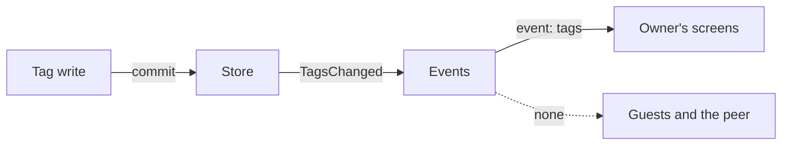

# Tag organizing

The owner organizes the tag vocabulary on the tag screens; the writes live in
[`internal/store`](../../internal/store) and reach the screens through
`/api/events`.

The diagram shows how a committed tag write reaches an open tag list.

## Tag-list change notice

A committed write that can change the rows of the tag list publishes
`domain.TagsChanged`, and `/api/events` sends it to owners as `event: tags`
with `{}` ([`events.go`](../../internal/httpapi/events.go)). The open list
re-reads the rows it has loaded and only shows a notice when they differ, so
the list never moves on its own while the owner works in it.

| Write | Sends `tags` |
| --- | --- |
| Tag create, rename, delete, merge, confirm, reject, batch | Yes |
| Synonym add and remove | Yes |
| Tag kind create, rename, delete, card-first; a tag's kind set or cleared | Yes |
| A video's tag attached, detached, confirmed or rejected, by the owner, the external API, work-info apply, a group turned into a tag, or automatic tagging and its undo | Yes |
| Tentative tags created by the external API or work-info apply | Yes |
| Interests picked during setup that create, confirm or classify a tag | Yes |
| A scan that changes folder names, so folder-derived counts | No |
| A rolled-back write | No |

Several changes before a subscriber's next write become one event, as
`candidates` does, and nothing is replayed after a reconnect. Guests and the
peer credential receive none; a paired node's tag changes reach the screen
through `peerItems`.

| Rejected | Why |
| --- | --- |
| Reusing the all-folders `smartFolder` event | It also fires for people, favorites and watch state, and reaches guests |
| A vocabulary revision returned by every write | Every write path, including scans that change folder-derived counts, would have to bump it in its transaction |
| Sending it on every video change | A scan changes thousands of videos; the list's continuation check already catches a list that changed under paging |
