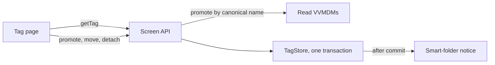

# Tag organizing: reading one tag and synonym operations

The tag page reads one tag (`getTag`) and changes one synonym at a time with
three owner-only screen operations under `/api/tags/{id}/synonyms/`:
`promote`, `move` and `detach`. The rules are in
[internal/domain/tag_synonym.go](../../internal/domain/tag_synonym.go), the
writes in
[internal/store/tag_synonym_operations.go](../../internal/store/tag_synonym_operations.go)
and the handlers in
[internal/httpapi/tag_synonyms.go](../../internal/httpapi/tag_synonyms.go).

The diagram shows where each operation writes.

## Each operation changes one named synonym

A synonym is a `tag_names` row with `canonical = 0`; each operation rewrites
the rows of one synonym in one transaction and adds no table.

| Operation | Names | Explicit attachments | Tentative state |
| --- | --- | --- | --- |
| `promote` | The synonym becomes the canonical name; the old canonical name becomes a synonym | Unchanged | The tag is confirmed |
| `move` | The synonym leaves the source and becomes a synonym of `targetId` | Stay on the source | The target is confirmed; the source is unchanged |
| `detach` | The synonym leaves the source and becomes the canonical name of a new tag | The new tag has none | The new tag is confirmed, with no kind; the source is unchanged |

"Make this tag a synonym of another tag" is the existing merge with the other
tag as the target, so it has no operation of its own.

| Rejected | Why |
| --- | --- |
| `PATCH /api/tags/{id}` renaming to the tag's own synonym swaps the names | A canonical-name rename is also the peer's by-name write and the external API's `rename_tag`; a second meaning changes them all |
| Replacing a tag's whole synonym list in one request | A list written from a stale screen silently undoes changes made elsewhere; one named synonym fails cleanly when it is gone |
| Adding the operations to the external API and MCP | The operations serve the screen; an external contract change is its own versioned decision |

## A stale request changes nothing

The transaction re-reads the source, the name and the target, and any error
leaves every row as it was.

| Status | `code` | When |
| --- | --- | --- |
| 400 | `invalid_request` with a tag-name reason | `name` breaks the tag-name rule |
| 400 | `invalid_request` with `move_same_tag` | `targetId` equals the source |
| 404 | `tag_not_found` | The source or target is missing, or its id is a remote id |
| 409 | `tag_synonym_not_found` | `name` is not a synonym of the source now, its canonical name included |

The screen never offers a move to the source itself, so such a request is a
client error, as `merge_same_tag` is for a merge.

| Rejected | Why |
| --- | --- |
| Applying the part that still applies | The owner acted on a tag that changed elsewhere; a silent partial change hides that |
| Treating a move to the source as a no-op | It hides a client bug the screen cannot produce |

## Attachments stay with the tag id

Explicit attachments (`video_tags`) belong to the tag id and stay with the
source on a move or detach. Folder-derived tags follow the name: a video under
a folder named like the moved or detached synonym is tagged by the tag that
holds the name now, without a rescan.

`video_tags` does not record which name attached a video, so the explicit
attachments cannot follow the name. Every operation commits as a match change,
publishing the smart-folder notice, because a moved name changes
folder-derived matches that smart folders read.

## Promote reaches the paired nodes

While this node reads others, `promote` checks the synonym here, checks every
link for a conflict as a rename does, and writes every link by canonical name
(`POST /api/peer/vocabulary` with action `promote`) before writing here;
`move` and `detach` write this node only
([peer-library.md](peer-library.md#vocabulary-by-name)).

A link's tag named `name` that holds `newName` as a synonym swaps the two;
otherwise the link renames the tag. A link without the tag answers
`changed: false`, and a `newName` another of its tags holds answers
`409 tag_name_taken`.

| Rejected | Why |
| --- | --- |
| Keeping `promote` local | Tags join across nodes by canonical name, so a local-only promote splits one shown tag into two |
| A plain rename on the link | A rename to the link's own synonym is a conflict, and the nodes may hold different synonyms |
| Sending `move` and `detach` to the links | Synonyms and tag creation are per node already |

## A remote id names no tag here

`getTag` and the three operations answer a remote id (at or above `2^40`) with
`404 tag_not_found` instead of forwarding it to the link, so the tag page shows
its gone state. `getTag` of a local id answers the `Tag` `listTags` gives,
joined with the links' tags of the same name while this node reads others.
