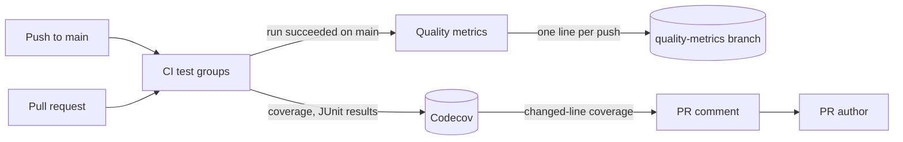

# Test and CI quality monitoring

Each push to `main` measures the quality of the code, the tests and CI, and
keeps the history; the measuring lives in [`ci.yml`](../../.github/workflows/ci.yml),
[`quality-metrics.yml`](../../.github/workflows/quality-metrics.yml) and
[`scripts/qualitymetrics`](../../scripts/qualitymetrics).

The diagram shows where each measure goes and who reads it.

## Measures and where they are kept

Each measure has one home, so a trend is read in one place.

| Measure | Tool | Measured | Kept in |
| --- | --- | --- | --- |
| Line coverage, by `go` and `web` flag and by file | Go `-coverprofile`, Vitest v8 | Every push to `main` and every pull request | [Codecov](https://app.codecov.io/gh/syudead/vv) |
| Duration and outcome of every test; flaky tests | JUnit from gotestsum, Vitest and Playwright | Same; E2E on pushes to `main` only | Codecov Test Analytics |
| Cyclomatic complexity of every function | `go/ast` for Go, the ESLint `complexity` rule for Web | After each successful CI run on a push to `main` | `history.jsonl` on the `quality-metrics` branch |
| Duplicated lines | jscpd | Same | Same |
| CI duration, whole run and per job (p50, p90 of the last 20 successful runs) | GitHub API through `gh` | Same | Same |

## Measured after the push's own CI run

`Quality metrics` starts on the push, waits for that commit's CI run, measures
only when the run succeeded, and queues every waiting run instead of keeping
one. Measured before its own CI run finished, a push would leave its CI
durations to the next push; with one waiting run, a burst of merges would leave
commits unmeasured. A `workflow_run` trigger would also wait for CI, but it runs
the checked-out commit with the default branch's privileges and caches.

## Coverage informs a pull request and does not block it

Codecov comments the coverage of the changed lines on a pull request, and its
status is informational ([`.github/codecov.yml`](../../.github/codecov.yml)).
A required coverage number invites tests written for the number, which
[Web test levels](web-testing.md) rules out by choosing the lowest level that
fails when a behaviour breaks.

## Measures run with no write token

The jobs that run npm dependencies or repository code hold read-only tokens;
only `Save history`, which runs neither, writes the history. A
same-repository dependency update would otherwise run its packages' install
scripts with a token that can push to the repository.

| Rejected | Why |
| --- | --- |
| A weekly schedule | A week of pushes lands in one measurement, so a change is not tied to the push that caused it |
| An Issue opened when a measure crosses a threshold | A count or a rounded mean names neither the function nor the pull request, so the Issue gave the maintainer nothing to decide on; rounding the mean also raised false regressions |
| Failing CI on a coverage drop or a complexity rise | The baseline is days old; thresholds are tuned on the history first |
| qlty as the single tool | It does not measure test durations, flaky tests or CI duration, and its lint layer repeats golangci-lint and ESLint |
