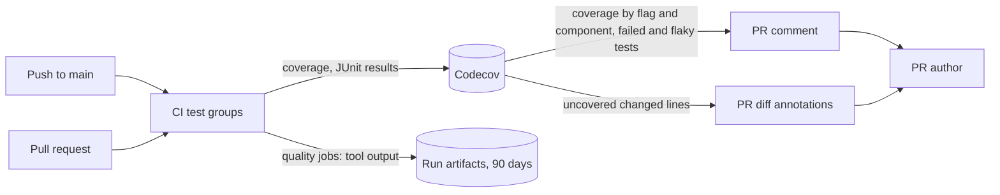

# Test and CI quality monitoring

CI sends coverage and test results to Codecov, and keeps the complexity of
every function and the duplicated code as artifacts, one job per measure; the
measuring lives in [`ci.yml`](../../.github/workflows/ci.yml) and the
`complexity-go`, `complexity-web` and `duplication` tasks in
[`Taskfile.yml`](../../Taskfile.yml).

The diagram shows where each measure goes and who reads it.

## Measures and where they are kept

Each measure has one home, and each is the output of an existing tool.

| Measure | Tool | Measured | Kept in |
| --- | --- | --- | --- |
| Line coverage, by `go` and `web` flag, by component and by file | Go `-coverprofile`, Vitest v8 | Every push to `main` and every pull request | [Codecov](https://app.codecov.io/gh/syudead/vv) |
| Duration and outcome of every test; flaky tests | JUnit from gotestsum, Vitest and Playwright | Same; E2E on pushes to `main` only | Codecov Test Analytics |
| Cyclomatic complexity of every Go function | gocyclo | Every push to `main` and every pull request | `gocyclo.txt` in the `complexity-go` artifact |
| Cyclomatic complexity of every Web function | The ESLint `complexity` rule with a maximum of 0 | Same | `eslint.json` in the `complexity-web` artifact |
| Duplicated code, by location | jscpd | Same | `jscpd-report.json` in the `duplication` artifact |

Each artifact keeps the tool's output as written, with the file and line of
every function and clone; nothing is summarised, compared with an earlier push
or kept beyond the 90 days of the artifact. Each measure runs in its own `Quality`
job beside the check groups: a measure takes under a minute, so it adds no time
to a run, and a failed measure neither fails the run nor loses the others. CI
durations are read on the Actions pages of the CI runs.

## Coverage informs a pull request and does not block it

Codecov reports on every pull request that changes code, and every status it
sets is informational ([`.github/codecov.yml`](../../.github/codecov.yml)).
A required coverage number invites tests written for the number, which
[Web test levels](web-testing.md) rules out by choosing the lowest level that
fails when a behaviour breaks.

| Codecov setting | What a pull request gets |
| --- | --- |
| Flags `go` (`cmd/`, `internal/`) and `web` (`web/src/`) | A project and a patch status per flag, so a drop names the side it happened on |
| Components | Coverage by the layers of [ARCHITECTURE.md](../../ARCHITECTURE.md) and the directories of `web/src`, in the comment |
| `require_changes: false` | The comment with the flag, component and file tables, even when coverage does not move |
| `github_checks.annotations` | Changed lines that no test runs, marked in the diff |
| `test_analytics.flake_detection` | Failed and flaky tests named in the comment |

A run uploads coverage four times, once from `go test` and once from each of
the three Vitest shards, and Codecov waits for all four (`after_n_builds: 4`)
before it comments or sets a status; with fewer it would compare a partial
report. A flag whose upload is missing carries its last coverage forward
instead of counting as zero. A newer push cancels a running CI run on a pull
request but not on `main`, so every commit on `main` uploads its coverage and
its E2E results, and a pull request always has a base to compare with.

| Rejected | Why |
| --- | --- |
| A history of summarised measures on a `quality-metrics` branch, compared with the previous push | A count or a rounded mean names neither the function nor the pull request, and the history had no reader |
| An Issue opened when a measure crosses a threshold | The Issue gave the maintainer nothing to decide on; rounding the mean also raised false regressions |
| A complexity counter of the repository's own | gocyclo counts the same way and already ships with golangci-lint |
| A separate workflow for the measures | It waited for CI and kept a history; with neither, the measures belong with the other checks in `ci.yml` |
| The measures at the end of the lint groups, on `main` only | They ran one after another and lengthened the lint groups; parallel jobs add no time, so pull requests are measured too |
| Collecting CI durations from the GitHub API | The Actions pages already show the duration of every run and job |
| Failing CI on a coverage drop or a complexity rise | A required number invites code written for the number |
| A comment only when coverage changes | The comment then rarely appeared, and the flag and component tables with it |
| Cancelling a running `main` run on a newer push | The cancelled commit's coverage and E2E results never reached Codecov, and later pull requests lost their base |
| Bundle Analysis and E2E coverage | Neither has a reader yet; each is a new measure, not a fix of the existing ones |
| qlty as the single tool | It does not measure test durations or flaky tests, and its lint layer repeats golangci-lint and ESLint |
