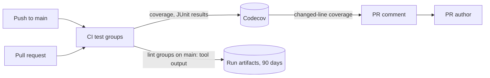

# Test and CI quality monitoring

CI sends coverage and test results to Codecov, and on each push to `main` its
lint groups keep the complexity of every function and the duplicated code as
artifacts; the measuring lives in [`ci.yml`](../../.github/workflows/ci.yml)
and the `quality-go` and `quality-web` tasks in
[`Taskfile.yml`](../../Taskfile.yml).

The diagram shows where each measure goes and who reads it.

## Measures and where they are kept

Each measure has one home, and each is the output of an existing tool.

| Measure | Tool | Measured | Kept in |
| --- | --- | --- | --- |
| Line coverage, by `go` and `web` flag and by file | Go `-coverprofile`, Vitest v8 | Every push to `main` and every pull request | [Codecov](https://app.codecov.io/gh/syudead/vv) |
| Duration and outcome of every test; flaky tests | JUnit from gotestsum, Vitest and Playwright | Same; E2E on pushes to `main` only | Codecov Test Analytics |
| Cyclomatic complexity of every Go function | gocyclo | Every push to `main`, in the `go lint` group | `go-complexity.txt` in the `quality-go` artifact |
| Cyclomatic complexity of every Web function | The ESLint `complexity` rule with a maximum of 0 | Every push to `main`, in the `web lint` group | `ts-complexity.json` in the `quality-web` artifact |
| Duplicated code, by location | jscpd | Every push to `main`, in the `go lint` group | `jscpd/jscpd-report.json` in the `quality-go` artifact |

Each artifact keeps the tool's output as written, with the file and line of
every function and clone; nothing is summarised, compared with an earlier push
or kept beyond the 90 days of the artifact. A pull request does not measure, so
the lint groups take no longer there; a failed measurement does not fail the
check. CI durations are read on the Actions pages of the CI runs.

## Coverage informs a pull request and does not block it

Codecov comments the coverage of the changed lines on a pull request, and its
status is informational ([`.github/codecov.yml`](../../.github/codecov.yml)).
A required coverage number invites tests written for the number, which
[Web test levels](web-testing.md) rules out by choosing the lowest level that
fails when a behaviour breaks.

| Rejected | Why |
| --- | --- |
| A history of summarised measures on a `quality-metrics` branch, compared with the previous push | A count or a rounded mean names neither the function nor the pull request, and the history had no reader |
| An Issue opened when a measure crosses a threshold | The Issue gave the maintainer nothing to decide on; rounding the mean also raised false regressions |
| A complexity counter of the repository's own | gocyclo counts the same way and already ships with golangci-lint |
| A separate workflow for the measures | It set up Go and both npm trees again for each push, which the lint groups already do |
| Collecting CI durations from the GitHub API | The Actions pages already show the duration of every run and job |
| Failing CI on a coverage drop or a complexity rise | A required number invites code written for the number |
| qlty as the single tool | It does not measure test durations or flaky tests, and its lint layer repeats golangci-lint and ESLint |
