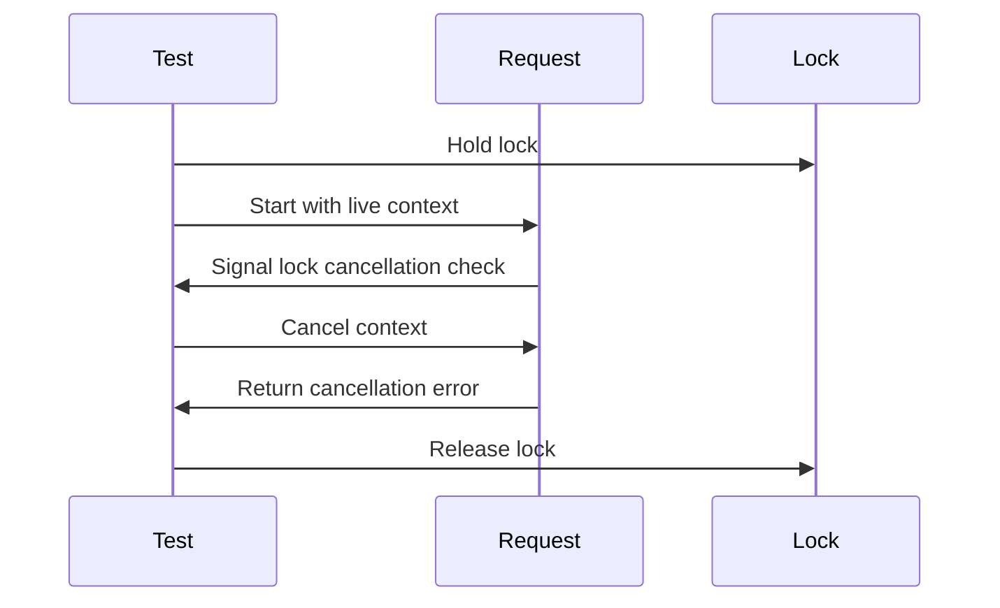

# Time and synchronization in tests

Tests apply the shared [testing policy](testing.md) without waiting for wall-clock time.

The sequence proves cancellation during a lock wait rather than rejection at an earlier gate.

## Clocks and state

Clock-dependent unit tests advance virtual time; concurrent tests synchronize on the state under test.
A fixed sleep does not prove another goroutine or promise reached that state.
An expired context can fail at an earlier gate, skipping the wait being tested.

| Behaviour | Mechanism |
| --- | --- |
| Deadline or retention expires | Advance virtual time with the production duration |
| Request starts after its deadline | Supply an already expired context or deadline |
| Work is cancelled while blocked | Observe the relevant wait, then cancel explicitly |
| Work has not completed | Synchronize with its blocked state before checking |
| Error maps to a failure code | Supply the error directly to classification logic |
| Test hangs | Use a failure guard that returns as soon as the expected event arrives |

## Go tools

Go unit tests use direct calls, in-process fakes and the synchronization tools below.
Real I/O, subprocesses and mutex waits are not driven by synctest's virtual clock.
A passing race check does not prove the intended branch was reached.

| Need | Tool |
| --- | --- |
| Timers and deadlines in cooperating goroutines | `testing/synctest` |
| Observe durable blocking inside a synctest bubble | `synctest.Wait`, which does not observe every kind of blocking |
| Reach an application state, including waits outside synctest | Channel or callback handshake |
| Cancel without a timer | `context.WithCancel` after the handshake |
| Detect concurrent memory access errors | Targeted `go test -race` |
