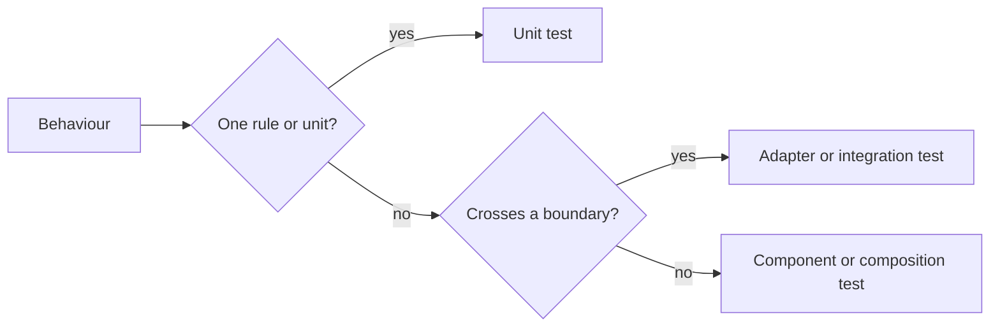

# Testing policy

Go and Web tests check each behaviour at the lowest level that detects its failure.
[Time and synchronization](testing-time.md) covers waits and Go tools;
[Web test levels](web-testing.md) covers Web tools and boundaries.

The diagram selects a test level from the behaviour it proves.

## Scope and test levels

Each test names the behaviour and boundary it proves, independently of its runner.
`go test` also runs SQLite, subprocess and WASM tests; unit tests isolate rules
from those dependencies through [application interfaces](../../ARCHITECTURE.md#intended-dependency-direction).
Test counts and coverage do not prove [defect detection](test-quality-monitoring.md).

| Case | Treatment |
| --- | --- |
| Rule variations | Test the rule directly |
| Rule reachable only through a larger flow | Extract it, retaining a focused caller wiring check |
| Higher-level test repeats a lower-level guarantee | Remove the duplicate |
| Integration test outside the intended scope | Remove it and state the boundary no longer checked |
| Unit tests cover parts of a removed integration test | Claim those parts, not the whole boundary |

## Fixtures and build cost

Fixtures contain the smallest input and dependencies needed for the tested boundary.
Shared prebuilt fixtures reduce repeated build and runtime compilation costs.

| Purpose | Fixture |
| --- | --- |
| CLI argument validation | Minimal valid input reaching validation |
| Plugin request handling | Small WASM reading the request and exercising relevant imports |
| Toolchain compatibility | Dedicated test building source with that toolchain |
| Prebuilt binary maintenance | Source and reproducible regeneration command beside the binary |

## Changes to existing tests

Test changes preserve the claimed behaviour or explicitly narrow the scope.
Changes follow the affected behaviour rather than rewriting the whole suite.

| Change | Verification |
| --- | --- |
| Cancellation or synchronization | Temporarily disable the behaviour and confirm test failure; do not commit the mutation |
| Performance | Disable result caching (`go test -count=1`) |
| Timing report | Separate package and full-suite timings because packages may run in parallel |
