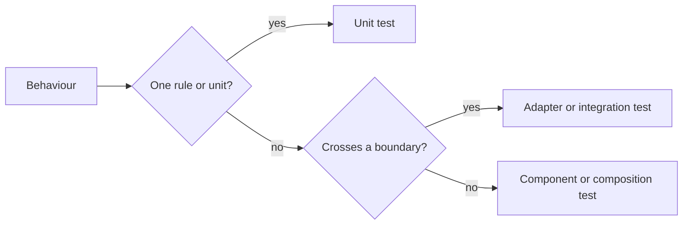

# Testing policy

Go and Web tests check each behaviour at the lowest level that detects its failure.
[Time and synchronization](testing-time.md) covers waits and Go tools;
[Web test levels](web-testing.md) covers Web tools and boundaries.

The diagram selects a test level from the behaviour it proves.

## Scope and test levels

Each test names the behaviour and boundary it proves, independently of its runner.
`go test` also runs SQLite, subprocess and WASM tests; unit tests isolate rules
from those dependencies through [application interfaces](../../ARCHITECTURE.md#intended-dependency-direction).
Test counts and coverage do not prove [defect detection](test-quality-monitoring.md).

| Case | Treatment |
| --- | --- |
| Rule variations | Test the rule directly |
| Rule reachable only through a larger flow | Extract it, retaining a focused caller wiring check |
| Higher-level test repeats a lower-level guarantee | Remove the duplicate |
| Integration test outside the intended scope | Remove it and state the boundary no longer checked |
| Unit tests cover parts of a removed integration test | Claim those parts, not the whole boundary |

## Unit test contracts

A unit test proves an observable rule with the smallest setup that would detect
its failure; the test name and assertions identify that rule.
Real SQLite, HTTP listeners, subprocesses and toolchains belong to tests of
those boundaries, while application and transport units use in-process fakes.

| Unit | Contract to assert |
| --- | --- |
| Validation | Accepted and rejected inputs, including the relevant boundary |
| Rejected request | Error response and zero calls to the operation it must prevent |
| HTTP, MCP or CLI adapter | Arguments passed to its dependency and the mapped result or error |
| Application rule | Result and required effects through its interfaces |

## Fixtures and build cost

Fixtures contain the smallest input and dependencies needed for the tested boundary.
Each extra row, byte or repetition represents a distinct case or a required boundary.
Shared fixtures prepare dependencies their callers actually use.
Shared prebuilt fixtures reduce repeated build and runtime compilation costs.

| Purpose | Fixture |
| --- | --- |
| CLI argument validation | Minimal valid input reaching validation |
| Plugin request handling | Small WASM reading the request and exercising relevant imports |
| Toolchain compatibility | Dedicated test building source with that toolchain |
| Prebuilt binary maintenance | Source and reproducible regeneration command beside the binary |
| Ordering and deduplication | A few distinct values, ties and duplicates with exact expected results |
| Pagination | Enough rows to cross a page boundary, including a tie and a final partial page |
| Sort and page-size combinations | Every sort order and representative page sizes, with additional combinations for interactions they can expose |
| Size validation | Below, at and above the limit using numbers or a small configurable limit, with a focused production caller check |
| SQL parameter or batch limit | Enough input to cross the actual implementation boundary |
| Constant query count | Two small input sizes that expose per-item queries |

## Load and waiting

Unit tests establish state through synchronization and time-dependent rules
through virtual time, using [Time and synchronization](testing-time.md).
Input volume and repeated execution measure capacity or increase the chance of
a race; neither proves an ordinary unit contract.

| Purpose | Treatment |
| --- | --- |
| Throughput, memory use or maximum load | Explicit benchmark or load test, outside unit cases |
| Duplicate delivery | The repetitions needed to demonstrate deduplication |
| Concurrency ordering or blocking | A channel, callback or virtual scheduler that observes the relevant state |
| Error classification | Inject the error at the dependency boundary |
| Deadlock protection | A failure guard that successful execution never waits out |

## Changes to existing tests

Slow-test changes first remove duplicate coverage, excessive setup and work outside
the test's scope, then preserve the remaining contract or explicitly narrow it.
Moving an unnecessary unit case to an integration suite does not justify keeping it;
retained integration tests identify a boundary that requires real dependencies.
Changes follow the affected behaviour rather than rewriting the whole suite.

| Change | Verification |
| --- | --- |
| Cancellation or synchronization | Temporarily disable the behaviour and confirm test failure; do not commit the mutation |
| Smaller fixture or extracted rule | Confirm the assertions still detect the defect the case claims to cover |
| Performance | Disable result caching (`go test -count=1`) |
| Timing report | Separate package and full-suite timings because packages may run in parallel |
