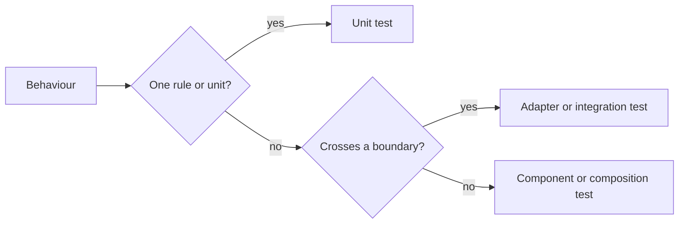
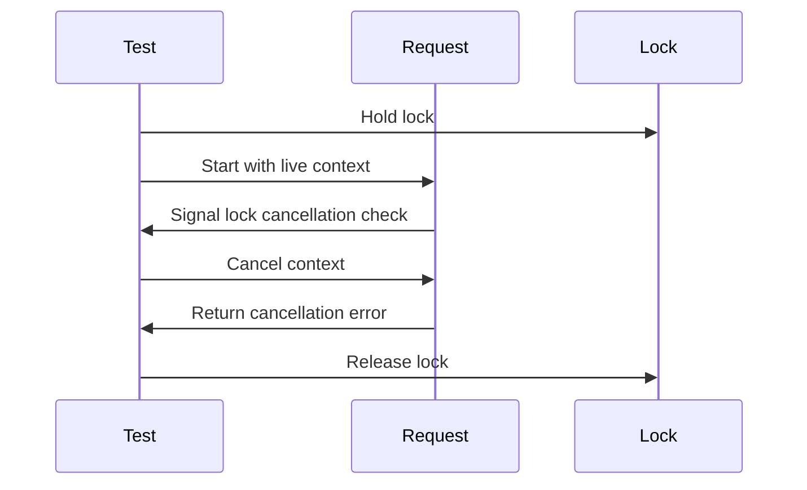

# Testing policy

Go and Web tests check each behaviour at the lowest level that fails when that
behaviour breaks. This document owns the shared policy and Go guidance;
[Web test levels](web-testing.md) describes the Web-specific levels and tools.

The diagram shows how a test's scope follows the behaviour it proves.

## Scope and test levels

Each test names the behaviour and boundary it proves; its runner does not
determine its level. `go test` also runs existing tests that use SQLite,
subprocesses and WASM, while a unit test checks a rule without those
dependencies. Test counts and line coverage do not establish that a test
detects a broken behaviour ([quality monitoring](test-quality-monitoring.md)).

| Case | Treatment |
| --- | --- |
| Variations of a rule | Test the rule directly rather than repeating a larger flow |
| A rule reachable only through a larger flow | Extract the rule and keep a focused check that its caller uses it |
| A higher-level test repeats a lower-level guarantee | Remove the duplicate |
| An integration test is outside the intended scope | Remove it and state which boundary is no longer checked |
| Unit tests cover parts of a removed integration test | Describe those parts without claiming the whole boundary is still covered |

## Time and synchronization

Clock-dependent unit tests advance a virtual clock; concurrent tests signal
the state under test before triggering cancellation or completing work. A
failure guard bounds a hung test and returns as soon as the expected event
arrives, so it adds no fixed wait to a passing test.

The sequence distinguishes cancellation during a lock wait from rejection
before the request reaches that lock.

| Behaviour | Test mechanism |
| --- | --- |
| Deadline or retention interval expires | Advance virtual time with the production duration |
| Request starts after its deadline | Supply an already expired context or deadline |
| Work is cancelled while blocked | Observe entry into the relevant wait, then cancel explicitly |
| Work has not completed yet | Synchronize with its blocked state before checking the result |
| Error maps to a failure code | Supply the error directly to the classification logic |

A fixed sleep does not prove another goroutine or promise reached a particular
state. A context that is already expired can fail at an earlier gate and does
not substitute for cancellation during a later wait.

## Fixtures and build cost

Fixtures contain the smallest input and dependencies needed to exercise the
boundary under test. Small, shared, prebuilt fixtures reduce repeated build
and runtime compilation costs in argument and request-handling tests.

| Fixture purpose | Shape |
| --- | --- |
| CLI argument validation | Minimal valid input that reaches validation |
| Plugin request and response handling | Small WASM fixture that reads the request and exercises the relevant imports |
| Compiler or toolchain compatibility | Dedicated test that builds the source with that toolchain |
| Prebuilt binary maintenance | Source and a reproducible regeneration command beside the binary |

## Go tools

Go unit tests use direct calls, in-process fakes and channels for the rules
owned by their package. The application interfaces in
[Architecture](../../ARCHITECTURE.md#intended-dependency-direction) keep those
rules independent of storage, media processes and HTTP servers.

| Need | Tool |
| --- | --- |
| Timers and deadlines in cooperating goroutines | `testing/synctest` |
| Observe goroutines durably blocked inside a synctest bubble | `synctest.Wait` |
| Reach a particular application state | Channel or callback handshake |
| Cancellation without waiting for a timer | `context.WithCancel` after the handshake |
| Detect concurrent memory access errors | Targeted `go test -race` |

Real I/O, subprocesses and mutex waits are not driven by synctest's virtual
clock. Tests involving them use explicit signals rather than assuming
`synctest.Wait` can observe every kind of blocking.

## Changes to existing tests

A change to a test preserves the behaviour it claims to check or explicitly
narrows that scope. Tests move to the appropriate level with changes to the
behaviour they cover, rather than through a rewrite of the whole suite.

For changes to cancellation or synchronization tests, temporarily disable the
behaviour being checked and confirm that the focused test fails; the mutation
is not committed. A passing race check finds no observed data race, but does
not prove the test reached its intended branch. Measure performance with test
result caching disabled (`go test -count=1` for Go) and report package timings
separately from the full suite, whose packages may run in parallel.
