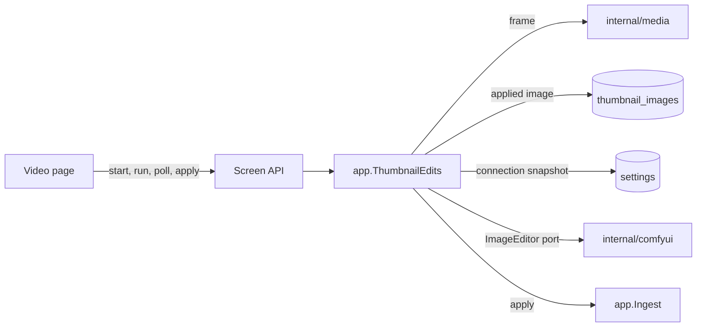
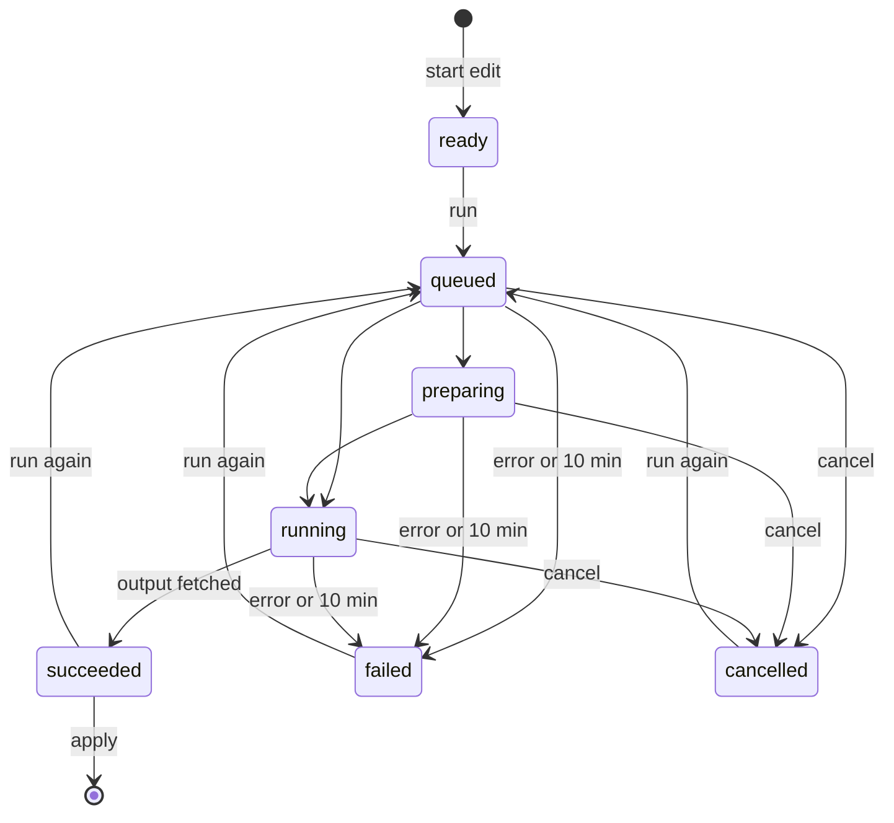
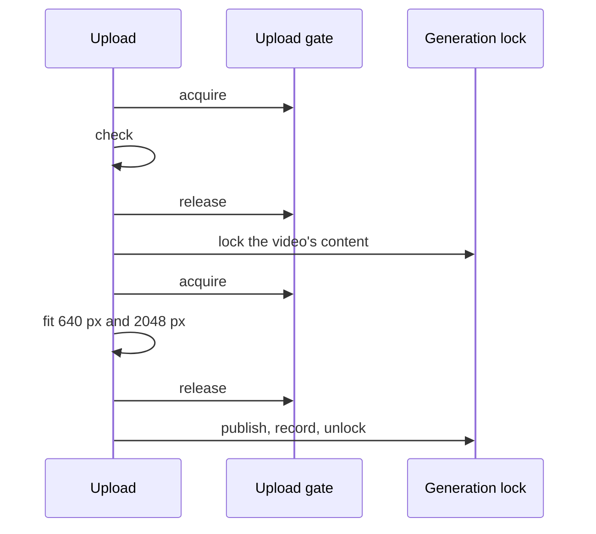

# Thumbnail editing sessions

An edit of a video frame or the current thumbnail with ComfyUI is an in-memory
session per video in
[`app.ThumbnailEdits`](../../internal/app/thumbnail_edits.go), served to the
video page by the `/api/thumbnail-edits` routes
([contract](../../specs/045-comfyui-thumbnails/contracts/screen-api.md)).

The diagram shows what a session talks to.

## A session lives in memory and is read by polling

A session holds the frame, the current run and the result image in memory;
the page reads it every second while a run is in progress, and each read asks
the provider for the run's state
([R-4](../../specs/045-comfyui-thumbnails/research.md#r-4-an-edit-is-an-in-memory-session-per-video-read-by-polling)).
A run belongs to one open page and must not be applied after a restart, so it
is neither a queued job nor a domain event, and a restart drops every session.
Each read is the page's heartbeat: a session not read for 5 minutes cancels its
run at the provider and ends.

The diagram shows a session's states.

Discard, 5 minutes without a read, a new edit of the same video and a restart
end a session in any state; a run in progress is cancelled at the provider
first. A submitted run with no terminal state 10 minutes later is cancelled and
fails as `timed_out`
([R-11](../../specs/045-comfyui-thumbnails/research.md#r-11-a-new-session-replaces-the-previous-one-a-run-is-limited-to-10-minutes)).
A background sweep every 30 seconds applies both limits to sessions nobody
reads, and every request applies them to its own session. A new edit ends the
previous session under that session's lock before the new one becomes visible,
so an apply or run already in progress on the previous session finishes first,
and only ending a session removes it, so a removed session answers `404`.

A cancel the provider does not confirm still shows the run as `cancelled`,
but vv keeps the provider's job and retries the cancel on every sweep for up
to an hour, even after the session ends. Until that cancel is confirmed, a new
run of the same video is not submitted and fails as `unreachable` (`502
provider_failed`), so an unconfirmed job is never replaced by one vv can no
longer cancel. Only one retry of a job is in flight at a time, and a new run
waits for any retry of its video's jobs to finish before it is submitted,
because a late Comfy Cloud interrupt stops every running job of the account.
Retries of different jobs run concurrently, so a sweep with many unconfirmed
jobs still takes about one provider timeout.

When the provider reports success, the read fetches the output. A fetch that
does not arrive (`unreachable`, or a timeout) leaves the run in its state and
the next read fetches again, within the 10-minute limit; an output that is
missing or does not decode fails the run as `no_output`, so `succeeded` always
has an image the apply can read.

| Rejected | Why |
| --- | --- |
| A job kind in the persistent queue | Its retries and `failed` records would outlive the page and show in the import issues |
| Progress through `/api/events` | That stream carries committed domain events to every viewer; a run's state is one page's |

## Edit source

Starting an edit names its `source`: `frame`, the frame at the player's
`positionMs`, or `thumbnail`, the current thumbnail
([R-4](../../specs/046-thumbnail-image-upload/research.md#r-4-an-edit-from-the-current-thumbnail-starts-from-the-stored-source-or-from-the-thumbnails-frame)).
`frame` without `positionMs` answers `400 thumbnail_position_out_of_range`, as
a position outside the duration does. For `thumbnail`, the session's image is
the first of these that exists:

| Case | Image | `positionMs` |
| --- | --- | --- |
| An image is applied | The row's `source` decoded to PNG, or `image` in a row without `source` | Absent |
| A position is recorded | The frame at that position | That position |
| Neither | The frame at the thumbnail job's automatic position, or the first frame when that position yields none | The automatic position, or `0` |

The automatic position and its first-frame fallback come from
`media.AutoThumbnailPositions`, the one rule the thumbnail job and the edit
both use, so the frame the owner edits is the one the thumbnail shows. A
stored image that does not decode answers `409 thumbnail_frame_unavailable`,
as a frame that cannot be extracted does. `frameWidth` and `frameHeight`
describe the session's image whatever its source, and the mask is checked
against that size. The session keeps the image in memory from the start, so a
later upload, position change or revert does not change the edit in progress
or what its runs send. The applied image and the recorded position are read
together in one query, not from the video the request read first, so an upload,
position change or revert that commits meanwhile yields the thumbnail before or
after it, never a mix of the two.

## A run uses the connection it started with

Starting a run reads the saved ComfyUI connection and keeps it in the run, so
reads, cancel and the output fetch go to that provider even when the owner
changes or removes the connection meanwhile. A run started after the
connection was removed answers `409 thumbnail_edit_not_ready`. A new run of a
session cancels the run in progress before it submits.

## Inputs are checked before anything is uploaded

The mask must be a PNG of the frame's pixel size and the reference a PNG, JPEG
or WebP of at most 20 MiB; either failing answers `400` with no upload. Each
is decoded to the end, so a truncated or corrupt file fails here, and an image
over 8192 × 8192 pixels counts as unreadable so that a forged header cannot
make the decode allocate without bound. WebP is decoded with
`golang.org/x/image/webp`, which reads still images only, so an animated WebP
is refused. The provider's output passes the same check before the run
succeeds, and applying a WebP output converts it to PNG for ffmpeg. The
frame is extracted by the server at the video's size, its long side capped at
2048 px
([R-8](../../specs/045-comfyui-thumbnails/research.md#r-8-the-frame-is-extracted-by-the-server-at-up-to-2048-px)),
so the page paints on the same pixels the provider receives. An upload or
submit the provider refuses answers `502 provider_failed` with the failure
reason, and the session shows the same reason as `failed`.

## Applying goes through the generation lock

Applying hands the result to `Ingest.ApplyThumbnailImage`, which fits it and
publishes it inside the content's thumbnail generation lock, so the apply,
revert and position override confirmed last wins
([R-10](../../specs/045-comfyui-thumbnails/research.md#r-10-apply-revert-and-the-position-override-are-ordered-by-the-generation-lock)).
The session ends after a successful apply and after `content_changed`, when
the video is gone or holds other content; an undecodable result keeps the
session so the owner can run again.

An apply writes one `thumbnail_images` row in the transaction that sets
`thumbnail_state` to `done`
([data model](../../specs/046-thumbnail-image-upload/data-model.md)):

| Column | Content |
| --- | --- |
| `image` | The 640 px JPEG fitted to the video's aspect; the thumbnail file is published from it |
| `source` | The same crop with its long side at most 2048 px, as a JPEG, for an edit that starts from the current thumbnail ([R-3](../../specs/046-thumbnail-image-upload/research.md#r-3-the-row-keeps-the-applied-images-source-at-up-to-2048-px-and-its-origin)); null in rows written before migration `00041` |
| `origin` | `generated` for an edit's result, `uploaded` for an uploaded image; the owner's `Video` answers it as `thumbnailImage` ([R-5](../../specs/046-thumbnail-image-upload/research.md#r-5-thumbnailimage-names-the-applied-images-origin-in-place-of-thumbnailgenerated)) |

A position change and a revert delete the whole row. The thumbnail job
republishes `image` and never reads `source`.

## Uploaded images

`POST /api/videos/{id}/thumbnail-image` makes an image from the owner's device
the thumbnail through the same `Ingest.ApplyThumbnailImage`, with origin
`uploaded`
([R-1](../../specs/046-thumbnail-image-upload/research.md#r-1-an-uploaded-image-is-applied-within-its-request-through-the-same-apply-as-a-generated-image),
[contract](../../specs/046-thumbnail-image-upload/contracts/screen-api.md#post-apivideosidthumbnail-image)).
It needs no ComfyUI connection and holds no session. The route reads the
video's content key before the body, holds the `image` part in memory and
writes nothing to disk before the fitted image is published, so a request cut
off before its body arrives leaves nothing behind. Once the body has arrived,
the check and the apply run under a context detached from the client and
bounded at five minutes, so a page that goes away does not abort an upload it
finished sending. The five minutes also bound the wait for the generation
lock: an apply whose context ends while it waits gives up its place and writes
nothing, and the lock keeps its order for the others.

The gate below bounds the decodes, not the bodies held in memory. Before it
reads a body, the route takes the body's size from a process-wide budget of
four bodies at the 65 MiB limit, and keeps it until it has answered. The size
is the `Content-Length` when that is within the limit, and the limit
otherwise. A request that finds the budget used up waits there, under the
client's context, before reading its body.

The check is the edit's image check with a larger pixel cap
([R-2](../../specs/046-thumbnail-image-upload/research.md#r-2-an-upload-is-a-png-jpeg-or-still-webp-of-at-most-64-mib-and-120-megapixels-decoded-one-at-a-time)):

| Limit | Upload | Edit reference |
| --- | --- | --- |
| Bytes | 64 MiB for the part; the body may be 1 MiB larger for the multipart framing | 20 MiB |
| Pixels in the header | 120 million, refused as `thumbnail_upload_too_large` with `limit` | 8192 × 8192, refused as unreadable |
| Formats | PNG, JPEG, still WebP decoded to the end; an animated WebP is refused by its `VP8X` header | The same |

A 120-megapixel PNG decodes to 480 MB, so one process-wide upload gate admits
one upload at a time to each step that decodes the original. The diagram shows
when an upload holds the gate.

An upload waiting on its own video's lock does not hold the gate, so it does
not stop uploads to other videos. A generated image's apply does not take the
gate; its input is the provider's output, already bounded by the edit's
checks. The lock orders an upload with a position change and a generated
image's apply, and the one confirmed last stays.
