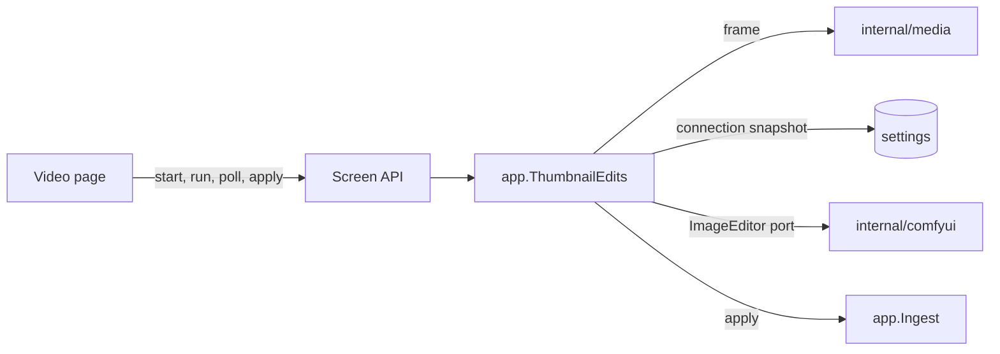
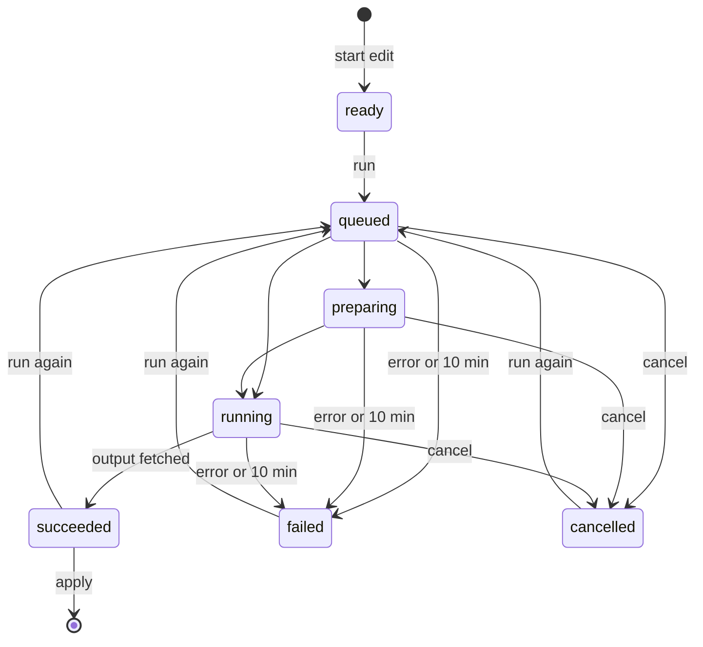

# Thumbnail editing sessions

An edit of a video frame with ComfyUI is an in-memory session per video in
[`app.ThumbnailEdits`](../../internal/app/thumbnail_edits.go), served to the
video page by the `/api/thumbnail-edits` routes
([contract](../../specs/045-comfyui-thumbnails/contracts/screen-api.md)).

The diagram shows what a session talks to.

## A session lives in memory and is read by polling

A session holds the frame, the current run and the result image in memory;
the page reads it every second while a run is in progress, and each read asks
the provider for the run's state
([R-4](../../specs/045-comfyui-thumbnails/research.md#r-4-an-edit-is-an-in-memory-session-per-video-read-by-polling)).
A run belongs to one open page and must not be applied after a restart, so it
is neither a queued job nor a domain event, and a restart drops every session.
Each read is the page's heartbeat: a session not read for 5 minutes cancels its
run at the provider and ends.

The diagram shows a session's states.

Discard, 5 minutes without a read, a new edit of the same video and a restart
end a session in any state; a run in progress is cancelled at the provider
first. A submitted run with no terminal state 10 minutes later is cancelled and
fails as `timed_out`
([R-11](../../specs/045-comfyui-thumbnails/research.md#r-11-a-new-session-replaces-the-previous-one-a-run-is-limited-to-10-minutes)).
A background sweep every 30 seconds applies both limits to sessions nobody
reads, and every request applies them to its own session. A new edit ends the
previous session under that session's lock before the new one becomes visible,
so an apply or run already in progress on the previous session finishes first,
and only ending a session removes it, so a removed session answers `404`.

When the provider reports success, the read fetches the output. A fetch that
does not arrive (`unreachable`, or a timeout) leaves the run in its state and
the next read fetches again, within the 10-minute limit; an output that is
missing or does not decode fails the run as `no_output`, so `succeeded` always
has an image the apply can read.

| Rejected | Why |
| --- | --- |
| A job kind in the persistent queue | Its retries and `failed` records would outlive the page and show in the import issues |
| Progress through `/api/events` | That stream carries committed domain events to every viewer; a run's state is one page's |

## A run uses the connection it started with

Starting a run reads the saved ComfyUI connection and keeps it in the run, so
reads, cancel and the output fetch go to that provider even when the owner
changes or removes the connection meanwhile. A run started after the
connection was removed answers `409 thumbnail_edit_not_ready`. A new run of a
session cancels the run in progress before it submits.

## Inputs are checked before anything is uploaded

The mask must be a PNG of the frame's pixel size and the reference a PNG, JPEG
or WebP of at most 20 MiB; either failing answers `400` with no upload. PNG and
JPEG are decoded to the end, so a truncated file fails here, and an image over
8192 × 8192 pixels counts as unreadable so that a forged header cannot make the
decode allocate without bound. The standard library has no WebP decoder and
the Plan adds no dependency for one, so a WebP passes when every RIFF chunk is
complete and its `VP8 ` or `VP8L` chunk has a valid header. The
frame is extracted by the server at the video's size, its long side capped at
2048 px
([R-8](../../specs/045-comfyui-thumbnails/research.md#r-8-the-frame-is-extracted-by-the-server-at-up-to-2048-px)),
so the page paints on the same pixels the provider receives. An upload or
submit the provider refuses answers `502 provider_failed` with the failure
reason, and the session shows the same reason as `failed`.

## Applying goes through the generation lock

Applying hands the result to `Ingest.ApplyThumbnailImage`, which fits it and
publishes it inside the content's thumbnail generation lock, so the apply,
revert and position override confirmed last wins
([R-10](../../specs/045-comfyui-thumbnails/research.md#r-10-apply-revert-and-the-position-override-are-ordered-by-the-generation-lock)).
The session ends after a successful apply and after `content_changed`, when
the video is gone or holds other content; an undecodable result keeps the
session so the owner can run again.
