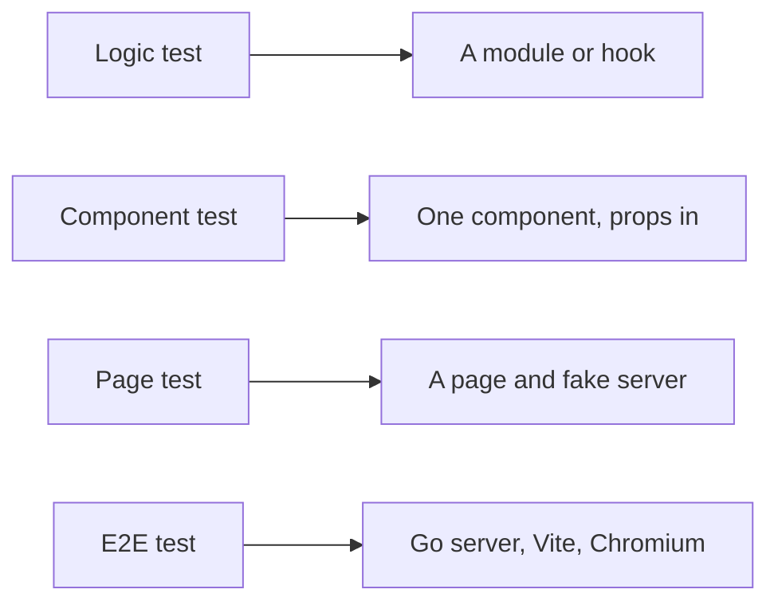
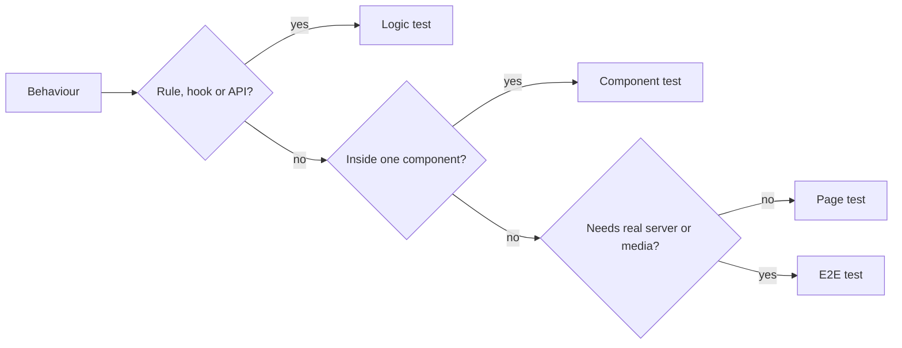

# Web test levels

Web tests apply the shared [testing policy](testing.md) at the levels below.
Unit tests run in Vitest with Testing Library on jsdom
(`task test-web`); browser tests run in Playwright against the real server
(`task test-e2e`).

The diagram shows the four levels and what each one renders.

## Test levels

Each level proves a different kind of behaviour, at a different cost per test.

| Level | Proves | Renders | Cost per test |
| --- | --- | --- | --- |
| Logic test | A rule (ordering, filtering, validation, formatting), a hook, or an API module | Nothing, or a hook through `renderHook`; `fetch` stubbed where the module calls it | 0.01 s |
| Component test | What one component shows and emits for given props | That component inside its providers | 0.10 s |
| Page test | A flow across components, request ordering, focus moving between parts, URL state | A `*Page` component with `fetch` replaced by a fake server | 0.35 s |
| E2E test | What only the real server, browser and media show: playback and seeking, the login cookie, and layout, scroll and focus that jsdom cannot compute | The app from the Vite development server in Chromium, against the built Go server | Seconds; runs on a push to `main` and on Renovate PRs |

The costs are the mean worker time per test in a full Vitest run.

Vitest runs in the `vmThreads` pool
([`web/vite.config.ts`](../../web/vite.config.ts)). A worker serves many test
files and loads jsdom and `node_modules` once, while each file still gets a new
VM context and jsdom, so module state and the DOM do not cross files. The
default `threads` pool loaded both again for every file, about a third of the
CPU time of a full run.

E2E does not cover the production Vite build or its embedding in the Go binary:
`task test-web` builds the SPA, and no test serves that build.

Timer-dependent Vitest tests apply [Time and synchronization](testing-time.md#clocks-and-state)
with `vi.useFakeTimers` and `vi.advanceTimersByTimeAsync`, restoring real timers
in cleanup with `vi.useRealTimers`.

## Choosing the level

The diagram applies the shared scope rule to Web components and pages.

A page test also fails when a rule or a component breaks, but it costs about 35
times a logic test and its failure does not point at the broken part. A rule
that only a page test can reach is a sign the rule lives inside the page
component; [Rules out of pages](#rules-out-of-pages) covers that case.

| Behaviour | Level |
| --- | --- |
| Tags sorted by name compare by natural sort key, then by id | Logic ([`tagPageRows.ts`](../../web/src/tags/tagPageRows.ts)) |
| A name already used by a tag shows the catalog's reason, not the server's message | Logic ([`tagNameField.ts`](../../web/src/tags/tagNameField.ts)) |
| Loading more videos sends the previous response's `nextCursor` | Logic ([`useVideos.ts`](../../web/src/api/useVideos.ts)) |
| A tag row that enters rename mode fills in the name, focuses and selects it | Component ([`TagRow`](../../web/src/tags/TagRow.tsx)) |
| A response that arrives after a newer request does not replace the newer rows | Page |
| Focus returns to the next row after a delete | Page |
| A video starts playing after a seek | E2E |

## Page tests

A page test covers one flow. A page with many flows shares its fake server and
helpers through a module under `web/src/testing/`, as the tag admin screen does
with [`tagsPage.tsx`](../../web/src/testing/tagsPage.tsx), and splits its tests
into files by topic.

Vitest runs the files of one CI shard in parallel and runs the tests of one file
in order, so one long file sets the shard's duration
([development.md](../how-to/development.md#validate-changes)).

## E2E tests

An E2E test stays only while all of these hold:

- It checks what only the real server, Chromium or media can break: playback
  and seeking, the login cookie, or layout, scroll and focus that jsdom cannot
  compute.
- It follows the shared [scope rules](testing.md#scope-and-test-levels).
- Thumbnail, preview or sprite preparation is complete before the tested
  interaction, and assertions await observable browser state.

A test that only takes screenshots is not a test. A behaviour that fails these
rules is tested at a lower level, or not at all when every part of it already
is.

## Rules out of pages

A rule a page computes moves to a pure module next to the page, and the page
test keeps one case that shows the page uses it. Which empty state the tag admin
screen shows is such a rule: it lives in
[`tagListView.ts`](../../web/src/tags/tagListView.ts) with logic tests, and the
component that renders each empty state has a component test.

## Existing tests

Page changes follow [Changes to existing tests](testing.md#changes-to-existing-tests).

| Rejected | Why |
| --- | --- |
| Every behaviour as a page test | 0.35 s per test, and a failure names the page rather than the broken rule |
| Snapshot tests of rendered markup | A snapshot fails on every markup change and does not state the behaviour |
| `isolate: false` or Testing Library's `defaultHidden` to speed page tests up | Tests share module state, or role queries also match hidden elements, so a test can pass on what the user cannot see |
