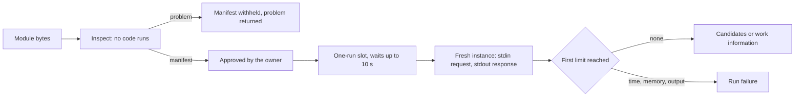
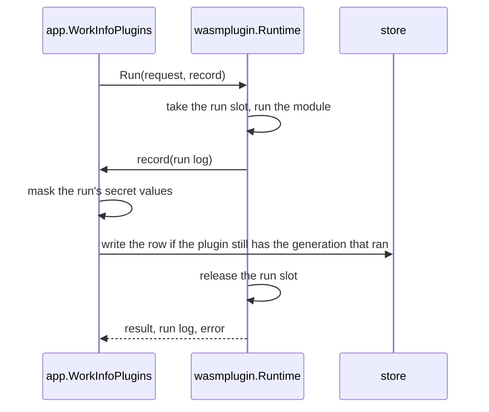
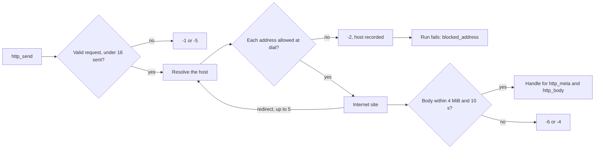
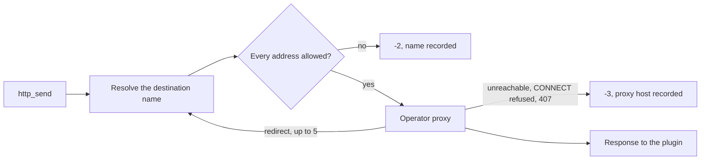
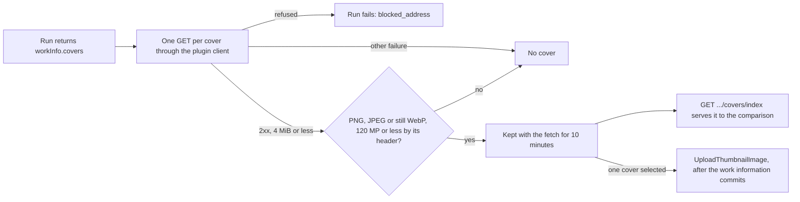
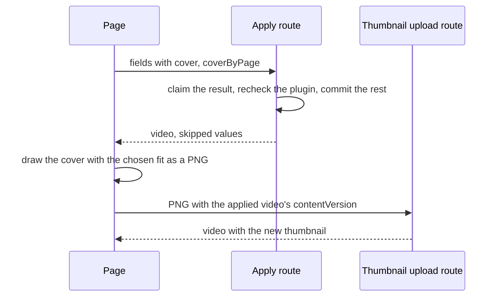
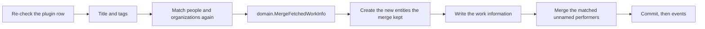

# Work-info plugins: sandbox, limits and network

VVMDM runs work-info plugins, WebAssembly modules that read work information
from external sites, inside its own process with wazero; the adapter is
[`internal/wasmplugin`](../../internal/wasmplugin) behind the
`WorkInfoPluginRuntime` port in
[`internal/app/work_info_plugin_runtime.go`](../../internal/app/work_info_plugin_runtime.go).
The plugin contract is
[Write a work-info plugin](../how-to/work-info-plugins.md).

The diagram shows what a module goes through, from upload to a run's result.

## Inspection never runs the module

`Inspect` compiles the module and reads its `vv.plugin` manifest, imports,
exports and tables, and returns the first validation `problem`
it finds ([`runtime.go`](../../internal/wasmplugin/runtime.go)).

The owner approves a plugin from its name, version and settings, so these come
from a custom section rather than from code the owner has not approved yet.
wazero's compiled module shows neither tables nor non-function imports, so
[`binary.go`](../../internal/wasmplugin/binary.go) reads the import and table
sections from the bytes.

| Checked                                                                                                                                                                                              | Problem when it fails  |
| ---------------------------------------------------------------------------------------------------------------------------------------------------------------------------------------------------- | ---------------------- |
| The bytes compile as a WebAssembly module whose memory starts at 128 MiB or less                                                                                                                     | `not_wasm`             |
| A `vv.plugin` section exists                                                                                                                                                                         | `manifest_missing`     |
| The manifest is a JSON object that follows the Manifest rules                                                                                                                                        | `manifest_invalid`     |
| `contract` is `1`, checked before the other fields                                                                                                                                                   | `contract_unsupported` |
| Every import is a `wasi_snapshot_preview1` or `vv` function with the same signature as vv's                                                                                                          | `import_unsupported`   |
| `_start` takes and returns nothing, and `memory` is exported                                                                                                                                         | `export_invalid`       |
| Every table's minimum, and its declared maximum when it has one, is 100,000 elements or less, and so is the sum over all tables of each table's declared maximum, or 100,000 for a table without one | `table_too_large`      |

## Tables get a maximum before compiling

A table without a declared maximum, as Go's `wasip1` linker writes the
function table, gets a maximum of 100,000 elements written into the module's
bytes before it is compiled, both at inspection and before a run
(`capTables` in [`binary.go`](../../internal/wasmplugin/binary.go)).

Table elements are host memory outside the linear memory cap, so an uncapped
`table.grow` could use the server's memory without bound. Refusing such tables
would refuse every Go-built plugin. For the same reason the cap holds for the
module as a whole: many tables, each within 100,000 elements, would otherwise
add up past it.

## A run has no files, no environment and fixed limits

Each run starts a fresh instance, writes the request JSON to standard input
and reads the response JSON from standard output
([`run.go`](../../internal/wasmplugin/run.go)). The instance gets clocks and a
random source, and no preopened directory, environment variable or argument.
Its only way to the network is the `vv` host functions, described in
[Plugins reach only public internet addresses](#plugins-reach-only-public-internet-addresses).

| Limit                 | Value                                                      | When it is reached                                                                                                                                                 |
| --------------------- | ---------------------------------------------------------- | ------------------------------------------------------------------------------------------------------------------------------------------------------------------ |
| Module size           | 16 MiB                                                     | `Inspect` returns `domain.ErrWorkInfoPluginTooLarge`                                                                                                               |
| Linear memory         | 128 MiB (2048 pages)                                       | `memory.grow` returns `-1`, the module is closed and the run fails with `memory_exceeded`, even when the plugin goes on to exit successfully                       |
| Run time              | 30 s from taking the run slot, compiling and HTTP included | The compile or the module is stopped and the run fails with `timed_out`                                                                                            |
| Standard output       | 1 MiB                                                      | The run is stopped with `output_too_large`                                                                                                                         |
| Standard error        | 64 KiB kept, the rest discarded                            | Written to the server log and kept as the plugin's last run ([The last run's standard error is kept per plugin](#the-last-runs-standard-error-is-kept-per-plugin)) |
| Runs at the same time | 1; a second run waits up to 10 s                           | The second run fails with `busy`                                                                                                                                   |

The memory cap is enforced by vv's memory allocator rather than by wazero's
page limit, because wazero refuses a `memory.grow` past its limit before the
allocator sees it, and vv could then not tell a memory failure from any other
non-zero exit. When a run reaches both the output and the memory limit, the
first one reached decides the failure. A run whose response is a plugin error,
a non-zero exit or output outside the contract fails with `plugin_failed`.

The run time starts when the run takes the slot, so compiling a module that is
not cached yet counts toward it. wazero checks the context between functions
only when it compiles with more than one worker, so a run compiles with two.

| Rejected                                 | Why                                                                                    |
| ---------------------------------------- | -------------------------------------------------------------------------------------- |
| A separate process per run               | The container and the Windows app would need different OS sandboxes                    |
| Running a `describe` operation at upload | The name and version shown for approval would come from unapproved code                |
| Several runs at the same time            | Each run may use 128 MiB, and one at a time bounds the plugins' memory to one module's |

## The last run's standard error is kept per plugin

Each plugin keeps the standard error of its last run as one
`work_info_plugin_runs` row, with every secret setting value replaced by
`[secret]`, for the owner to read through
`GET /api/work-info-plugins/{id}/last-run`.
The settings screen shows it in the last run dialog, opened from the plugin
row's `Last run output`.
The server log keeps receiving the same text unmasked, as before.

| Rule                                                                                                                                                                                                | Where                                                                              | Why                                                                                                                                                            |
| --------------------------------------------------------------------------------------------------------------------------------------------------------------------------------------------------- | ---------------------------------------------------------------------------------- | -------------------------------------------------------------------------------------------------------------------------------------------------------------- |
| `Run` returns the run log on success and on failure, and calls `record` only when the module started and ended in success or a run failure                                                          | [`run.go`](../../internal/wasmplugin/run.go)                                       | A `busy` refusal, a module that failed to compile or ran out of time while compiling, and a cancelled request ran nothing worth replacing the last output with |
| The row is written inside `record`, before the run slot is released                                                                                                                                 | `internal/app`, `internal/wasmplugin`                                              | Rows are written in the order the runs end, so an older run never overwrites a newer one                                                                       |
| Each secret value the run received is replaced wherever it occurs, and overlapping matches become one `[secret]`; in a truncated output, a tail that is the start of a secret value is replaced too | [`work_info_plugin_run_log.go`](../../internal/domain/work_info_plugin_run_log.go) | A value cut at 64 KiB leaves no part in clear; a value the plugin encodes first is not found                                                                   |
| The row is written only while `work_info_plugins` has the row with the generation that ran, in one statement                                                                                        | [`work_info_plugin_runs.go`](../../internal/store/work_info_plugin_runs.go)        | A run of a replaced (even with the same bytes), revoked or deleted plugin writes nothing                                                                       |
| A replacing upload deletes the row in its transaction; deleting the plugin cascades                                                                                                                 | `internal/store`                                                                   | The screen shows only output of the current module                                                                                                             |

A failure to save the row is written to the server log and does not change
the run's result.

## Plugins reach only public internet addresses

A plugin has no sockets; vv performs each of its HTTP requests through the
`vv` host functions `http_send`, `http_meta` and `http_body`
([`host.go`](../../internal/wasmplugin/host.go)), with its own HTTP client
([`netclient.go`](../../internal/wasmplugin/netclient.go)). The client
resolves the URL's host and checks every resolved address in the dialer's
control hook, just before each connection, so a redirect and a DNS answer go
through the same check as the first request.

The diagram shows one `http_send`, from the plugin's request to its handle or
error.

An address is allowed only when, after an IPv4-mapped IPv6 address is turned
back into IPv4, it is global unicast (for IPv6, inside `2000::/3`), it lies in
none of the ranges of `refusedPrefixes`, and it is not an address of the
server's own interfaces ([`address.go`](../../internal/wasmplugin/address.go)).
`refusedPrefixes` is one table: every range of the IANA IPv4 and IPv6
Special-Purpose Address Registries whose "Globally Reachable" is not `True`,
plus `fec0::/10` and the prefixes that embed an IPv4 address (`64:ff9b::/96`,
`64:ff9b:1::/48`, `2001::/32`, `2002::/16`). The server's interfaces are read at each check,
because they can change while vv runs.

A refused request answers `-2` to the plugin and makes the whole run fail with
`blocked_address` and the refused host, whatever the plugin writes afterwards,
so a plugin cannot hide from the owner that it tried to reach vv or the LAN. A
request that fails to connect answers `-3`; when the plugin then fails, the
run fails with `network_error` and the first host that could not be reached,
because the owner can act on the host and not on the plugin's message alone.

| Limit            | Value                                                       | When it is reached                                                 |
| ---------------- | ----------------------------------------------------------- | ------------------------------------------------------------------ |
| Requests         | 16 per run, `GET` and `POST`, `http` and `https`            | A 17th request answers `-5`; another method or scheme answers `-1` |
| Redirects        | 5 per request                                               | The sixth redirect response is handed to the plugin as it is       |
| Time             | 10 s per request, from sending to the last byte of the body | The request answers `-4`                                           |
| Response headers | 1 MiB                                                       | The request answers `-3`                                           |
| Response body    | 4 MiB                                                       | The request answers `-6`                                           |

The client ignores `HTTP_PROXY` and the other proxy variables, because a
proxy would make the dial check see only the proxy's address. It drops `Host`
and the hop-by-hop headers a plugin sets. When the plugin sets no
`User-Agent`, it sends a common desktop browser's one (Chrome on Windows),
because a plugin reads the page the user opened, not a crawl, and a bot-like
value can get a different page or a refusal. The body reaches the plugin as
bytes with the response headers, so the plugin decodes the page's character
set itself.

The address check and the proxy support below live only in this adapter.
The ComfyUI and Ollama clients keep reaching the LAN, where those services
run, and never use the plugins' proxy.

| Rejected                                                              | Why                                                                                               |
| --------------------------------------------------------------------- | ------------------------------------------------------------------------------------------------- |
| Resolving and checking the host name before a request without a proxy | The connection resolves the name again and may get another answer, and a redirect skips the check |
| A host-name allowlist per plugin                                      | A public name can resolve to a LAN address                                                        |
| Returning the refusal to the plugin only                              | The plugin could ignore it, and the owner would not see that it tried                             |
| Separate connect, TLS and header timeouts                             | A slow site could then answer `-3` instead of `-4` before the 10 s request limit                  |

### A run can go through the operator's proxy

`Runtime.Run` takes `domain.WorkInfoRunNetwork`, whose `Proxy` is the proxy
the operator chose, or nil for none.
`domain.ParseWorkInfoPluginProxyURL` holds the URL rule: the `http`, `https`
or `socks5` scheme, a host, an optional port and optional user information,
with no path, query or fragment, at most 2048 characters; `""` means no proxy.
A run without a proxy uses the client above unchanged.

The owner sets the proxy in the settings screen's `Network` section on every
build, through `PUT /api/settings/plugin-proxy`, which `app.WorkInfoPluginProxy`
checks against that rule and stores as the `settings` row
`work_info_plugins.proxy_url`. `app.WorkInfoPlugins` reads the row before each
run, so a saved change applies from the next run and a run in progress keeps
the value it started with. A stored value that breaks the rule fails the run
instead of connecting directly.

A run with a proxy gets its own transport, whose connections all go to the
proxy, so the dial-time check cannot see the destination. Instead, the
transport's `Proxy` callback, which Go calls for every request and every
followed redirect, resolves the destination host (or parses a literal
address) and refuses the request with `-2` and `blocked_address` when any
resolved address fails the same rule.
The refused host is the name, and the proxy never sees the request. The
proxy's own address is not checked: the operator chose it, and it usually
sits on the LAN.

A proxy that cannot be reached, fails the TLS or SOCKS exchange, refuses the
`CONNECT` or answers `407` makes the request answer `-3`; when the plugin then
fails, the run fails with `network_error` and the proxy's host, because the
owner fixes the proxy setting, not the site. The transport and its
connections are closed when the run ends, so the next run uses the setting it
starts with.

The diagram shows one `http_send` with a proxy set.

The residual risk is a name whose answer changes between VVMDM's lookup and
the proxy's: VVMDM checks the address it resolved, and the proxy connects to
the address it resolves itself. A proxy that refuses private destinations
closes that gap; VVMDM cannot.

| Rejected                                      | Why                                                                                                      |
| --------------------------------------------- | -------------------------------------------------------------------------------------------------------- |
| Trusting the proxy to refuse LAN destinations | It holds only when the operator configured the proxy so, and VVMDM must refuse those destinations itself |
| Keeping the dial-time check through a proxy   | It would see only the proxy, whose LAN address would fail every request                                  |
| Honouring `HTTP_PROXY`                        | The operator could not set a proxy for plugins alone, and the Windows app has no environment to edit     |

## The fetch keeps the work details and their matches

`WorkInfoPlugins.FetchWorkInfo` in
[`internal/app/work_info_fetch.go`](../../internal/app/work_info_fetch.go)
orders the fetched dates by kind and the people and organizations by role,
then matches the people and organizations through `CreditStore.Match`. The
details and the matches stay in the in-memory result with the title and the
tags, for the same 10 minutes. A
result without people or organizations does not read the store.

Sites hand descriptions over as HTML fragments, so the parse turns ` `,
` ` and ` ` (any case) into line feeds and keeps any other markup as
literal text; the page shows a description's line feeds as line breaks and
never renders HTML. Every work-info save applies the same conversion, and the
page converts once more on display for descriptions saved before it.

The matches are only shown: the screen marks each entry as linked, `New` or
`Not linked` from them.
The apply matches again inside its transaction, as the next section shows.
Before it writes anything, the apply refuses a selected field whose row has
no value in the result with `invalid_request`.

## The owner picks each value the apply writes

The apply takes a `domain.WorkInfoSelection`
([`work_info_fetch.go`](../../internal/domain/work_info_fetch.go)): the title,
code, description and each date kind as whole fields, the tags and the cover
at `coverIndex` as chosen values, and the people, organizations, URLs and
external IDs one by one. People and organizations are named by `at`, their
position in the fetch's ordered details, because two entries may share a name;
URLs and external IDs are named by value. `FetchedWorkInfo.Select` narrows the
details to the chosen entries before the merge, and refuses with
`invalid_request` a position outside the result, a position named twice or a
value the result does not carry, so an apply writes only what the comparison
showed.

The comparison in
[`CompareStep.tsx`](../../web/src/player/workInfoFetch/CompareStep.tsx) is
built from the parts the person dialog uses
([`compareParts.tsx`](../../web/src/player/workInfoFetch/compareParts.tsx)),
in this order: the cover picker, `Fills empty fields`, `Differs from now`,
the tags, `People and organizations`, `Adds to lists`, and `Same as now`
folded. Every change starts selected, replacements included, so the owner
clears what they do not want. A person or organization entry is a toggle
marked linked, `New` or `Not linked`; an entry already on the video with no
profile or face to fill is only counted.

The apply's response lists the people it linked as `linkedPeople`. When there
are any, the dialog ends on a result step with a link to each person's page
with `?fetch=1`, which opens that page's `Fetch info…`
([person-plugins.md](person-plugins.md#work-info-fetches-do-not-look-people-up)).

| Rejected                        | Why                                                                                                      |
| ------------------------------- | -------------------------------------------------------------------------------------------------------- |
| A whole-row checkbox for a list | The owner could not drop one wrong person or URL without dropping the rest                               |
| Naming people by name           | Two fetched entries in one role may share a name                                                         |
| Starting replacements cleared   | The owner fetched to change the video; a dialog that applies nothing by default asks for a click per row |

## The owner matches unnamed performers with fetched ones

Face recognition makes an unnamed person for each face it cannot link
([face-recognition.md](face-recognition.md)), so a video analysed before its
work information is fetched lists each performer twice: the unnamed person
with the face and the fetched person with the name. The cast rule merges only
one-to-one pairs, and a fetched face merges only a person it is sure of, so the
owner matches the rest where both are in view.

Under the role rows, `People and organizations` adds an `Unnamed people` row
when the video has unnamed performers and the fetch has a linked or new
performer. Each unnamed performer shows their face beside the face of the
fetched performer chosen for them, both `PersonFace judge`, over a `Select` of
those performers, which starts at `Keep apart`. A performer already on the
video is offered too, so fetching a video that is already doubled again
settles it; the pair then sends that entry in `people` by itself, which also
fills the person's empty fields as a chosen entry does. A fetched performer
chosen for another unnamed person, or cleared above, is disabled, and a pair
whose toggled performer is cleared later is not sent.

The apply takes the pairs as `samePeople`, each the fetched performer's `at`
and the unnamed person's id. `FetchedWorkInfo.SelectSamePeople` refuses with
`invalid_request` an entry not chosen in `people` or not a performer, and an
entry or person named twice, and maps each `at` to the narrowed details. In the
apply's transaction, after the work information is written, each unnamed
person is merged into the person the entry linked, as confirming a face
candidate does: a face_merge entry decided by the owner, which can be undone,
and the unnamed person's face for a person without one. An unnamed person
holding external IDs is merged as a named one, without undo, because the undo
snapshot keeps no external IDs.

| Case | Result |
| --- | --- |
| The person is no longer an unnamed performer of the work, or the entry was skipped | Nothing is merged for the pair |
| The merge is refused for good (the people's limits) | Rolled back alone and reported as skipped under the entry |

| Rejected | Why |
| --- | --- |
| Matching on the person's faces page | The fetched person has no face from the video, so the pair is never offered as a candidate there |
| Linking the entry to the unnamed person and naming them | A second write path beside the merge, and no undo |
| Lowering the automatic merge thresholds | The automatic merges are already too inaccurate for the owner; a person decides the pairs |

## VVMDM fetches the covers and applies one as an uploaded image

A plugin returns its covers as URLs in `workInfo.covers`, because a site often
shows a jacket, a package and stills, and the owner picks the thumbnail. VVMDM
fetches the first 5 distinct valid URLs one after another after the run
(`images` in
[`cover.go`](../../internal/wasmplugin/cover.go)), with the HTTP client of the
plugin's requests. The address rule of
[Plugins reach only public internet addresses](#plugins-reach-only-public-internet-addresses)
therefore holds for the covers, and a refused address fails the run with
`blocked_address`. Any
other failure drops that cover and keeps the rest of the result
([plugin contract](../how-to/work-info-plugins.md#cover-images)).

The diagram shows a cover from the run to the thumbnail.

[`work_info_cover.go`](../../internal/app/work_info_cover.go) checks the
image's header only. The full decode is the apply's: the cover goes through
`Ingest.UploadThumbnailImage`, the path of an uploaded image
([thumbnail-editing.md](thumbnail-editing.md#uploaded-images)), so it takes
the upload gate, the 120-megapixel cap and the generation lock, and is stored
with origin `uploaded`.

The browser shows each cover from
`GET /api/videos/{id}/work-info-fetches/{fetchId}/covers/{index}`, so it never
contacts the plugin's site. The result lists the kept covers as `covers`, each
with its `index` and size, and the apply names the chosen one as `coverIndex`. VVMDM sets the type from the format it read and sends
`nosniff` and a sandboxing `Content-Security-Policy`, so the response is only
ever an image.

Each cover is held in memory with its fetch. Together the held covers,
people's images and person plugin results' images stay within 48 MiB, twelve
images at the 4 MiB limit: a result over that budget drops the results with
images that expire first, whatever their kind, and applying one of them answers
`work_info_fetch_stale`.

The apply makes the cover the thumbnail after the work-information
transaction commits, so a plugin replaced or revoked since the fetch, which
that transaction re-checks, leaves the thumbnail unchanged. Any failure of the
cover after the commit (an image the thumbnail path refuses, a video whose
content changed since the fetch, a write error) is skipped as `invalid`: the
fetch is single-use and already applied, so an error would leave the screen
unable to tell what was written.

### The page frames the cover as it frames an uploaded image

The comparison decodes the chosen cover in the page and draws it on the video's
aspect with the uploaded image's free placement, `Whole image` by default
([thumbnail-editing.md](thumbnail-editing.md#the-page-frames-the-image-before-it-is-sent)).
`Adjust framing` opens the same preview; its `Use this framing` keeps the
fit and uploads nothing. The diagram shows an apply with the cover selected.

`coverByPage` makes the apply check and consume the result for the cover as
for any field, so an expired result or a plugin replaced or revoked since the
fetch still answers `work_info_fetch_stale` and the page uploads nothing; the
server only leaves the thumbnail to the page.
A failed upload adds the cover to the skipped values as `invalid`, the
server's report for a cover it could not apply. A cover the page cannot
decode stays an `` without `Adjust framing`, and the apply sends `cover`
so the server fits it as above.

| Rejected                                               | Why                                                                                             |
| ------------------------------------------------------ | ----------------------------------------------------------------------------------------------- |
| Send the fit with the apply and let the server compose | The preview and the result would come from two drawings, the reason uploads compose in the page |
| Apply the cover the server fitted                      | A centre crop drops the part of a cover the owner wants, such as the front of a jacket scan     |

| Rejected                                                      | Why                                                                                                           |
| ------------------------------------------------------------- | ------------------------------------------------------------------------------------------------------------- |
| The plugin downloads the image and returns it in its response | The response is limited to 1 MiB, and base64 grows the image by a third                                       |
| The browser loads the cover from the site                     | The site would see the viewer's address                                                                       |
| Fetching the cover again for each view or at the apply        | The site could answer another image than the one the owner compared                                           |
| Keeping `cover` beside `covers`                               | The maintainer asked for no compatibility with older modules, and two fields would need a rule for which wins |

## People's images are fetched like the cover and become faces after the commit

A fetched person's `image` URL goes through the cover's path: after the run,
`personImages` in [`cover.go`](../../internal/wasmplugin/cover.go) fetches the
first 7 image URLs in result order, one after another within the run's
deadline, and the header check keeps each image with its person in the fetch.
`GET /api/videos/{id}/work-info-fetches/{fetchId}/people/{index}/image` serves
it to the comparison, and `hasImage` on the fetched person tells the screen
which index has one.

The comparison offers an entry for a person already on the video when that
person would gain something: a fetched profile, or a kept image for a person
without a face. The video carries each person's face revision but not the
stored profile, so a fetched profile counts even when the person's fields are
already filled; applying it then changes nothing, because the apply writes
only empty fields.

The limits of 5 covers and 7 people's images keep one fetch within the budget:
twelve images at 4 MiB make 48 MiB, so a single result never exceeds the
budget on its own.

After the apply commits, `applyPersonImages` in
[`work_info_person_images.go`](../../internal/app/work_info_person_images.go)
takes each person the apply linked and whose fetched entry has an image. A
person who has a face keeps it. For the others, the image is fitted as an
uploaded face under the thumbnail uploads' gate
([people.md](people.md#a-face-is-one-fitted-jpeg-in-sqlite)), and `AddPersonImage` stores it only if no face was
set since. The returned video carries each stored face's new revision, so the
client can address the face without reading the video again. An image that does
not decode, a person deleted since, or a write error drops that face and leaves
the apply's result as it is, for the reason the cover gives.

| Rejected                                    | Why                                                                         |
| ------------------------------------------- | --------------------------------------------------------------------------- |
| Fetch every person's image                  | 100 people per role at 4 MiB exceed the result budget and the 30 s deadline |
| Store the face inside the apply transaction | Decoding and fitting an image would hold the write transaction              |
| Replace a face the person has               | The owner's face would be lost to a plugin's choice                         |

## The apply merges the selected fields in one transaction

`OverrideStore.ApplyFetchedWorkInfo` in
[`internal/store/work_info_fetch.go`](../../internal/store/work_info_fetch.go)
writes the selected title, tags and work details of a fetched result in one
transaction.

The diagram shows the order of the steps inside the transaction.

1. The plugin row is read again, as before: a replaced, revoked or deleted
   plugin answers `ErrWorkInfoFetchStale` and nothing is written.
2. The fetched people and organizations are matched again with the same
   query as at fetch time (`matchCredits` in
   [`credit_match.go`](../../internal/store/credit_match.go)). An entity
   created between the fetch and the apply is linked, not created twice.
3. `domain.MergeFetchedWorkInfo` in
   [`work_info_merge.go`](../../internal/domain/work_info_merge.go) lays the
   selected fields over the stored work information. It has no store
   dependency, so its rules are unit-tested without SQLite.
4. Only the new entities the merge kept are created, with the fetched name
   and external IDs, through the same insert as `CreditStore.Create`.
5. The result is written with 047's replace path, only when it differs from
   the stored value. The edit time of the user key's members then advances.
6. The unnamed performers the owner matched are merged into the linked
   people ([above](#the-owner-matches-unnamed-performers-with-fetched-ones)).

After the commit the apply publishes `VideoOverrideChanged` as before and,
when the work information changed, one `VideoWorkInfoChanged`. A failure at
any step rolls back the title, the tags, the work information and the new
entities together.

| Field                              | Merge rule                                                         |
| ---------------------------------- | ------------------------------------------------------------------ |
| `code`, `description`, a date kind | Replaces the stored value                                          |
| A person or organization role      | Appends the entities not linked in that role yet, in fetched order |
| `urls`, `externalIds`              | Appends the values not stored yet, in fetched order                |

The merge also returns, for each fetched person, the position of the link it
resolved to. After the new entities are created, the apply fills each linked
person's empty profile fields from the fetched `profile`, in fetched order, so
a person named twice keeps the first valid value; a stored value is never
replaced. `domain.FillFetchedPersonProfile` copies a value only when the
profile stays valid with it, and reports the others as skipped under the
person's role field with the value `name: property value`.

A value the merge leaves out is returned as skipped with its field, the text
the comparison showed and a reason. The rest of the row is still applied.

| Reason      | When                                                                                                                                |
| ----------- | ----------------------------------------------------------------------------------------------------------------------------------- |
| `invalid`   | The value breaks a field rule of `NormalizeWorkInfo`, or a new entity's name or external IDs break `NormalizeCredit`                |
| `too_many`  | The entry is over the field's limit, counted after the stored entries, or a new entity would carry more external IDs than its limit |
| `ambiguous` | The match found several entities, or an external ID of a new entry already belongs to another new entity                            |

The merge decides the skips before anything is created, so a skipped entry
leaves no entity linked to no video. New entries in one result that share an
external ID or a folded name become one entity, linked once per role, and the
entity carries the external IDs of every entry folded into it, so a later
fetch that names it only by one of those IDs still finds it.
