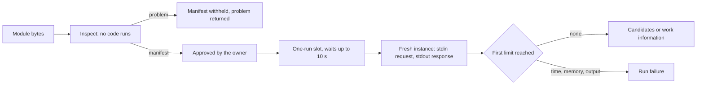
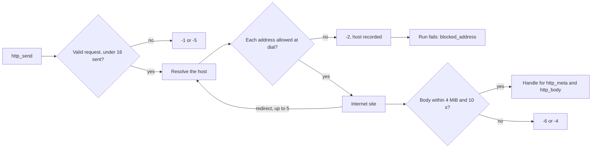

# Work-info plugins: sandbox, limits and network

VVMDM runs work-info plugins, WebAssembly modules that read work information
from external sites, inside its own process with wazero; the adapter is
[`internal/wasmplugin`](../../internal/wasmplugin) behind the
`WorkInfoPluginRuntime` port in
[`internal/app/work_info_plugin_runtime.go`](../../internal/app/work_info_plugin_runtime.go).
The plugin contract is
[Write a work-info plugin](../how-to/work-info-plugins.md),
and the reasons for each choice are in the feature's
[research.md](../../specs/049-work-info-plugins/research.md) (R-1 to R-5).

The diagram shows what a module goes through, from upload to a run's result.

## Inspection never runs the module

`Inspect` compiles the module and reads its `vv.plugin` manifest, imports,
exports and tables, and returns the first `problem` of
[data-model.md](../../specs/049-work-info-plugins/data-model.md#work_info_plugins)
it finds ([`runtime.go`](../../internal/wasmplugin/runtime.go)).

The owner approves a plugin from its name, version and settings, so these come
from a custom section rather than from code the owner has not approved yet.
wazero's compiled module shows neither tables nor non-function imports, so
[`binary.go`](../../internal/wasmplugin/binary.go) reads the import and table
sections from the bytes.

| Checked | Problem when it fails |
| --- | --- |
| The bytes compile as a WebAssembly module whose memory starts at 128 MiB or less | `not_wasm` |
| A `vv.plugin` section exists | `manifest_missing` |
| The manifest is a JSON object that follows the Manifest rules | `manifest_invalid` |
| `contract` is `1`, checked before the other fields | `contract_unsupported` |
| Every import is a `wasi_snapshot_preview1` or `vv` function with the same signature as vv's | `import_unsupported` |
| `_start` takes and returns nothing, and `memory` is exported | `export_invalid` |
| Every table's minimum, and its declared maximum when it has one, is 100,000 elements or less, and so is the sum over all tables of each table's declared maximum, or 100,000 for a table without one | `table_too_large` |

## Tables get a maximum before compiling

A table without a declared maximum, as Go's `wasip1` linker writes the
function table, gets a maximum of 100,000 elements written into the module's
bytes before it is compiled, both at inspection and before a run
(`capTables` in [`binary.go`](../../internal/wasmplugin/binary.go)).

Table elements are host memory outside the linear memory cap, so an uncapped
`table.grow` could use the server's memory without bound. Refusing such tables
would refuse every Go-built plugin. For the same reason the cap holds for the
module as a whole: many tables, each within 100,000 elements, would otherwise
add up past it.

## A run has no files, no environment and fixed limits

Each run starts a fresh instance, writes the request JSON to standard input
and reads the response JSON from standard output
([`run.go`](../../internal/wasmplugin/run.go)). The instance gets clocks and a
random source, and no preopened directory, environment variable or argument.
Its only way to the network is the `vv` host functions, described in
[Plugins reach only public internet addresses](#plugins-reach-only-public-internet-addresses).

| Limit | Value | When it is reached |
| --- | --- | --- |
| Module size | 16 MiB | `Inspect` returns `domain.ErrWorkInfoPluginTooLarge` |
| Linear memory | 128 MiB (2048 pages) | `memory.grow` returns `-1`, the module is closed and the run fails with `memory_exceeded`, even when the plugin goes on to exit successfully |
| Run time | 30 s from taking the run slot, compiling and HTTP included | The compile or the module is stopped and the run fails with `timed_out` |
| Standard output | 1 MiB | The run is stopped with `output_too_large` |
| Standard error | 64 KiB kept, the rest discarded | Written to the server log only |
| Runs at the same time | 1; a second run waits up to 10 s | The second run fails with `busy` |

The memory cap is enforced by vv's memory allocator rather than by wazero's
page limit, because wazero refuses a `memory.grow` past its limit before the
allocator sees it, and vv could then not tell a memory failure from any other
non-zero exit. When a run reaches both the output and the memory limit, the
first one reached decides the failure. A run whose response is a plugin error,
a non-zero exit or output outside the contract fails with `plugin_failed`.

The run time starts when the run takes the slot, so compiling a module that is
not cached yet counts toward it. wazero checks the context between functions
only when it compiles with more than one worker, so a run compiles with two.

| Rejected | Why |
| --- | --- |
| A separate process per run | The container and the Windows app would need different OS sandboxes |
| Running a `describe` operation at upload | The name and version shown for approval would come from unapproved code |
| Several runs at the same time | Each run may use 128 MiB, and one at a time bounds the plugins' memory to one module's |

## Plugins reach only public internet addresses

A plugin has no sockets; vv performs each of its HTTP requests through the
`vv` host functions `http_send`, `http_meta` and `http_body`
([`host.go`](../../internal/wasmplugin/host.go)), with its own HTTP client
([`netclient.go`](../../internal/wasmplugin/netclient.go)). The client
resolves the URL's host and checks every resolved address in the dialer's
control hook, just before each connection, so a redirect and a DNS answer go
through the same check as the first request.

The diagram shows one `http_send`, from the plugin's request to its handle or
error.

An address is allowed only when, after an IPv4-mapped IPv6 address is turned
back into IPv4, it is global unicast (for IPv6, inside `2000::/3`), it lies in
none of the ranges of `refusedPrefixes`, and it is not an address of the
server's own interfaces ([`address.go`](../../internal/wasmplugin/address.go)).
`refusedPrefixes` is one table: every range of the IANA IPv4 and IPv6
Special-Purpose Address Registries whose "Globally Reachable" is not `True`,
plus `fec0::/10` and the prefixes that embed an IPv4 address (`64:ff9b::/96`,
`64:ff9b:1::/48`, `2001::/32`, `2002::/16`). The server's interfaces are read at each check,
because they can change while vv runs.

A refused request answers `-2` to the plugin and makes the whole run fail with
`blocked_address` and the refused host, whatever the plugin writes afterwards,
so a plugin cannot hide from the owner that it tried to reach vv or the LAN. A
request that fails to connect answers `-3`; when the plugin then fails, the
run fails with `network_error` and the first host that could not be reached,
because the owner can act on the host and not on the plugin's message alone.

| Limit | Value | When it is reached |
| --- | --- | --- |
| Requests | 16 per run, `GET` and `POST`, `http` and `https` | A 17th request answers `-5`; another method or scheme answers `-1` |
| Redirects | 5 per request | The sixth redirect response is handed to the plugin as it is |
| Time | 10 s per request, from sending to the last byte of the body | The request answers `-4` |
| Response headers | 1 MiB | The request answers `-3` |
| Response body | 4 MiB | The request answers `-6` |

The client ignores `HTTP_PROXY` and the other proxy variables, because a
proxy would make the dial check see only the proxy's address. It drops `Host`
and the hop-by-hop headers a plugin sets, and sends a `User-Agent` of its own
when the plugin sets none. The body reaches the plugin as bytes with the
response headers, so the plugin decodes the page's character set itself.

The address check lives only in this adapter. The ComfyUI and Ollama clients
keep reaching the LAN, where those services run.

| Rejected | Why |
| --- | --- |
| Resolving and checking the host name before the request | The connection resolves the name again and may get another answer, and a redirect skips the check |
| A host-name allowlist per plugin | A public name can resolve to a LAN address |
| Returning the refusal to the plugin only | The plugin could ignore it, and the owner would not see that it tried |
| Separate connect, TLS and header timeouts | A slow site could then answer `-3` instead of `-4` before the 10 s request limit |
