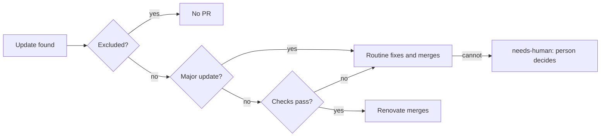
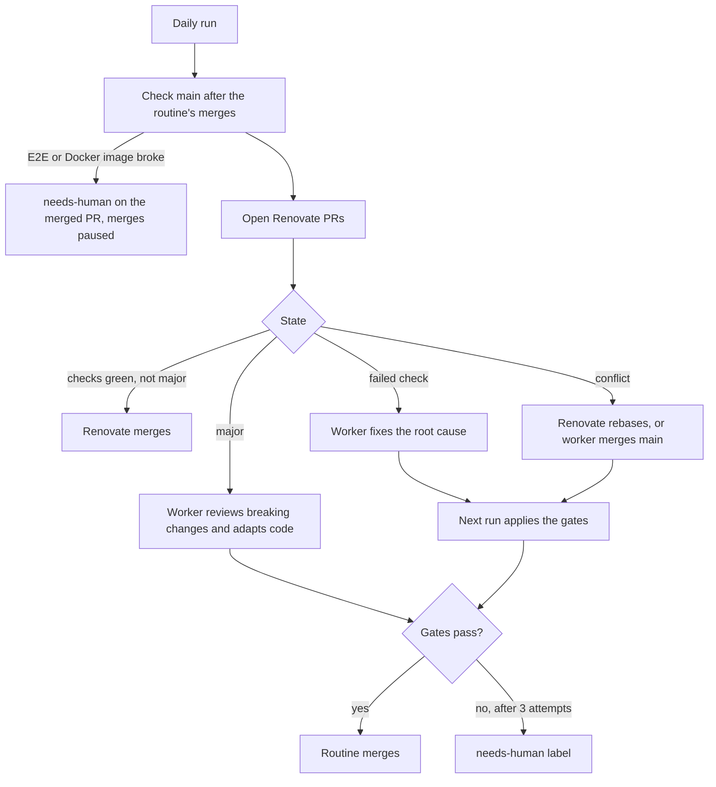

# Handle dependency updates (Renovate)

The [Renovate](https://docs.renovatebot.com/) GitHub App opens dependency update
PRs according to `renovate.json`; the intent behind that configuration lives
here.

## What Renovate does

Renovate decides per update whether it merges the PR itself. The PRs it leaves
open go to [the Renovate routine](#the-renovate-routine).

- PRs open early every Monday morning (JST) in 6 groups: Go modules, web npm,
  tools npm, GitHub Actions, mise tools and container images. Vulnerability fix
  PRs open at any time.
- Minor, patch, pin, digest pinning (`pinDigest`), digest and lockfile maintenance updates are merged
  automatically once the required `Checks` job passes.
- Renovate PRs run Browser E2E and build the Docker image without publishing
  it. Other PRs run them only after the merge to `main`.
- GitHub Actions are pinned to commit hashes, with the tag name in a comment
  (the `config:best-practices` default).
- Base images in `Dockerfile` are pinned as `tag@sha256:digest`; when the
  content behind a tag changes, Renovate opens a digest update PR.
- `renovate.json` constrains npm to 11.x for Renovate's lockfile generation;
  local development and CI do not inherit this constraint. npm 12 currently
  fails on the `@tailwindcss/oxide-wasm32-wasi` tarball during lockfile-only
  updates ([npm issue #9800](https://github.com/npm/cli/issues/9800)). Revisit
  the constraint when npm fixes that failure.

## Excluded dependencies

| Dependency | Treatment | Reason |
| --- | --- | --- |
| `golang` / `node` images in `Dockerfile`; `go` / `node` in `mise.toml` | Version updates are excluded; digest updates of the `Dockerfile` images stay in scope | The runtime version must match the `go` line in `go.mod`, so a person changes them together |
| `task` and `jq` in `mise.toml`; `alpine` in `Dockerfile` | In scope, in the mise tools and container images groups | — |
| `ghcr.io/syudead/vv:latest` in `compose.hosting.yaml` | Excluded | `latest` follows the image published from `main`; pinning its digest would stop that behavior |
| FFmpeg bundled in the Windows zip (`ffmpegVersion` and `ffmpegSHA256` in `scripts/build/windows_app.go`) | Raised by a person ([Raise the bundled FFmpeg version](#raise-the-bundled-ffmpeg-version)) | Renovate does not read these constants |
| Dependabot security updates | Disabled in the repository settings | Renovate's `vulnerabilityAlerts` does the same job |

The exclusion uses `matchDepNames`, not `matchPackageNames`, because the mise
manager names `go` as `golang/go` and `node` as `nodejs`, while the dependency
name is shared by both managers.

## Dependencies with a narrow use

These direct dependencies serve one adapter each. Renovate updates them with
their group; the table says what to check when one changes.

| Dependency | Used by | Check on an update |
| --- | --- | --- |
| `github.com/coder/websocket` | `internal/comfyui`, for the step progress of a ComfyUI run ([045 research, R-5](../../specs/045-comfyui-thumbnails/research.md#r-5-provider-differences-stay-inside-the-adapter)) | `go test ./internal/comfyui`; the module has no dependencies of its own, so an update adds none |
| `golang.org/x/image` | `internal/app` and `internal/media`, for the WebP decoder that checks a thumbnail edit's reference image and output and fits an applied WebP ([thumbnail-editing.md](../design-docs/thumbnail-editing.md#inputs-are-checked-before-anything-is-uploaded)) | `go test ./internal/app ./internal/media`; only the `webp` package is imported |

## Raise the bundled FFmpeg version

The Windows zip bundles Gyan.dev's essentials build
(`ffmpeg-<version>-essentials_build.zip`) from the GitHub Releases of
`GyanD/codexffmpeg`, pinned by version and SHA-256
([Windows desktop app distribution](../design-docs/windows-app.md#distribution)).
Raise it in one PR:

1. Check that the new release has `ffmpeg-<version>-essentials_build.zip` and
   that its SHA-256 matches the `.sha256` value at
   <https://www.gyan.dev/ffmpeg/builds/>.
2. Change `ffmpegVersion` and `ffmpegSHA256` in `scripts/build/windows_app.go`.
   On a mismatch, `task build-windows-app` fails and prints the expected and
   actual values.
3. Build the zip with `task build-windows-app` and check the version in its
   `ffmpeg/README.txt`.
4. After the merge, check that the `Windows app` workflow run on `main` passes,
   which confirms the bundled `ffmpeg` has `h264_nvenc` and `h264_qsv`.

When `ffmpeg` changes encoder names or arguments, update
[hardware-encoding.md](../design-docs/hardware-encoding.md) and
`internal/media` to match.

## Update the vendored shadcn skill

The shadcn CLI is the `shadcn` devDependency in `web/package.json`, which
Renovate updates with the web npm group. The shadcn skill in
`.agents/skills/shadcn/` is a copy that Renovate does not read; refresh it in
one PR:

1. Copy `skills/shadcn/` from the new commit of
   [shadcn-ui/ui](https://github.com/shadcn-ui/ui), without `evals/`.
2. Replace every `npx shadcn@latest`, `pnpm dlx shadcn@latest` and
   `bunx --bun shadcn@latest` with `npm --prefix web exec shadcn --`, and update
   the commit in `.agents/skills/shadcn/VENDORED.md`.
3. Run `task test-web`; `vendoredSkill.test.ts` fails while `shadcn@` remains.

## The Renovate routine

A Claude Code Routine runs the
[renovate-triage](../../.agents/skills/renovate-triage/SKILL.md) skill every
day at 07:47 JST. It handles every open Renovate PR that Renovate does not
merge itself, and merges it into `main` when it passes the gates in the skill,
major updates included.

- One worker per PR fixes it on the PR's own branch, with one push per run. CI
  runs on that push, and the next day's run merges the PR when CI is green.
- A major update is merged only after the worker posts a table of its breaking
  changes on the PR: what each one affects in the repository, how the PR
  handles it, and the verdict `safe to merge`.
- When an update the routine merged breaks Browser E2E or the Docker image on
  `main`, the next run comments the failed job on the merged PR and labels it
  `needs-human`. The routine does not revert it. Until a person removes that
  label, the routine keeps fixing PRs but merges none.
- Each run that changes anything lists what it did in a comment on Renovate's
  Dependency Dashboard Issue.

## Renovate PRs that need a person

- The routine labels a PR `needs-human` when three attempts did not get it
  green, when the new version has a bug with no workaround in this repository,
  or when the failure also happens on `main`. The PR comments say why. Remove
  the label to hand the PR back to the routine.
- A merged PR labelled `needs-human` broke `main`. Fix or revert it yourself,
  then remove the label so the routine merges again.
- To pause an update, close the PR (the same version is not opened again) or set
  `enabled: false` in `packageRules` in `renovate.json`.

## Changing the configuration

Validate with `npx --package renovate renovate-config-validator` before pushing.
