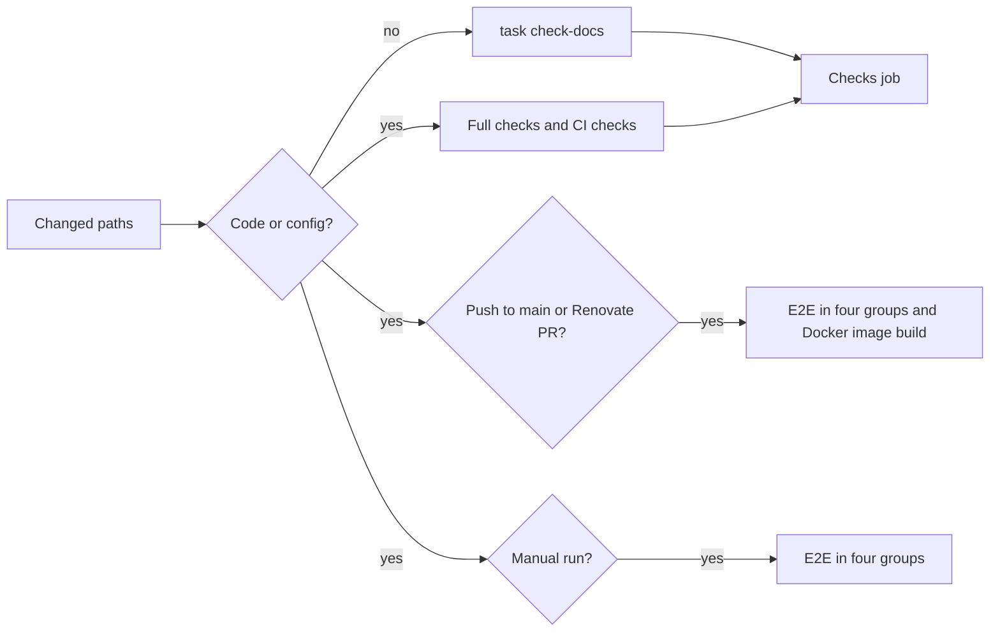

# Development

## Set up the toolchain

Go, Node.js and Task versions are pinned in `mise.toml`. `ffmpeg`, Docker, Git
and bash are system dependencies, checked by `task doctor`.

```bash
mise trust
mise install
mise exec --command "task setup"
mise exec --command "task doctor"
```

`task setup` is the only task that installs npm dependencies. On Windows, stop
a running development server before repeating it, because native dependency
files may be locked.

## Run locally

```bash
mise exec --command "task dev"
```

Open <http://localhost:5173>. The command starts the Go server with automatic
restart and the Vite development server.

| Setting | Effect |
| --- | --- |
| `MDM_ADDR` | Go listen address and the default Vite API proxy target |
| `MDM_API_TARGET` | Vite API proxy target, when it differs from `MDM_ADDR` |
| `MDM_DATA_DIR` | Data folder; a Go binary started directly on Windows needs an absolute path with the drive letter (`task dev` supplies one) |

## Validate changes

Read the [testing policy](../design-docs/testing.md) when writing or changing
Go or Web tests; it defines their scope, synchronization and fixture choices.

Choose the smallest scope that covers the change and its callers. Each Go/Web
scope includes formatting and lint as well as tests; focused tests alone are
not a pre-push check. Run these through `mise exec --command "..."` when the
pinned tools are not on `PATH`.

| Change | Before pushing |
| --- | --- |
| Go package | `task check SCOPE=go GO_PACKAGES="./internal/domain/... ./internal/app/..."` |
| Web feature | `task check SCOPE=web WEB_FILES="src/tags src/testing/tagsPage.tsx" WEB_TESTS="src/tags"` |
| Both | Run both scoped commands |
| Shared dependencies, configuration, or unclear impact | `task check` |
| Markdown, `docs/`, or `specs/` | `task check-docs`, also for mixed changes |
| Comments only | Check formatting for the changed files and verify the diff changes no code or tool directives |
| Any Go or Web source change | After the scoped check, `task test-go-report GO_PACKAGES="..."` and/or `task test-web-report -- <test files>`, then `task coverage-changed` |

`task check` defaults to `SCOPE=all`, running Go and Web formatting, lint and
tests on the host platform. `SCOPE=docs` runs the document checks.
`task check-go` and `task check-web` are direct aliases for their scopes.
`GO_PACKAGES` accepts space-separated Go package patterns from the repository
root and defaults to `./...`. `WEB_FILES` accepts space-separated paths from
`web/` for Prettier and ESLint and defaults to `.`; `WEB_TESTS` accepts Vitest
test-file filters from `web/` and defaults to the whole suite. A source path
is not necessarily a test-file filter: select its tests and affected callers
explicitly. No matching tests is a failure. Web type checking always covers
both TypeScript projects because types cross file boundaries.

`task coverage-changed` compares the working tree, untracked files included,
with the merge base of `BASE` (default `origin/main`; a feature PR passes
`BASE=origin/<feature>`) and lists each changed statement line that no test ran
and each changed file missing from the reports. Resolve every entry by the
[changed-line coverage](../design-docs/testing.md#changed-line-coverage) rule
and record the result in the PR's `確認` table.

Include dependent packages, callers and shared fixtures when narrowing a scope.
For a deletion, select its surviving package or parent directory. Do not narrow
checks for shared toolchain, dependency, Taskfile, lint or test configuration
changes. Record the scope and results in the PR; reuse passing results until
relevant inputs change. After a fix, rerun the failed check and those affected
by the fix. Format only affected files, or use `task fmt` for a broad rewrite.

CI runs these additional checks without making them a local pre-push gate;
`task check-ci` reproduces them together, and each task can run on its own.

| CI check | Run locally when |
| --- | --- |
| `generate-check` | Changing OpenAPI, generators or registry components; run `task generate` first |
| `migrations-check` | Changing migration SQL |
| `e2e-groups-check` | Changing E2E files or CI grouping |
| `lint-go-windows-desktop`, `build-windows-check` | Changing Windows, desktop or cross-platform code |
| `build-check-web` | Changing bundling, assets or build configuration |

`task check-ci` supplements local checks; it does not run them or browser E2E.
CI also runs full Go and Web suites, coverage/report uploads and quality metrics.

Lint findings are fixed in the code, never silenced: `task check` fails on any
`//nolint` comment in Go sources (`scripts/nolintguard`) and on any
`eslint-disable*` or other inline ESLint configuration comment in `web/`
(`linterOptions.noInlineConfig`). A change keeps the functions it adds or makes
more complex at complexity 25 or less and shares code instead of copying it;
the Codex review raises a breach
([Complexity and duplication](../design-docs/complexity-and-duplication.md)).

Browser tests are a separate command:

```bash
mise exec --command "task test-e2e"
```

`task help` lists every command; `Taskfile.yml` is the supported entry point
for developer commands.

CI picks its jobs from the changed paths and reports through the required
`Checks` and `Browser E2E` jobs.



"No" means only Markdown, `docs/` or `specs/` changed. For a code change, CI
runs full local and CI-only tasks as parallel `Checks (<group>)` jobs: Go lint
with generation, migration, E2E grouping and Windows lint/build checks, Go tests,
Web lint with the SPA build check, and the Vitest suite split into three shards
(`task test-web-report -- --shard=1/3`). `task test-web` remains an explicit
build-and-test command. Keep both local and CI-only tasks represented in
`.github/workflows/ci.yml`. A new
`web/e2e/*.e2e.ts` file goes into one of the four E2E groups there;
`task e2e-groups-check` fails when a file is in no group or in two. Only the Go groups
restore the Go build cache, and each saves its own copy on a push to `main`.
Vitest shards by file, so a test file that grows to dominate a shard is split by
topic, as `web/src/tags/TagsPage*.test.tsx` are around the shared
`web/src/testing/tagsPage.tsx`. A push to `main` is a
merged pull request, so browser E2E and the Docker image build do not run on a
pull request; `Browser E2E` passes there without running. Renovate PRs (head
branch `renovate/*`) are the exception: they run both, without publishing the
image, because the Renovate routine merges them without a person
([dependency-updates.md](dependency-updates.md)).

To run browser E2E on a branch before it merges, start the CI workflow by hand
(`workflow_dispatch`) from the Actions tab or with
`gh workflow run ci.yml --ref <branch>`. A manual run treats the branch as a
code change and runs every `Checks` group and the four E2E groups; it does not
build the Docker image.

The Go and Vitest test groups run the same tests as `task test-go` and
`task test-web-unit` through `task test-go-report` and `task test-web-report`,
which also write coverage and JUnit test results under `reports/`. CI uploads
them to [Codecov](https://app.codecov.io/gh/syudead/vv), together with the E2E
results of a push to `main`, even when a test fails. On each pull request that
changes code, Codecov comments the coverage of the changed lines, names failed
and flaky tests and sets an informational patch status per `go` and `web` flag,
without blocking the merge
([`.github/codecov.yml`](../../.github/codecov.yml)); coverage by flag and by
component is on the Flags and Components pages of Codecov. A newer push cancels a
running CI run on a pull request but not on `main`, so every commit on `main`
reaches Codecov. The upload authenticates
with GitHub OIDC, so the repository needs no Codecov token, but it must be
activated once on codecov.io by signing in with GitHub and installing the
Codecov GitHub App. A failed upload does not fail the check.

Beside the check groups, the `Quality` jobs run `task complexity-go`,
`task complexity-web` and `task duplication` in parallel on every pull request
and push to `main`. Each writes one tool's output under `reports/quality/`: the
cyclomatic complexity of every Go function from gocyclo (pinned as a tool in
`tools/go.mod`), that of every Web function from the ESLint `complexity` rule,
and the duplicated code that jscpd finds. CI keeps each as an artifact of the
same name for 90 days
([Test and CI quality monitoring](../design-docs/test-quality-monitoring.md));
a failed measure does not fail the run. `task quality-metrics` runs all three on
a local machine.

On the first day of each month the `Mutation testing` workflow
([`.github/workflows/mutation-testing.yml`](../../.github/workflows/mutation-testing.yml))
measures whether the Go tests catch injected bugs. It runs
`task mutation-go`, which runs gremlins (pinned as a tool in `tools/go.mod`) on
`./internal/domain/...` and writes `reports/mutation/go/gremlins.json`, the
place and outcome of every mutant. The workflow keeps that report as it is, as
an artifact for 90 days; mutants that the tests miss do not fail the run.
`MUTATION_GO_DIR=./internal/other task mutation-go` measures another package
tree, and arguments after `--` go to
`gremlins unleash`. A pull request that changes the workflow runs it too. Web
mutation testing with StrykerJS waits for a release of
`@stryker-mutator/vitest-runner` that fixes
[stryker-js#6210](https://github.com/stryker-mutator/stryker-js/issues/6210):
with Vitest 5 the runner filters out every test, so every mutant survives.

When the OpenAPI contract changes, edit `api/openapi.yaml` (or
`api/external-v1.yaml` for the external API) and run `task generate`. Never edit
`internal/httpapi/gen/`, `internal/httpapi/extgen/` or `web/src/api/gen/`
directly.
