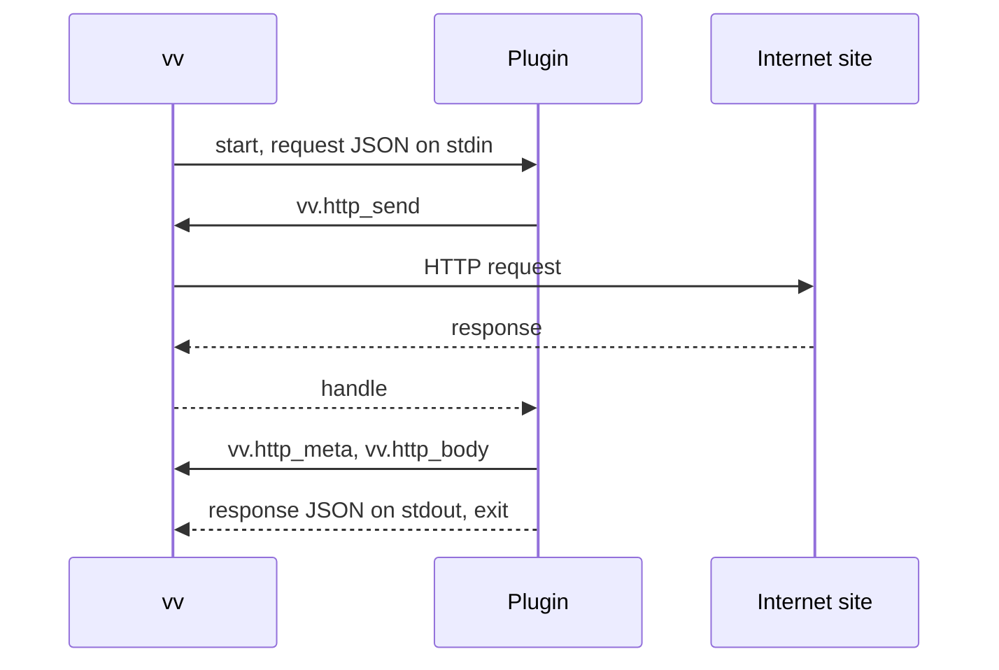

# Write a work-info plugin

A work-info plugin is a WebAssembly module that VVMDM runs to search an
external site for works and fetch a work's title, tags and details; when you finish,
you have a module the owner can add and approve on the settings screen. This
guide is the plugin contract, version 1. Why the sandbox, the limits and the
network rule have this shape is in
[work-info-plugins.md](../design-docs/work-info-plugins.md).

VVMDM starts a fresh instance for each run, as the diagram shows.



## Prerequisites

- Go 1.24 or later, which builds `wasip1` modules with
  `GOOS=wasip1 GOARCH=wasm`. Any toolchain that builds a module meeting
  [Module](#module) works; the steps use Go.
- The VVMDM server binary `mdm` (in the container image at
  `/usr/local/bin/mdm`, or built with `go build ./cmd/mdm`), to write the
  manifest into the module and run it locally. `VVMDM.exe` of the Windows app
  does not take commands. The commands read no settings, open no database and
  need no `ffmpeg`.
- A VVMDM owner account, to add and approve the plugin.

## Steps

1. In a new directory, create a Go module for the plugin:

   ```bash
   go mod init example.com/title-plugin
   ```

2. Write the plugin as `main.go`, a Go `main` package. It reads the
   [request](#request) from standard input, calls the
   [host functions](#host-functions) for HTTP, and writes the
   [response](#response) to standard output. This one fetches the work's page
   and returns its `<title>`:

   ```go
   package main

   import (
       "encoding/json"
       "html"
       "os"
       "regexp"
       "unsafe"
   )

   //go:wasmimport vv http_send
   func httpSend(req unsafe.Pointer, reqLen uint32) int32

   //go:wasmimport vv http_meta
   func httpMeta(handle int32, buf unsafe.Pointer, bufCap uint32) int32

   //go:wasmimport vv http_body
   func httpBody(handle int32, buf unsafe.Pointer, bufCap uint32) int32

   type request struct {
       Operation string            `json:"operation"`
       URL       string            `json:"url"`
       Settings  map[string]string `json:"settings"`
   }

   var titleTag = regexp.MustCompile(`(?is)<title[^>]*>(.*?)</title>`)

   func main() {
       var req request
       if err := json.NewDecoder(os.Stdin).Decode(&req); err != nil {
           fail("unreadable request")
           return
       }
       page, ok := get(req.URL)
       if !ok {
           fail("could not read " + req.URL)
           return
       }
       info := map[string]any{}
       if m := titleTag.FindSubmatch(page); m != nil {
           info["title"] = html.UnescapeString(string(m[1]))
       }
       reply(map[string]any{"workInfo": info})
   }

   // get sends a GET request and returns the body of a 200 response.
   func get(url string) ([]byte, bool) {
       req, _ := json.Marshal(map[string]string{"method": "GET", "url": url})
       handle := httpSend(unsafe.Pointer(&req[0]), uint32(len(req)))
       if handle < 0 {
           return nil, false
       }
       var meta struct {
           Status int `json:"status"`
       }
       if json.Unmarshal(read(httpMeta, handle), &meta) != nil || meta.Status != 200 {
           return nil, false
       }
       return read(httpBody, handle), true
   }

   // read asks for the length with an empty buffer, then reads into a buffer of that size.
   func read(fn func(int32, unsafe.Pointer, uint32) int32, handle int32) []byte {
       var probe [1]byte
       n := fn(handle, unsafe.Pointer(&probe[0]), 0)
       if n <= 0 {
           return nil
       }
       buf := make([]byte, n)
       fn(handle, unsafe.Pointer(&buf[0]), uint32(n))
       return buf
   }

   func fail(message string) {
       reply(map[string]any{"error": map[string]any{"message": message}})
   }

   func reply(v any) {
       _ = json.NewEncoder(os.Stdout).Encode(v)
   }
   ```

   Report a failure as an `error` response and exit normally: a non-zero exit
   also fails the run, but the owner then sees no message.

3. Build the module:

   ```bash
   GOOS=wasip1 GOARCH=wasm go build -o plugin.wasm .
   ```

4. Write the [manifest](#manifest) as `manifest.json`:

   ```json
   {
     "contract": 1,
     "name": "example-title",
     "version": "0.1.0",
     "description": "Reads the title of a work's page.",
     "operations": ["fetch"]
   }
   ```

5. Write the manifest into the module with `mdm plugin pack`, the VVMDM
   server binary's plugin command. It checks the manifest and the packed
   module as an upload would, and only then replaces the module's
   `vv.plugin` section, so you can run it after every build or manifest
   change:

   ```bash
   mdm plugin pack plugin.wasm manifest.json
   ```

   On success it prints the plugin's name, version, operations and settings
   as the settings screen lists them. On a problem it exits with code 2,
   prints the problem, and leaves `plugin.wasm` as it was: for a manifest,
   the field and the rule it breaks, such as
   `manifest_invalid: settings[0].default must be one of options`.

6. Run the plugin once with `mdm plugin run`, giving the operation and its
   input:

   ```bash
   mdm plugin run plugin.wasm fetch https://example.com/works/1
   ```

   The operation is `search`, whose input is the words, or `fetch`, whose
   input is the work's URL; the input follows the same rules as on the video
   page. Give a plugin with [settings](#setting-fields) their values with
   `--set KEY=VALUE`, once per key, such as `--set token=abc`; only keys the
   manifest declares are taken, and a setting without `--set` receives its
   `default`, as in VVMDM.
   `--proxy URL` sends the plugin's requests through a proxy, as the
   operator's proxy setting does. The run has the same [limits](#limits) and
   [address rule](#addresses) as in VVMDM.

7. In VVMDM, open **Settings**, choose **Add plugin** in the **Work-info
   plugins** section, and pick `plugin.wasm`. Review the plugin and approve
   it.

## Check the result

`mdm plugin run` exits with code 0 when the response is valid. It prints
what VVMDM keeps of the response as indented JSON on standard output,
`{"candidates": […]}` for `search` or `{"workInfo": {…}}` for `fetch`, after
VVMDM's limits and trimming, and the plugin's standard error on standard
error. A failed run exits with code 1 and ends standard error with one line
such as `Run failed: blocked_address, host 127.0.0.1`: the failure, the host
for `blocked_address` and `network_error`, and the plugin's message for
`plugin_failed`. A module that VVMDM would refuse, an undeclared or missing
setting, and an input or proxy URL that breaks its rule exit with code 2 and
the reason. Secret values given with `--set` are printed as the plugin
wrote them; VVMDM masks them only on the settings screen.

The plugin's row shows its name and version with the **Approved** badge, and
the video page offers **Fetch work info from a plugin**. A row without a name
shows why VVMDM refused the module; see [Troubleshooting](#troubleshooting).

## Module

| Item | Rule |
| --- | --- |
| Format | A WebAssembly core module built for `wasip1` that exports `_start` as a function with no parameters and no results, and `memory` as a memory |
| Tables | Together at most 100,000 elements, each table counted at its declared maximum or, without one, at the larger of its minimum and 100,000; a table without a declared maximum (as Go's `wasip1` linker writes it) is accepted and capped at 100,000 by VVMDM before compiling |
| Imports | Only functions of `wasi_snapshot_preview1` and `vv`, with VVMDM's signatures |
| WASI | No preopened directories, no environment variables, no arguments; clocks and random work; standard input holds the request, standard output takes the response, standard error goes to the server log |
| Limits | [Limits](#limits) |

## Manifest

The custom section `vv.plugin` holds this JSON object. Unknown fields are
ignored. VVMDM reads it without running the module, and checks `contract`
before the other fields.

| Field | Type | Required | Rule |
| --- | --- | --- | --- |
| `contract` | integer | Yes | `1` |
| `name` | string | Yes | 1 to 64 characters of `a-z`, `0-9`, `-`, `.`; the plugin's identity, so a module with the same name replaces it |
| `version` | string | Yes | 1 to 32 characters, shown to the owner |
| `description` | string | No | At most 500 characters |
| `operations` | string array | Yes | A non-empty subset of `search` and `fetch`, each at most once |
| `settings` | object array | No | At most 10 declarations of the [setting fields](#setting-fields) |

Declare a setting for anything the owner supplies, such as an API key
(`"secret": true`) or a language. The owner enters the values on the settings
screen, and VVMDM passes them only to this plugin's runs.

### Setting fields

| Field | Type | Required | Rule |
| --- | --- | --- | --- |
| `key` | string | Yes | 1 to 32 characters of `A-Z`, `a-z`, `0-9`, `_`, starting with a letter; unique within the manifest |
| `label` | string | Yes | 1 to 60 characters, shown to the owner |
| `secret` | boolean | No | Defaults to `false` |
| `required` | boolean | No | Defaults to `false` |
| `default` | string | No | 1 to 2000 characters; with `options`, one of them; not allowed with `"secret": true` |
| `options` | string array | No | 2 to 50 distinct values of 1 to 200 characters, in the order the owner sees them; not allowed with `"secret": true` |

A manifest that breaks a rule is refused with `manifest_invalid`.

A `default` is the value a run receives while the owner has not stored one,
so declare it for any setting that has a sensible value, such as
`"default": "ja"` for a language. VVMDM never writes the default into the
owner's values: a later version's default reaches every owner who has not
chosen a value.

`options` turns the setting into a choice. A replacement that drops an option
keeps the owner's stored value, but VVMDM does not pass it to the run: the
run receives the `default` instead, or nothing when there is none, and the
settings screen shows the owner that the stored value is no longer one of the
options.

## Request

VVMDM writes one JSON object to standard input and closes it.

| Operation | Fields |
| --- | --- |
| `search` | `{"contract": 1, "operation": "search", "query": "<1 to 200 characters>"}` |
| `fetch` | `{"contract": 1, "operation": "fetch", "url": "<an http or https URL of at most 2048 characters>"}` |

Both operations also carry `"settings": {"<key>": "<value>"}` with the
effective value of every declared key that has one, and only those keys. The
effective value is the owner's stored value when it is set and, for a setting
with `options`, one of them; otherwise it is the `default`. A run never starts
while a `required` key has no effective value, so a `required` key with a
`default` never stops a run.

## Response

The plugin writes one JSON object to standard output and exits. Unknown fields
are ignored, so a later contract can add fields without breaking version 1.

| Case | Body |
| --- | --- |
| `search` result | `{"candidates": [{"url": "...", "title": "...", "detail": "..."}]}`: `url` (http or https) and `title` required, `detail` optional; VVMDM keeps the first 50 |
| `fetch` result | `{"workInfo": {"title": "...", "tags": ["..."], ...}}`: every field optional; the fields are in [Work fields](#work-fields) |
| Failure | `{"error": {"message": "..."}}`: VVMDM shows the first 300 characters of `message` to the owner |

A non-zero exit, or output that is none of these, fails the run with
`plugin_failed`.

### Work fields

`workInfo` carries these fields. A plugin that returns only `title` and
`tags` needs no other field.

| Field | Shape | VVMDM keeps |
| --- | --- | --- |
| `title` | string | As written |
| `tags` | `["..."]` | The first 100, without duplicates |
| `code` | string, such as the product code | Trimmed |
| `description` | string; line feeds allowed | Trimmed |
| `dates` | `[{"kind": "release", "date": "2024-03-01"}]`; `kind` is `release`, `recorded` or `published`; `date` is `YYYY`, `YYYY-MM` or `YYYY-MM-DD` | The first date of each kind |
| `people` | `[{"role": "performer", "name": "...", "externalIds": [{"source": "...", "value": "..."}]}]`; `role` is `performer`, `director`, `photographer` or `streamer`; `externalIds` optional | The first 100 of each role, and the first 20 distinct external IDs of each person |
| `organizations` | `[{"role": "maker", "name": "...", "externalIds": [...]}]`; `role` is `maker` or `label`; `externalIds` optional | The first 20 of each role, and the first 20 distinct external IDs of each organization |
| `urls` | `["https://..."]` | The first 20 distinct |
| `externalIds` | `[{"source": "...", "value": "..."}]`, the work's identifiers on other sites | The first 20 distinct `(source, value)` pairs |

For every field except `title` and `tags`, VVMDM trims surrounding
whitespace from each string, then drops an entry that is empty, an entry
whose `kind`, `role`, `source` or `value` is missing or not in the table, and
a field or entry of another JSON type. The limits count what remains. The
same person or organization twice in one role, with the same name and
external IDs, is kept once.

The owner sees every kept value and picks which ones to apply. A value that
breaks a rule of [Set work information](external-api.md#set-work-information),
such as a `code` over 100 characters, a `date` in another form or a URL that
is not absolute, is shown but not applied, and VVMDM tells the owner it was
skipped.

VVMDM links a fetched person or organization to an existing one by external
ID first and then by name or alias, and creates one when nothing matches.
Return the site's own identifier for each person, as
`"externalIds": [{"source": "<site>", "value": "<id>"}]`, so that the same
performer is linked across fetches, across spellings and across plugins that
use the same `source`. A name that matches more than one existing person is
not linked.

## Host functions

Module `vv`. Pointers and lengths are `i32` offsets into the plugin's exported
`memory`. JSON is UTF-8.

| Function | Signature | Does |
| --- | --- | --- |
| `http_send` | `(req_ptr, req_len) -> handle` | Performs the request and returns a handle (0 or more) to its response, or a negative error |
| `http_meta` | `(handle, buf_ptr, buf_cap) -> len` | Writes the response's metadata JSON when it fits in `buf_cap`, and always returns its full length |
| `http_body` | `(handle, buf_ptr, buf_cap) -> len` | Writes the response body bytes when they fit in `buf_cap`, and always returns their full length |

A plugin that receives a length larger than its buffer calls again with a
buffer of that size. Handles stay valid until the run ends.

| JSON | Shape |
| --- | --- |
| `http_send` request | `{"method": "GET" or "POST", "url": "...", "headers": {"Name": "value"}, "body": "<base64>"}`; `headers` and `body` optional; VVMDM sends a desktop Chrome `User-Agent` when the plugin sets none, and drops `Host` and hop-by-hop headers |
| `http_meta` result | `{"status": 200, "url": "<final URL after redirects>", "headers": {"Name": ["value"]}}` |

The body reaches the plugin as bytes, so the plugin decodes the page's
character set itself, from the `Content-Type` header or the page.

| `http_send` error | Meaning |
| --- | --- |
| `-1` | The request JSON is invalid (method, scheme, URL) |
| `-2` | The address was refused; the run fails with `blocked_address` whatever the plugin returns |
| `-3` | The connection or TLS failed, or the response headers exceeded 1 MiB |
| `-4` | The request took longer than 10 s |
| `-5` | The run has made 16 requests already |
| `-6` | The body exceeded 4 MiB |

`http_meta` and `http_body` return `-1` for an unknown handle.

## Limits

A run stops at the first limit it reaches. A site that refuses a request with
`429` is not a VVMDM limit; [Rate limiting](#rate-limiting) says how a plugin
handles it within these limits.

| Limit | Value | When it is reached |
| --- | --- | --- |
| Module size | 16 MiB | The upload is refused |
| Linear memory | 128 MiB (2048 pages) | The run fails with `memory_exceeded` |
| Run time | 30 s, compiling and HTTP included | The run fails with `timed_out` |
| Standard output | 1 MiB | The run fails with `output_too_large` |
| Standard error | 64 KiB kept, the rest discarded | Written unchanged to the server log, and kept as the plugin's last run with each secret setting value replaced by `[secret]`, which the owner opens on the settings screen from the plugin row's `Last run output`; a value the plugin encodes or splits first is not replaced |
| Runs at the same time | 1; a second run waits up to 10 s | The second run fails with `busy` |
| HTTP requests | 16 per run, `GET` and `POST`, `http` and `https` | `http_send` returns `-5`, or `-1` for another method or scheme |
| Redirects | 5 per request | The sixth redirect response is handed to the plugin as it is |
| Request time | 10 s, from sending to the last byte of the body | `http_send` returns `-4` |
| Response headers | 1 MiB | `http_send` returns `-3` |
| Response body | 4 MiB | `http_send` returns `-6` |

## Rate limiting

A site may answer `429 Too Many Requests` when requests come too fast. VVMDM
does not retry for the plugin: `http_send` returns the `429` response like any
other, and the plugin decides. Handle it this way:

1. Read the `Retry-After` header from `http_meta`. It is a number of seconds
   or an HTTP date; when it is missing or cannot be read, take 1 s.
2. Take the smaller of that delay and 5 s as the wait.
3. Before waiting, check the budget: when the run's waits, this one included,
   would total more than 10 s, do not wait and go to step 5.
4. Wait, then send the request once more. Clocks and `nanosleep` work in the
   sandbox, so the language's ordinary sleep works.
5. When the budget is spent, or the retry answers `429` again, return an
   `error` response whose message names the site and the delay, such as
   `example.com is busy; try again in 60 s`.

This fits the [Limits](#limits). Every retry is a request and counts toward
the 16 per run, so a plugin that fetches up to 7 pages still has one retry per
page. The waits of a run total at most 10 s however many pages are refused,
so the rest of the 30 s run time stays for compiling the module, the plugin's
own work and its requests. The waits do not make room for the requests: each
request may still take up to 10 s, so a plugin that also makes several slow
requests can reach `timed_out` with or without a `429`. A plugin that waits
longer than this budget makes that more likely, and the owner then sees no
message; an `error` response tells the owner to try again later.

## Addresses

A plugin reaches public internet addresses only. VVMDM resolves each request's
host and checks every address just before it connects, including after a
redirect. It refuses:

- addresses that are not global unicast, such as multicast, and IPv6
  addresses outside `2000::/3`;
- every range of the IANA IPv4 and IPv6 Special-Purpose Address Registries
  whose "Globally Reachable" is not `True`, such as loopback, the private LAN
  ranges (`10.0.0.0/8`, `172.16.0.0/12`, `192.168.0.0/16`, `fc00::/7`),
  link-local addresses and `100.64.0.0/10`;
- `fec0::/10` and the prefixes that embed an IPv4 address (`64:ff9b::/96`,
  `64:ff9b:1::/48`, `2001::/32`, `2002::/16`);
- the addresses of the VVMDM server's own interfaces.

A refused address answers `-2`, and the run fails with `blocked_address` and
the refused host, whatever the plugin writes afterwards. VVMDM ignores
`HTTP_PROXY` and the other proxy variables for plugin requests.

The operator may send plugin requests through a proxy (`http`, `https` or
`socks5`). The plugin sees no difference in the host functions. VVMDM then
resolves each request's host, and each redirect's, before the request leaves,
and refuses it with `-2` and `blocked_address` when any address falls under
the rules above, so a public name that resolves to the LAN is refused before
it reaches the proxy. When the proxy cannot be reached, refuses the
connection or answers `407`, the request answers `-3`, and if the plugin then
fails, the run fails with `network_error` and the proxy's host.

## Troubleshooting

| Symptom | Cause | Fix |
| --- | --- | --- |
| `manifest_missing` | The module has no `vv.plugin` section, as a fresh build has none | Run `mdm plugin pack` on the built module (step 5) |
| `manifest_invalid` | The section is not a JSON object, or a field breaks a [Manifest](#manifest) rule | Fix the field `mdm plugin pack` names in `manifest.json` and run it again |
| `contract_unsupported` | `contract` is not `1` | Set `"contract": 1` |
| `import_unsupported` | The module imports something other than WASI and `vv` functions, or uses another signature | Build for `wasip1` and declare the host functions as in step 2 |
| `export_invalid` | `_start` or `memory` is missing or has another type | Build a command (`package main`) rather than a library |
| `table_too_large` | The module's tables exceed 100,000 elements | Reduce the module's tables |
| The fetch fails with `plugin_failed` and no message | The plugin exited non-zero or wrote output outside [Response](#response) | Write an `error` response and exit normally |
| The fetch fails with `blocked_address` | A request or redirect pointed at VVMDM, the LAN or another refused [address](#addresses) | Request public sites only |
