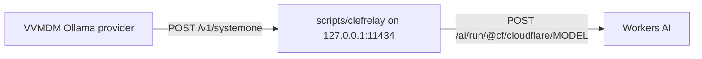

# Try auto-tagging with Clef on Workers AI

After these steps, VVMDM's auto-tagging sends its questions to Clef on
Cloudflare Workers AI through a local relay, on a machine that cannot run
Ollama, such as a Claude Code on the web container. VVMDM is unchanged: it
still talks to its Ollama provider, and the relay stands in for Ollama. Why
the relay reshapes requests, and how it compares with the other options, is in
[ai-layer.md](../design-docs/ai-layer.md#workers-ai-through-a-relay).



## Prerequisites

- A Cloudflare account ID and an API token with Workers AI access. In a
  Claude Code on the web environment whose network settings inject the token
  for `api.cloudflare.com`, only the account ID is needed.
- An environment where VVMDM runs ([Running VVMDM](running-vv.md)).

## Steps

1. Start the relay. It listens on Ollama's default address,
   `127.0.0.1:11434`.

   ```sh
   export CLOUDFLARE_ACCOUNT_ID=<account id>
   export CLOUDFLARE_API_TOKEN=<token>   # omit when a proxy injects it
   task clef-relay
   ```

   Pass `-- -addr 127.0.0.1:11435` to `task clef-relay` when port 11434 is
   taken.
2. Start VVMDM and sign in as the owner.
3. In Settings, Ollama, keep the URL `http://127.0.0.1:11434` (or the address
   from step 1), choose the model `clef-flash` or `clef`, and select **Save and
   test connection**. This reaches the relay only.
4. In Settings, Auto-tagging, select **Test judging**. This sends one question
   through the relay to Workers AI.
5. Turn auto-tagging on and tag videos as usual
   ([auto-tagging.md](../design-docs/auto-tagging.md)).

## Check the result

Both tests report success, and the relay prints one line per request to
Workers AI:

```text
clefrelay: clef-flash 16 questions, 9→1 images, 3099 tokens, 1.459s
```

Auto-tagged videos show their tags, and suggested tags show the confirm and
reject buttons.

## Troubleshooting

| Symptom | Cause | Fix |
| --- | --- | --- |
| The connection test says it cannot reach Ollama | The relay is not running, or listens on another address | Start the relay, and use its address as the Ollama URL |
| The connection test says the model is missing | The saved model is not a Clef model | Choose `clef-flash` or `clef` |
| Test judging fails with `ollama answered 401` or `403` | The token is missing or lacks Workers AI access | Set `CLOUDFLARE_API_TOKEN` to a token with Workers AI access |
| `clefrelay: Account ID が無い` on start | `CLOUDFLARE_ACCOUNT_ID` is unset | Export it, or pass `-- -account <id>` |
