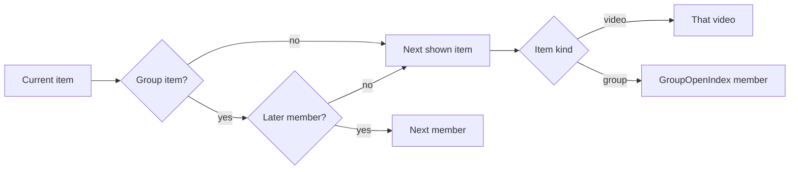

# Data model: Named playlists and continuous playback

Parent Issue: #787. The rest of the model is unchanged. Sources of truth:

| Topic | Source |
| --- | --- |
| Existing table definitions | [internal/store/migrations/](../../internal/store/migrations/) |
| Data classes | [running-vv.md, Data and recovery](../../docs/how-to/running-vv.md#data-and-recovery) |
| User key, bundles, succession | [030 data-model, User key](../030-video-versions/data-model.md#user-key), [internal/store/versions.go](../../internal/store/versions.go), [internal/store/successions.go](../../internal/store/successions.go) (`moveUserData`) |
| Folder key, group members and order | [017 data-model](../017-folder-groups/data-model.md#assignment-rules) |
| Watch state, the member a group opens at | [internal/domain/watch.go](../../internal/domain/watch.go), `GroupOpenIndex` in [internal/domain/library_item.go](../../internal/domain/library_item.go) |

This file covers only the tables, values and rules this feature adds.

## Migration

`00036_playlists.sql` (the last migration on `main` is
`00035_watch_history_title_key.sql`; confirm the number when implementing).
A later migration, `00039_playlists_order_idx.sql`, adds
`playlists_order_idx` on `playlists (updated_at desc, id desc)`, the order and
cursor of `ListPlaylists`, so a page does not scan and sort every playlist.

```sql
-- User data (specs/044-playlists/research.md R-1). No foreign key to the library.
create table playlists (
    id         integer primary key autoincrement,
    name       text    not null check (length(name) between 1 and 100),
    created_at integer not null,  -- Unix ms
    updated_at integer not null   -- Unix ms; any change of the name or the items
);

create table playlist_items (
    id          integer primary key autoincrement,
    playlist_id integer not null references playlists (id) on delete cascade,
    -- Exactly one of the two keys is set.
    content_key text,  -- a video's user key ('bundle:<id>' for a bundle member)
    folder_key  text,  -- a group's folder key (domain.FolderKey of its absolute path)
    position    integer not null,  -- 0-based, dense within the playlist (R-3)
    added_at    integer not null,  -- Unix ms
    check ((content_key is null) <> (folder_key is null)),
    check (content_key is null or content_key <> ''),
    unique (playlist_id, content_key),
    unique (playlist_id, folder_key)
);
create index playlist_items_order_idx on playlist_items (playlist_id, position);
create index playlist_items_content_idx on playlist_items (content_key);
```

Down drops both tables. Both are user data: ARCHITECTURE.md ("User data
survives a rebuild") and the table in running-vv.md gain them.
`RemoveContent`, `releaseContentIndex`, `rebuildFolderIndex` and media folder
removal touch neither.

Invariants (added to `internal/store/invariants_test.go`):

| Rule | Enforced in |
| --- | --- |
| The positions of one playlist are `0 … n-1` | `internal/store/invariants_test.go` |
| `folder_key` equals `domain.FolderKey(folder_key)` | `internal/store/invariants_test.go` |

## Succession and bundling

Every path below runs in the transaction that already re-keys the other user
data, through one package-private helper `rekeyPlaylistItems(tx, from, to)`, which
moves rows and never copies them. In each playlist that ends up with two items of key `to`, the
one with the larger `position` is deleted, and the playlist is renumbered
([R-2](research.md#r-2-bundling-and-succession-re-key-every-members-items-and-merge-duplicates)).

| Path | Change |
| --- | --- |
| `moveUserData` (same-path succession) | Items of `from` become items of `to` |
| `VersionStore.Bundle` | Items of every key absorbed into the bundle (a member's content key, or an absorbed bundle's key) move to the bundle key |
| `VersionStore.Unbundle`, last-but-one member removed | The bundle key's items move to the remaining member's content key (where `replaceUserData` runs) |
| `VersionStore.Unbundle`, other members remain | No change: the items stay with the bundle, and the removed member has none |
| `MakeRepresentative` | No change: the bundle key stays |
| Folder rename, move, dissolve | No change: the folder key no longer resolves, and resolves again when a group has it (R-4) |

## `domain` values added

| Value | Content |
| --- | --- |
| `Playlist` | `ID`, `Name`, `ItemCount` (shown items), `UpdatedAt`, `Covers []FolderPreview` (the list card's art, filled by `ListPlaylists` only; nil elsewhere) |
| `PlaylistPage` | One page of `ListPlaylists`: `Items []Playlist`, `Total` (every playlist, independent of paging), `NextCursor` (empty on the last page), `Version` (the list's order, an opaque string from the count and the sum of every `updated_at`; it changes with any create, delete, rename or item change, so a client that sees a different `Version` on a later page reads the list again from the first page, [contracts/screen-api.md](contracts/screen-api.md#get-apiplaylists)) |
| `PlaylistCursor`, `EncodePlaylistCursor`, `DecodePlaylistCursor` | The last playlist of a page as `UpdatedAtMs` and `ID`, wrapped like `WatchHistoryCursor` (JSON in URL-safe base64); an unreadable cursor is `ErrInvalidCursor` |
| `PlaylistItem` | `ID`, and one of `Video *Video` or `Group *LibraryGroup`, both read as the owner |
| `ValidatePlaylistName(string) (string, error)` | Trims; empty or over 100 characters is `*InvalidPlaylistNameError` ([R-11](research.md#r-11-a-playlist-name-is-1-to-100-characters-after-trimming-names-may-repeat)) |
| `PlaylistAdd` | Input of `AddPlaylistItems`: `VideoIDs []int64`, `FolderPaths []string` (absolute) |
| `PlaylistAdded` | `Added int`, `Existing int` (resolved but already in the playlist) |
| `PlaylistStep` | `ItemID`, `Video Video`: a video to open and the item it belongs to |
| `PlaylistPlayback` | `Playlist`, `ItemID`, `Position` (1-based among shown items; 0 when the current item is not shown), `Count`, `Next *PlaylistStep`, `PreviousItem *PlaylistStep`, `NextItem *PlaylistStep` |
| `ErrPlaylistNotFound`, `ErrPlaylistItemNotFound` | `404 not_found` |

## Playback order

`domain.PlaylistPlaybackOf(items, current)` decides from every item of the
playlist in position order, each marked shown or not and, for a shown group
item, with its members and their progress, and from the current item and
video. A hidden item stays in the input so the current item keeps its place
when it is hidden. The store reads its inputs in one read transaction.



| Case | Result |
| --- | --- |
| Current item is the last shown item, with no later member | `Next` absent: the end of the playlist (requirement 9) |
| Current video is no longer a member of the current group item | As "no later member": the next shown item |
| Current item is not shown (its video or group is gone) | `Position` 0; its place in the order still decides `Next`, `PreviousItem` and `NextItem` |
| Current video also appears as another item (a video item and a member of a group item) | The `item` parameter decides the place; each item plays at its own place (Edge Case) |
| Current item or playlist does not exist | `ErrPlaylistItemNotFound` / `ErrPlaylistNotFound` ([R-7](research.md#r-7-a-playlist-playback-overrides-the-group-and-folder-neighbours)) |
| `PreviousItem`, `NextItem` | The start video of the adjacent shown item: the video, or the group's `GroupOpenIndex` member |

A group item starts at the member `GroupOpenIndex` picks, the one the group
card opens: the first member in progress, else the first not completed, else
the first member when all are watched. It then plays the members in the
group's order to the last one; a watched member after the start is played
too, as group autoplay does (requirement 7). A fully watched group item is
played from its first member rather than skipped, because requirement 7 makes
the item start where opening the group does, and the group card replays a
watched group from its first member.

## Store operations (`PlaylistStore`)

A new role type `PlaylistStore`, holding only the `sql` connection like
`FavoriteStore`. Every write sets `playlists.updated_at`.

| Operation | Rule |
| --- | --- |
| `ListPlaylists(cursor, limit)` | One `PlaylistPage`: the playlists after `cursor` (the first page when empty), `updated_at` descending, then `id` descending, `limit` of them at most (one more row is read to know whether a `NextCursor` follows, as `ListWatchHistory` does), with the shown item count and, for the returned page only, `Covers`: the first shown items in position order, a video item's video or a group item's first member in group order with a thumbnail, only videos with a generated thumbnail, up to `MaxFolderPreviews` ([contracts/screen-api.md](contracts/screen-api.md#get-apiplaylists)); `Total`, `Version`, the summaries and the covers are read in one read transaction; an unreadable cursor is `ErrInvalidCursor` |
| `CreatePlaylist(name)` | Validated name; empty playlist |
| `RenamePlaylist(id, name)` | `ErrPlaylistNotFound` when absent |
| `DeletePlaylist(id)` | Items cascade; `ErrPlaylistNotFound` when absent |
| `Playlist(id)` | The playlist and its shown items in `position` order, videos and groups read as the owner |
| `AddPlaylistItems(id, PlaylistAdd)` | Video ids resolved with `userKeysForVideoIDs`; folders written only when in `folder_groups.path_key`, as `SetFavorites`; existing keys counted in `Existing`; the rest appended in request order |
| `MovePlaylistItem(id, itemID, afterItemID *int64)` | `nil` is the top; the item is placed right after `afterItemID` and the playlist is renumbered; either id absent from the playlist is `ErrPlaylistItemNotFound` |
| `RemovePlaylistItem(id, itemID)` | Deletes the row and renumbers; `ErrPlaylistItemNotFound` when absent |
| `PlaylistPlayback(id, itemID, videoID)` | [Playback order](#playback-order) |
