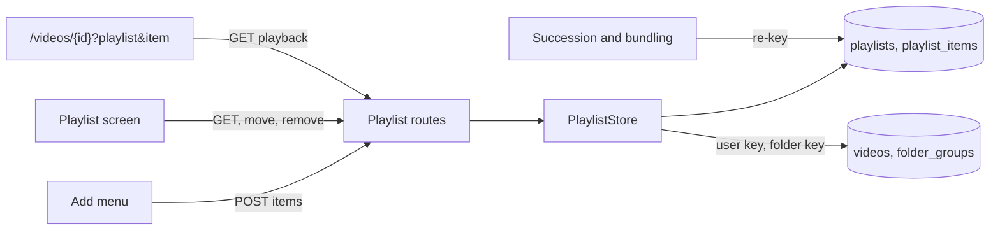
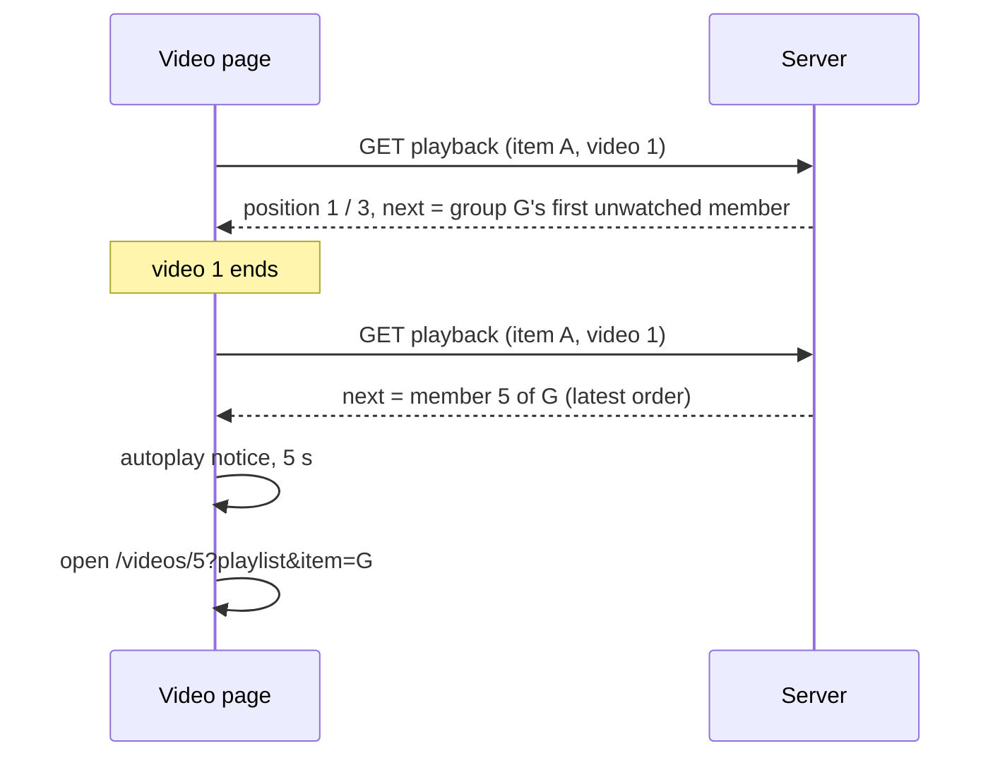
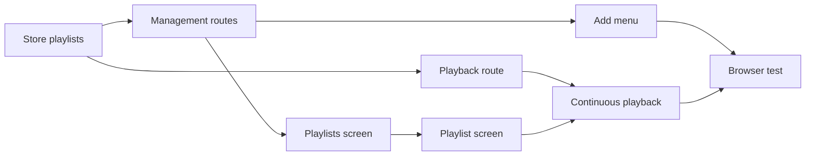

# Implementation Plan: Named playlists and continuous playback

**Branch**: `feature/044-playlists` | **Parent Issue**: #787

**Input**: The parent Issue. It is this feature's specification.

## Summary

The owner creates any number of named playlists, adds videos and groups to
them from the places a favorite can be set, orders and removes the items, and
plays a playlist from its first or any item through to its end, with the
group autoplay notice between items. Playlists are owner data keyed like
favorites, so they survive rescans and follow bundles and successions; the
server decides the next video from the playlist's latest order.

The diagram shows the parts this feature adds and what each one reads.



| Concern | Approach |
| --- | --- |
| Storage | `playlists` and `playlist_items`, items keyed by the user key or the folder key, no foreign key to the library ([R-1](research.md#r-1-two-tables-items-keyed-like-favorites-with-no-foreign-key-to-the-library), [data-model.md, Migration](data-model.md#migration)) |
| Bundles and successions | Every member's items are re-keyed; duplicates keep the earlier position ([R-2](research.md#r-2-bundling-and-succession-re-key-every-members-items-and-merge-duplicates)) |
| Order | Dense positions; "move after" one item ([R-3](research.md#r-3-dense-integer-positions-reordered-by-move-after)) |
| Missing files, dissolved or renamed groups | Left out at read time, back at their position when they resolve ([R-4](research.md#r-4-hidden-items-are-resolved-at-read-time-never-deleted)) |
| Adding | One bulk add of `videoIds` and `folders`, skipping existing items ([R-5](research.md#r-5-one-owner-only-bulk-add-for-videos-and-groups-appended-in-request-order)) |
| Continuous playback | `?playlist&item` on the video page; the server answers the position and the next video, read on open and at the end ([R-6](research.md#r-6-the-server-answers-the-playlist-position-and-the-next-video-from-the-latest-order), [R-7](research.md#r-7-a-playlist-playback-overrides-the-group-and-folder-neighbours)) |
| Who | Owner only through the existing defaults ([R-8](research.md#r-8-owner-only-through-the-existing-rules)) |
| Reordering on screen | `@dnd-kit/core` and `@dnd-kit/sortable` ([R-9](research.md#r-9-drag-reordering-with-dnd-kitcore-and-dnd-kitsortable)) |

The sequence shows one transition from a video item to a group item.



The Issue has the `ui` label, so the `design` stage writes `ui-design.md`
before the screen units: the playlists and playlist screens, the add menu and
its "new playlist" path, the drag handle, the confirmation before deleting,
the empty playlist, the playlist line and arrows on the video page, and the
end-of-playlist layer, judged against the parent Issue's `UI品質`.

Out of scope, as the parent Issue says: merging favorites into playlists, a
built-in "Watch later", shuffle and repeat, the external API and MCP, sharing
with guests, and smart playlists.

## Technical Context

**Canonical definitions**:

| Topic | Source |
| --- | --- |
| Boundaries, dependency direction, user data, the authentication boundary | [ARCHITECTURE.md](../../ARCHITECTURE.md), [.golangci.yml](../../.golangci.yml) (depguard) |
| Favorites: keys, bulk write, selection, toggles on card, selection bar and video page | [035 data-model](../035-favorites/data-model.md), [035 ui-design](../035-favorites/ui-design.md) |
| Groups, the group autoplay notice, the end-of-playback layer | [017 ui-design, Video page](../017-folder-groups/ui-design.md#video-page), [web/src/player/AutoplayNotice.tsx](../../web/src/player/AutoplayNotice.tsx) |
| User key, bundles, succession | [030 data-model, User key](../030-video-versions/data-model.md#user-key), [internal/store/successions.go](../../internal/store/successions.go), [internal/store/versions.go](../../internal/store/versions.go) |
| Owner-only screens, the gate, the sidebar | [016 ui-design, Guest degradation](../016-single-account-auth/ui-design.md#guest-degradation), [web/src/auth/AuthGate.tsx](../../web/src/auth/AuthGate.tsx), [web/src/shell/navigation.ts](../../web/src/shell/navigation.ts) |
| Screen API and generated code | [api/openapi.yaml](../../api/openapi.yaml), `task generate` |
| Screens and Web tests | [design-system.md](../../docs/design-docs/design-system.md), [web-testing.md](../../docs/design-docs/web-testing.md), [i18n.md](../../docs/design-docs/i18n.md) |
| Checks | [Taskfile.yml](../../Taskfile.yml) (`task check`, `task check-docs`, `task test-e2e`) |

**Feature-specific context**:

- One migration, `00036_playlists.sql`
  ([data-model.md, Migration](data-model.md#migration)).
- Nine new routes and no change to an existing one
  ([contracts/screen-api.md](contracts/screen-api.md)).
- The video page reads its first URL query parameters (`playlist`, `item`);
  until now it carried context only in `location.state`
  ([R-6](research.md#r-6-the-server-answers-the-playlist-position-and-the-next-video-from-the-latest-order)).
- New Web dependencies `@dnd-kit/core` and `@dnd-kit/sortable`
  ([R-9](research.md#r-9-drag-reordering-with-dnd-kitcore-and-dnd-kitsortable)).

## Constitution Check

| Rule (source) | Verdict |
| --- | --- |
| Adapters import neither each other nor `internal/app` (ARCHITECTURE.md, depguard) | Pass: `internal/store` and `internal/httpapi` meet through a `Playlists` interface `internal/httpapi` declares; no use case in `internal/app` |
| The domain decides, the store enforces (ARCHITECTURE.md) | Pass: `ValidatePlaylistName` and `PlaylistPlaybackOf` are in `internal/domain`; one key per playlist is a unique index |
| Store roles: one operation per role, cross-role work through private helpers (ARCHITECTURE.md) | Pass: `PlaylistStore` is new; succession and bundling call the private `rekeyPlaylistItems` in their own transactions |
| Events after commit (ARCHITECTURE.md) | Pass: no new event ([R-10](research.md#r-10-no-domain-event-and-no-live-update)) |
| User data survives a rebuild (ARCHITECTURE.md) | Pass: keyed by user key and folder key, no foreign key to the library; the invariant's list and the recovery table gain both tables |
| Every read knows its viewer (ARCHITECTURE.md) | Pass: the routes are owner only, and the store reads videos and groups with the owner audience the boundary classified |
| Do not hand-edit generated files (AGENTS.md) | Pass: `api/openapi.yaml` changes, then `task generate` |
| Read design-system.md before a screen; test at the lowest level (AGENTS.md) | Pass: screens follow `ui-design.md` from the registry; the order rule gets domain tests, screens page tests, the flow one browser test |
| Dependency updates follow dependency-updates.md (AGENTS.md) | Pass: the two dnd-kit packages are added under its rules |

No violation, so no complexity tracking.

## Project Structure

### Documentation (this feature)

```text
specs/044-playlists/
├── plan.md
├── research.md
├── data-model.md
└── contracts/
    └── screen-api.md
```

`ui-design.md` is written by the `design` stage (the Issue has the `ui`
label). No `quickstart.md`: every acceptance criterion and Edge Case is
reachable in store, domain and page tests or in the browser test below.

### Source Code

**Affected boundaries**:

| Boundary | What it owns in this feature |
| --- | --- |
| `internal/domain` | The playlist values, the name rule, the playback order |
| `internal/store` | The migration, `PlaylistStore`, the re-key in succession and bundling |
| `internal/httpapi`, `api/openapi.yaml`, `cmd/mdm` | The nine routes, `requiresJSONBody`, the wiring |
| `web/src/api` | `playlists.ts` |
| `web/src/playlists` (new), `web/src/app`, `web/src/shell`, `web/src/auth`, `web/src/i18n` | The two screens, their routes, the sidebar entry, the owner-only paths, the catalog text |
| `web/src/library`, `web/src/videoList`, `web/src/player` | The add menu next to the favorite toggle; the playlist context on the video page |
| `web/e2e` | The browser test |

**New paths**: `internal/store/migrations/00036_playlists.sql`,
`internal/domain/playlist.go`, `internal/store/playlists.go`,
`internal/httpapi/playlists.go`, `web/src/api/playlists.ts`,
`web/src/playlists/`, `web/e2e/playlists.e2e.ts`.

**Structure decision**: The add menu is one component under
`web/src/playlists/` used by the card, the selection bar and the video page,
so the three places share the menu's states. The playlist context on the video
page is one hook that turns the URL and the playback response into the arrows,
the notice target and the end state, so `VideoPage` chooses between it and the
related videos in one place
([R-7](research.md#r-7-a-playlist-playback-overrides-the-group-and-folder-neighbours)).

## Implementation Work

The diagram shows which units have to land first. The screen units also wait
for the `design` stage's `ui-design.md`.



### Store playlists and their items as owner data that follows bundles and successions

**Scope**: `00036_playlists.sql`, the playlist values and
`ValidatePlaylistName` in `internal/domain`, `PlaylistStore` with every
operation except `PlaylistPlayback`, `rekeyPlaylistItems` in succession and
bundling, the invariants, and both tables in ARCHITECTURE.md and
running-vv.md ([data-model.md](data-model.md)).

**Dependencies**: None.

**Acceptance**: `task check` and `task check-docs` pass; store tests show: a
video added to two playlists is read in both; adding it again counts it as
`existing` and leaves one item; adding videos and a group appends them in
request order; an id not in the library and a folder that is not a group are
counted in neither number; a move to the top, to after another item, and to
the end are read back in that order; removing an item renumbers the rest and
leaves `video_favorites` and `playback_progress` unchanged; deleting a
playlist removes its items; an item whose video has no location is left out
and is read at its old position after the content is rescanned; a group item
is left out after the folder is ungrouped and back after `auto`; same-path
succession re-keys an item and, in a playlist holding both keys, keeps the
earlier one; bundling two members that are both in a playlist leaves one
bundle item at the earlier position, and bundling a non-representative member
alone keeps its item; dissolving the bundle gives the item back to the
remaining member; names of 0 and 101 characters after trimming are rejected
and two playlists may share a name.

### Add the playlist management routes to the screen API

**Scope**: Every route in [contracts/screen-api.md](contracts/screen-api.md)
except `GET /api/playlists/{id}/playback`, its schemas, the handlers and the
`Playlists` interface, `requiresJSONBody`, the wiring in `cmd/mdm`, and
`web/src/api/playlists.ts` for those routes.

**Dependencies**: Store playlists and their items as owner data that follows
bundles and successions.

**Acceptance**: `task check` passes with no diff from `task generate`;
handler tests show each status in the contract's tables: `201` on create,
`400` on an empty name, `200` with `added` and `existing` on add, `204` then
`404` on removing one item, `400` on moving an item after itself, `404` on a
deleted playlist; a guest gets `401` on every route, and
`TestAccessClassificationMatchesOpenAPISecurity` passes.

### Answer a playlist's position and next video for the video page

**Scope**: `PlaylistPlaybackOf` in `internal/domain`,
`PlaylistStore.PlaylistPlayback`, `GET /api/playlists/{id}/playback` and its
schemas and handler, and its client function
([data-model.md, Playback order](data-model.md#playback-order),
[contracts/screen-api.md, Playback](contracts/screen-api.md#get-apiplaylistsidplayback)).

**Dependencies**: Store playlists and their items as owner data that follows
bundles and successions.

**Acceptance**: `task check` passes with no diff from `task generate`; domain
tests cover every row of the Playback order table; store or handler tests
show, for a playlist video A, group G (members 1 to 3, member 1 watched),
video B: from A, `next` is member 2 and `nextItem` is member 2; from member 2,
`next` is member 3; from member 3, `next` is B; from B, `next` is absent and
`position` is 3 of 3; after moving B to the top, `next` from member 3 is
absent; with A's file gone, `count` is 2 and `previousItem` from G is absent;
a removed item and a deleted playlist answer `404`; a guest gets `401`.

### Add the playlists screen to the sidebar for the owner

**Scope**: The `/playlists` screen listing the playlists and creating one, its
route, the sidebar entry, `/playlists` in `ownerOnlyPath`, and the catalog
text; layout and wording follow `ui-design.md`.

**Dependencies**: Add the playlist management routes to the screen API; the
`design` stage's `ui-design.md`.

**Acceptance**: This unit changes a screen, so it needs a visual and
interaction review against `ui-design.md` and the parent Issue's `UI品質`.
`task check` passes; page tests show: playlists listed newest change first
with their item counts; creating one with a name adds it to the list; an empty
name cannot be sent; two playlists of the same name are both listed; the guest
sidebar has no entry and a guest at `/playlists` is sent to the login page.

### Show, reorder and remove a playlist's items on the playlist screen

**Scope**: The `/playlists/{id}` screen: the items with thumbnail, title and
watch state, play from the top and from any item, drag reordering with
`@dnd-kit/core` and `@dnd-kit/sortable`, removing an item, renaming,
deleting with a confirmation, the empty playlist, a deleted playlist, and the
catalog text ([R-3](research.md#r-3-dense-integer-positions-reordered-by-move-after),
[R-9](research.md#r-9-drag-reordering-with-dnd-kitcore-and-dnd-kitsortable)).

**Dependencies**: Add the playlists screen to the sidebar for the owner.

**Acceptance**: This unit changes a screen, so it needs a visual and
interaction review against `ui-design.md` and the parent Issue's `UI品質`.
`task check` passes; page tests show: items in the response's order with the
watch state of each; moving an item by keyboard sends `move` with the item
above its new place, and reloading shows the new order; removing an item takes
its row away; deleting asks first, cancel changes nothing, confirm leaves for
`/playlists`; an empty playlist has no play action and says how to add items;
play opens `/videos/{id}?playlist=&item=` of the first item, with a group
item opening its `openVideoId`; a `404` shows the playlist as gone.

### Add videos and groups to a playlist from cards, the selection bar and the video page

**Scope**: The add menu under `web/src/playlists/` (the playlists, a new
playlist from the menu, the result toast) beside the favorite toggle on video
and group cards and rows, in the selection bar with the `videoIds` and
`folders` the favorite menu sends, and on the video page; owner only
([R-5](research.md#r-5-one-owner-only-bulk-add-for-videos-and-groups-appended-in-request-order)).

**Dependencies**: Add the playlist management routes to the screen API; the
`design` stage's `ui-design.md`.

**Acceptance**: This unit changes a screen, so it needs a visual and
interaction review against `ui-design.md` and the parent Issue's `UI品質`.
`task check` passes; page tests show: from a video card, choosing a playlist
sends that video's id; from a group card, the group's folder; from a
selection of two videos and one group, the two ids and the folder in one
request; creating a playlist from the menu creates it and adds to it; the toast
tells an add from an item already there; a guest sees no add action on cards,
in the selection bar or on the video page.

### Play a playlist continuously on the video page

**Scope**: The playlist context hook on the video page: reading `playlist`
and `item`, the playback response on open and at the end, the playlist line
with name and position, the previous and next item arrows, the autoplay
notice to `next` with cancel and play now, the end-of-playlist layer, keeping
the query on every step, and dropping the context on `404`; the page without
the query is unchanged
([R-6](research.md#r-6-the-server-answers-the-playlist-position-and-the-next-video-from-the-latest-order),
[R-7](research.md#r-7-a-playlist-playback-overrides-the-group-and-folder-neighbours)).

**Dependencies**: Answer a playlist's position and next video for the video
page; Show, reorder and remove a playlist's items on the playlist screen; the
`design` stage's `ui-design.md`.

**Acceptance**: This unit changes a screen, so it needs a visual and
interaction review against `ui-design.md` and the parent Issue's `UI品質`.
`task check` passes; page tests show: with the query, the line shows the
playlist name and `2 / 3`; at the end the playback is read again and the
notice names its `next`; cancelling stops the advance; advancing opens the
next video with `item` set to its item; with no `next`, the end-of-playlist
layer shows and nothing advances; the arrows open `previousItem` and
`nextItem`; a `404` leaves the related videos' neighbours in charge and no
notice after the end; without the query, a group member advances inside its
group as before.

### Cover playlists in a browser test

**Scope**: `web/e2e/playlists.e2e.ts` against the real server and media
([web-testing.md, Test levels](../../docs/design-docs/web-testing.md#test-levels)).

**Dependencies**: Add videos and groups to a playlist from cards, the
selection bar and the video page; Play a playlist continuously on the video
page.

**Acceptance**: `task test-e2e -- e2e/playlists.e2e.ts` passes and shows:
one video added to two playlists is listed in both (acceptance criterion 1);
adding it again leaves one item (2); a new order survives a reload and drives
playback (3); removing an item leaves the video in the library with its
favorite (4); video, group, video from the top advances through the group's
unwatched members to the last video (5); cancelling the notice stays (6); the
last item ends with the end-of-playlist layer (7); opening the same video from
the library advances inside its group (8); a guest sees no entry and
`/playlists` shows the login page (9).
