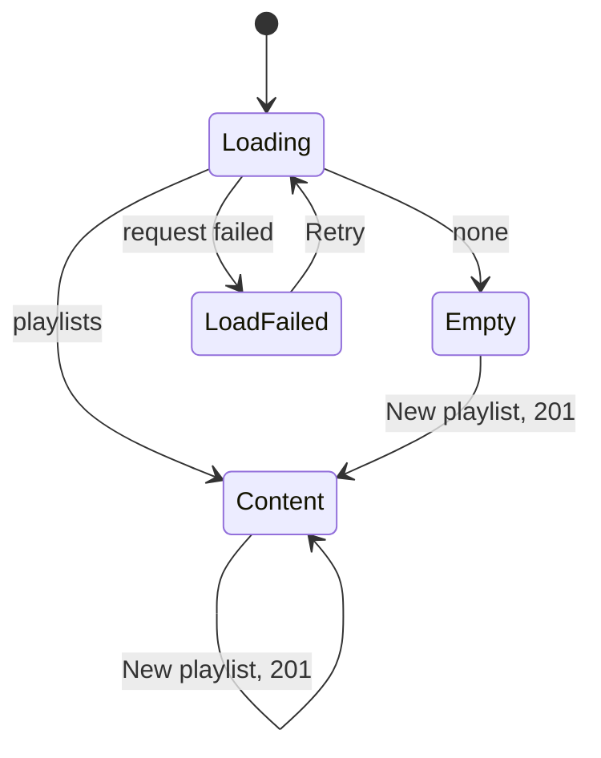
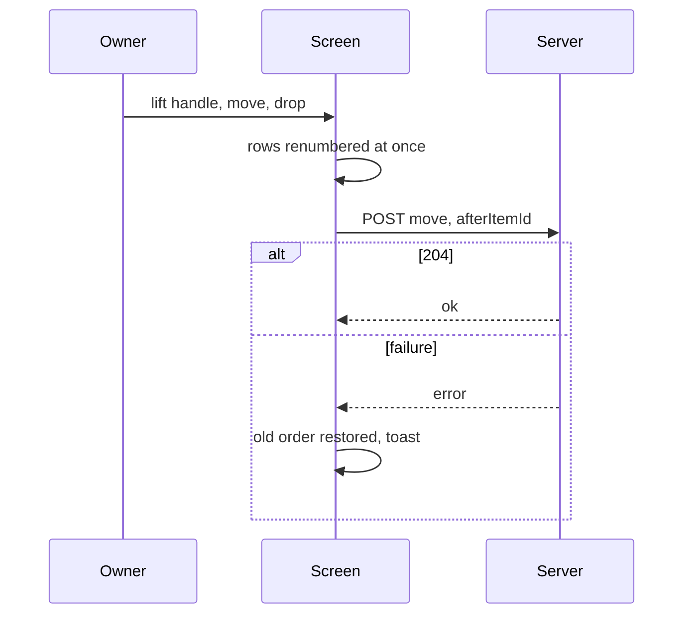
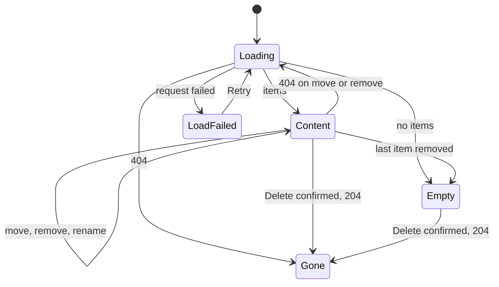
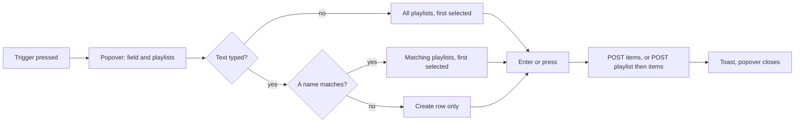
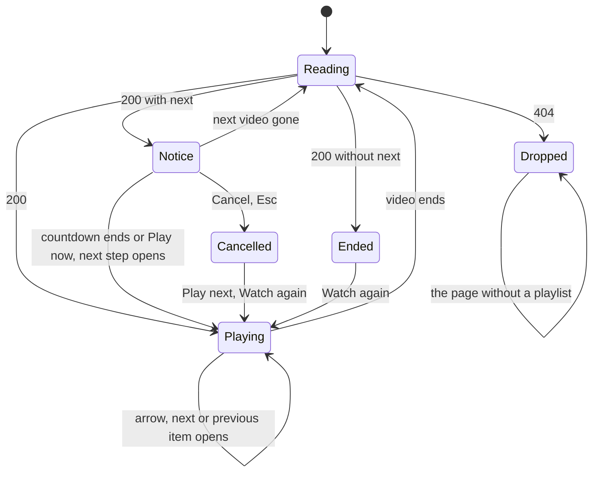
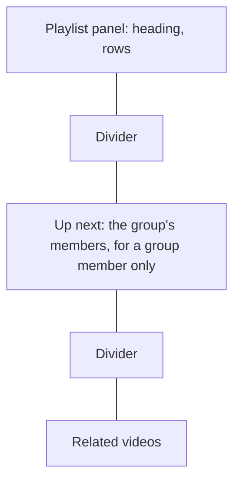

# UI design: Named playlists and continuous playback

**Feature**: [parent Issue #787](https://github.com/syudead/vv/issues/787) ·
[plan.md](plan.md) ·
[research.md R-3](research.md#r-3-dense-integer-positions-reordered-by-move-after) ·
[R-5](research.md#r-5-one-owner-only-bulk-add-for-videos-and-groups-appended-in-request-order) ·
[R-6](research.md#r-6-the-server-answers-the-playlist-position-and-the-next-video-from-the-latest-order) ·
[R-7](research.md#r-7-a-playlist-playback-overrides-the-group-and-folder-neighbours) ·
[R-8](research.md#r-8-owner-only-through-the-existing-rules) ·
[R-9](research.md#r-9-drag-reordering-with-dnd-kitcore-and-dnd-kitsortable) ·
[R-11](research.md#r-11-a-playlist-name-is-1-to-100-characters-after-trimming-names-may-repeat) ·
[data-model.md, Playback order](data-model.md#playback-order) ·
[contracts/screen-api.md](contracts/screen-api.md)

Sources that already decide things, linked rather than repeated here:

| Topic | Source |
| --- | --- |
| Tokens, closed scales, library and viewing density | [design-system.md, Foundations](../../docs/design-docs/design-system.md#foundations); the values in `@theme` of [`web/src/ui/tokens.css`](../../web/src/ui/tokens.css), named here and never copied |
| `ListPage`, `PageHeader`, `DataTable`, the state blocks | [patterns.md, List page](../../web/registry/rules/patterns.md#list-page), [Sections](../../web/registry/rules/patterns.md#sections) and [States](../../web/registry/rules/patterns.md#states) |
| `FormDialog`, `ConfirmDialog`: `pending`, the failure `Alert` inside them | [patterns.md, Form dialog](../../web/registry/rules/patterns.md#form-dialog) and [Confirm dialog](../../web/registry/rules/patterns.md#confirm-dialog) |
| `Button`, `Popover`, `Command`, `DropdownMenu`, `Tooltip`, `Sonner`, `VideoThumbnail`, `FavoriteToggle`: what each is for | [components.md](../../web/registry/rules/components.md) |
| The library list view's columns, row height and watch marks; the group row | [library-ui.md, List view and selection](../../docs/design-docs/library-ui.md#list-view-and-selection), [017 UI design, List view row](../017-folder-groups/ui-design.md#list-view-row) |
| The favorite heart on cards, rows and the video page, and when the off mark shows | [library-ui.md, Favorite mark](../../docs/design-docs/library-ui.md#favorite-mark), [035 UI design, Card](../035-favorites/ui-design.md#card) and [Video page](../035-favorites/ui-design.md#video-page) |
| The selection bar's order, wrapping and the `Favorite` menu's `videoIds` and `folders` | [library-ui.md, Selection bar](../../docs/design-docs/library-ui.md#selection-bar), [035 UI design, Selection bar](../035-favorites/ui-design.md#selection-bar) |
| The selection bar's `Add tag` popover: a `Command` inside the popover that is the picker | [014 UI design, Selection bar](../014-video-tags/ui-design.md#selection-bar), [components.md, TagCommand](../../web/registry/rules/components.md#tagcommand) |
| The video page: the group line, the member list, the arrows, the autoplay notice and the end-of-playback layer | [library-ui.md, Group members](../../docs/design-docs/library-ui.md#group-members), [017 UI design, Video page](../017-folder-groups/ui-design.md#video-page), [012 UI design, Ended](../012-video-detail-ia/ui-design.md#ended) and [Neighbor arrows](../012-video-detail-ia/ui-design.md#neighbor-arrows) |
| An owner-only list screen: sidebar entry, route, the gate, `document.title` | [043 UI design, Sidebar entry and route](../043-watch-history/ui-design.md#sidebar-entry-and-route), [016 UI design, Guest degradation](../016-single-account-auth/ui-design.md#guest-degradation) |
| Width breakpoints in CSS; layout checked by people | [library-ui.md, Width breakpoints](../../docs/design-docs/library-ui.md#width-breakpoints-in-css-and-the-sidebar-exception), [Layout verified by people](../../docs/design-docs/library-ui.md#layout-verified-by-people-not-machines) |
| Screen text | [`web/src/i18n/en.ts`](../../web/src/i18n/en.ts) (`shell.nav`, `common`, `list.card`, `library.selection`, `player`); this feature adds `playlists` and the words below |

The diagram shows the parts this feature adds and where each action leads.

```mermaid
flowchart LR
  side[Sidebar: Playlists] --> list[Playlists screen]
  list -->|New playlist| create[Form dialog]
  list -->|row| detail[Playlist screen]
  detail -->|Play, row| page[Video page, playlist context]
  detail -->|handle| move[Row moved]
  detail -->|More| manage[Rename, Delete]
  card[Card, row, video page, selection bar] -->|Add to playlist| picker[Playlist picker]
  picker -->|choose, create| toast[Result notice]
  page --> panel[Aside: playlist panel]
  panel -->|row| page
  page -->|video ends| notice[Autoplay notice]
  notice --> page
  page -->|last item ends| end[End of playlist]
```

Unchanged: the library's cards, rows and toolbar apart from the one added
control, the favorite heart, the group card, the folder pages, the video page
without `?playlist`, the sidebar's other entries and the gate. No change to
the design system: every part below is a registry component or pattern, no
token is added, and the contrast pairs in `web/src/theme/tokens.test.ts` gain
nothing.

## Why this shape

The playlists screen is a list page whose body is a `DataTable` of one row per
playlist: the name, the item count and when it last changed. The screen's one
job is to open a playlist, and a row the owner presses is the quietest form
for that; a card per playlist was rejected because `GET /api/playlists`
carries no artwork, so a card would be a framed box around a name, and a
`GroupedList` was rejected because the rows share no heading. The one
`default` action is "New playlist", because a new owner's first act on the
screen is to make one; rename and delete live on the playlist itself, where
the name is in view, so the list holds no row menu and nothing competes with
the names (`UI品質`, `操作の優先度`).

The playlist screen is a list page whose body is the library list view's
table with the row the parent Issue asks for: thumbnail, title and watch state
(`UI品質`, `情報密度`), plus a number, a drag handle and a remove `×`. The
table is the library's because the Issue asks that an item look as it does in
the library, and a row reads as an order where cards in a grid do not. The
whole row plays the playlist from that item, because requirement 6 makes
"start here" the thing to do with an item, and the header's one `default`
action plays from the top; a per-row play button beside a row that already
plays was rejected as a second control for one action. Rename and delete sit
behind the header's `More` menu, after the play action, so the order of
controls is the order of use (`UI品質`, `視覚的な階層`, `操作の優先度`).

Reordering is drag and drop by a handle, with the keyboard path dnd-kit
provides (R-9). The handle is the first thing in a row so the eye reads
"grab here, then the item"; a row without a handle, dragged anywhere, was
rejected because the row is a link and a press that opens must not also be a
press that lifts.

Adding is one picker at the four places the Issue names, in the shape the
owner already knows from the selection bar's `Add tag`: a popover with a
`Command` whose field filters the playlists and whose first row creates one
from the typed name. A `DropdownMenu` of names was rejected because
requirement 1 puts no limit on playlists and a menu with no search grows past
the screen; two steps ("New playlist…" then a dialog) were rejected because
typing a name and pressing Enter is the create path the tag picker already
taught. The control sits where the favorite heart sits (R-5, requirement 2):
beside it in the card's corner and the row's column, after it in the video
page's action group, and after `Favorite` in the selection bar, with the same
reveal rule as the off heart so a card that is not pointed at looks as it
does today (`UI品質`, `操作の優先度`: the same reach as the favorite).

On the video page the playlist is one line above the title, in the group
line's place and form, with the name and "2 / 7"; the arrows step between
items, the autoplay notice is the group notice unchanged, and the end is the
end-of-playback layer labelled "End of playlist" (R-7). The aside opens with
a panel of the playlist's items, in the member list's row form with the
current item marked, so the owner sees what played and what follows without
leaving the page, as the panel of comparable players does; the line above the
title gives the position, and the panel gives the order (the maintainer's
decision on the first design's open question). Inside a group item the
group's "Up next" member list keeps its place below the panel: the panel
says which item the group is and what follows it, the member list says what
plays next inside it, and the two read in the order of the lines above the
title (playlist, then group). Nesting the member list inside the current
group row was rejected because the member list reads beyond its window as
it scrolls and a nested list would scroll inside a scrolling panel; dropping
the member list in a playlist context was rejected because the member that
plays next would then be in no list. The panel's list is capped in height
and scrolls inside, so a long playlist does not push the member list and the
related videos below the fold, and the panel holds no handle and no `×`:
the playlist screen, one press away in the panel's heading, is where the
order is changed.

## Words

Text in `web/src/i18n/en.ts` under `playlists`, except where a key is named.
User data (a playlist name, a title) is embedded as an argument. `items` is
the catalog's "1 item" / "N items" helper, and `videos` its "N videos".

| Place | Text | Notes |
| --- | --- | --- |
| Sidebar entry, page title, `document.title` of `/playlists` | Playlists | `shell.nav.playlists`, `playlists.title`, `playlists.documentTitle` |
| Playlists table accessible name | Playlists | `playlists.table` |
| Column heads | Name, Items, Updated | `playlists.columns.name`, `.items`, `.updated` |
| Updated cell | 3 days ago | `formatRelative(updatedAt)`, as the library list view's `Added` column; the full date and time in `title` |
| Row link accessible name | {name}, {N items} | `playlists.rowLabel(name, count)` |
| Header count on `/playlists` | 3 playlists | `playlists.count(count)`; "1 playlist" |
| New-playlist button, dialog title | New playlist | `playlists.new`, `playlists.newDialog.title` |
| Name field label | Name | `playlists.nameLabel` |
| Name field error | Use a name of 1 to 100 characters. | `playlists.nameRule`; shown as `FieldError` when, at a submit attempt, the trimmed name is empty or over 100 characters, counted in code points as the server counts (R-11) |
| Create action; while sending | Create; Creating… | `playlists.newDialog.submit`, `.submitting` |
| Create failed | Couldn't create the playlist: {reason} | `playlists.newDialog.failed`; `destructive` `Alert` in the dialog |
| Empty playlists title | No playlists yet | `playlists.empty.title` |
| Empty playlists description | Create a playlist, then add videos and groups to it from the library. | `playlists.empty.description` |
| Playlists load failed | Couldn't load the playlists | `playlists.loadFailed`; `Retry` is `common.retry` |
| Header count on `/playlists/{id}` | 12 items · 1:32:10 | `playlists.detail.count(count, duration)`: `items(count)`, then ` · ` and the sum of the shown items' lengths through `formatDuration`; the duration part is omitted when any shown item has no length |
| Play action, accessible name | Play; Play "{name}" from the top | `playlists.detail.play`, `playlists.detail.playFor(name)` |
| More button, tooltip and accessible name | More | `common.more` |
| Menu items | Rename…, Delete… | `playlists.detail.rename`, `playlists.detail.delete` |
| Rename dialog title; action; while sending | Rename playlist; Save; Saving… | `playlists.renameDialog.title`, `.submit`, `.submitting` |
| Rename failed | Couldn't rename the playlist: {reason} | `playlists.renameDialog.failed` |
| Delete dialog title | Delete "{name}"? | `playlists.deleteDialog.title(name)` |
| Delete dialog description | The playlist is deleted. Its videos and groups stay in the library. | `playlists.deleteDialog.description` |
| Delete action; while sending | Delete; Deleting… | `playlists.deleteDialog.submit`, `.submitting`; `destructive` |
| Delete failed | Couldn't delete the playlist: {reason} | `playlists.deleteDialog.failed` |
| Deleted | Deleted "{name}" | `playlists.deleted(name)`; a toast on `/playlists` |
| Items table accessible name | Items | `playlists.detail.table` |
| Row link accessible name | Play from {title} | `playlists.item.playFrom(title)`; a group item uses the group name |
| Group item's second line | 12 videos | `library.group.count`, with the `Folder` icon, as the library's group row |
| Watched mark | Watched | `list.card.watched`, as the library's list view |
| Drag handle accessible name | Reorder "{title}" | `playlists.item.reorder(title)` |
| Keyboard instructions for the handle | Press Space to pick up, the arrow keys to move, Space to drop and Esc to cancel. | `playlists.item.reorderInstructions`; read through dnd-kit's `screenReaderInstructions` |
| Remove button, tooltip | Remove from playlist | `playlists.item.remove` |
| Remove button, accessible name | Remove "{title}" from the playlist | `playlists.item.removeFor(title)` |
| Move failed | Couldn't move the item: {reason} | `playlists.item.moveFailed`; a toast |
| Remove failed | Couldn't remove the item: {reason} | `playlists.item.removeFailed`; a toast |
| Empty playlist title | No items yet | `playlists.detail.empty.title` |
| Empty playlist description | Add videos and groups with Add to playlist on a card, on the video page, or in the selection bar. | `playlists.detail.empty.description` |
| Empty playlist action | Open library | `playlists.detail.empty.action`; a link to `/` |
| Deleted playlist title | This playlist no longer exists | `playlists.detail.gone.title` |
| Deleted playlist description | It was deleted, maybe in another tab. | `playlists.detail.gone.description` |
| Deleted playlist action | Back to playlists | `playlists.detail.gone.action`; a link to `/playlists` |
| Playlist load failed | Couldn't load the playlist | `playlists.detail.loadFailed` |
| Picker trigger, tooltip; selection bar action | Add to playlist | `playlists.add.label`; the selection bar uses `library.selection.addToPlaylist` with the same text |
| Picker trigger accessible name on a video card or row | Add "{title}" to a playlist | `list.card.addToPlaylist(title)` |
| Picker trigger accessible name on a group card or row | Add group "{name}" to a playlist | `library.group.addToPlaylist(name)` |
| Picker field placeholder and accessible name | Search or create a playlist | `playlists.add.search` |
| Picker list accessible name | Playlists | `playlists.add.list` |
| Create row | Create "{name}" | `playlists.add.create(name)` |
| Picker with no playlists and no text | No playlists yet. Type a name to create one. | `playlists.add.none` |
| Typed name too long | Use a name of up to 100 characters | `playlists.add.nameTooLong`; the reason line under the field, as `TagCommand` shows its reasons |
| Picker loading, load failed | Loading…, Couldn't load the playlists | `playlists.add.loading`, `playlists.add.loadFailed`; `Retry` is `common.retry` |
| Added | Added {N items} to "{name}" | `playlists.add.added(count, name)`; when `existing` is 0 |
| Nothing new | Already in "{name}"; {N items} already in "{name}" | `playlists.add.existing(count, name)`: the first form for one, the second for more; when `added` is 0 and `existing` is not |
| Partly new | Added {N items} to "{name}"; {M} already there | `playlists.add.partly(added, existing, name)` |
| Nothing resolved | Nothing was added | `playlists.add.nothing`; when both numbers are 0 |
| Add failed | Couldn't add to the playlist: {reason} | `playlists.add.failed` |
| Playlist line accessible name | Playlist "{name}", item 2 of 7. Open the playlist | `player.playlist.line(name, position, count)`; without the position part when `position` is 0 |
| Playlist line position | 2 / 7 | `player.related.position(position, count)` |
| Panel heading accessible name | Playlist "{name}". Open the playlist | `player.playlist.line(name, 0, count)`: the position is beside the heading, not in its name |
| Panel heading count | 2 / 7 | `player.related.position(position, count)`, as the member list's heading; omitted when `position` is 0 |
| Panel row accessible name | Play from {title} | `playlists.item.playFrom(title)`, as the playlist screen's rows; a group item uses the group name |
| Panel current row | Now playing | `player.related.nowPlaying`, hidden, before the title, as the member list's current row |
| Panel load failed | Couldn't load the playlist | `playlists.detail.loadFailed`; `Retry` is `common.retry` |
| Arrow tooltips and accessible names | Previous item: {title}; Next item: {title} | `player.playlist.previous`, `player.playlist.next`, joined by `player.neighbors.withTitle` |
| End-of-playlist label | End of playlist | `player.playlist.end` |
| End-of-playlist announcement | Playback finished. End of the playlist "{name}" | `player.playlist.endAnnouncement(name)`; `role="status"`, once |
| Playlist gone during playback | This video is no longer in the playlist. Playback stops after it. | `player.playlist.gone`; a toast |
| Unplayable item passed over | Skipped "{title}": it can't be played here. | `player.playlist.skipped(title)`; a toast ([Unplayable item](#unplayable-item)) |
| Unplayable last item | Can't play "{title}". End of the playlist. | `player.playlist.skippedLast(title)`; a toast |

"Item" is the word for a video or a group in a playlist, as the counts in
the parent Issue count them, and the bulk toasts count items as the favorite
toasts do. "Play from" rather than "Open", because pressing a row starts
playback (requirement 6). "Watch again" and "Up next" keep their existing
keys.

## Sidebar entry and route

"Playlists" (lucide `ListVideo`, `/playlists`, `ownerOnly`) is the fourth
entry of the sidebar's top group, after "History" and before "Tags": the first
four entries are the screens for finding something to watch, and the last two
are management. A guest's top group stays "Library" and "Folders". The rail
and the drawer treat it as the other entries, and it has no count badge.

`/playlists` and `/playlists/{id}` have the shape of `/history`: inside
`AppShell`, loaded when used, and in the gate's owner-only paths, so a guest
opening either is sent to `/login?next=…` with the full URL (R-8).
`document.title` is "Playlists" on the list and the playlist's name on the
playlist screen. The playlist screen's row links and its `Play` carry
`/playlists/{id}` as `state.from`, so the video page's `×` and Esc come back
to the playlist.

## Playlists screen

A `ListPage` with no toolbar, no band, no aside and no selection bar. The
header is the `PageHeader` title "Playlists" (`text-xl font-semibold`), the
count "3 playlists" and, in `actions`, the one `default` `sm` button "New
playlist" (lucide `Plus`). The body is one `DataTable` or one state block;
the header stays where it is in every state.

| Part | Form |
| --- | --- |
| Rows | One per playlist, in the API's order (last changed first, so the playlist the owner is building sits at the top) |
| Name | `text-sm font-medium text-foreground`, one line, truncated with the full name in `title`; the cell is a `Link` to `/playlists/{id}` that covers the row (`hover:bg-accent` on the row), with lucide `ListVideo` in `text-muted-foreground` before the name |
| Items | `items(count)` in `text-xs text-muted-foreground tabular-nums`, right-aligned; "0 items" for an empty playlist, not blank, so an empty row does not read as a loading glitch |
| Updated | `formatRelative(updatedAt)` in `text-xs text-muted-foreground`, right-aligned, from `md`; hidden below |
| Nothing else | No check column, no row menu, no thumbnail: the API gives no artwork, and the row's one action is to open |

Two playlists may share a name (R-11); two rows with the same name are told
apart by their counts and dates, and nothing merges them.

### New playlist

"New playlist" opens a `FormDialog` with one `Field`: the `Label` "Name" and
an `Input` (`autoComplete="off"`) that takes the focus when the dialog opens.
The input has no `maxLength`: HTML counts UTF-16 units, so a name of 100 emoji
would stop at 50, while the server counts code points (R-11). The dialog
counts the trimmed name in code points instead (`Array.from`), as the search
box does. The footer is `Cancel` and the `default` "Create".

| Event | Behaviour |
| --- | --- |
| Name empty after trimming, or over 100 code points | "Create" stays enabled, and the field shows no error while the owner types. Enter or a press sends nothing; "Use a name of 1 to 100 characters." becomes the field's `FieldError` and the field is `aria-invalid` until the text changes |
| Submit | `pending`: both buttons disabled, "Creating…" with a `Spinner`; the trimmed name is sent to `POST /api/playlists` |
| `201` | The dialog closes, the new row is at the top of the table, and focus moves to its name link; no toast, the row is the result |
| `400` | The field's `FieldError` is "Use a name of 1 to 100 characters."; the dialog stays open |
| Other failure | A `destructive` `Alert` "Couldn't create the playlist: {reason}" under the field; the dialog stays open |
| Cancel, Esc | The dialog closes; the typed name is dropped |

### States

The diagram shows the body's states and what moves it between them.



| State | What the screen shows |
| --- | --- |
| Loading | `LoadingState` `layout="table"` in the body; the header with "New playlist" |
| Load failed | `ErrorState` with "Couldn't load the playlists" and `Retry` |
| Empty | `EmptyState` with lucide `ListVideo`, "No playlists yet", "Create a playlist, then add videos and groups to it from the library." and the `default` `sm` action "New playlist", which opens the same dialog; the header's button is not drawn, so the area has one `default` button |
| Content | The table; the header's count and "New playlist" |
| Creating | The dialog in its `pending` form over the unchanged table |

The list is read when the screen opens and after a create; returning from a
playlist re-reads it (the `Link` leaves the route and the screen mounts
again). It does not refresh on its own while open (R-10).

## Playlist screen

A `ListPage` with no toolbar, no band, no aside and no selection bar. The
header is the `PageHeader` title (the playlist's name, `text-xl
font-semibold`, breaking onto a second line when it has to), the count "12
items · 1:32:10" and, in `actions`, the `default` `sm` "Play" (lucide `Play`)
followed by the `ghost` `icon-sm` "More" button (lucide `Ellipsis`) that opens
a `DropdownMenu` with "Rename…" (lucide `Pencil`), a `DropdownMenuSeparator`
and "Delete…" (lucide `Trash2`, `variant="destructive"`). The body is one
`DataTable` of the items or one state block.

The name is the strongest text on the screen and the only one in `text-xl`;
the count and the row numbers are `text-xs text-muted-foreground`, so the
name and the rows are what the eye lands on and the numbers are read only
when wanted (`UI品質`, `タイポグラフィ`). "Play" is the one filled control on
the screen; "More" is a quiet icon beside it.

### Rows

The table takes the library list view's columns and row height, so an item
looks as it does in the library's list view, with the handle and the number
in front and the `×` at the end. Row by row:

| Column | Form |
| --- | --- |
| Handle and number | A `w-list-number` cell: the `ghost` `icon-sm` handle (lucide `GripVertical`, `text-muted-foreground`, `cursor-grab`, `aria-label` "Reorder "{title}"") then the 1-based number in `text-xs text-muted-foreground tabular-nums`. The handle is always drawn, never revealed on hover only, because the screen is used by touch as well |
| Thumbnail | `VideoThumbnail` `w-list-thumb rounded-sm` as the list view row: the video's image, or for a group the first member's; `VideoThumbnailDuration` bottom right; `VideoThumbnailProgress` on the bottom edge while the video, or the group, is in progress. No favorite, no selection mark, no public mark |
| Title | `text-sm font-medium` as the list view row, `text-muted-foreground` when watched, clamped to two lines with the full text in `title`. A group item shows under its name one `text-xs text-muted-foreground` line with lucide `Folder` (`size-3`) and "12 videos", as the library's group row. The thumbnail and the title are one `Link` that covers the row from the number to the `×`, with `hover:bg-accent` on the row |
| Watched | From `sm`: lucide `Check` in `text-success` with the hidden "Watched" for a watched video or a watched group; "3 / 12" in `tabular-nums` for a group in progress; empty otherwise, as the list view |
| Length | The video's length, or the group's total, in `tabular-nums`, right-aligned; empty when unknown |
| Remove | The `ghost` `icon-sm` `×` (lucide `X`, `text-muted-foreground`, tooltip "Remove from playlist"), at the row's end, always drawn |

Pressing the row's link opens `/videos/{videoId}?playlist={id}&item={itemId}`
with `state: { from: "/playlists/{id}", autoplay: true }`, where `videoId` is
the video, or a group's `openVideoId`
([contracts/screen-api.md, Client use](contracts/screen-api.md#client-use)):
playback starts from that item. The header's "Play" does the same for the
first row. The quality, size and added columns of the library's list view are
not drawn: the row is an item in an order, and the three would widen it
without saying where to start or what is left.

A video that is in the library but cannot be played (`playable` false) keeps
its link and shows the list view row's warning line under its title
(`text-xs text-warning`, lucide `AlertTriangle` `size-3`), so the owner sees
it before playback passes over it
([Unplayable item](#unplayable-item)).

### Reordering

A row is lifted by its handle, with the pointer, with touch, or with the
keyboard (R-9). The diagram shows one move.



| Event | Behaviour |
| --- | --- |
| Lifted | The row is drawn on `bg-popover` with `shadow-elevated` and follows the pointer; the other rows shift to make room (`transition-transform`, none under reduced motion). The row's link is inert while lifted |
| Keyboard | With the handle focused: Space lifts, `↑` and `↓` move the row one place, Space drops, Esc cancels and restores the order; dnd-kit announces each step, and the instructions are read once when the handle takes the focus |
| Dropped at a new place | The order and the numbers change at once; one `POST /api/playlists/{id}/items/{itemId}/move` is sent with `afterItemId` the item now above it, `null` at the top. No toast: the new order is the result |
| Dropped at the same place | Nothing is sent |
| Failure | The order goes back to what the server last confirmed and a toast shows "Couldn't move the item: {reason}". A `404` (the item or the playlist is gone) re-reads the playlist instead, as the `404` row below says |
| Another move while one is in flight | Allowed; each is sent in order, each relative to the order on the screen when it was dropped |

### Removing an item

Pressing `×` sends `DELETE /api/playlists/{id}/items/{itemId}` at once. There
is no confirmation and no success toast: the row leaving is the result, the
video or group stays in the library (requirement 5), and the owner can add it
back from a card.

| Event | Behaviour |
| --- | --- |
| Pressed | The `×` is `disabled` and shows a `Spinner`; the row stays; a second press does nothing |
| `204` | The row leaves and the rows below it renumber; the header's count and length change. Focus moves to the next row's `×`, else the previous row's, else the page title (`titleRef`). When the last row leaves, the body shows the empty state and "Play" is no longer drawn |
| `404` | The list is stale: the screen re-reads the playlist while the current rows stay drawn, and replaces them when the response arrives; a `404` on that read is the deleted state |
| Other failure | The row stays, the `×` returns, and a toast shows "Couldn't remove the item: {reason}" |

### Renaming

"Rename…" opens a `FormDialog` "Rename playlist" with the one `Field` of
[New playlist](#new-playlist), prefilled with the current name and the text
selected, and the `default` action "Save". The rules of the name field are
the same; "Save" is `submitDisabled` only while the trimmed text equals the
current name, which needs no message. On `200` the dialog closes, the heading and `document.title`
show the trimmed name, and focus returns to "More". A `404` shows the deleted
state. Failures stay in the dialog as "Couldn't rename the playlist:
{reason}".

### Deleting

"Delete…" opens a `ConfirmDialog`: the title "Delete "{name}"?", the
description "The playlist is deleted. Its videos and groups stay in the
library.", `Cancel` first, then the `destructive` "Delete". The description
names what stays, because the one thing an owner fears here is losing the
videos (requirement 5); the words settle it before the press.

| Event | Behaviour |
| --- | --- |
| Confirm | `pending`: both buttons disabled, "Deleting…" with a `Spinner` |
| `204` | The dialog closes, the screen leaves for `/playlists`, and a toast there says "Deleted "{name}"" |
| `404` | The playlist was already deleted: the same as `204`, without the toast |
| Other failure | A `destructive` `Alert` "Couldn't delete the playlist: {reason}" under the description; the dialog stays open |
| Cancel, Esc | The dialog closes, nothing changes (requirement 11) |

### States

The diagram shows the body's states and what moves it between them.



| State | What the screen shows |
| --- | --- |
| Loading | `LoadingState` `layout="table"` in the body; the header with a `Skeleton` line in the name's place and no count or actions until the playlist arrives |
| Load failed | `ErrorState` with "Couldn't load the playlist" and `Retry`; the header without actions |
| Gone | `EmptyState` with lucide `ListX`, "This playlist no longer exists", "It was deleted, maybe in another tab." and the `default` `sm` action "Back to playlists"; the header shows "Playlists" as its title and no count or actions, so the screen names nothing it cannot show |
| Empty | `EmptyState` with lucide `ListVideo`, "No items yet", "Add videos and groups with Add to playlist on a card, on the video page, or in the selection bar." and the `default` `sm` action "Open library"; the header shows the name, "0 items" and "More" but no "Play", because there is nothing to play |
| Content | The table; the header with the count, "Play" and "More" |
| Moving, removing | As [Reordering](#reordering) and [Removing an item](#removing-an-item); the rest unchanged |
| Renaming, deleting | The dialog in its `pending` form over the unchanged table |

Items whose video or group is hidden (R-4) are not in the response, so the
numbers count the shown items and a hidden item takes no row; when its
content returns, the next read shows it at its place. The playlist is read
when the screen opens, after a `404` on a move or a remove, and when the
owner returns to it from the video page (the `Link` leaves the route, so the
screen mounts again); each row then shows the watch state the viewing left.

## Add to playlist

One picker component, used at four places, opens from a trigger and holds the
playlists. The diagram shows one add.



| Part | Form |
| --- | --- |
| Popover | A `Popover` of `w-popover`, opening below the trigger on cards and rows and on the video page, and above it (`side="top"`) in the selection bar, as `Add tag` does. It closes on Esc, a press outside, and after a result |
| Field | `CommandInput` with the placeholder and name "Search or create a playlist", focused when the popover opens; no `maxLength`, so the length rule below counts code points as the server does |
| List | `CommandList` named "Playlists", `shouldFilter={false}`: the playlists whose name contains the trimmed text, ignoring case, in the API's order (last changed first), each with lucide `ListVideo`; with no text, every playlist. The first row is selected, so Enter acts on it |
| Create row | Shown first, before the matches, while the trimmed text is not empty and no playlist's name equals it exactly; it reads "Create "{name}"" with lucide `Plus`. With no match it is the only row |
| Typed name over 100 code points after trimming | The reason line "Use a name of up to 100 characters" under the field; neither Enter nor a press acts |
| No playlists and no text | "No playlists yet. Type a name to create one." in place of the list |
| Loading | "Loading…" in place of the list; `GET /api/playlists` is read each time the popover opens, so a playlist made on another screen is there |
| Load failed | "Couldn't load the playlists" with a `ghost` `sm` "Retry" in place of the list; the field still takes a name, and Enter on a name creates |
| Choosing a playlist | `POST /api/playlists/{id}/items` with the place's `videoIds` and `folders`; the row shows a `Spinner` in place of its icon until the response |
| Creating | `POST /api/playlists` with the trimmed name, then the add to the new playlist; "Create "{name}"" shows the `Spinner` |
| Result | The popover closes and one toast reads "Added 3 items to "Tonight"", "Already in "Tonight"" (or "{N items} already in "{name}""), "Added 2 items to "Tonight"; 1 already there" or "Nothing was added", from the response's `added` and `existing`. A failure, including a `404` for a playlist deleted meanwhile, keeps the popover open with the reason line "Couldn't add to the playlist: {reason}" under the field, so the owner can pick another |

The same name as an existing playlist is not offered as a create row, because
a second "Tonight" made by Enter would be a slip, not a choice; the owner who
wants two makes the second from the playlists screen (R-11).

Where the trigger sits, and what it sends:

| Place | Trigger | Sends |
| --- | --- | --- |
| Video card (library, folder pages, search results) | In the thumbnail's top-end `VideoThumbnailMark`, to the left of the favorite heart: lucide `ListPlus` `size-5` with `drop-shadow-mark`, `text-foreground`, in a `size-8` hit area with no surface, `aria-label` "Add "{title}" to a playlist". It is shown exactly when the off heart is shown ([035 UI design, When the mark is shown](../035-favorites/ui-design.md#when-the-mark-is-shown)), and stays shown while its popover is open. Pressing neither opens the card nor changes the selection; the pointer entering it stops the hover preview, as the heart does | `videoIds: [id]` |
| Group card | The same, in the group card's corner mark beside its heart, `aria-label` "Add group "{name}" to a playlist" | `folders: [group.folder]` |
| List view rows (video and group) | A `w-8` column right after the favorite column with the same button in the row's form (`size-6`, icon `size-4`, `text-muted-foreground`, `text-foreground` on hover), visible when the row's off heart is | As the card of that kind |
| Video page | In the facts row's action group, right after the favorite toggle and before "Use current frame as thumbnail": the group's icon-only `ghost` button with lucide `ListPlus` and the tooltip "Add to playlist". It is drawn for the owner whenever the group is, including a video with no location; it is absent on a group member's group line, which adds nothing | `videoIds: [id]` |
| Selection bar | "Add to playlist" (lucide `ListPlus` + text, `ghost` `sm`) right after `Favorite`, before `Visibility`; the order is count → Add tag → Remove tag → Favorite → Add to playlist → Visibility → Bundle as versions → divider → Select all → clear. It wraps with the bar's rules, in the group from `Favorite` onward, and is never shortened to an icon. It is `disabled` with the same reason as `Favorite` when the number to send is over 20000 | `folders` the chosen groups and `videoIds` the selected ids that are not members of a chosen group, as `Favorite` ([035 UI design, Selection bar](../035-favorites/ui-design.md#selection-bar)); the selection stays after the result |

The card corner now holds two marks at the top end; both are hidden on a card
that is not pointed at, so the resting card is unchanged, and on a device
without hover both show on every card, as the off heart already does. The
heart stays nearest the corner, because it is the mark that carries a state
and is scanned for; the add control has no state and sits inside it.

## Video page in a playlist

With `?playlist=<id>&item=<itemId>` in the URL and the owner signed in, the
page reads `GET /api/playlists/{id}/playback?item=&video=` when it opens, when
the video ends, and when the notice finds its next video gone (R-6), and the
response drives the parts below; `GET /api/playlists/{id}` is read alongside
each of those reads for the [playlist panel](#playlist-panel), and the pair
is taken as one order only when the two responses carry the same
`playlist.updatedAt` ([One order](#one-order)). Without the query, or for a
guest, the page is unchanged (requirement 8). The diagram shows the page's
states while the context holds.



| Part | Form |
| --- | --- |
| Playlist line | One line above the title, first in the title block, in the group line's form: lucide `ListVideo` (`size-3.5`, `text-muted-foreground`), the playlist name (one line, truncated, full name in `title`), `·`, and "2 / 7" in `tabular-nums`; `text-xs`, `text-sm` from `sm`, `text-muted-foreground`. The line is a `Link` to `/playlists/{id}` (`state.from` carried over) with the accessible name "Playlist "{name}", item 2 of 7. Open the playlist". When `position` is 0 (the current item is hidden), the line shows the name alone. When the video is also in a group, the group line follows it, so the two lines read playlist then group then title |
| Aside | The [playlist panel](#playlist-panel) first, then, for a group member, the group's "Up next" member list, then the related videos, each divided from the next as the member list is divided from the related videos today |
| Arrows | The player's edge arrows go to `previousItem` and `nextItem` (the start video of the adjacent items) instead of the related videos' neighbours; a side with no adjacent item is not drawn. Tooltips and names are "Previous item: {title}" and "Next item: {title}". Moving opens that video with `item` set to the step's `itemId` and the query kept; playing or ended moves start playback, paused moves do not, as today. They are drawn over a state layer too, where the player is absent ([Unplayable item](#unplayable-item)) |
| Notice | At the end of a video with `next`, the group autoplay notice unchanged: "Up next", the countdown, the thumbnail and title of `next.video`, `Cancel` and `Play now`. Its link and its advance open `/videos/{next.video.id}?playlist={id}&item={next.itemId}`; a step whose video is the one on the page but whose `item` differs restarts playback from the start with the new position on the line (R-7) |
| Cancelled | The end-of-playback layer with "Next video" = `next.video`, "Play next" and "Watch again", as cancelling the group notice |
| Next video gone | The playback is read again: with a new `next` the notice starts over with it, and with none the end-of-playlist layer shows |
| End of playlist | At the end of a video with no `next`: the end-of-playback layer's centred `bg-navbar` surface with, from the top (`gap-3`), the label "End of playlist" in `text-xs font-semibold text-primary`, the playlist name in `text-base font-semibold` clamped to two lines, and the `secondary` "Watch again". Nothing advances and no countdown runs (requirement 9); the hidden announcement reads "Playback finished. End of the playlist "{name}"" once. `×` and Esc return to the playlist screen, which is `state.from` |
| Dropped | A `404` from any read, the playlist read included: the line and the panel are not drawn, the arrows follow the related videos again, no notice and no end-of-playlist layer follow the current video, and the toast "This video is no longer in the playlist. Playback stops after it." shows once. The URL keeps its query; a reload reads again and may find the playlist back |
| Reading | Between the page opening and the first response, the line is not drawn and no arrows are drawn; the title block keeps its place, because the line, when it comes, is one `text-xs` row above the title. The panel's place in the aside is held by its loading form, so the related videos do not move when the panel fills |

### Playlist panel

The aside's first section while the context holds: the playlist's items in
order, with the current item marked, read from `GET /api/playlists/{id}`
alongside every playback read and drawn only from a pair that agrees on the
order ([One order](#one-order)), so the panel and the server's `next` show
the same order after a move or a remove in another tab (R-6, Edge Case). It
does not refresh on its own between reads (R-10). The diagram shows the
aside's sections in a playlist context.



| Part | Form |
| --- | --- |
| Heading row | `flex items-baseline justify-between`, as the member list's heading: the `h2` (`text-sm font-semibold`) is lucide `ListVideo` (`size-3.5`, `text-muted-foreground`) and the playlist name on one line, truncated, with the full name in `title`; the name is a `Link` to `/playlists/{id}` (`state.from` carried over, accessible name "Playlist "{name}". Open the playlist"), because below `lg` the line above the title is a screen away. To its right, "2 / 7" in `text-xs text-muted-foreground tabular-nums`; nothing when `position` is 0 |
| Rows | A `ul` labelled by the heading, `gap-3` between rows, one per item in the response's order (shown items only, so the numbers match `count`). A row is the member list's row: the number in `w-5 text-right text-xs text-muted-foreground tabular-nums`, the `w-related-thumb` `VideoThumbnail` (the video's image, or a group's first member's; `VideoThumbnailDuration`; `VideoThumbnailProgress` while the video, or the group, is in progress) and the title in `text-sm font-medium` clamped to two lines, `text-muted-foreground` with lucide `Check` (`size-3.5`, `text-success`, hidden "Watched") when watched. A group item shows its name, under it the `text-xs text-muted-foreground` line with lucide `Folder` (`size-3`) and "12 videos", and "3 / 12" in `text-xs text-muted-foreground tabular-nums` in the check's place while in progress. An unplayable video keeps the playlist screen row's warning line under its title |
| Row link | The row is a `Link` (`-m-1.5 p-1.5 rounded-lg hover:bg-accent`, as a related row) to `/videos/{videoId}?playlist={id}&item={itemId}`, `videoId` the video or the group's `openVideoId`, with `state.from` carried over and `autoplay` true when the page's video is playing or ended and false when paused, as the arrows. Its accessible name is "Play from {title}". A video item's row plays the hover preview as a related row does; a group item's row plays none, because the preview would be one member's and the row is the group's |
| Current row | The item whose `id` is the playback response's `itemId`: not a link, `aria-current="true"`, `border-l-2 border-primary bg-accent pl-1`, with the hidden "Now playing" before the title, as the member list's current row; the hover surface does not change. For a group member the current row is the group item, its "3 / 12" says where in the group, and the member list below marks the member. When `position` is 0, no row is current |
| Height | The list is `max-h-80 overflow-y-auto` (`scrollbar-on-hover`, `overscroll-contain`) at every width: a playlist of up to three items takes its own height, and a longer one shows three rows and the top of a fourth, so the cut row says the list scrolls. The cap keeps the member list and the related videos within reach under a long playlist |
| Scrolling | When the panel fills and whenever `itemId` changes, the list's own `scrollTop` is set so the current row is in view with the bottom of the row above it, so the eye reads what came before and what follows; the page and the aside column never move for it, at any width (a `scrollIntoView` would move them, which is why 017 reads the `lg` width for the member list). At `lg`, the panel and, for a group member, the "Up next" heading line stay at the top of the column, and the rows under them scroll in one container as today |
| Divider | One `Separator` between the panel and what follows, with the spacing of the member list's divider (`pt-5` above, `pb-2` below), so the three sections keep one rhythm (`UI品質`, `余白のリズム`). With no group and no related videos, nothing follows and no divider is drawn |

The panel changes nothing: a move or a remove is done on the playlist
screen, which the heading opens, so the panel holds no handle and no `×`,
and nothing in it is drawn in `primary` except the current row's line and
the progress bars' fill (`UI品質`, `視覚的な階層`).

| State | Panel |
| --- | --- |
| Loading | While the playback read or the playlist read has not answered, or the pair does not agree yet ([One order](#one-order)): a `Skeleton` line in the name's place with no count, and three skeleton rows (a `w-related-thumb` block and two lines), as the related videos load. A later pair that is being read again keeps the rows it replaces until it agrees |
| Content | The heading, the rows and the current row in view |
| Load failed | The playlist read failed and the playback read did not: the heading from the playback response's `playlist`, and in the list's place "Couldn't load the playlist" with a `ghost` `sm` "Retry" that reads the playlist again; the line, the arrows and the notice are unaffected |
| Every item hidden | The heading with no count and no rows; the current video ends at the end-of-playlist layer, because the server's `next` is absent |
| Dropped | A `404` from the playback read or the playlist read: the panel is not drawn, and the aside is the page's without the query |
| Guest, no query | Not drawn |

#### One order

The two reads are independent requests, so a move or a remove in another
tab that lands between them would leave the panel in one order and `next`,
`position` and `count` in another. Both responses carry the playlist's
`updatedAt` (`playlist.updatedAt` of the playback response, `updatedAt` of
the playlist response), which every write of the name or the items sets
([data-model.md, Migration](data-model.md#migration)), so the page uses the
pair only when the two values are equal. When they differ, both are read
again, until they agree or a third pair still differs; then the pair whose
`updatedAt` is later stands for both parts (the panel from the playlist
response, the line, the arrows and the notice from the playback response),
and the next read, at the video's end, aligns them. A shared revision
parameter or the items inside the playback response were rejected: the
responses already carry the value that tells the two orders apart, and the
API stays as [screen-api.md](contracts/screen-api.md) has it, so the playback
route's implementation is unchanged.

### Unplayable item

The server's `next` is the next shown item and does not look at whether its
video can be played, and a video that creates no player never ends. The page
therefore passes over such an item itself. The rule covers the states that
create no player and do not change by waiting: `ReadFailure` (probe failed),
`Unplayable` (`playable` false) and `MissingVideo`.

| Arrival | Behaviour |
| --- | --- |
| With `autoplay` in `state`: the header's "Play", a row press, the notice's advance or "Play now", "Play next" | Once the playback read answers, the page opens `next` with `replace`, keeping `autoplay`, and the toast "Skipped "{title}": it can't be played here." shows. With no `next`, the page stays on the video's state layer and the line shows its position, with the toast "Can't play "{title}". End of the playlist." |
| Without `autoplay`: an arrow moved while paused, a reload, an opened link | Nothing advances. The state layer shows as today, with the reprobe for the owner, and the playlist's arrows stay drawn over it, so "Next item" continues by hand |
| `ProcessingStages` (probe pending) | The page waits as today. It plays when the probe ends with a playable video, and passes over the item by the rule above when the probe fails |

In a playlist context the arrows are drawn whenever the playback read has
answered, with or without a player, because they are the way on from a video
that cannot end. A run of unplayable items is passed over one at a time, each
with its own toast; the toasts replace one another, so only the last one
stays. `/api/playlists/{id}/playback` and its order rules are unchanged.

A member of a group item plays the group's members in order to the group's
end and then the next item, as the group notice does today; the aside's "Up
next" member list and its position stay those of the group, below the
[playlist panel](#playlist-panel), whose current row is the group item, and
the playlist line above the title says which item the group is. The related
videos' `nextId` is not used for anything while the context holds (R-7).

## Guest degradation

When drawing as a guest, the following are not shown. They are neither
`disabled` nor `aria-disabled` (as in 016).

| Place | Not shown | Instead |
| --- | --- | --- |
| Sidebar | "Playlists" | The top group stays "Library" and "Folders" |
| `/playlists`, `/playlists/{id}` | The screens | The gate sends a guest to `/login?next=…` (acceptance criterion 9) |
| Cards and rows, the video page's action group, the selection bar | "Add to playlist" | The response has no `favorite`, and the add control is drawn only where the heart is |
| Video page with `?playlist=` | The playlist line, the playlist panel, the arrows' playlist targets, the notice and the end layer of the playlist | No playback or playlist request is sent; the page plays the public video as it does without the query |

## Responsive behaviour

The widths below are the ones the implementation is judged at. The tables
change at `sm` (640 px: the watched column) and `md` (768 px: the updated
column); the video page's line and layers change at `sm` as the group line
and the notice already do.

| Width | Layout |
| --- | --- |
| 360px | The sidebar is the drawer. Playlists: the header is the title, the count and "New playlist" on one row, with the button's text kept; the table shows Name and Items. Playlist: the header is the name on up to two lines, the count under it, and "Play" with "More" at the row's end; a row is the handle and number, the `w-list-thumb` thumbnail, the title on up to two lines, the length and the `×`, with no watched column; a long title never pushes the `×` out of the row. The dialogs span the width with the dialog's own margin. The picker popover is `w-popover`, kept inside the viewport. The selection bar's "Add to playlist" sits on the tier with "Favorite" and "Visibility" or the tier below, at the right end, with its text whole. Video page: the playlist line is `text-xs` above the title; the notice and the end layer omit the thumbnail as today; the aside is under the facts with its top border and `px-4`, and the playlist panel is its first section, with its rows the width of the related rows, its list no taller than `max-h-80` and scrolling inside while the page does not move, and the member list and the related videos below it |
| 768px | The rail sidebar. Playlists: Name, Items and Updated. Playlist: the watched column joins the row; the header's name, count and the two actions fit one row for a name of up to about 40 characters, and a longer name wraps under the actions. The selection bar, with one item selected, holds the count and the five actions on the first row and "Select all" and clear at the right end of the second; with two or more, "Favorite" onward on the second row, as the bar's rules say. Video page: still one column; the aside under the facts with `px-6`, the panel as at 360px |
| 1280px | Playlists: the three columns with the names taking the width. Playlist: the full row; the dragged row's shadow is visible against the rows it passes. The selection bar is one row. Video page: two columns; the playlist line sits above the title in the left column, and the aside (`w-detail-aside-wide` at this width) opens with the playlist panel, whose heading and capped list stay at the top of the column while the member list and the related videos scroll under them; at 1280×800 the panel leaves at least three related rows in view below it |

## Review criteria

Judged by looking at the screen at 360px, 768px and 1280px, with three
playlists, one of them holding at least eight items including two groups,
one watched video, one video in progress and one unplayable video, and one
empty playlist.

1. **Visual hierarchy (playlist screen)**: the playlist's name is the
   strongest text on the screen and the only `text-xl`; below it the rows'
   titles are read first and their thumbnails support them. The numbers at
   the row's start and the count under the name are `text-xs` in the muted
   colour and do not catch the eye before a title. "Play" is the one filled
   control on the screen; "More", the handles and the `×` are drawn in the
   muted colour and nothing in a row is drawn in `primary` except the
   progress bar's fill (`UI品質`, `視覚的な階層`, `タイポグラフィ`).
2. **Information density**: a playlist row is the library list view's row
   put side by side: the same thumbnail width, the same title size and
   weight, the same watched mark and the same height; at 1280×800 at least
   seven rows are on screen under the header, and at 360×780 at least four.
   A row holds a thumbnail, a title, the watch state and the length, and no
   tags, favorite, quality, size or date (`UI品質`, `情報密度`).
3. **Spacing rhythm**: the playlists screen and the playlist screen have the
   header, the gap to the body and the body's edges of the history and tags
   screens, because `ListPage` draws them; the table's card and border are
   the library list view's. Nothing on either screen writes its own margin
   (`UI品質`, `余白のリズム`).
4. **Priority of actions**: on the playlist screen, Tab reaches "Play"
   before "More", and "More" holds "Rename…" and "Delete…" with "Delete…"
   last after a line. Pressing a row starts playback from that item without
   a further press; "Play" starts from the first. Removing an item is one
   press on `×`; deleting the playlist takes "More", "Delete…" and "Delete",
   and Cancel or Esc changes nothing (requirement 11, `UI品質`,
   `操作の優先度`).
5. **Adding from a card**: a library card that is not pointed at looks as it
   did before this feature. Pointing at it reveals the add control to the
   left of the outline heart in the same corner; pressing it opens the
   picker without opening the video or changing the selection; choosing a
   playlist closes the picker and a toast says "Added 1 item to "{name}"";
   the card's look does not change. On a touch device both marks show on
   every card. The same control is in the list view row's column after the
   heart, on the group card's corner, second in the video page's action
   group, and in the selection bar after "Favorite" (requirement 2,
   acceptance criterion 1).
6. **Picker**: typing part of a name narrows the list; typing a name no
   playlist has shows "Create "{name}"" first, and Enter creates it and adds
   the item in one step; typing the exact name of an existing playlist shows
   no create row. Adding the same video to the same playlist again shows
   "Already in "{name}"" and the playlist still has it once (acceptance
   criterion 2). Selecting two videos and one group and choosing a playlist
   shows "Added 3 items to "{name}"" and the playlist has three rows (R-5).
7. **Reordering**: dragging a row by its handle moves it, the numbers
   renumber at once, and reloading the screen shows the same order
   (acceptance criterion 3). With the handle focused, Space, `↓`, Space moves
   the row one place down and the same request is sent; Esc during a move
   restores the order. A row dragged over the others is drawn above them
   with a shadow, and the others shift to make room.
8. **Removing and the library**: after removing a row, the video's library
   card shows the same heart and the same progress as before (acceptance
   criterion 4); the row below took its number. Removing the last row shows
   "No items yet" with "Open library" and no "Play".
9. **Continuous playback**: "Play" on a playlist of video, group, video opens
   the first video with the line "{name} · 1 / 3"; at its end the notice
   names the group's first unwatched member and advances; the group's
   members play in order with the line still "2 / 3"; at the last member's
   end the notice names the third item's video; at its end the end layer
   reads "End of playlist" with the name and only "Watch again", and nothing
   advances (acceptance criteria 5 and 7). Cancelling the notice leaves the
   "Next video" layer and nothing advances (acceptance criterion 6).
   Pressing a row in the middle plays only the items after it.
10. **Position and arrows**: the playlist line sits above the title, smaller
    and in the muted colour, and does not catch the eye before the title;
    pressing it opens the playlist screen. The player's right arrow opens the
    next item's start video with the line's position one higher; the left
    arrow the previous; the first item has no left arrow and the last no
    right arrow. When the video is a group member, the group line follows the
    playlist line, the panel's current row is the group item, and the aside's
    "Up next" under the panel is the group's member list.
11. **Direct playback unchanged**: opening the same group member from the
    library shows no playlist line, the arrows move within the group, and the
    notice at its end is the group's (acceptance criterion 8). Reordering the
    playlist in a second tab while a video plays makes the notice at its end
    name the item that now follows (Edge Case).
12. **Deleted playlist**: deleting the playlist leaves for `/playlists` with
    the toast "Deleted "{name}"". Opening `/playlists/{id}` of a deleted
    playlist shows "This playlist no longer exists" with "Back to playlists".
    Deleting it in a second tab while a video plays from it shows, at the
    video's end, no notice, no end-of-playlist layer and the plain end layer,
    with the toast about the playlist once.
13. **Guests**: signed in as a guest, the sidebar has no "Playlists" at any
    width, `/playlists` and `/playlists/{id}` show the login page, no card,
    row, video page or selection bar shows "Add to playlist", and a public
    video opened with `?playlist=1&item=2` plays with no playlist line and
    no playback request (acceptance criterion 9).
14. **Playlist panel**: with the eight-item playlist playing its fifth item,
    the aside opens with the playlist's name and "5 / 8" as a heading of the
    related videos' size, and under it rows of the related videos' density,
    with the fifth row marked by its left line and surface and not pressable;
    the list shows three rows and the top of a fourth, is scrolled so the
    fourth row's bottom edge and the fifth row are in view, and scrolls inside
    itself while the page and the aside stay put at 360px and at 1280px.
    Pressing the heading opens the playlist screen; pressing the seventh row
    plays its item with the line reading "7 / 8" and the panel's mark on the
    seventh row. Reordering the playlist in a second tab and letting the video
    end redraws the panel in the new order. The panel holds no handle and no
    `×`, and the member list and the related videos follow it after one
    divider each (requirement 8, `UI品質`, `視覚的な階層`, `情報密度`,
    `余白のリズム`).
15. **Failing examples** (`UI品質`): the playlists drawn as framed cards with
    an icon where artwork would be; a row menu with rename and delete on the
    playlists screen; the playlist's count or the row numbers in the same
    size or weight as the name; a `default` play button on every row; the
    handle revealed only on hover; rows taller than the library's list view
    rows, or rows with quality, size and date columns; "Delete…" drawn as a
    `destructive` button in the header; the add control drawn on every
    resting card, or inside the heart's place with the heart moved; the
    picker as a menu of names with no field; a second "Tonight" offered as a
    create row; the playlist line in `text-base` or above the title in
    `primary`; a countdown on the end-of-playlist layer; the playlist panel
    drawn below the member list or the related videos, or with rows denser or
    taller than the related rows; the panel grown to the playlist's whole
    height; the current row drawn as a link or without its left line; a
    handle or a `×` in the panel's rows; the panel scrolling the page to its
    current row.
