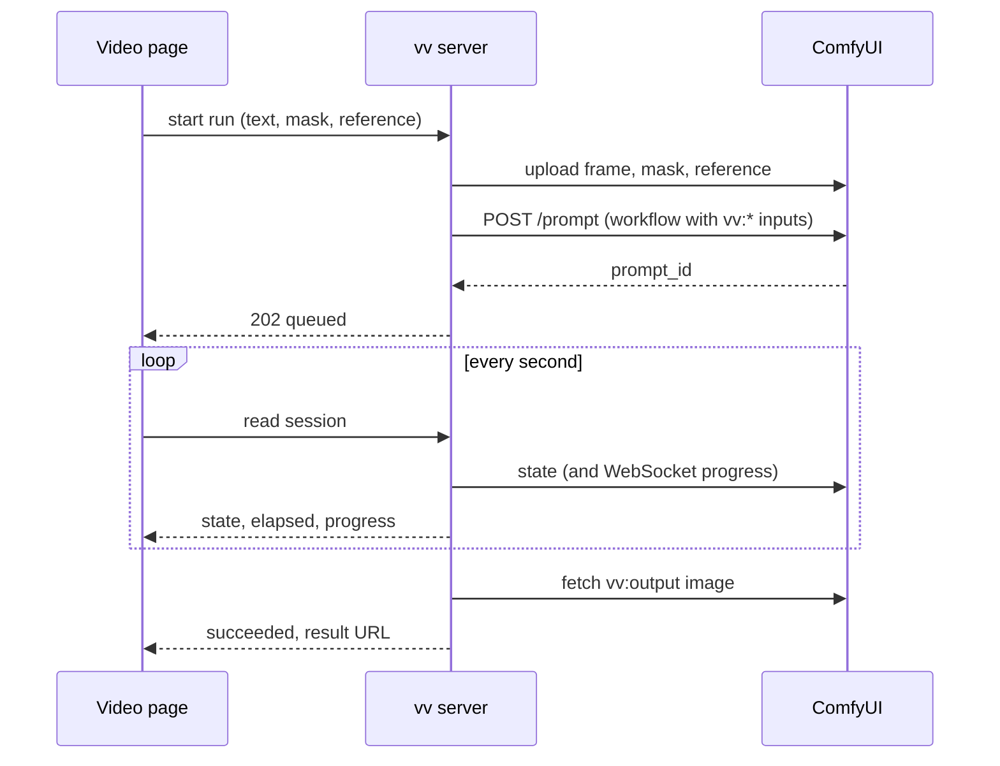

# Contract: The thumbnail workflow and its runs

Source of truth: this document until the implementation moves it to
`docs/how-to/comfyui-thumbnails.md`, where the owner reads how to prepare a
workflow. It covers what vv requires of the owner's ComfyUI workflow and how
vv drives one run. The decisions are in
[research.md R-2](../research.md#r-2-named-nodes-in-the-owners-api-format-workflow-are-the-whole-contract),
[R-3](../research.md#r-3-absent-optional-inputs-get-a-neutral-value) and
[R-5](../research.md#r-5-provider-differences-stay-inside-the-adapter).

## Workflow format

The workflow is ComfyUI's API format ("Export (API)"): a JSON object whose keys
are node ids and whose values carry `class_type`, `inputs` and `_meta.title`.
vv finds nodes by `_meta.title` and writes only the inputs in this table.

| Title | Required | Node | vv writes |
| --- | --- | --- | --- |
| `vv:frame` | Yes | An image loader with an `image` input (`LoadImage`) | `image`: the uploaded frame |
| `vv:output` | Yes | A node that saves or previews images (`SaveImage`, `PreviewImage`) | Nothing; vv reads its first output image |
| `vv:prompt` | No | A node with a string `prompt` or `text` input | That input (`prompt` when both exist): the owner's text, or `""` |
| `vv:mask` | No | An image loader with an `image` input (`LoadImage`, `LoadImageMask`) | `image`: the uploaded mask, or a mask covering the whole frame |
| `vv:reference` | No | An image loader with an `image` input | `image`: the uploaded reference image, or the frame |

The mask is a PNG of the frame's pixel size: painted pixels are opaque white,
the rest opaque black. A workflow reads it with `LoadImageMask` on the `red`
channel, or with `LoadImage` and an image-to-mask node.

## Registration

`domain.ParseThumbnailWorkflow` accepts a workflow or answers one reason.

| Situation | Reason |
| --- | --- |
| Not a JSON object, larger than 1 MiB, or a node without `class_type` | `workflow_invalid` |
| The UI format (a top-level `nodes` array) | `workflow_not_api_format` |
| No node titled `vv:frame` or `vv:output` | `workflow_missing_node`, with the title |
| Two nodes with one `vv:*` title | `workflow_duplicate_node`, with the title |
| A `vv:*` node without the input the table names | `workflow_node_input_missing`, with the title |

On success the API answers which optional inputs the workflow takes
(`prompt`, `mask`, `reference`). Registration never contacts ComfyUI, so a
workflow can be registered before the connection works.

## Run

The sequence shows one run from the page's start to the result.

Uploads use names that start with `vv-` and a random part, with
`overwrite=true` and `type=input`. vv does not delete them or the output from
ComfyUI afterwards, because a self-hosted ComfyUI has no route that deletes
them.

## Run states

| vv state | Self-hosted ComfyUI | Comfy Cloud |
| --- | --- | --- |
| `queued` | The id is in `queue_pending` | `submitted`, `queued_waiting`, `waiting_to_dispatch`, `pending` |
| `preparing` | Not reported | `preparing` |
| `running` | The id is in `queue_running` | `executing`, `in_progress` |
| `succeeded` | `history/{id}` has `status.completed` and an output image | `success`, `completed`, and an output image |
| `failed` | `history/{id}` has `status_str: error`, or the id has gone from the queue without a history entry | `error`, `non_retryable_error`, `lost` |
| `cancelled` | After vv's cancel | `cancel_requested`, `cancelled` |

Step progress (`value` of `max`) comes from the WebSocket `progress` message
for the run's `prompt_id`, and is absent when no message arrived.

## Failure reasons

| Reason | When |
| --- | --- |
| `unreachable` | No connection, a DNS failure, or a 5xx answer |
| `unauthorized` | `401` or `403` from Comfy Cloud |
| `insufficient_credits` | `402` from Comfy Cloud, or an error whose type names credits |
| `workflow_rejected` | `POST /prompt` answers `400` (`node_errors`); the first node error's message is passed on |
| `run_failed` | The provider reports the run failed; the execution error's message is passed on |
| `no_output` | The run succeeded and `vv:output` has no image |
| `timed_out` | No terminal state 10 minutes after submitting |
