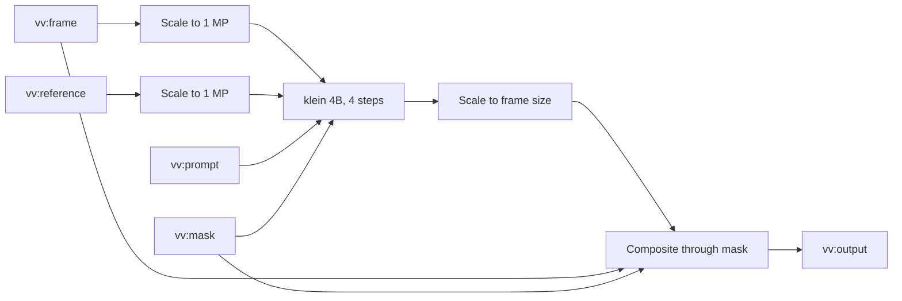
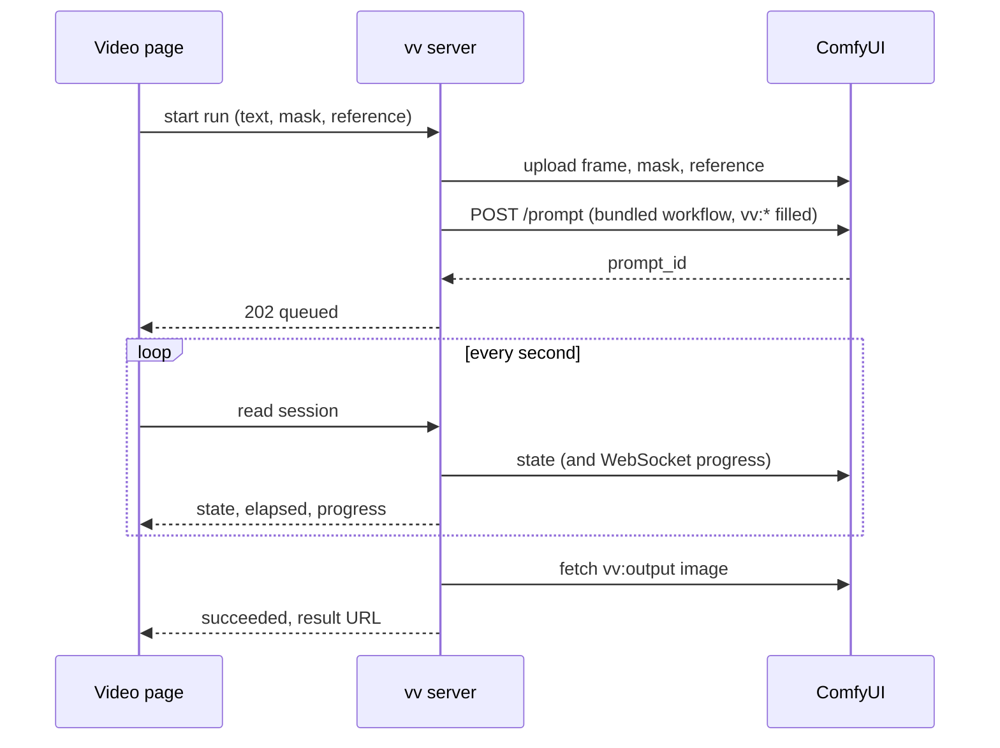

# Contract: The bundled thumbnail workflow and its runs

Source of truth: the workflow files embedded in `internal/comfyui`, once they
exist; until then this document and the two files beside it
([workflows/](workflows/)). It covers the workflows vv ships, what a
self-hosted ComfyUI needs to run them, and how vv drives one run. The
decisions are in
[research.md R-2](../research.md#r-2-vv-bundles-the-workflow-named-nodes-are-its-internal-contract),
[R-3](../research.md#r-3-absent-inputs-get-a-neutral-value-or-the-variant-without-the-node),
[R-5](../research.md#r-5-provider-differences-stay-inside-the-adapter),
[R-12](../research.md#r-12-the-model-is-flux2-klein-4b-fp8) and
[R-13](../research.md#r-13-the-connection-test-checks-the-workflows-nodes-and-model-files).

## Workflows

Both files are ComfyUI's API format: a JSON object whose keys are node ids and
whose values carry `class_type`, `inputs` and `_meta.title`. They come from the
model POC and ran on Comfy Cloud.

| File | Used when |
| --- | --- |
| [`workflows/thumbnail-edit.json`](workflows/thumbnail-edit.json) | The owner attached no reference image |
| [`workflows/thumbnail-edit-reference.json`](workflows/thumbnail-edit-reference.json) | The owner attached a reference image |

vv finds the nodes it fills by `_meta.title` and writes only the inputs in
this table.

| Title | Node | vv writes |
| --- | --- | --- |
| `vv:frame` | `LoadImage` | `image`: the uploaded frame |
| `vv:prompt` | `CLIPTextEncode` | `text`: the owner's instruction; when it is empty and a mask is painted, the default instruction below; otherwise `""` |
| `vv:mask` | `LoadImageMask` (`red` channel) | `image`: the uploaded mask, or a white mask of the frame's size |
| `vv:reference` | `LoadImage` (reference variant only) | `image`: the uploaded reference image |
| `vv:output` | `SaveImage` | Nothing; vv reads its first output image |

The default instruction is fixed English text, sent whatever the owner's
language:

```text
Remove any text, logo or object in the marked area and restore the background behind it so it matches its surroundings.
```

The mask is a PNG of the frame's pixel size: painted pixels are opaque white,
the rest opaque black. The diagram shows what the workflow does with the
inputs.



The composite takes the mask grown by 8 px and blurred, so the edit blends at
its edge, and every pixel outside it is the frame's (the model POC measured no
change outside the mask in 9 runs). The output always has the frame's size.
The seed is fixed at 42, so the same inputs give the same result and the owner
changes the instruction to get another one.

## Required files

A self-hosted ComfyUI needs no custom nodes, only a version recent enough to
have the core nodes the workflows use, and these model files. Comfy Cloud
provides them.

| File | ComfyUI folder | Size | Source |
| --- | --- | --- | --- |
| `flux-2-klein-4b-fp8.safetensors` | `models/diffusion_models` | 4.07 GB | `huggingface.co/black-forest-labs/FLUX.2-klein-4b-fp8` |
| `qwen_3_4b.safetensors` | `models/text_encoders` | 8.04 GB | `huggingface.co/Comfy-Org/z_image_turbo` (`split_files/text_encoders`) |
| `flux2-vae.safetensors` | `models/vae` | 0.34 GB | `huggingface.co/Comfy-Org/flux2-dev` (`split_files/vae`) |

The connection test reports a missing node with "update ComfyUI" and a missing
file with its folder and source. The VRAM need is estimated at 8 to 12 GB and
was not measured.

## Run

The sequence shows one run from the page's start to the result.



Uploads use names that start with `vv-` and a random part, with
`overwrite=true` and `type=input`. vv does not delete them or the output from
ComfyUI afterwards, because a self-hosted ComfyUI has no route that deletes
them.

## Run states

| vv state | Self-hosted ComfyUI | Comfy Cloud |
| --- | --- | --- |
| `queued` | The id is in `queue_pending` | `submitted`, `preprocessing`, `queued_waiting`, `queued_limited`, `allocated`, `waiting_to_dispatch`, `pending` |
| `preparing` | Not reported | `preparing`, `pending_execution` |
| `running` | The id is in `queue_running` | `executing`, `in_progress`, `executed` |
| `succeeded` | `history/{id}` has `status.completed` and an output image | `success`, `completed`, and an output image |
| `failed` | `history/{id}` has `status_str: error`, or the id has gone from the queue without a history entry | `error`, `non_retryable_error`, `lost` |
| `cancelled` | After vv's cancel | `cancel_requested`, `cancelled` |

Step progress (`value` of `max`) comes from the WebSocket `progress` message
for the run's `prompt_id`, and is absent when no message arrived.

## Failure reasons

| Reason | When |
| --- | --- |
| `unreachable` | No connection, a DNS failure, or a 5xx answer |
| `unauthorized` | `401` or `403` from Comfy Cloud |
| `insufficient_credits` | `402` from Comfy Cloud, or an error whose type names credits |
| `workflow_rejected` | `POST /prompt` answers `400` (`node_errors`); the first node error's message is passed on |
| `run_failed` | The provider reports the run failed; the execution error's message is passed on |
| `no_output` | The run succeeded and `vv:output` has no image |
| `missing_models` | `POST /prompt` names a node type or a model file the provider does not have; the missing names are passed on |
| `timed_out` | No terminal state 10 minutes after submitting |
