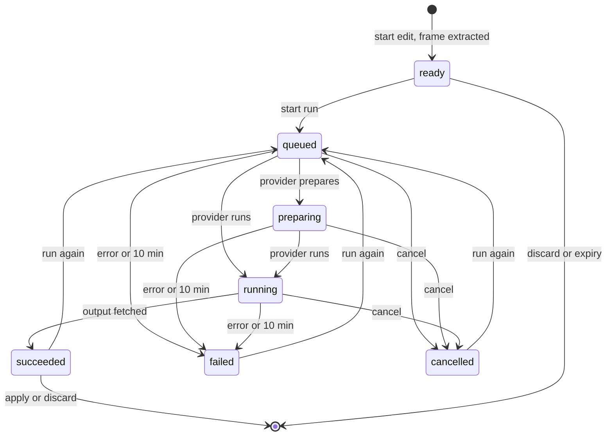

# Data model: Edit a video frame with ComfyUI and use it as the thumbnail

Parent Issue: #942.

The rest of the model is unchanged: the tables are canonical in
[internal/store/migrations/](../../internal/store/migrations/), and the
categories of tables are in
[running-vv.md, Data and recovery](../../docs/how-to/running-vv.md#data-and-recovery).
This file covers the table, the settings and the in-memory session this
feature adds.

## Migration

`00038_thumbnail_images.sql` (the last migration on `main` is
`00037_auto_tag_suggestions.sql`; the implementation takes the next free
number if another feature lands first). Up creates `thumbnail_images`; down
drops it.

## `thumbnail_images`

The image the owner applied as a video's thumbnail
([R-6](research.md#r-6-the-applied-image-is-user-data-in-sqlite-the-thumbnail-file-is-rebuilt-from-it)).
Non-rebuildable user data, keyed by content key with no foreign key to
`videos`, like `video_overrides`.

| Field | Type | Null | Meaning |
| --- | --- | --- | --- |
| `content_key` | text, primary key | No | The content the image belongs to |
| `image` | blob | No | The fitted JPEG ([R-7](research.md#r-7-the-generated-image-is-fitted-to-the-videos-frame-before-it-is-stored)), the same bytes as the published thumbnail file |
| `revision` | integer | No | Written on each apply by the rule of `video_overrides.thumbnail_revision` (the larger of now in ms and the previous value + 1) |
| `applied_at` | integer | No | Unix ms of the apply |

**Relationships**: None. The table is `without rowid`. Bundling and
succession leave it alone, as they leave `video_overrides`: a thumbnail
belongs to one content.

## Rules

| Rule | Enforced in |
| --- | --- |
| Applying writes the row, publishes the thumbnail file, sets `thumbnail_state` to `done` for every video with the content and clears its thumbnail scan issues, in that order inside the generation lock | `app.Ingest.ApplyThumbnailImage`, `OverrideStore` |
| Applying fails with `content_changed` when no video with the session's id has the session's content key | `app.Ingest.ApplyThumbnailImage` re-reads the video inside the lock |
| Setting a thumbnail position deletes the row | `OverrideStore.SetThumbnailPosition` in the same transaction |
| Reverting deletes the row and publishes a frame from `thumbnail_position_ms`, or by the automatic rule when it is null | `app.Ingest.RevertThumbnailImage` |
| The thumbnail job publishes the row's `image` when a row exists, and extracts a frame otherwise | `app.Ingest.Thumbnail` |
| `video_overrides` keeps its position while an image is applied | [R-10](research.md#r-10-apply-revert-and-the-position-override-are-ordered-by-the-generation-lock) |
| Every apply and revert publishes `domain.VideoOverrideChanged` and advances the video's edited time (`touchEditedAt`) | `OverrideStore` |
| No row has an empty `content_key` or an empty `image` | The writer; `internal/store/invariants_test.go` |

The table joins `running-vv.md`'s user-data row, and its translation follows
from `doc-translator`.

## Values added to `domain`

| Value | Content |
| --- | --- |
| `Video.ThumbnailImageRevision` | `int64`; 0 when no image is applied. The `thumbnailUrl` version becomes `<content key prefix>-g<revision>` when it is set, ahead of the position's `-r<revision>` |
| `ComfyUISettings` | `Provider` (`self_hosted` or `cloud`), `URL` (self-hosted only), `APIKey` (cloud only, never returned by the API) |
| `ThumbnailWorkflow` | The workflow JSON as registered, and its `Inputs` (`Prompt`, `Mask`, `Reference` booleans) found by [contracts/workflow.md](contracts/workflow.md) |
| `ParseThumbnailWorkflow([]byte) (ThumbnailWorkflow, error)` | The registration rule of contracts/workflow.md, as a pure function with one error value per reason |
| `ThumbnailEditState` | `ready`, `queued`, `preparing`, `running`, `succeeded`, `failed`, `cancelled` ([Edit session](#edit-session)) |

## Settings

Saved in `settings` ([00017_settings.sql](../../internal/store/migrations/00017_settings.sql)).

| Key | Value |
| --- | --- |
| `comfyui.provider` | `self_hosted` or `cloud`; absent until saved |
| `comfyui.url` | The self-hosted base URL, normalized like `ollama.endpoint` |
| `comfyui.api_key` | The Comfy Cloud key ([R-9](research.md#r-9-the-api-key-is-write-only)) |
| `comfyui.workflow` | The registered workflow JSON |

## Edit session

A session lives in memory in `app.ThumbnailEdits`, one per video
([R-4](research.md#r-4-an-edit-is-an-in-memory-session-per-video-read-by-polling)).

| Field | Meaning |
| --- | --- |
| `ID` | Random, 128 bits, the route key |
| `VideoID`, `ContentKey` | The video and its content when the session started |
| `Frame` | The extracted PNG and its size ([R-8](research.md#r-8-the-frame-is-extracted-by-the-server-at-up-to-2048-px)) |
| `Run` | The current run: the settings and workflow snapshot, the provider's job id, the state, `StartedAt`, the optional step progress, the error reason |
| `Result` | The output image of the last run that succeeded |
| `LastReadAt` | Updated on every read; 5 minutes without one ends the session |

The diagram shows a session's states and what moves it between them.

Any state ends on discard, on expiry, when a new edit of the same video
starts, and on a restart; a run in progress is cancelled at the provider first
([R-11](research.md#r-11-a-new-session-replaces-the-previous-one-a-run-is-limited-to-10-minutes)).
`failed` carries one reason: `unreachable`, `unauthorized`,
`insufficient_credits`, `workflow_rejected`, `run_failed`, `no_output` or
`timed_out`.

## What does not change

`video_overrides` keeps its columns: the applied image is a separate row, so
reverting returns to the chosen position. Seek sprites, card scrub frames and
hover previews keep coming from the file (the Issue's `対象外`).
