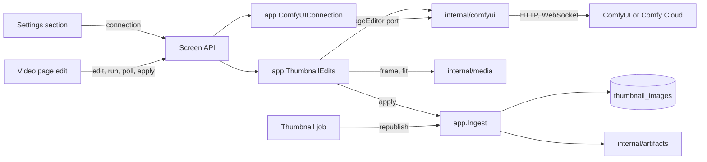
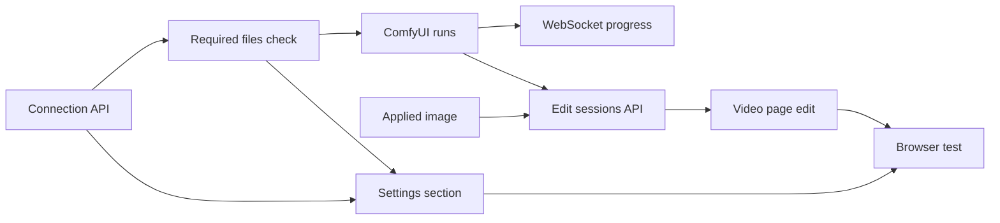

# Implementation Plan: Edit a video frame with ComfyUI and use it as the thumbnail

**Branch**: `feature/045-comfyui-thumbnails` | **Parent Issue**: #942

**Input**: The parent Issue. It is this feature's specification.

## Summary

The owner saves a ComfyUI connection (self-hosted or Comfy Cloud) in
Settings, then on the video page edits the current frame with text, a painted
mask and a reference image, watches the run, compares the result with the
frame, and applies it as the thumbnail. vv bundles the workflow and the model
(FLUX.2 [klein] 4B), tells a self-hosted owner which model files are missing,
holds each edit in memory for the page that started it, and keeps an applied
image as user data that the thumbnail job republishes after any rescan.

The diagram shows the parts this feature adds and what each one talks to.



| Concern | Approach |
| --- | --- |
| Provider | An `ImageEditor` port and one `internal/comfyui` adapter for both providers ([R-1](research.md#r-1-an-image-edit-port-in-internalapp-one-internalcomfyui-adapter-for-both-providers), [R-5](research.md#r-5-provider-differences-stay-inside-the-adapter)) |
| Workflow and model | Two bundled API-format workflows (with and without a reference) on FLUX.2 [klein] 4B fp8, inputs found by `vv:*` titles, absent inputs filled with neutral values ([R-2](research.md#r-2-vv-bundles-the-workflow-named-nodes-are-its-internal-contract), [R-3](research.md#r-3-absent-inputs-get-a-neutral-value-or-the-variant-without-the-node), [R-12](research.md#r-12-the-model-is-flux2-klein-4b-fp8), [contracts/workflow.md](contracts/workflow.md)) |
| Missing files | The connection test checks the workflows' nodes and model files through `/object_info` ([R-13](research.md#r-13-the-connection-test-checks-the-workflows-nodes-and-model-files)) |
| Edit and run | An in-memory session per video, polled by the page, ended by discard, expiry or a new edit; 10-minute run limit ([R-4](research.md#r-4-an-edit-is-an-in-memory-session-per-video-read-by-polling), [R-11](research.md#r-11-a-new-session-replaces-the-previous-one-a-run-is-limited-to-10-minutes)) |
| Frame | Extracted by the server at up to 2048 px ([R-8](research.md#r-8-the-frame-is-extracted-by-the-server-at-up-to-2048-px)) |
| Applied image | Fitted to the video's aspect, stored in `thumbnail_images`, republished by the thumbnail job ([R-6](research.md#r-6-the-applied-image-is-user-data-in-sqlite-the-thumbnail-file-is-rebuilt-from-it), [R-7](research.md#r-7-the-generated-image-is-fitted-to-the-videos-frame-before-it-is-stored)) |
| Ordering | Apply, revert and the position override share the generation lock ([R-10](research.md#r-10-apply-revert-and-the-position-override-are-ordered-by-the-generation-lock)) |
| API key | Write-only ([R-9](research.md#r-9-the-api-key-is-write-only)) |
| Routes | New owner-only routes for settings, edits and revert; the position override changed ([contracts/screen-api.md](contracts/screen-api.md)) |

The Issue has the `ui` label, so the `design` stage writes `ui-design.md`
before the two screen units: the ComfyUI section in Settings with the missing
files, the edit entry
next to the video page's thumbnail controls
([029 ui-design](../029-video-overrides/ui-design.md)), mask painting, the
run's states and failures, the comparison with apply, run again and discard,
and "use the frame instead".

Out of scope, as the parent Issue says: batch generation, shipping,
downloading or installing ComfyUI or model files, the owner's own workflows or
models and a choice of methods, replacing seek sprites, scrub frames
or hover previews, a history of generated images, other providers, uploading
an image made outside vv, and showing Comfy Cloud credits. The external API
and MCP do not gain these routes, because the Issue asks only for the screen.

## Technical Context

**Canonical definitions**:

| Topic | Source |
| --- | --- |
| Boundaries, dependency direction, user data, generated files, the authentication boundary | [ARCHITECTURE.md](../../ARCHITECTURE.md), [.golangci.yml](../../.golangci.yml) (depguard) |
| The AI layer's port-and-provider shape and connection settings | [ai-layer.md](../../docs/design-docs/ai-layer.md), [internal/app/ollama.go](../../internal/app/ollama.go), [internal/ollama](../../internal/ollama) |
| The thumbnail position override, the generation lock, `thumbnailUrl` | [029 research](../029-video-overrides/research.md), [029 data-model](../029-video-overrides/data-model.md), [internal/app/ingest.go](../../internal/app/ingest.go), [internal/store/overrides.go](../../internal/store/overrides.go) |
| Thumbnail files | [internal/artifacts/store.go](../../internal/artifacts/store.go), [internal/media/thumbnail.go](../../internal/media/thumbnail.go) |
| Settings storage | [00017_settings.sql](../../internal/store/migrations/00017_settings.sql), [internal/store/settings.go](../../internal/store/settings.go) |
| Screen API, errors, generated code | [api/openapi.yaml](../../api/openapi.yaml), [023 error-api](../023-english-i18n/contracts/error-api.md), `task generate` |
| Screens and Web tests | [design-system.md](../../docs/design-docs/design-system.md), [web-testing.md](../../docs/design-docs/web-testing.md), [i18n.md](../../docs/design-docs/i18n.md), [web/src/player/VideoFacts.tsx](../../web/src/player/VideoFacts.tsx), [web/src/settings/OllamaSection.tsx](../../web/src/settings/OllamaSection.tsx) |
| Checks | [Taskfile.yml](../../Taskfile.yml) (`task check`, `task check-docs`, `task test-e2e`) |

**Feature-specific context**:

- One migration, `00038_thumbnail_images.sql`
  ([data-model.md, Migration](data-model.md#migration)).
- One new Go dependency, `github.com/coder/websocket`
  ([R-5](research.md#r-5-provider-differences-stay-inside-the-adapter)); no
  new Web dependency.
- The first outbound credential vv stores
  ([R-9](research.md#r-9-the-api-key-is-write-only)).
- The first screen-API routes that take `multipart/form-data` and answer
  images that are not artifacts (the frame and the result).
- The e2e run starts a fake ComfyUI server; nothing in `web/e2e` fakes an
  outside service yet.
- The first JSON assets embedded in a Go adapter (the two workflows,
  [contracts/workflows/](contracts/workflows/)), whose model was chosen by a
  model POC on Comfy Cloud ([R-12](research.md#r-12-the-model-is-flux2-klein-4b-fp8)).

## Constitution Check

| Rule (source) | Verdict |
| --- | --- |
| Adapters import neither each other nor `internal/app`; `internal/app` imports no adapter (ARCHITECTURE.md, depguard) | Pass: `internal/comfyui` depends on `internal/domain` only and joins the adapter list in `.golangci.yml`; `internal/app` declares `ImageEditor` and the settings store interface |
| The domain decides, the store enforces (ARCHITECTURE.md) | Pass: settings normalization and the edit states are in `internal/domain`; the workflows and their check are the adapter's; the apply order is in `internal/app` under the existing lock |
| One owner for generated files (ARCHITECTURE.md) | Pass: thumbnail files are still placed only by `internal/artifacts`; the applied image is a row, not a file ([R-6](research.md#r-6-the-applied-image-is-user-data-in-sqlite-the-thumbnail-file-is-rebuilt-from-it)) |
| User data survives a rebuild (ARCHITECTURE.md) | Pass: `thumbnail_images` is keyed by content key with no foreign key, and joins the user-data list in ARCHITECTURE.md and running-vv.md |
| Events after commit (ARCHITECTURE.md) | Pass: apply and revert publish the existing `VideoOverrideChanged` after commit; edit sessions publish nothing ([R-4](research.md#r-4-an-edit-is-an-in-memory-session-per-video-read-by-polling)) |
| Every read knows its viewer (ARCHITECTURE.md) | Pass: every route is owner only; `thumbnailGenerated` is in owner responses only, and the `thumbnailUrl` version carries a revision, not owner data |
| No request to a URL from a request body (ai-layer.md) | Pass: the check and runs use the saved URL only |
| Do not hand-edit generated files (AGENTS.md) | Pass: `api/openapi.yaml` changes, then `task generate` |
| Dependency updates follow dependency-updates.md (AGENTS.md) | Pass: `github.com/coder/websocket` is added under its rules |
| Read design-system.md before a screen; test at the lowest level (AGENTS.md) | Pass: rules get domain tests, the adapter `httptest` fakes, the screens page tests, the flow one browser test |
| Documentation with the change (core-beliefs.md) | Pass: each unit names the document it updates |

No violation, so no complexity tracking. The verdicts hold after Phase 1.

## Project Structure

### Documentation (this feature)

```text
specs/045-comfyui-thumbnails/
├── plan.md
├── research.md
├── data-model.md
├── quickstart.md
└── contracts/
    ├── screen-api.md
    ├── workflow.md
    └── workflows/
        ├── thumbnail-edit.json
        └── thumbnail-edit-reference.json
```

`ui-design.md` is written by the `design` stage (the Issue has the `ui`
label). `quickstart.md` exists because the automated checks run against a fake
ComfyUI only. `contracts/workflow.md` and the two workflow files are the
source until the files move into `internal/comfyui`; the owner-facing part
(what a self-hosted ComfyUI needs) moves to the how-to below.

### Source Code

**Affected boundaries**:

| Boundary | What it owns in this feature |
| --- | --- |
| `internal/domain` | `ComfyUISettings`, the edit states and failure reasons, `Video.ThumbnailImageRevision` |
| `internal/comfyui` (new) | The provider adapter: the embedded workflows, connection test with the required-files check, uploads, runs, states, cancel, output, WebSocket progress |
| `internal/media` | `FrameAt` (PNG up to 2048 px) and `FitThumbnailImage` (fit to an aspect, JPEG) |
| `internal/store` | The migration, the `comfyui.*` settings, `thumbnail_images` reads and writes, the join for `ThumbnailImageRevision` |
| `internal/app` | `ComfyUIConnection`, `ThumbnailEdits`, `Ingest.ApplyThumbnailImage`, `Ingest.RevertThumbnailImage`, the thumbnail job's republish |
| `internal/httpapi`, `api/openapi.yaml`, `cmd/mdm` | The routes, the multipart and image responses, the wiring |
| `web/src/api`, `web/src/settings`, `web/src/player`, `web/src/i18n` | The client functions, the Settings section, the edit on the video page, the catalog text |
| `web/e2e` | The fake ComfyUI and the browser test |
| `docs/` | `ai-layer.md`, a new `docs/design-docs/thumbnail-editing.md`, a new `docs/how-to/comfyui-thumbnails.md`, `running-vv.md`, ARCHITECTURE.md |

**New paths**: `internal/comfyui/` (with `internal/comfyui/workflows/`),
`internal/domain/comfyui.go`,
`internal/app/comfyui.go`, `internal/app/thumbnail_edits.go`,
`internal/store/thumbnail_images.go`,
`internal/store/migrations/00038_thumbnail_images.sql`,
`internal/httpapi/comfyui.go`, `internal/httpapi/thumbnail_edits.go`,
`web/src/settings/ComfyUISection.tsx`, `web/src/player/thumbnailEdit/`,
`web/e2e/fake-comfyui.mjs`, `web/e2e/thumbnail-edit.e2e.ts`.

**Structure decision**: The edit on the video page is its own directory under
`web/src/player/`, because the mask canvas, the run panel and the comparison
are one flow that `VideoFacts` only opens. The fake ComfyUI serves the
self-hosted routes from contracts/workflow.md, including `/object_info`, so
the browser test exercises the real adapter.

## Implementation Work

The diagram shows which units have to land first. The two screen units also
wait for the `design` stage's `ui-design.md`.



### Save and test a ComfyUI connection through the screen API

**Scope**: `ComfyUISettings` and its normalization, the `comfyui.provider`,
`comfyui.url` and `comfyui.api_key` settings, `app.ComfyUIConnection`, the new
`internal/comfyui` package with its connection test for both providers,
`GET`/`PUT /api/settings/comfyui` and `POST /api/settings/comfyui/check`, the
client functions, the depguard entry, the ARCHITECTURE.md subsystem map and an
"Image-edit provider" section in ai-layer.md
([contracts/screen-api.md](contracts/screen-api.md#get-apisettingscomfyui-put-apisettingscomfyui),
[R-1](research.md#r-1-an-image-edit-port-in-internalapp-one-internalcomfyui-adapter-for-both-providers),
[R-9](research.md#r-9-the-api-key-is-write-only)).

**Dependencies**: None.

**Acceptance**: `task check` and `task check-docs` pass with no diff from
`task generate`; handler tests show a saved key is answered as
`apiKeySet: true` and never in a body, a `PUT` without `apiKey` keeps it and
`""` clears it, and each `400` reason of the contract; adapter tests against
`httptest` servers show the check is available for a self-hosted
`/system_stats`, and unavailable with a distinct message for a refused
connection, a non-ComfyUI reply, a Cloud `401`, and nothing saved; a guest
gets `401` on each route and
`TestAccessClassificationMatchesOpenAPISecurity` passes.

### Embed the workflows and report missing nodes and model files

**Scope**: The two workflows of [contracts/workflows/](contracts/workflows/)
moved into `internal/comfyui/workflows/` and embedded, a test that each has
the `vv:*` titles of [contracts/workflow.md](contracts/workflow.md#workflows),
the required-files check of the connection test through `/object_info` with
the `missing` list and its sources, `GET /api/thumbnail-edits/readiness`, the
client functions, and `docs/how-to/comfyui-thumbnails.md` for the owner (the
files a self-hosted ComfyUI needs and where they go, the Comfy Cloud key)
([R-12](research.md#r-12-the-model-is-flux2-klein-4b-fp8), [R-13](research.md#r-13-the-connection-test-checks-the-workflows-nodes-and-model-files),
[contracts/screen-api.md](contracts/screen-api.md#post-apisettingscomfyuicheck)).

**Dependencies**: Save and test a ComfyUI connection through the screen API.

**Acceptance**: `task check` and `task check-docs` pass with no diff from
`task generate`; adapter tests against `httptest` fakes of `/object_info`
show available when every node and file is listed, a `model` item with its
folder and source for each file a loader lacks, a `node` item for each
missing `class_type`, and the same check on Comfy Cloud's route; handler tests
show `readiness` answering `connection` before and after a save.

### Add the ComfyUI connection to Settings

**Scope**: A ComfyUI section in Settings: provider choice, URL or API key
(the key field shows only that a key is saved), save, test with its result
and the missing nodes and files with their folders and sources, the catalog
text, and a docs link to the how-to; layout and wording follow
`ui-design.md`.

**Dependencies**: Save and test a ComfyUI connection through the screen API;
Embed the workflows and report missing nodes and model files.

**Acceptance**: `task check` passes; page tests show the key is never put
into the field after a save, the test result and its message, and each
missing item with its folder and source; the screen change gets a visual
review against design-system.md.

### Keep an applied thumbnail image across rescans and let the owner revert it

**Scope**: `00038_thumbnail_images.sql` and its store operations,
`FitThumbnailImage` in `internal/media`, `Ingest.ApplyThumbnailImage` and
`Ingest.RevertThumbnailImage`, the thumbnail job's republish from the row,
the position override deleting the row, `thumbnailGenerated` and the
`thumbnailUrl` version, `DELETE /api/videos/{id}/thumbnail-image` and its
client function, and the user-data lists in ARCHITECTURE.md and running-vv.md
([data-model.md](data-model.md),
[R-6](research.md#r-6-the-applied-image-is-user-data-in-sqlite-the-thumbnail-file-is-rebuilt-from-it),
[R-7](research.md#r-7-the-generated-image-is-fitted-to-the-videos-frame-before-it-is-stored),
[R-10](research.md#r-10-apply-revert-and-the-position-override-are-ordered-by-the-generation-lock)).

**Dependencies**: None.

**Acceptance**: `task check` and `task check-docs` pass; media tests show a
1:1 PNG fitted for a 16:9 video comes out 640×360 and one for a video of
unknown size keeps 1:1; app and store tests show: after apply, the thumbnail
file holds the row's bytes and `thumbnailUrl` changes; after the video row is
removed and the content scanned again, the thumbnail job publishes the same
bytes; apply for a content key no video has answers `content_changed` and
writes nothing; a position set after apply removes the row and the file is that
frame; revert after a position returns to that position's frame, and without
one to the automatic frame; an apply that waits on the lock behind a position
change still wins; a publish that fails during apply or revert leaves the
row, `thumbnailUrl` and the file unchanged, and a store write that fails
after publishing restores the previous file.

### Run a thumbnail workflow on ComfyUI and Comfy Cloud

**Scope**: The `ImageEditor` port in `internal/app` and its `internal/comfyui`
implementation for both providers: uploads, the workflow variant with `vv:*`
inputs, neutral values and the default instruction, submit, the state
mapping, cancel, the output fetch (Cloud's redirect without the key), and the
failure reasons; the default instruction's wording is settled with the
quickstart step on Comfy Cloud
([contracts/workflow.md, Run, Run states and Failure reasons](contracts/workflow.md#run),
[R-3](research.md#r-3-absent-inputs-get-a-neutral-value-or-the-variant-without-the-node),
[R-5](research.md#r-5-provider-differences-stay-inside-the-adapter)).

**Dependencies**: Embed the workflows and report missing nodes and model files.

**Acceptance**: `task check` passes; adapter tests against `httptest` fakes of
each provider show: the submitted prompt is the embedded variant with only
the `vv:*` inputs changed; a run with a reference uses the reference variant
and one without it the other; an absent mask uploads an all-white PNG of the
frame's size; a painted mask with an empty instruction sends the default
instruction; every row of the Run states table maps to its
vv state; cancel while queued deletes from the queue and while running
interrupts (self-hosted) or sends `POST /interrupt` (Cloud); Cloud's output is fetched from the redirect without
`X-API-Key`; each row of the Failure reasons table is produced from its
provider reply.

### Report step progress from the ComfyUI WebSocket

**Scope**: The adapter's WebSocket client on `github.com/coder/websocket` for
both providers, filtering `progress` messages by `prompt_id`, and the
dependency's entry under dependency-updates.md
([R-5](research.md#r-5-provider-differences-stay-inside-the-adapter)).

**Dependencies**: Run a thumbnail workflow on ComfyUI and Comfy Cloud.

**Acceptance**: `task check` passes; adapter tests show a fake's `progress`
messages for the run's id appear as `value` of `max`, messages for another id
are ignored, and a WebSocket that refuses the connection leaves the progress
absent while the run still reaches `succeeded`.

### Serve thumbnail edit sessions on the screen API

**Scope**: `app.ThumbnailEdits` (sessions, snapshot, polling expiry, the
10-minute limit, replacement), `FrameAt` in `internal/media`, the
`/api/videos/{id}/thumbnail-edits` and `/api/thumbnail-edits/{editId}…`
routes with the multipart input and the image responses, apply through
`Ingest.ApplyThumbnailImage`, the client functions, and
`docs/design-docs/thumbnail-editing.md` linked from the design-docs index
([contracts/screen-api.md](contracts/screen-api.md),
[data-model.md, Edit session](data-model.md#edit-session),
[R-4](research.md#r-4-an-edit-is-an-in-memory-session-per-video-read-by-polling),
[R-8](research.md#r-8-the-frame-is-extracted-by-the-server-at-up-to-2048-px),
[R-11](research.md#r-11-a-new-session-replaces-the-previous-one-a-run-is-limited-to-10-minutes)).

**Dependencies**: Keep an applied thumbnail image across rescans and let the
owner revert it; Run a thumbnail workflow on ComfyUI and Comfy Cloud.

**Acceptance**: `task check` and `task check-docs` pass with no diff from
`task generate`; app tests with a fake `ImageEditor` and a fake clock show:
every transition of the Edit session diagram; a session not read for 5
minutes is cancelled at the provider and answers `404`; a run past 10 minutes
fails as `timed_out`; a second edit of the same video cancels the first's run;
a connection changed during a run does not change the run's snapshot;
handler tests show each status of the contract, a mask of the wrong size
answers `400` before anything is uploaded, and a guest
gets `401` on each route.

### Edit the thumbnail from the video page

**Scope**: The entry next to the thumbnail controls (disabled with the reason
when no connection is saved, absent for a guest), the edit view with the
frame, mask painting, the reference image, the prompt, the run state with
elapsed time and progress, cancel, the side-by-side comparison with apply,
run again and discard, discard on unmount, and "use the frame instead" while
`thumbnailGenerated`; the catalog text; layout and interaction follow
`ui-design.md`.

**Dependencies**: Serve thumbnail edit sessions on the screen API.

**Acceptance**: `task check` passes; page tests show the entry disabled with
the Settings reason without a connection, the state label changing from
queued to preparing to running with the elapsed time, a progress bar only when
`progress` is present, the failure reason's text, the result next to the
frame, and that leaving the page calls discard; the screen change gets a
visual review against design-system.md at phone width.

### Cover thumbnail editing in a browser test with a fake ComfyUI

**Scope**: `web/e2e/fake-comfyui.mjs`, a self-hosted ComfyUI fake that
answers `/object_info` with the required nodes and files, records the
submitted prompt and answers a fixed image after a delay, started
by `run-e2e.mjs`, and `web/e2e/thumbnail-edit.e2e.ts`.

**Dependencies**: Add the ComfyUI connection to Settings; Edit the thumbnail
from the video page.

**Acceptance**: `task test-e2e -- e2e/thumbnail-edit.e2e.ts` passes, showing:
the owner saves the fake as the connection, tests it, paints a mask, runs, sees the state change, applies; the library card and
the video page show the fake's image after a reload and after a full scan;
"use the frame instead" restores the frame; a cancel and a discard leave the
thumbnail unchanged; a guest sees no entry.
