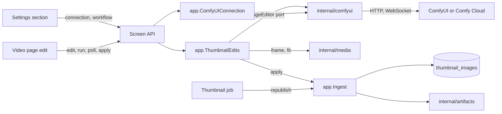
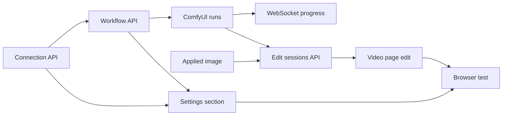

# Implementation Plan: Edit a video frame with ComfyUI and use it as the thumbnail

**Branch**: `feature/045-comfyui-thumbnails` | **Parent Issue**: #942

**Input**: The parent Issue. It is this feature's specification.

## Summary

The owner saves a ComfyUI connection (self-hosted or Comfy Cloud) and one
workflow in Settings, then on the video page edits the current frame with
text, a painted mask and a reference image, watches the run, compares the
result with the frame, and applies it as the thumbnail. vv drives the owner's
workflow through nodes titled `vv:*`, holds each edit in memory for the page
that started it, and keeps an applied image as user data that the thumbnail
job republishes after any rescan.

The diagram shows the parts this feature adds and what each one talks to.



| Concern | Approach |
| --- | --- |
| Provider | An `ImageEditor` port and one `internal/comfyui` adapter for both providers ([R-1](research.md#r-1-an-image-edit-port-in-internalapp-one-internalcomfyui-adapter-for-both-providers), [R-5](research.md#r-5-provider-differences-stay-inside-the-adapter)) |
| Workflow | The owner's API-format workflow, inputs and output found by `vv:*` titles, absent inputs filled with neutral values ([R-2](research.md#r-2-named-nodes-in-the-owners-api-format-workflow-are-the-whole-contract), [R-3](research.md#r-3-absent-optional-inputs-get-a-neutral-value), [contracts/workflow.md](contracts/workflow.md)) |
| Edit and run | An in-memory session per video, polled by the page, ended by discard, expiry or a new edit; 10-minute run limit ([R-4](research.md#r-4-an-edit-is-an-in-memory-session-per-video-read-by-polling), [R-11](research.md#r-11-a-new-session-replaces-the-previous-one-a-run-is-limited-to-10-minutes)) |
| Frame | Extracted by the server at up to 2048 px ([R-8](research.md#r-8-the-frame-is-extracted-by-the-server-at-up-to-2048-px)) |
| Applied image | Fitted to the video's aspect, stored in `thumbnail_images`, republished by the thumbnail job ([R-6](research.md#r-6-the-applied-image-is-user-data-in-sqlite-the-thumbnail-file-is-rebuilt-from-it), [R-7](research.md#r-7-the-generated-image-is-fitted-to-the-videos-frame-before-it-is-stored)) |
| Ordering | Apply, revert and the position override share the generation lock ([R-10](research.md#r-10-apply-revert-and-the-position-override-are-ordered-by-the-generation-lock)) |
| API key | Write-only ([R-9](research.md#r-9-the-api-key-is-write-only)) |
| Routes | New owner-only routes for settings, edits and revert; the position override changed ([contracts/screen-api.md](contracts/screen-api.md)) |

The Issue has no `ui` label, so no `design` stage runs: the two screen units
build from the design system and the video page's existing thumbnail controls
([029 ui-design](../029-video-overrides/ui-design.md)), and each owes a visual
review.

Out of scope, as the parent Issue says: batch generation, shipping or
installing ComfyUI, models or workflows, replacing seek sprites, scrub frames
or hover previews, a history of generated images, other providers, uploading
an image made outside vv, and showing Comfy Cloud credits. The external API
and MCP do not gain these routes, because the Issue asks only for the screen.

## Technical Context

**Canonical definitions**:

| Topic | Source |
| --- | --- |
| Boundaries, dependency direction, user data, generated files, the authentication boundary | [ARCHITECTURE.md](../../ARCHITECTURE.md), [.golangci.yml](../../.golangci.yml) (depguard) |
| The AI layer's port-and-provider shape and connection settings | [ai-layer.md](../../docs/design-docs/ai-layer.md), [internal/app/ollama.go](../../internal/app/ollama.go), [internal/ollama](../../internal/ollama) |
| The thumbnail position override, the generation lock, `thumbnailUrl` | [029 research](../029-video-overrides/research.md), [029 data-model](../029-video-overrides/data-model.md), [internal/app/ingest.go](../../internal/app/ingest.go), [internal/store/overrides.go](../../internal/store/overrides.go) |
| Thumbnail files | [internal/artifacts/store.go](../../internal/artifacts/store.go), [internal/media/thumbnail.go](../../internal/media/thumbnail.go) |
| Settings storage | [00017_settings.sql](../../internal/store/migrations/00017_settings.sql), [internal/store/settings.go](../../internal/store/settings.go) |
| Screen API, errors, generated code | [api/openapi.yaml](../../api/openapi.yaml), [023 error-api](../023-english-i18n/contracts/error-api.md), `task generate` |
| Screens and Web tests | [design-system.md](../../docs/design-docs/design-system.md), [web-testing.md](../../docs/design-docs/web-testing.md), [i18n.md](../../docs/design-docs/i18n.md), [web/src/player/VideoFacts.tsx](../../web/src/player/VideoFacts.tsx), [web/src/settings/OllamaSection.tsx](../../web/src/settings/OllamaSection.tsx) |
| Checks | [Taskfile.yml](../../Taskfile.yml) (`task check`, `task check-docs`, `task test-e2e`) |

**Feature-specific context**:

- One migration, `00038_thumbnail_images.sql`
  ([data-model.md, Migration](data-model.md#migration)).
- One new Go dependency, `github.com/coder/websocket`
  ([R-5](research.md#r-5-provider-differences-stay-inside-the-adapter)); no
  new Web dependency.
- The first outbound credential vv stores
  ([R-9](research.md#r-9-the-api-key-is-write-only)).
- The first screen-API routes that take `multipart/form-data` and answer
  images that are not artifacts (the frame and the result).
- The e2e run starts a fake ComfyUI server; nothing in `web/e2e` fakes an
  outside service yet.

## Constitution Check

| Rule (source) | Verdict |
| --- | --- |
| Adapters import neither each other nor `internal/app`; `internal/app` imports no adapter (ARCHITECTURE.md, depguard) | Pass: `internal/comfyui` depends on `internal/domain` only and joins the adapter list in `.golangci.yml`; `internal/app` declares `ImageEditor` and the settings store interface |
| The domain decides, the store enforces (ARCHITECTURE.md) | Pass: the workflow rule and settings normalization are pure functions in `internal/domain`; the apply order is in `internal/app` under the existing lock |
| One owner for generated files (ARCHITECTURE.md) | Pass: thumbnail files are still placed only by `internal/artifacts`; the applied image is a row, not a file ([R-6](research.md#r-6-the-applied-image-is-user-data-in-sqlite-the-thumbnail-file-is-rebuilt-from-it)) |
| User data survives a rebuild (ARCHITECTURE.md) | Pass: `thumbnail_images` is keyed by content key with no foreign key, and joins the user-data list in ARCHITECTURE.md and running-vv.md |
| Events after commit (ARCHITECTURE.md) | Pass: apply and revert publish the existing `VideoOverrideChanged` after commit; edit sessions publish nothing ([R-4](research.md#r-4-an-edit-is-an-in-memory-session-per-video-read-by-polling)) |
| Every read knows its viewer (ARCHITECTURE.md) | Pass: every route is owner only; `thumbnailGenerated` is in owner responses only, and the `thumbnailUrl` version carries a revision, not owner data |
| No request to a URL from a request body (ai-layer.md) | Pass: the check and runs use the saved URL only |
| Do not hand-edit generated files (AGENTS.md) | Pass: `api/openapi.yaml` changes, then `task generate` |
| Dependency updates follow dependency-updates.md (AGENTS.md) | Pass: `github.com/coder/websocket` is added under its rules |
| Read design-system.md before a screen; test at the lowest level (AGENTS.md) | Pass: rules get domain tests, the adapter `httptest` fakes, the screens page tests, the flow one browser test |
| Documentation with the change (core-beliefs.md) | Pass: each unit names the document it updates |

No violation, so no complexity tracking. The verdicts hold after Phase 1.

## Project Structure

### Documentation (this feature)

```text
specs/045-comfyui-thumbnails/
├── plan.md
├── research.md
├── data-model.md
├── quickstart.md
└── contracts/
    ├── screen-api.md
    └── workflow.md
```

`quickstart.md` exists because the automated checks run against a fake
ComfyUI only. `contracts/workflow.md` is the owner-facing workflow contract
until the how-to below takes it over.

### Source Code

**Affected boundaries**:

| Boundary | What it owns in this feature |
| --- | --- |
| `internal/domain` | `ComfyUISettings`, `ThumbnailWorkflow` and its parser, the edit states and failure reasons, `Video.ThumbnailImageRevision` |
| `internal/comfyui` (new) | The provider adapter: connection test, uploads, runs, states, cancel, output, WebSocket progress |
| `internal/media` | `FrameAt` (PNG up to 2048 px) and `FitThumbnailImage` (fit to an aspect, JPEG) |
| `internal/store` | The migration, the `comfyui.*` settings, `thumbnail_images` reads and writes, the join for `ThumbnailImageRevision` |
| `internal/app` | `ComfyUIConnection`, `ThumbnailEdits`, `Ingest.ApplyThumbnailImage`, `Ingest.RevertThumbnailImage`, the thumbnail job's republish |
| `internal/httpapi`, `api/openapi.yaml`, `cmd/mdm` | The routes, the multipart and image responses, the wiring |
| `web/src/api`, `web/src/settings`, `web/src/player`, `web/src/i18n` | The client functions, the Settings section, the edit on the video page, the catalog text |
| `web/e2e` | The fake ComfyUI and the browser test |
| `docs/` | `ai-layer.md`, a new `docs/design-docs/thumbnail-editing.md`, a new `docs/how-to/comfyui-thumbnails.md`, `running-vv.md`, ARCHITECTURE.md |

**New paths**: `internal/comfyui/`, `internal/domain/comfyui.go`,
`internal/app/comfyui.go`, `internal/app/thumbnail_edits.go`,
`internal/store/thumbnail_images.go`,
`internal/store/migrations/00038_thumbnail_images.sql`,
`internal/httpapi/comfyui.go`, `internal/httpapi/thumbnail_edits.go`,
`web/src/settings/ComfyUISection.tsx`, `web/src/player/thumbnailEdit/`,
`web/e2e/fake-comfyui.mjs`, `web/e2e/thumbnail-edit.e2e.ts`.

**Structure decision**: The edit on the video page is its own directory under
`web/src/player/`, because the mask canvas, the run panel and the comparison
are one flow that `VideoFacts` only opens. The fake ComfyUI serves the
self-hosted routes from contracts/workflow.md, so the browser test exercises
the real adapter.

## Implementation Work

The diagram shows which units have to land first.



### Save and test a ComfyUI connection through the screen API

**Scope**: `ComfyUISettings` and its normalization, the `comfyui.provider`,
`comfyui.url` and `comfyui.api_key` settings, `app.ComfyUIConnection`, the new
`internal/comfyui` package with its connection test for both providers,
`GET`/`PUT /api/settings/comfyui` and `POST /api/settings/comfyui/check`, the
client functions, the depguard entry, the ARCHITECTURE.md subsystem map and an
"Image-edit provider" section in ai-layer.md
([contracts/screen-api.md](contracts/screen-api.md#get-apisettingscomfyui-put-apisettingscomfyui),
[R-1](research.md#r-1-an-image-edit-port-in-internalapp-one-internalcomfyui-adapter-for-both-providers),
[R-9](research.md#r-9-the-api-key-is-write-only)).

**Dependencies**: None.

**Acceptance**: `task check` and `task check-docs` pass with no diff from
`task generate`; handler tests show a saved key is answered as
`apiKeySet: true` and never in a body, a `PUT` without `apiKey` keeps it and
`""` clears it, and each `400` reason of the contract; adapter tests against
`httptest` servers show the check is available for a self-hosted
`/system_stats`, and unavailable with a distinct message for a refused
connection, a non-ComfyUI reply, a Cloud `401`, and nothing saved; a guest
gets `401` on each route and
`TestAccessClassificationMatchesOpenAPISecurity` passes.

### Register a thumbnail workflow with nodes titled vv

**Scope**: `ThumbnailWorkflow` and `ParseThumbnailWorkflow`, the
`comfyui.workflow` setting, `GET`/`PUT`/`DELETE /api/settings/comfyui/workflow`
and `GET /api/thumbnail-edits/readiness`, the client functions, and
`docs/how-to/comfyui-thumbnails.md` written from
[contracts/workflow.md, Workflow format and Registration](contracts/workflow.md#workflow-format)
for the owner.

**Dependencies**: Save and test a ComfyUI connection through the screen API.

**Acceptance**: `task check` and `task check-docs` pass; domain tests cover
every row of the Registration table and report `prompt`, `mask` and
`reference` for a workflow with all five titles and none for one with only
`vv:frame` and `vv:output`; handler tests show `413` over 1 MiB, `404`
before registration, `204` on delete, and `readiness` answering
`connection` and `workflow` for each of the four combinations.

### Add the ComfyUI connection and workflow to Settings

**Scope**: A ComfyUI section in Settings: provider choice, URL or API key
(the key field shows only that a key is saved), save, test with its result,
workflow file upload with the inputs it takes, removal, the catalog text, and
a docs link to the how-to.

**Dependencies**: Save and test a ComfyUI connection through the screen API;
Register a thumbnail workflow with nodes titled vv.

**Acceptance**: `task check` passes; page tests show the key is never put
into the field after a save, the test result and its message, a rejected
workflow's reason, and the optional inputs after a registration; the screen
change gets a visual review against design-system.md in both themes.

### Keep an applied thumbnail image across rescans and let the owner revert it

**Scope**: `00038_thumbnail_images.sql` and its store operations,
`FitThumbnailImage` in `internal/media`, `Ingest.ApplyThumbnailImage` and
`Ingest.RevertThumbnailImage`, the thumbnail job's republish from the row,
the position override deleting the row, `thumbnailGenerated` and the
`thumbnailUrl` version, `DELETE /api/videos/{id}/thumbnail-image` and its
client function, and the user-data lists in ARCHITECTURE.md and running-vv.md
([data-model.md](data-model.md),
[R-6](research.md#r-6-the-applied-image-is-user-data-in-sqlite-the-thumbnail-file-is-rebuilt-from-it),
[R-7](research.md#r-7-the-generated-image-is-fitted-to-the-videos-frame-before-it-is-stored),
[R-10](research.md#r-10-apply-revert-and-the-position-override-are-ordered-by-the-generation-lock)).

**Dependencies**: None.

**Acceptance**: `task check` and `task check-docs` pass; media tests show a
1:1 PNG fitted for a 16:9 video comes out 640×360 and one for a video of
unknown size keeps 1:1; app and store tests show: after apply, the thumbnail
file holds the row's bytes and `thumbnailUrl` changes; after the video row is
removed and the content scanned again, the thumbnail job publishes the same
bytes; apply for a content key no video has answers `content_changed` and
writes nothing; a position set after apply removes the row and the file is that
frame; revert after a position returns to that position's frame, and without
one to the automatic frame; an apply that waits on the lock behind a position
change still wins.

### Run a thumbnail workflow on ComfyUI and Comfy Cloud

**Scope**: The `ImageEditor` port in `internal/app` and its `internal/comfyui`
implementation for both providers: uploads, the workflow with `vv:*` inputs
and neutral values, submit, the state mapping, cancel, the output fetch
(Cloud's redirect without the key), and the failure reasons
([contracts/workflow.md, Run, Run states and Failure reasons](contracts/workflow.md#run),
[R-3](research.md#r-3-absent-optional-inputs-get-a-neutral-value),
[R-5](research.md#r-5-provider-differences-stay-inside-the-adapter)).

**Dependencies**: Register a thumbnail workflow with nodes titled vv.

**Acceptance**: `task check` passes; adapter tests against `httptest` fakes of
each provider show: the submitted prompt has only the `vv:*` inputs changed;
an absent mask uploads an all-white PNG of the frame's size and an absent
reference uploads the frame; every row of the Run states table maps to its
vv state; cancel while queued deletes from the queue and while running
interrupts (self-hosted); Cloud's output is fetched from the redirect without
`X-API-Key`; each row of the Failure reasons table is produced from its
provider reply.

### Report step progress from the ComfyUI WebSocket

**Scope**: The adapter's WebSocket client on `github.com/coder/websocket` for
both providers, filtering `progress` messages by `prompt_id`, and the
dependency's entry under dependency-updates.md
([R-5](research.md#r-5-provider-differences-stay-inside-the-adapter)).

**Dependencies**: Run a thumbnail workflow on ComfyUI and Comfy Cloud.

**Acceptance**: `task check` passes; adapter tests show a fake's `progress`
messages for the run's id appear as `value` of `max`, messages for another id
are ignored, and a WebSocket that refuses the connection leaves the progress
absent while the run still reaches `succeeded`.

### Serve thumbnail edit sessions on the screen API

**Scope**: `app.ThumbnailEdits` (sessions, snapshot, polling expiry, the
10-minute limit, replacement), `FrameAt` in `internal/media`, the
`/api/videos/{id}/thumbnail-edits` and `/api/thumbnail-edits/{editId}…`
routes with the multipart input and the image responses, apply through
`Ingest.ApplyThumbnailImage`, the client functions, and
`docs/design-docs/thumbnail-editing.md` linked from the design-docs index
([contracts/screen-api.md](contracts/screen-api.md),
[data-model.md, Edit session](data-model.md#edit-session),
[R-4](research.md#r-4-an-edit-is-an-in-memory-session-per-video-read-by-polling),
[R-8](research.md#r-8-the-frame-is-extracted-by-the-server-at-up-to-2048-px),
[R-11](research.md#r-11-a-new-session-replaces-the-previous-one-a-run-is-limited-to-10-minutes)).

**Dependencies**: Keep an applied thumbnail image across rescans and let the
owner revert it; Run a thumbnail workflow on ComfyUI and Comfy Cloud.

**Acceptance**: `task check` and `task check-docs` pass with no diff from
`task generate`; app tests with a fake `ImageEditor` and a fake clock show:
every transition of the Edit session diagram; a session not read for 5
minutes is cancelled at the provider and answers `404`; a run past 10 minutes
fails as `timed_out`; a second edit of the same video cancels the first's run;
settings changed during a run do not change the run's snapshot; handler tests
show each status of the contract, a mask of the wrong size and a part the
workflow cannot take answer `400` before anything is uploaded, and a guest
gets `401` on each route.

### Edit the thumbnail from the video page

**Scope**: The entry next to the thumbnail controls (disabled with the reason
when `readiness` is not complete, absent for a guest), the edit view with the
frame, mask painting, the reference image, the prompt, the run state with
elapsed time and progress, cancel, the side-by-side comparison with apply,
run again and discard, discard on unmount, and "use the frame instead" while
`thumbnailGenerated`; the catalog text.

**Dependencies**: Serve thumbnail edit sessions on the screen API.

**Acceptance**: `task check` passes; page tests show the entry disabled with
the Settings reason for each incomplete `readiness`, painting and the
reference disabled when `inputs` lacks them, the state label changing from
queued to preparing to running with the elapsed time, a progress bar only when
`progress` is present, the failure reason's text, the result next to the
frame, and that leaving the page calls discard; the screen change gets a
visual review against design-system.md in both themes and at phone width.

### Cover thumbnail editing in a browser test with a fake ComfyUI

**Scope**: `web/e2e/fake-comfyui.mjs`, a self-hosted ComfyUI fake that
records the submitted prompt and answers a fixed image after a delay, started
by `run-e2e.mjs`, and `web/e2e/thumbnail-edit.e2e.ts`.

**Dependencies**: Add the ComfyUI connection and workflow to Settings; Edit
the thumbnail from the video page.

**Acceptance**: `task test-e2e -- e2e/thumbnail-edit.e2e.ts` passes, showing:
the owner saves the fake as the connection, tests it, registers a workflow,
paints a mask, runs, sees the state change, applies; the library card and
the video page show the fake's image after a reload and after a full scan;
"use the frame instead" restores the frame; a cancel and a discard leave the
thumbnail unchanged; a guest sees no entry.
