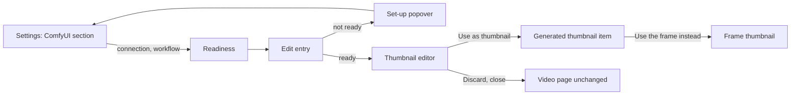
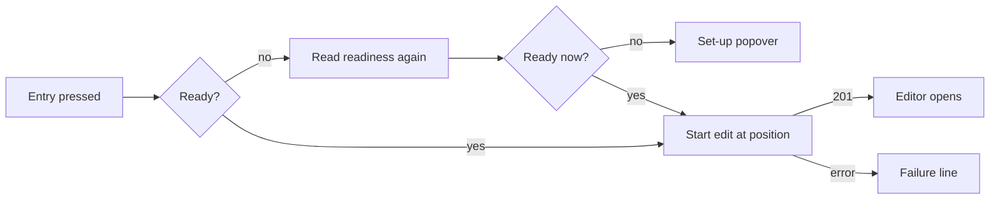
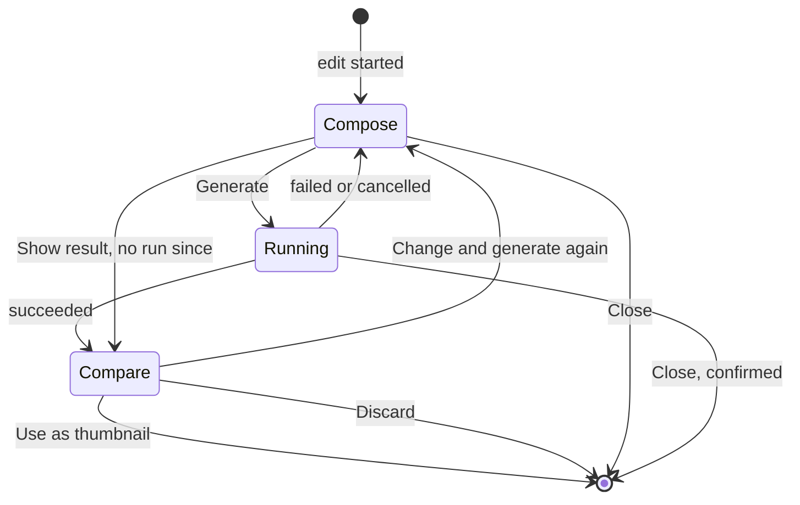

# UI design: Editing a video frame with ComfyUI into the thumbnail

**Feature**: [parent Issue #942](https://github.com/syudead/vv/issues/942) ·
[plan.md](plan.md) · [contracts/screen-api.md](contracts/screen-api.md) ·
[contracts/workflow.md](contracts/workflow.md) ·
[data-model.md, Edit session](data-model.md#edit-session) ·
[research.md R-3](research.md#r-3-absent-optional-inputs-get-a-neutral-value) ·
[R-4](research.md#r-4-an-edit-is-an-in-memory-session-per-video-read-by-polling) ·
[R-7](research.md#r-7-the-generated-image-is-fitted-to-the-videos-frame-before-it-is-stored) ·
[R-9](research.md#r-9-the-api-key-is-write-only) ·
[R-10](research.md#r-10-apply-revert-and-the-position-override-are-ordered-by-the-generation-lock)

Sources that already decide things, linked rather than repeated here:

| Topic | Source |
| --- | --- |
| Tokens, closed scales, video-page density | [design-system.md, Foundations](../../docs/design-docs/design-system.md#foundations); the values in `@theme` of [`web/src/ui/tokens.css`](../../web/src/ui/tokens.css), named here and never copied |
| One dark scheme, no light set | [library-ui.md, Dark scheme only](../../docs/design-docs/library-ui.md#dark-scheme-only-without-a-lightdark-switch) |
| `SettingsPage`, `PageSection`, `FormRow`, `Dialog`, `ConfirmDialog` | [patterns.md](../../web/registry/rules/patterns.md) |
| `Button`, `Textarea`, `RadioGroup`, `ToggleGroup`, `Slider`, `Popover`, `Tooltip`, `Alert`, `Progress`, `Spinner`, `Skeleton` | [components.md](../../web/registry/rules/components.md) |
| The Ollama section: Save, Save and test connection, the test result lines | [`OllamaSection.tsx`](../../web/src/settings/OllamaSection.tsx) |
| A provider choice as a `RadioGroup` in a settings row, a guide link in the description | [`TranscodingSection.tsx`](../../web/src/settings/TranscodingSection.tsx), [`docsLinks.ts`](../../web/src/settings/docsLinks.ts) |
| The video page's information rows, their right-hand actions, the thumbnail item and the one failure line | [library-ui.md, Information rows](../../docs/design-docs/library-ui.md#information-rows); [029 UI design, Thumbnail fact](../029-video-overrides/ui-design.md#thumbnail-fact) |
| When the capture button is pressable and which position it sends | [029 UI design, Capture button](../029-video-overrides/ui-design.md#capture-button) |
| Width breakpoints in CSS; layout checked by people | [library-ui.md, Width breakpoints](../../docs/design-docs/library-ui.md#width-breakpoints-in-css-and-the-sidebar-exception), [Layout verified by people](../../docs/design-docs/library-ui.md#layout-verified-by-people-not-machines) |
| Screen text | [`web/src/i18n/en.ts`](../../web/src/i18n/en.ts); this feature adds `settings.comfyui`, `player.thumbnailEdit` and the words below |

This feature adds three things, all for the owner only:

1. A **ComfyUI section** in Settings (requirements 1 to 3, acceptance
   criterion 1).
2. An **edit entry** among the video page's information-row actions and the
   **thumbnail editor** it opens (requirements 4 to 9 and 13, acceptance
   criteria 2 to 4 and 6).
3. A **generated thumbnail item** in the information row, with the way back to
   the frame (requirements 10 to 12, acceptance criteria 5 and 7).

The diagram shows the parts and where each action leads.

Unchanged: the player and its control bar, the title, tags and visibility
toggle, the library cards, related videos and every other screen, which show
the applied image through the existing `thumbnailUrl`. Guests see none of the
three (requirement 14, acceptance criterion 8).

## Why this shape

The editor is a **full-screen dialog over the video page**, a new
`EditorDialog` pattern ([Changes to the design system](#changes-to-the-design-system)).
Painting an area needs the frame as large as the window allows, and comparing
two images needs both at a readable size; the registry's `Dialog` stops at
`max-w-lg` (32rem), which leaves a 16:9 frame about 290 px tall at 1280 px.
Editing in place of the player was rejected: the player, its layers and its
keys would have to give way to a canvas inside a column that also scrolls the
title, tags and facts, and the rest of the page would stay live during a
half-finished edit. A separate route was rejected because requirement 4 starts
the edit on the video page, and leaving that page must discard the edit
(the Issue's edge cases); a modal over the page ties the edit's life to the
page with no back-button or reload rules of its own. Photo and thumbnail
editors in current products (video publishing studios, photo libraries,
generative-fill tools) converge on the same form: a full-window editor with
the image in the middle, tools beside or under it, and the result shown before
it is kept.

The entry is one more icon button in the information row's action group, next
to `Use current frame as thumbnail`, because it is the same kind of action on
the same object, at the same weight: editing the thumbnail is never more
prominent than playback (029, [Why here and not elsewhere](../029-video-overrides/ui-design.md#why-here-and-not-elsewhere)).
It starts from the frame on screen, so it is pressable exactly when the capture
button is, and it sends the same position.

Inside the editor, the frame stage is the primary region and the side panel
holds the inputs and the one main action, top to bottom in the order the owner
fills them: painting happens on the stage, then instructions, then an optional
reference image, then `Generate`. After a run succeeds the stage turns into the
comparison of the frame and the result, and the panel's main action becomes
`Use as thumbnail`; requirement 9's three choices sit together under it, so
nothing is applied without the owner having both images in view.

The generated image is shown in the comparison cropped as the thumbnail will be
(R-7 fits it to the video's shape), so what the owner approves is what the cards
show; a note says so only when the crop removed something.

An optional input the registered workflow cannot take stays visible, disabled,
with one muted line naming the missing `vv:*` node, instead of being hidden.
Its value is the Issue's edge case: the owner learns before running that the
workflow, not vv, decides what can be attached, and which node to add. It is
not mistaken for a working control because it has the registry's disabled look
and the line directly under it says why (Q-5).

The way back to the frame is the thumbnail item's `×`, the same place and form
as clearing a chosen position, because requirement 12 makes the two the same
kind of override. Neither it nor a new capture asks for confirmation, as
neither does in 029; the Issue lists both as the owner's way back.

## Words

The English is the draft the catalog takes; after implementation
[`web/src/i18n/en.ts`](../../web/src/i18n/en.ts) is canonical.

### Settings

| Place | Text | Notes |
| --- | --- | --- |
| Section title | ComfyUI | |
| Section description | Where VVMDM sends a video frame to edit it into a thumbnail, and the workflow it runs there. | Followed by the guide link |
| Guide link | How to prepare a workflow | Opens `docs/how-to/comfyui-thumbnails.md` on the docs site in a new tab; `Opens in a new tab` for screen readers, as Transcoding |
| Provider row label | Runs on | |
| Provider options | My own ComfyUI · Comfy Cloud | |
| Provider option hints | ComfyUI you run on this PC or another one. · Comfy's hosted service. Uses your API key and its credits. | |
| URL row | ComfyUI URL | Hint: `Where ComfyUI listens, for example http://127.0.0.1:8188.` |
| API key row | API key | Hint without a saved key: `Create one in your Comfy Cloud account.` With a saved key: `A key is saved. Type a new one to replace it.` |
| Save | Save · Saving… | Toast on success: `ComfyUI settings saved` |
| Test | Save and test connection · Testing… | |
| Test passed | Connected to ComfyUI. · Connected to Comfy Cloud. | By the saved provider |
| Test failed | The connection test failed: {reason} | `{reason}` is the check result's `message` |
| Save failed | Couldn't save the settings: {reason} | |
| Workflow row | Workflow | Hint: `Export it from ComfyUI with Export (API). It needs nodes titled vv:frame and vv:output.` |
| Workflow buttons | Upload workflow… · Replace… · Remove · Uploading… | |
| Registered workflow | Registered. Takes: {inputs}. · Registered. Takes the frame only. | `{inputs}` joins `instructions`, `a painted area`, `a reference image` in that order |
| Workflow rejected | Couldn't register the workflow: {reason} | |
| Loading, load failed | Loading the ComfyUI settings · Couldn't load the ComfyUI settings: {reason} | |

### Video page

| Place | Text | Notes |
| --- | --- | --- |
| Entry, name and tooltip | Edit thumbnail with ComfyUI | |
| Set-up popover title | Set up ComfyUI first | |
| Set-up popover body | Save a ComfyUI connection in Settings. · Register a thumbnail workflow in Settings. · Save a ComfyUI connection and register a workflow in Settings. | By what `readiness` lacks |
| Set-up popover link | Open Settings | To the ComfyUI section of Settings |
| Start failed | Couldn't start editing the thumbnail: {reason} | The information row's one failure line |
| Editor title, detail | Edit thumbnail · Frame at {time} | `{time}` in the `formatDuration` format |
| Editor close | Close | The `×` |
| Painting tools | Paint · Erase · Brush size · Undo · Clear painting | `Brush size` names the slider |
| Paint layer name | Painted area | Accessible name only |
| Painting hint | Paint over what to change. Leave it unpainted to let the workflow change the whole frame. | |
| Instructions field | Instructions | Placeholder: `For example: remove the caption at the bottom` |
| Reference image | Reference image · Add image… · Remove reference image | Hint: `PNG, JPEG or WebP, up to 20 MB.` |
| Reference refused | Choose a PNG, JPEG or WebP image up to 20 MB. | Checked before anything is sent |
| Input not taken | This workflow takes no painted area (no vv:mask node). · This workflow takes no instructions (no vv:prompt node). · This workflow takes no reference image (no vv:reference node). | |
| Main action | Generate · Generate again | |
| Run states | Waiting in the queue · Preparing · Generating | |
| Step progress | Step {value} of {max} | Only when the provider reports it |
| Elapsed | {m:ss} | `tabular-nums`; read as `Elapsed {time}` |
| Long wait hint | The first run can take a minute while ComfyUI loads its models. | After 20 seconds in `Waiting in the queue` or `Preparing` |
| Cancel | Cancel | |
| Cancelled | Cancelled. The thumbnail is unchanged. | |
| Run failed | Couldn't generate the image: {reason} | Description: the provider's message, when there is one |
| Comparison labels | Frame · Generated | |
| Crop note | Cropped to the video's shape, as the thumbnail will be. | Only when the result's shape differs from the video's |
| Comparison actions | Use as thumbnail · Applying… · Change and generate again · Discard | |
| Back to the result | Show result | In Compose while the session is still `succeeded` |
| Apply failed | Couldn't use the image: {reason} | |
| Edit ended | This edit has ended, because it was opened again elsewhere or left idle. Close it and start again. | On `thumbnail_edit_not_found` |
| Close confirmation | Discard this edit? · The run is cancelled and the generated image is lost. The thumbnail stays as it is. · Keep editing · Discard | |
| Generated item | Generated thumbnail | Visually hidden label, `title` and image `alt` |
| Generated item `×` | Use the frame instead | |

### Error reasons

Added to the `reason` table in `web/src/i18n/errors.ts`
([contracts/screen-api.md](contracts/screen-api.md),
[contracts/workflow.md, Failure reasons](contracts/workflow.md#failure-reasons)).
`thumbnail_position_out_of_range`, `thumbnail_frame_unavailable`,
`file_unavailable` and `video_not_found` keep their text.

| Reason | Text |
| --- | --- |
| `comfyui_url_invalid` | Enter an http or https URL |
| `comfyui_api_key_missing` | Enter the Comfy Cloud API key |
| `workflow_invalid` | The file isn't a ComfyUI workflow |
| `workflow_not_api_format` | This is the editor format; export it with Export (API) |
| `workflow_missing_node` | No node is titled {node} |
| `workflow_duplicate_node` | More than one node is titled {node} |
| `workflow_node_input_missing` | The {node} node has no input VVMDM can fill |
| `request_too_large` | The file is larger than 1 MB |
| `thumbnail_edit_not_ready` | ComfyUI isn't set up |
| `thumbnail_edit_input_unsupported` | The workflow has no node for {input} |
| `thumbnail_edit_mask_invalid` | The painting doesn't match the frame |
| `thumbnail_edit_reference_invalid` | The reference image can't be read |
| `thumbnail_edit_no_result` | There is no generated image yet |
| `thumbnail_image_invalid` | The generated image can't be read |
| `content_changed` | The video changed while you were editing |
| `unreachable` | ComfyUI can't be reached |
| `unauthorized` | Comfy Cloud rejected the API key |
| `insufficient_credits` | Comfy Cloud has no credits left |
| `workflow_rejected` | ComfyUI rejected the workflow |
| `run_failed` | The workflow failed in ComfyUI |
| `no_output` | The vv:output node produced no image |
| `timed_out` | No result after 10 minutes |

## Changes to the design system

One pattern is added to the registry, its rules file
([patterns.md](../../web/registry/rules/patterns.md)) and
[design-system.md](../../docs/design-docs/design-system.md) before the editor
uses it, by the "Edit the thumbnail from the video page" unit.

| Change | Item | What it is |
| --- | --- | --- |
| `EditorDialog` skeleton | `editor-dialog`, block `editor-dialog-example` | A modal `Dialog` that fills the viewport edge to edge on `bg-background`: a header band `navbar` high with a bottom border (title, a muted detail after it, the close `×` as a `ghost` `icon-sm` `Button`), a `stage` slot and an `aside` slot. From `lg` the stage fills the rest and the aside is a column `detail-aside` wide (`detail-aside-wide` from `xl`) with a left border; below `lg` the stage sits under the band, capped at the named step `editor-stage` (about 45% of the viewport's height), and the aside follows it. The aside has a `footer` slot that holds the main actions: at the aside's bottom from `lg`, stuck to the viewport's bottom below `lg`. The stage centres its content on `bg-muted` with `p-4`. Esc and the `×` call `onClose`, which the screen may answer with a `ConfirmDialog`. Use it for a task on one image that needs the whole window; a form stays a `FormDialog` |

The named step `editor-stage` is added to `tokens.css`, as `player-height` is.
No colour token is added: the paint layer is the `primary` colour at
`opacity-50`, and the brush outline is `foreground`. Nothing is added to
`pairs` in `web/src/theme/tokens.test.ts`, because neither carries text.

## Settings: ComfyUI section

A `PageSection` titled `ComfyUI`, placed after `Auto-tagging` and before
`Transcoding`, so the two sections that reach an outside AI service sit
together. It follows the Ollama section's shape: the connection's values are
saved together with `Save`, and `Save and test connection` saves unsaved
values first, because the server tests only the saved connection.

| Row | Control | Rule |
| --- | --- | --- |
| Runs on | `RadioGroup`, two items with a hint under each label | Changing it shows the matching row below at once; nothing is saved until `Save` |
| ComfyUI URL | `Input type="url"`, `sm:w-sm` | Only for `My own ComfyUI` |
| API key | `Input type="password"`, `sm:w-sm`, `autocomplete="off"` | Only for `Comfy Cloud`. Always empty after load and after a save; the hint says whether a key is saved (requirement 2). An empty field keeps the saved key |
| (actions) | `Save` (`default` `sm`), `Save and test connection` (`outline` `sm`) | The test result lines and the save failure follow the Ollama section: a muted status line with a spinner or a check, or a `destructive` `Alert` |
| Workflow | The registered state, then the buttons | Acts at once, apart from `Save` ([Workflow row](#workflow-row)) |

The guide link follows the description, in the Transcoding section's form.

### Workflow row

The workflow is uploaded as a file, because it is an exported `.json` the
owner keeps; pasting a megabyte of JSON into a field was rejected.

| State | The row shows |
| --- | --- |
| None registered | `Upload workflow…` (`outline` `sm`), which opens the system file picker for `.json` |
| Uploading | The pressed button reads `Uploading…` with a spinner and is `aria-disabled` |
| Registered | A `CircleCheck` and `Registered. Takes: …` in `text-sm`, then `Replace…` (`outline` `sm`) and `Remove` (`ghost` `sm`) on the next line |
| Rejected | The previous state stays; a `destructive` `Alert` under the row says `Couldn't register the workflow: {reason}`, with the node's title in the reason when it has one |

`Remove` acts without confirmation: the owner keeps the file and can upload it
again. A rejected upload never replaces a registered workflow. The `Alert`
clears on the next upload or removal.

### States

| State | What the section shows |
| --- | --- |
| Loading | Two `Skeleton` rows `h-9`, as Ollama |
| Load failed | `ErrorState` with `Retry` |
| Nothing saved | `My own ComfyUI` selected, an empty URL, no workflow |
| Saved, not tested | The saved values; no test line |
| Testing | `Testing…` with a spinner |
| Test passed or failed | The test line under the actions until a value changes or the next test |

## Video page: edit entry

An `ActionButton` (`ghost` `icon-sm`, lucide `WandSparkles`,
`text-muted-foreground`) right after `Use current frame as thumbnail` in the
information row's action group, before `Open file`. The page reads
`GET /api/thumbnail-edits/readiness` when it opens for the owner; a guest gets
no entry and no request.

The diagram shows what pressing the entry does.

| State | The entry |
| --- | --- |
| Ready, frame on screen | Pressable; pauses playback, starts the edit at the player's position and spins while the frame is extracted |
| Not ready (`connection` or `workflow` false) | `opacity-50` and `aria-disabled`, still focusable; pressing reads readiness again (the owner may have just set it up in another tab), and if it is still not ready opens a `Popover` with the set-up title, the body for what is missing and an `Open Settings` `link` button |
| No frame to start from | `aria-disabled`, `opacity-50`, no popover; the same conditions as the capture button (029) |
| Starting | `LoaderCircle` spinning, `aria-disabled`; a second press sends nothing |

The set-up popover is the one place the reason can be read on a touch screen,
where the tooltip never shows; it is what makes requirement 13's "the owner can
tell settings are needed" hold without hover. A failed start shows the
information row's one failure line (`Couldn't start editing the thumbnail:
{reason}`), which replaces any earlier line, as in 029.

## Thumbnail editor

An `EditorDialog` titled `Edit thumbnail`, with `Frame at {time}` as its detail.
It opens with the focus on the instructions field when the workflow takes them,
otherwise on `Generate`.

The diagram shows the editor's views and what moves between them; the session
states behind them are in [data-model.md, Edit session](data-model.md#edit-session).

### Compose

The stage shows the frame (`frameUrl`) at the largest size that fits, its whole
area visible (`object-contain`), with the paint layer over it at the same size.
Over the stage's top edge sits one tool row (`ToggleGroup type="single"`
`outline` `default` with `Paint` and `Erase`, a `Slider` `Brush size` of three
steps, then `Undo` and `Clear painting` as `ghost` `icon` buttons with
tooltips), and under the stage the painting hint in `text-sm
text-muted-foreground`.

| Painting rule | Behaviour |
| --- | --- |
| Pointer | Mouse, pen and one finger paint; the stage does not scroll or zoom under a stroke |
| Brush | A round brush; its diameter is 2%, 5% or 10% of the frame's shorter side, so a step covers the same part of the frame at every window size; a pointer that can hover shows the brush as a `foreground` outline |
| Paint | `primary` at `opacity-50` over the frame, so the frame stays readable under it |
| Undo | Removes the last stroke; also Ctrl+Z or ⌘+Z while the stage has the focus |
| Clear painting | Removes every stroke |
| Sent as | A PNG of the frame's pixel size, painted pixels white and the rest black ([contracts/workflow.md](contracts/workflow.md#workflow-format)); nothing is sent when nothing is painted |

The aside holds, top to bottom: `Instructions` (`Textarea`, four lines and
growing, with its `Label`); `Reference image` (`Add image…` as an `outline`
`default` `Button`, or once chosen, the image at `h-16` with its file name and a
`ghost` `icon-sm` `×`), with its hint; and the run area. Its footer holds
`Generate` (`default`, `lg`, the full width of the aside), and `Show result`
(`ghost`) above it while the session is still `succeeded`: the owner came back
from Compare with `Change and generate again` and has not started a run. Once
a run starts, the earlier result is gone from the screen for good, because
apply takes only a `succeeded` session
([contracts/screen-api.md](contracts/screen-api.md#post-apithumbnail-editseditidapply))
and a failed or cancelled run must never leave an image on screen that cannot
be applied.

An input the workflow does not take is disabled (`opacity-50`) with its
`Input not taken` line under it in `text-sm text-muted-foreground`. Without
`vv:mask` the tool row is disabled and the stage takes no strokes. A reference
file of another type or over 20 MB is refused in the aside with a `destructive`
`Alert` before anything is sent.

`Generate` is pressable with any combination of inputs, including none
(requirement 5; absent inputs get neutral values,
[R-3](research.md#r-3-absent-optional-inputs-get-a-neutral-value)).

### Running

While a run is in progress the inputs, the tool row and the stage are locked
(`aria-disabled`, `opacity-50` on the controls; the paint stays visible), and
`Generate` gives its place in the footer to `Cancel` (`outline`, `lg`, full
width). The run area in the aside, above the footer, shows:

| Line | Content |
| --- | --- |
| State | A `Spinner`, the state's words in `text-base font-medium`, and the elapsed time at the line's end in `text-muted-foreground tabular-nums` |
| Progress | A `Progress` with `value` and `max` and `Step {value} of {max}` in `text-sm` muted, only while `progress` is present |
| Hint | The long-wait hint in `text-sm` muted, after 20 seconds in `Waiting in the queue` or `Preparing` |

The run area is a `role="status"` region, so a change of state is announced. The
elapsed time ticks every second on the page between reads and takes the
server's `elapsedMs` on each read, so it never jumps backwards by more than the
read's delay. When the provider reports no steps, no bar is drawn: an
indeterminate bar next to a spinner would say the same thing twice.

`Cancel` cancels at once; the area then shows `Cancelled. The thumbnail is
unchanged.` in muted text, and the view returns to Compose with the inputs
kept.

### Failure

A failed run returns to Compose with the inputs kept, and the run area shows a
`destructive` `Alert`: `Couldn't generate the image: {reason}` as the title and
the provider's message, when there is one, as the description. The same
`Alert` carries the `400` and `502` answers of starting a run. `Generate` reads
`Generate again`. The thumbnail is never touched (the Issue's edge cases).

When the session has ended (`404 thumbnail_edit_not_found`: another tab started
an edit of this video, or the page was not read for 5 minutes), the stage keeps
the last image it showed, every control except the close `×` is disabled, and
the aside shows the `Edit ended` `Alert`.

### Compare

The stage shows two boxes side by side, the frame first, each with its label
(`Frame`, `Generated`) above it in `text-sm text-muted-foreground`, each the
video's shape and the same size, `gap-4` apart; below `md` they stack, the
frame on top. The frame fills its box; the generated image covers its box
centred (`object-cover`), which is the crop the thumbnail gets
([R-7](research.md#r-7-the-generated-image-is-fitted-to-the-videos-frame-before-it-is-stored)),
and the crop note follows the boxes when the result's shape differs. No paint
is drawn over either image.

The aside keeps the instructions and the reference read-only, and the run area
shows the finished run's elapsed time. Its footer holds, top to bottom:
`Use as thumbnail` (`default`, `lg`, full width), then `Change and generate
again` (`outline`) and `Discard` (`ghost`) side by side.

| Action | Result |
| --- | --- |
| Use as thumbnail | Spins and reads `Applying…`; on `200` the editor closes, the response `Video` replaces the page's video and the generated item appears ([Generated thumbnail item](#generated-thumbnail-item)). No toast: the item is the result, as in 029 |
| Use as thumbnail fails | The editor stays; an `Alert` above the footer says `Couldn't use the image: {reason}`. On `content_changed` the session has ended, so only the `×` stays enabled |
| Change and generate again | Returns to Compose with the instructions, the paint and the reference kept |
| Discard | Ends the session (`DELETE`) and closes the editor without asking: it is the named choice of requirement 9 |

### Closing

The `×` and Esc close the editor. While a run is in progress or a result has
not been applied, a `ConfirmDialog` asks first (`Discard this edit?`), because
the generated image cannot be got back and a run costs time and, on Comfy
Cloud, credits; otherwise the editor closes at once. Closing, discarding, and
leaving the video page all end the session; the focus returns to the entry.
Playback stays paused after the editor closes.

While the editor is open, the video page's keys do not act: Space types in the
field, Esc is the editor's.

## Generated thumbnail item

While `thumbnailGenerated` is `true`, the information row's thumbnail item
([029, Item](../029-video-overrides/ui-design.md#item-only-when-set)) shows the
generated image in place of the position item: lucide `WandSparkles` (`size-4`,
`aria-hidden`), the small image (`thumbnailUrl`, as 029), and the `×` named
`Use the frame instead`. No time is shown, because the image did not come from
one position. Pressing `×` sends `DELETE /api/videos/{id}/thumbnail-image`,
spins while sending, and on `200` the item shows the position item when a
position is set, or disappears (requirement 12, acceptance criterion 7). A
failure uses the row's one failure line, `Couldn't change the thumbnail:
{reason}`, as 029.

`Use current frame as thumbnail` keeps its behaviour; on `200` the position
item replaces the generated item, because the server dropped the image with the
same request ([contracts/screen-api.md](contracts/screen-api.md#put-apivideosidthumbnail-position-changed)).

## Responsive behaviour

Only Tailwind's default breakpoints are used, switched in CSS. The widths
judged are 360px, 768px and 1280px, with the editor also at 1440px.

| Width | Settings section | Editor |
| --- | --- | --- |
| 1440px | As 1280px | Stage left, aside `detail-aside-wide` right; Compare's two boxes side by side, each about 470 px wide |
| 1280px | Label and hint left, control right (`FormRow`) | Stage left, aside `detail-aside` right; the footer at the aside's bottom; the tool row on one line |
| 768px | As 1280px | Stage on top, capped at `editor-stage`; the aside below it; the footer stuck to the bottom; Compare side by side |
| 360px | Label, hint and control stacked; the provider items stacked | As 768px, with Compare's boxes stacked; the tool row wraps to two lines; `Change and generate again` and `Discard` share one line under `Use as thumbnail`; no horizontal scroll |

A portrait video's frame and comparison boxes take the frame's shape inside the
stage; the stage never scrolls sideways.

## Review criteria

Judged by looking at the running screen in vv's one dark scheme
(library-ui.md, Layout verified by people). "It exists" alone does not pass
(Q-4).

1. **Visual hierarchy**: on the video page the eye still goes player → title →
   tags; the entry carries the same weight as the capture button next to it, with
   no fill, border or `primary` colour. In the editor the frame is the largest
   thing on screen and is read before the aside; in Compare the two images are
   read before any button, and `Use as thumbnail` is the one `primary` control
   in view.
2. **Information density**: the information row of a video with no override
   gains exactly one icon. The aside shows only the inputs the workflow takes
   as working controls, and a disabled one carries one short line, not a
   paragraph. The run area is three lines at most.
3. **Spacing rhythm**: the Settings section has the same row padding and gaps
   as the Ollama section above it. In Compare the two boxes are the same size
   with one gap between them, and their labels sit at the same height. The
   footer's buttons line up with the aside's fields on both edges.
4. **Typography**: the run state reads at `text-base` weight `medium`, louder
   than the hint and the step line under it; the elapsed time keeps its width as
   it ticks (`tabular-nums`). Every hint and `Input not taken` line is the
   muted `text-sm`; no text is set in `primary`.
5. **Action priority**: from the entry, painting a caption, typing an
   instruction and pressing `Generate` needs no other step; the state line
   changes from `Waiting in the queue` to `Generating` with the time running,
   and `Cancel` stays in the footer in every waiting state (acceptance
   criterion 4). After a result, one press of `Use as thumbnail` closes the
   editor and the information row shows the generated item; one press of its
   `×` brings the frame back (acceptance criteria 5 and 7).
6. **Visible state**: no wait looks frozen: during `Preparing` the time keeps
   counting and after 20 seconds the hint appears. A failure, a cancel or a
   discard leaves the card, the video page's thumbnail item and related videos
   as they were (acceptance criterion 6), and the failure's reason names its
   cause in words.
7. **Phone width**: at 360px a finger paints on the frame without the page
   scrolling; the footer's main action stays on screen while the aside
   scrolls; nothing scrolls sideways.
8. **Guest**: signed out, the same video page has no entry, no generated item
   and no ComfyUI request (acceptance criterion 8).
9. **Examples that do not meet the requirement**: the edit opens on another
   page or in a dialog too small to paint in; `Use as thumbnail` is pressable
   before both images are in view; the comparison shows the generated image
   uncropped while the card shows it cropped; a saved API key appears in the
   field or in the page source; an input the workflow cannot take accepts
   input; the entry is hidden, rather than dimmed with a reason, when ComfyUI is
   not set up.

## Accessibility

The parent Issue does not ask for screen reader or contrast design, so only
names and announcements are decided, as in 029.

- The entry is `Edit thumbnail with ComfyUI`; the generated item's image `alt`
  and hidden label are `Generated thumbnail`; its `×` is `Use the frame
  instead`.
- The stage's paint layer is named `Painted area`; painting has no keyboard
  form, which the Issue does not ask for.
- The run area is `role="status"`; failure `Alert`s are `role="alert"`;
  spinners are `aria-hidden`, and controls that are sending or locked are
  `aria-disabled`.
