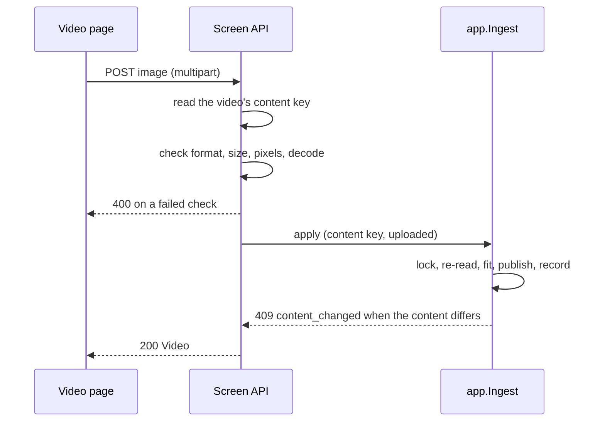

# Contract: Uploading a thumbnail image and starting an edit from the current thumbnail

Source of truth: `api/openapi.yaml`. This document covers the route this
feature adds, the two it changes and the `Video` field it replaces. Every route
is owner only: none is listed in `accessRoutes`, so the boundary answers `401`
to a guest (requirement 7), and `TestAccessClassificationMatchesOpenAPISecurity`
checks the `security` of each. Error bodies follow
[023 error-api](../../023-english-i18n/contracts/error-api.md); this feature
adds the reasons named below. The other routes of
[045 contracts/screen-api.md](../../045-comfyui-thumbnails/contracts/screen-api.md)
are unchanged.

## `Video` change

| Field | Type | Rule |
| --- | --- | --- |
| `thumbnailImage` | `generated`, `uploaded` | Present while an applied image is the thumbnail, in owner responses only; replaces `thumbnailGenerated` ([R-5](../research.md#r-5-thumbnailimage-names-the-applied-images-origin-in-place-of-thumbnailgenerated)) |
| `thumbnailUrl` | string (existing) | Unchanged: the version is `<content key prefix>-g<revision>` while an image is applied, for guests too |

## `POST /api/videos/{id}/thumbnail-image`

`uploadThumbnailImage`. Makes the uploaded image the video's thumbnail
([R-1](../research.md#r-1-an-uploaded-image-is-applied-within-its-request-through-the-same-apply-as-a-generated-image)).

The diagram shows the request's path and where each failure is answered.

| Field | In | Type | Required | Meaning |
| --- | --- | --- | --- | --- |
| `image` | `multipart/form-data` | PNG, JPEG or still WebP, up to 64 MiB and 120 megapixels | Yes | The image ([R-2](../research.md#r-2-an-upload-is-a-png-jpeg-or-still-webp-of-at-most-64-mib-and-120-megapixels-decoded-one-at-a-time)) |

**Response**: `200` with the `Video` of `GET /api/videos/{id}`, with
`thumbnailImage: "uploaded"` and a new `thumbnailUrl` version, once the
thumbnail file is published. The existing `video` event follows, as after the
position override. A position set earlier stays recorded, as after a
generated image's apply.

| Status | `code` / reason | When |
| --- | --- | --- |
| `400` | `invalid_request` / `thumbnail_upload_too_large` | The `image` part is over 64 MiB (the body as a whole may be up to 1 MiB larger, for the multipart framing), or the header says more than 120 megapixels; `limit` carries the exceeded limit |
| `400` | `invalid_request` / `thumbnail_upload_invalid` | Not a PNG, JPEG or WebP, an animated WebP, or a file that does not decode to the end |
| `404` | `not_found` / `video_not_found` | No such video |
| `409` | `conflict` / `content_changed` | The video is gone or holds other content than when the request started |
| `409` | `conflict` / `thumbnail_image_invalid` | ffmpeg could not fit the image |

Nothing is written on any error. A request cut off before its body arrives
in full is not applied; once the body has arrived, the check and the apply run
under a context detached from the client's cancellation and bounded at five
minutes, so they complete even when the page has gone
([R-1](../research.md#r-1-an-uploaded-image-is-applied-within-its-request-through-the-same-apply-as-a-generated-image)).

## `POST /api/videos/{id}/thumbnail-edits` (changed)

`startThumbnailEdit`. The body gains `source`
([R-4](../research.md#r-4-an-edit-from-the-current-thumbnail-starts-from-the-stored-source-or-from-the-thumbnails-frame)).

| Field | In | Type | Required | Meaning |
| --- | --- | --- | --- | --- |
| `source` | Body | `frame`, `thumbnail` | Yes | What the edit starts from |
| `positionMs` | Body | integer | For `frame` | The frame's position, as today; ignored for `thumbnail` |

**Response**: `201` `ThumbnailEdit` in `ready`, as today. For `thumbnail`,
the session's image is the stored source when an image is applied, otherwise
the frame at the recorded position, otherwise the frame at the automatic
position, or the first frame when that position yields none, as the thumbnail
job does; `frameUrl`, `frameWidth` and `frameHeight` describe that image
whichever its source, and the mask must match its size.

| Status | `code` / reason | When |
| --- | --- | --- |
| `400` | `invalid_request` / `thumbnail_position_out_of_range` | `frame` with a position outside the duration, or without `positionMs` |
| `404`, `409` | As today | `thumbnail_edit_not_ready`, `thumbnail_frame_unavailable` (also when the stored source cannot be decoded), `file_unavailable` |

## `ThumbnailEdit` (changed)

| Field | Type | Meaning |
| --- | --- | --- |
| `source` | `frame`, `thumbnail` | What the session started from |
| `positionMs` | integer | The position the frame was taken at when the image is a frame (chosen, recorded, automatic, or `0` after the first-frame fallback); absent for a stored source |

The other fields are unchanged.

## Client use

The video page uploads from its own entry, independent of the edit's
readiness, and replaces its video with the response. When the owner starts an
edit, the page sends `source: "frame"` with the player's position or
`source: "thumbnail"` without one, and the editor labels its first image by
the response's `source` and `positionMs`.
