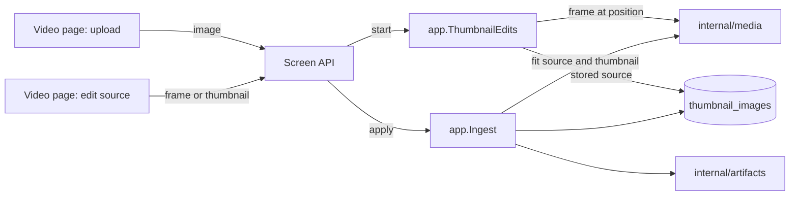
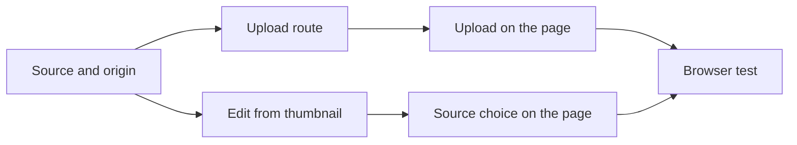

# Implementation Plan: Set a local image as the thumbnail and edit the current thumbnail with ComfyUI

**Branch**: `feature/046-thumbnail-upload-edit` | **Parent Issue**: #980

**Input**: The parent Issue. It is this feature's specification.

## Summary

The owner uploads a PNG, JPEG or WebP from their device on the video page and
it becomes the video's thumbnail, kept the way a generated image is kept
([045 R-6](../045-comfyui-thumbnails/research.md#r-6-the-applied-image-is-user-data-in-sqlite-the-thumbnail-file-is-rebuilt-from-it)):
fitted to the video's aspect, republished after a rescan, and dropped by a new
position or by "use the frame instead". A ComfyUI edit can then start from the
current thumbnail instead of the frame on screen, whatever the thumbnail is:
the stored image when one is applied, otherwise the frame the thumbnail was
taken from. To make a stored image editable, the apply keeps a copy of it at
the edit's resolution next to the 640 px thumbnail.

The diagram shows the parts this feature adds or changes and what each one
talks to; unchanged parts of 045 are in
[thumbnail-editing.md](../../docs/design-docs/thumbnail-editing.md).



| Concern | Approach |
| --- | --- |
| Upload | One owner-only multipart route, applied within the request through the same apply as a generated image ([R-1](research.md#r-1-an-uploaded-image-is-applied-within-its-request-through-the-same-apply-as-a-generated-image), [contracts/screen-api.md](contracts/screen-api.md#post-apivideosidthumbnail-image)) |
| What is accepted | PNG, JPEG or still WebP up to 64 MiB and 120 megapixels, one decode at a time ([R-2](research.md#r-2-an-upload-is-a-png-jpeg-or-still-webp-of-at-most-64-mib-and-120-megapixels-decoded-one-at-a-time)) |
| Re-editing | The row keeps the applied image's source at up to 2048 px and its origin ([R-3](research.md#r-3-the-row-keeps-the-applied-images-source-at-up-to-2048-px-and-its-origin), [data-model.md](data-model.md)) |
| Edit source | `source` on starting an edit: the frame on screen, or the current thumbnail ([R-4](research.md#r-4-an-edit-from-the-current-thumbnail-starts-from-the-stored-source-or-from-the-thumbnails-frame)) |
| Naming the image | `thumbnailImage` (`generated` or `uploaded`) replaces `thumbnailGenerated` ([R-5](research.md#r-5-thumbnailimage-names-the-applied-images-origin-in-place-of-thumbnailgenerated)) |
| Ordering and revert | Unchanged: the generation lock, a position or revert deleting the row ([045 R-10](../045-comfyui-thumbnails/research.md#r-10-apply-revert-and-the-position-override-are-ordered-by-the-generation-lock)) |

The Issue has the `ui` label, so the `design` stage writes `ui-design.md`
before the two screen units. It covers: the upload entry on the video page and
its states (choosing, sending, refused, failed), the information-row item for
an uploaded image, how the owner picks the frame or the current thumbnail when
starting an edit, and the editor's title, detail and comparison labels when
the source is the current thumbnail.

Out of scope, as the parent Issue's `対象外` says: setting an image on several
videos at once, a history of applied images, the external API and MCP, manual
cropping or rotation in vv, and seek sprites, card scrub frames and hover
previews.

## Technical Context

**Canonical definitions**:

| Topic | Source |
| --- | --- |
| Boundaries, user data, generated files, the authentication boundary | [ARCHITECTURE.md](../../ARCHITECTURE.md), [.golangci.yml](../../.golangci.yml) |
| The applied image, its apply, revert and republish, the generation lock | [045 research](../045-comfyui-thumbnails/research.md), [045 data-model](../045-comfyui-thumbnails/data-model.md), [thumbnail-editing.md](../../docs/design-docs/thumbnail-editing.md), [internal/app/ingest.go](../../internal/app/ingest.go), [internal/store/thumbnail_images.go](../../internal/store/thumbnail_images.go) |
| Edit sessions, the frame, the input checks | [internal/app/thumbnail_edits.go](../../internal/app/thumbnail_edits.go), [internal/app/thumbnail_edit_images.go](../../internal/app/thumbnail_edit_images.go), [045 contracts/screen-api.md](../045-comfyui-thumbnails/contracts/screen-api.md) |
| Fitting and frame extraction | [internal/media/thumbnail_image.go](../../internal/media/thumbnail_image.go), [internal/media/frame.go](../../internal/media/frame.go), [internal/media/thumbnail.go](../../internal/media/thumbnail.go) |
| The workflows' inputs (`vv:frame` takes any PNG) | [045 contracts/workflow.md](../045-comfyui-thumbnails/contracts/workflow.md#workflows) |
| Screen API, errors, generated code | [api/openapi.yaml](../../api/openapi.yaml), [023 error-api](../023-english-i18n/contracts/error-api.md), `task generate` |
| The video page, the editor, screen rules and Web tests | [045 ui-design](../045-comfyui-thumbnails/ui-design.md), [web/src/player/VideoFacts.tsx](../../web/src/player/VideoFacts.tsx), [web/src/player/thumbnailEdit/](../../web/src/player/thumbnailEdit/), [design-system.md](../../docs/design-docs/design-system.md), [web-testing.md](../../docs/design-docs/web-testing.md) |
| The browser test and the fake ComfyUI | [web/e2e/thumbnail-edit.e2e.ts](../../web/e2e/thumbnail-edit.e2e.ts), [web/e2e/fake-comfyui.mjs](../../web/e2e/fake-comfyui.mjs) |
| Checks | [Taskfile.yml](../../Taskfile.yml) (`task check`, `task check-docs`, `task test-e2e`) |

**Feature-specific context**:

- One migration, `00041_thumbnail_image_sources.sql`
  ([data-model.md, Migration](data-model.md#migration)); no new Go or Web
  dependency.
- The first route that decodes an image over 64 megapixels in the Go process:
  a 120-megapixel PNG decodes to 480 MB, so the upload check runs one at a
  time ([R-2](research.md#r-2-an-upload-is-a-png-jpeg-or-still-webp-of-at-most-64-mib-and-120-megapixels-decoded-one-at-a-time)).
- The e2e run needs a PNG, a JPEG and a WebP to upload; ffmpeg builds may
  lack libwebp, so the WebP is a checked-in fixture file.

## Constitution Check

| Rule (source) | Verdict |
| --- | --- |
| Adapters import neither each other nor `internal/app`; `internal/app` imports no adapter (ARCHITECTURE.md, depguard) | Pass: the fit stays in `internal/media` behind the `Generator` interface, the checks and the apply in `internal/app`, the multipart reading in `internal/httpapi` |
| User data survives a rebuild (ARCHITECTURE.md) | Pass: the source and origin are columns of `thumbnail_images`, keyed by content key with no foreign key |
| One owner for generated files (ARCHITECTURE.md) | Pass: the thumbnail file is still published only by `internal/artifacts`; an upload is held in memory until it is fitted ([R-1](research.md#r-1-an-uploaded-image-is-applied-within-its-request-through-the-same-apply-as-a-generated-image)) |
| Every read knows its viewer (ARCHITECTURE.md) | Pass: the upload route is owner only and absent from `accessRoutes`; `thumbnailImage` is in owner responses only, as `thumbnailGenerated` was |
| Events after commit (ARCHITECTURE.md) | Pass: an upload publishes the existing `VideoOverrideChanged` after the apply's transaction |
| Do not hand-edit generated files (AGENTS.md) | Pass: `api/openapi.yaml` changes, then `task generate` |
| Complexity 25 or less; share code instead of copying it (AGENTS.md) | Pass: the upload route reads its part with the run route's multipart reader, and the upload check is the edit's image check with a larger pixel cap |
| Read design-system.md before a screen; test at the lowest level (AGENTS.md) | Pass: limits get domain tests, the apply app and store tests, the route handler tests, the screens page tests, the flow one browser test |
| Documentation with the change (core-beliefs.md) | Pass: each unit names the document it updates |

No violation, so no complexity tracking. The verdicts hold after Phase 1.

## Project Structure

### Documentation (this feature)

```text
specs/046-thumbnail-image-upload/
├── plan.md
├── research.md
├── data-model.md
├── quickstart.md
└── contracts/
    └── screen-api.md
```

`ui-design.md` is written by the `design` stage (the Issue has the `ui`
label). `quickstart.md` exists because the automated checks upload generated
images to a fake ComfyUI only; a real phone photo and a real model's result
from an uploaded photo are checked by a person.

### Source Code

**Affected boundaries**:

| Boundary | What it owns in this feature |
| --- | --- |
| `internal/domain` | The upload limits and their errors, `ThumbnailImageOrigin`, `Video.ThumbnailImageOrigin`, the edit source |
| `internal/media` | `FitThumbnailSource` (fit to the aspect at up to 2048 px) and the automatic thumbnail position for a frame-based source |
| `internal/store` | The migration, the `source` and `origin` columns, reading the source |
| `internal/app` | The upload check under one mutex, `Ingest.ApplyThumbnailImage` writing the source and origin, `ThumbnailEdits.Start` with a source |
| `internal/httpapi`, `api/openapi.yaml` | The upload route, the changed start route, the `Video` field, the multipart reader shared with the run route |
| `web/src/api`, `web/src/player`, `web/src/i18n` | The client functions, the upload entry and item, the edit source choice, the catalog text |
| `web/e2e` | The upload fixtures and the browser test |
| `docs/` | `thumbnail-editing.md` (uploads, the edit source), `library-ui.md` (the information row's item), `running-vv.md` (unchanged list, the row grows) |

**New paths**: `internal/store/migrations/00041_thumbnail_image_sources.sql`,
`internal/httpapi/thumbnail_upload.go`,
`web/src/player/thumbnailUpload/`, `web/e2e/fixtures/thumbnail-upload.webp`.

**Structure decision**: The upload is a route of its own on the video, not a
step of the edit session, so it works without a ComfyUI connection and holds
no state ([R-1](research.md#r-1-an-uploaded-image-is-applied-within-its-request-through-the-same-apply-as-a-generated-image)).
The upload entry is its own directory under `web/src/player/` beside
`thumbnailEdit/`, because it shares the information row's failure line with
the edit entry but none of the editor's views.

## Implementation Work

The diagram shows which units have to land first. The two screen units also
wait for the `design` stage's `ui-design.md`.



### Keep the applied image's source and origin for re-editing

**Scope**: `00041_thumbnail_image_sources.sql` and the store's writes and read
of `source` and `origin`, `FitThumbnailSource` in `internal/media`,
`Ingest.ApplyThumbnailImage` taking an origin and writing the source with the
thumbnail, `Video.ThumbnailImageOrigin`, `thumbnailImage` replacing
`thumbnailGenerated` in `api/openapi.yaml`, the client type and the video
page's existing item and the browser test reading it, and the thumbnail
editing design document's note on the row
([data-model.md](data-model.md),
[R-3](research.md#r-3-the-row-keeps-the-applied-images-source-at-up-to-2048-px-and-its-origin),
[R-5](research.md#r-5-thumbnailimage-names-the-applied-images-origin-in-place-of-thumbnailgenerated),
[contracts/screen-api.md, `Video` change](contracts/screen-api.md#video-change)).

**Dependencies**: None.

**Acceptance**: `task check` and `task check-docs` pass with no diff from
`task generate`; media tests show a 4000 × 3000 PNG fitted for a 16:9 video
comes out 2048 × 1152 and a 1280 × 720 one keeps its size; store and app
tests show an apply writes `source`, `origin` and the 640 px `image` in one
transaction, a position change and a revert remove all three, the thumbnail
job republishes `image` as before, a row from the previous migration reads a
null source and `generated`, and the invariants test rejects an empty
`source`; handler tests show `thumbnailImage: "generated"` after an edit's
apply in the owner's response and no such field for a guest or when no image
is applied.

### Upload an image as the video's thumbnail through the screen API

**Scope**: `POST /api/videos/{id}/thumbnail-image` with its multipart reading
shared with the run route, the limits and errors in `internal/domain`, the
upload check (format, still WebP, size, pixel cap, decoded to the end) under
one mutex in `internal/app`, the apply with origin `uploaded` inside the
generation lock with the content key read at the start of the request, the
client function, and the "Uploaded images" section of thumbnail-editing.md
([R-1](research.md#r-1-an-uploaded-image-is-applied-within-its-request-through-the-same-apply-as-a-generated-image),
[R-2](research.md#r-2-an-upload-is-a-png-jpeg-or-still-webp-of-at-most-64-mib-and-120-megapixels-decoded-one-at-a-time),
[contracts/screen-api.md](contracts/screen-api.md#post-apivideosidthumbnail-image)).

**Dependencies**: Keep the applied image's source and origin for re-editing.

**Acceptance**: `task check` and `task check-docs` pass with no diff from
`task generate`; handler tests show a PNG, a JPEG and a WebP each answer `200`
with `thumbnailImage: "uploaded"` and a new `thumbnailUrl` version, a text
file, a truncated JPEG and an animated WebP answer `400
thumbnail_upload_invalid`, a body over 64 MiB and an image whose header says
12000 × 11000 answer `400 thumbnail_upload_too_large` with `limit`, nothing is
written in any `400`, a video whose content changed between the read and the
lock answers `409 content_changed`, a guest gets `401`, and
`TestAccessClassificationMatchesOpenAPISecurity` passes; app tests show a
second upload waits for the first's check and an upload that waits on the
lock behind a position change still wins.

### Start a thumbnail edit from the current thumbnail

**Scope**: `source` and the optional `positionMs` of
`POST /api/videos/{id}/thumbnail-edits`, `ThumbnailEdits.Start` taking the
row's source (or `image` for a row without one) as a PNG, or extracting the
frame at the recorded position or the automatic position exposed by
`internal/media`, `source` and `positionMs` in `ThumbnailEdit`, the client
function, and the "Edit source" section of thumbnail-editing.md
([R-4](research.md#r-4-an-edit-from-the-current-thumbnail-starts-from-the-stored-source-or-from-the-thumbnails-frame),
[contracts/screen-api.md](contracts/screen-api.md#post-apivideosidthumbnail-edits-changed)).

**Dependencies**: Keep the applied image's source and origin for re-editing.

**Acceptance**: `task check` and `task check-docs` pass with no diff from
`task generate`; app tests with a fake frame source show: `thumbnail` with an
applied image answers `ready` with the stored source's pixel size and
`positionMs` absent, and the frame route serves a PNG; `thumbnail` with a
position and no image extracts at that position and answers it; `thumbnail`
with neither extracts at the automatic position of the video's duration;
`frame` without `positionMs` answers `400`; a revert after the session
started leaves the session's image unchanged and the run still uses it;
handler tests show each status of the contract and a guest's `401`.

### Upload a thumbnail image from the video page

**Scope**: The upload entry in the information row for the owner, the file
picker limited to PNG, JPEG and WebP, the refusal of another type or a file
over 64 MiB before anything is sent, the sending state, the failure line, the
item for an uploaded image with its "use the frame instead", the catalog text
and the error reasons; placement, wording and states follow `ui-design.md`,
and library-ui.md's information rows gain the entry and the item.

**Dependencies**: Upload an image as the video's thumbnail through the screen
API.

**Acceptance**: `task check` and `task check-docs` pass; page tests show the
entry absent for a guest, a refused file's text without a request, the
response `Video` replacing the page's video and the item showing the uploaded
image, the failure line on a `400` with the reason's text, and the item's `×`
calling the revert; the screen change gets a visual review against
design-system.md at phone width.

### Choose the frame or the current thumbnail when editing on the video page

**Scope**: The source choice when the owner starts an edit, the start request
with `source`, the editor's title, detail and comparison labels for a
thumbnail source, and the catalog text; interaction and wording follow
`ui-design.md`. The editor's painting, run, cancel, apply and discard are
unchanged.

**Dependencies**: Start a thumbnail edit from the current thumbnail.

**Acceptance**: `task check` passes; page tests show the current-thumbnail
choice sends `source: "thumbnail"` without a position and the frame choice
sends the player's position, the editor's detail names the source, and the
comparison's first box carries the thumbnail-source label; the screen change
gets a visual review against design-system.md at phone width.

### Cover the upload and the edit from the current thumbnail in a browser test

**Scope**: The PNG and JPEG fixtures generated by `run-e2e.mjs`, the
checked-in WebP fixture, and the upload and thumbnail-source flows in
`web/e2e/thumbnail-edit.e2e.ts` against the fake ComfyUI.

**Dependencies**: Upload a thumbnail image from the video page; Choose the
frame or the current thumbnail when editing on the video page.

**Acceptance**: `task test-e2e -- e2e/thumbnail-edit.e2e.ts` passes, showing:
each of the three formats uploaded from the page becomes the thumbnail on the
library card, the video page and another video's related videos, and stays
after a reload and a full scan; an image of another aspect fills the card at
the video's aspect; "use the frame instead" and a new capture bring a frame
back; an edit started from the uploaded image shows it as the source and,
after a masked run, the fake's colour inside the painted area and the
uploaded image's colour outside it; an edit started from a generated
thumbnail shows that image next to the new result; a guest sees neither the
upload entry nor the source choice.
