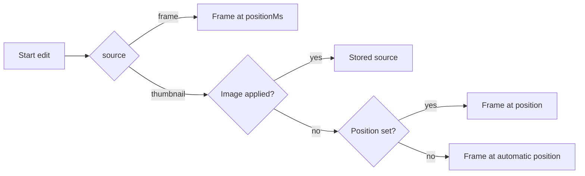

# Research: Set a local image as the thumbnail and edit the current thumbnail with ComfyUI

Parent Issue: #980. Inherited decisions:

| Topic | Source of truth |
| --- | --- |
| The applied image as user data, fitted to the video's aspect, republished by the thumbnail job; apply, revert and the position override ordered by the generation lock | [045 R-6](../045-comfyui-thumbnails/research.md#r-6-the-applied-image-is-user-data-in-sqlite-the-thumbnail-file-is-rebuilt-from-it), [R-7](../045-comfyui-thumbnails/research.md#r-7-the-generated-image-is-fitted-to-the-videos-frame-before-it-is-stored), [R-10](../045-comfyui-thumbnails/research.md#r-10-apply-revert-and-the-position-override-are-ordered-by-the-generation-lock) |
| The edit session in memory, the frame at up to 2048 px, the input checks | [045 R-4](../045-comfyui-thumbnails/research.md#r-4-an-edit-is-an-in-memory-session-per-video-read-by-polling), [R-8](../045-comfyui-thumbnails/research.md#r-8-the-frame-is-extracted-by-the-server-at-up-to-2048-px), [thumbnail-editing.md](../../docs/design-docs/thumbnail-editing.md#inputs-are-checked-before-anything-is-uploaded) |
| The workflows composite the result onto the input through the mask | [045 R-3](../045-comfyui-thumbnails/research.md#r-3-absent-inputs-get-a-neutral-value-or-the-variant-without-the-node), [contracts/workflow.md](../045-comfyui-thumbnails/contracts/workflow.md#workflows) |
| The error shape and reason codes | [023 error-api](../023-english-i18n/contracts/error-api.md) |

This file records only the decisions this feature adds.

## R-1: An uploaded image is applied within its request, through the same apply as a generated image

**Decision**: `POST /api/videos/{id}/thumbnail-image` takes the image as
`multipart/form-data`, holds it in memory, checks it, and hands it to
`Ingest.ApplyThumbnailImage` with origin `uploaded`, inside the generation
lock, with the video's content key read at the start of the request. Nothing
touches the disk before the fitted image is published, and the request
answers the `Video` once the thumbnail is in place.

| Option | Verdict |
| --- | --- |
| **A route of its own, applied within the request** | Chosen |
| Upload through the edit session (start an edit with the image, then apply) | Rejected: starting an edit needs a saved ComfyUI connection, which requirement 1 does not ask for, and the session's 5-minute life and polling add nothing to a one-step upload |
| Write the upload to a temporary file first | Rejected: a request cut off halfway would leave a file to clean up (the Issue's edge case); in memory, a cut-off request leaves nothing |

**Rationale**: The apply already does everything after the image exists: the
content check, the fit, the stash and publish, the row, the event. Reading the
content key before the body arrives and passing it to the apply answers the
edge case "the video is gone or its location holds other content" the way the
edit session does, and the lock makes the upload, a position change and a
generated image's apply "last confirmed wins".

## R-2: An upload is a PNG, JPEG or still WebP of at most 64 MiB and 120 megapixels, decoded one at a time

**Decision**: The upload must be a PNG, JPEG or WebP of at most 64 MiB whose
header says at most 120 million pixels, and it is decoded to the end before
anything is applied; a failure anywhere answers `400` with
`thumbnail_upload_too_large` (bytes or pixels, with `limit`) or
`thumbnail_upload_invalid` (not one of the formats, truncated, corrupt or
animated). One upload is decoded at a time per process.

| Option | Verdict |
| --- | --- |
| **64 MiB, 120 megapixels, one decode at a time** | Chosen |
| The reference image's limits (20 MiB, 8192 × 8192 = 67 megapixels) | Rejected: a 108-megapixel phone photo is 12000 × 9000 and a 100-megapixel medium-format photo 11656 × 8742; requirement 2 says a camera photo is not refused for its size |
| No pixel cap | Rejected: a forged header could make the decode allocate without bound ([thumbnail-editing.md](../../docs/design-docs/thumbnail-editing.md#inputs-are-checked-before-anything-is-uploaded)) |
| Header check only, decode in ffmpeg | Rejected: ffmpeg decodes a truncated JPEG into a half-grey image with a warning, so a corrupt upload would become the thumbnail instead of failing with a reason |

**Rationale**: 120 megapixels covers every phone and consumer camera on sale,
and the few images over it (scans, panoramas) are the "extreme" case the Issue
allows refusing with a reason. A 120-megapixel PNG decodes to 480 MB and a
JPEG to 180 MB, which is why only one upload is decoded at a time; the
reference image and the provider's output keep their limits.

## R-3: The row keeps the applied image's source at up to 2048 px and its origin

**Decision**: Applying an image (generated or uploaded) stores two fits of it
in `thumbnail_images`: `image`, the 640 px JPEG the thumbnail file is built
from, and `source`, the same crop with its long side at most 2048 px, as a
JPEG, which an edit from the current thumbnail starts from. The row also
records `origin`, `generated` or `uploaded`
([data-model.md](data-model.md)).

| Option | Verdict |
| --- | --- |
| **A 2048 px JPEG beside the thumbnail** | Chosen |
| Edit the 640 px thumbnail | Rejected: 045 R-8 rejected 640 px for an edit because the model loses the text it is asked to remove, and the result would be 640 px |
| Store the uploaded bytes as they are | Rejected: up to 64 MiB per video in the backup, and a generated result has no original other than the PNG the session drops on apply |
| A PNG source | Rejected: about 4 MB per video against about 1 MB for a JPEG at quality 2, for a difference the model does not see |

**Rationale**: The source is made in the same apply and the same transaction
as the thumbnail, so the two never disagree, and the mask of an edit from the
thumbnail is checked against the source's size as it is against a frame's. A
row written before this feature has no source; an edit then starts from its
`image`, the only image there is.

## R-4: An edit from the current thumbnail starts from the stored source or from the thumbnail's frame

**Decision**: Starting an edit takes a `source`: `frame`, with the player's
`positionMs` as today, or `thumbnail`. For `thumbnail`, the session's image is
the row's source when an image is applied, otherwise the frame at the
recorded position, otherwise the frame at the automatic position
`internal/media` uses for the thumbnail. The session holds the image in
memory from then on, so a later upload, position change or revert does not
change the edit in progress, and its apply is the last confirmed operation.

The diagram shows how the source is chosen.

| Option | Verdict |
| --- | --- |
| **The stored source, else the thumbnail's frame at edit resolution** | Chosen |
| The published thumbnail file for every kind of thumbnail | Rejected: 640 px ([R-3](#r-3-the-row-keeps-the-applied-images-source-at-up-to-2048-px-and-its-origin)) |
| Read the source again when the run starts | Rejected: the Issue's edge case says an edit continues on the image it started with when the thumbnail changes meanwhile |
| A separate route for editing the thumbnail | Rejected: the session, its routes and the editor are the same; only the first image differs |

**Rationale**: The session already keeps its image in memory and the
workflows' `vv:frame` takes any PNG, so a stored source enters the run exactly
as an extracted frame does. The automatic position is the rule the thumbnail
job applies, so the frame the owner edits is the one the thumbnail shows.

## R-5: `thumbnailImage` names the applied image's origin in place of `thumbnailGenerated`

**Decision**: The owner's `Video` carries `thumbnailImage`, `generated` or
`uploaded`, while an image is applied, and `thumbnailGenerated` is removed.

| Option | Verdict |
| --- | --- |
| **One field with the origin** | Chosen |
| Keep `thumbnailGenerated: true` for both | Rejected: the information row's item names what it shows ("Generated thumbnail", a wand icon), which would mislabel an upload |
| Keep the boolean and add an origin field | Rejected: two fields for one fact |

**Rationale**: The field is in owner responses of the screen API only and
has one reader, the video page, so replacing it costs one page and one
browser test. The `thumbnailUrl` version is unchanged, so cards and related
videos need nothing.
