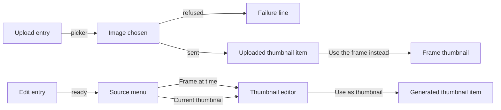
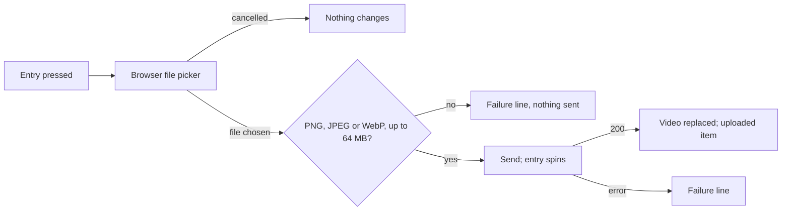
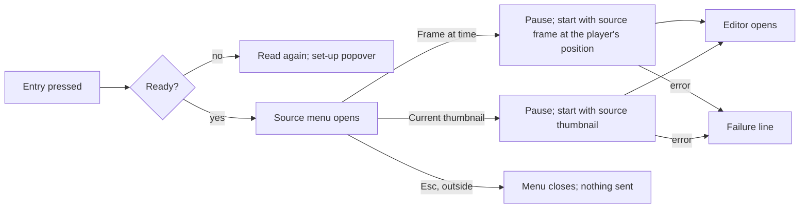

# UI design: Setting a local image as the thumbnail and editing the current thumbnail with ComfyUI

**Feature**: [parent Issue #980](https://github.com/syudead/vv/issues/980) ·
[plan.md](plan.md) · [contracts/screen-api.md](contracts/screen-api.md) ·
[research.md R-1](research.md#r-1-an-uploaded-image-is-applied-within-its-request-through-the-same-apply-as-a-generated-image) ·
[R-2](research.md#r-2-an-upload-is-a-png-jpeg-or-still-webp-of-at-most-64-mib-and-120-megapixels-decoded-one-at-a-time) ·
[R-4](research.md#r-4-an-edit-from-the-current-thumbnail-starts-from-the-stored-source-or-from-the-thumbnails-frame) ·
[R-5](research.md#r-5-thumbnailimage-names-the-applied-images-origin-in-place-of-thumbnailgenerated)

Sources that already decide things, linked rather than repeated here:

| Topic | Source |
| --- | --- |
| Tokens, closed scales, video-page density | [design-system.md, Foundations](../../docs/design-docs/design-system.md#foundations); the values in `@theme` of [`web/src/ui/tokens.css`](../../web/src/ui/tokens.css), named here and never copied |
| `Button`, `DropdownMenu`, `Popover`, `Tooltip`, `Input` | [components.md](../../web/registry/rules/components.md) |
| The video page's information rows, their right-hand actions, the thumbnail item and the one failure line | [library-ui.md, Information rows](../../docs/design-docs/library-ui.md#information-rows); [029 UI design, Thumbnail fact](../029-video-overrides/ui-design.md#thumbnail-fact) |
| The edit entry, its readiness and set-up popover, the editor's views, Compare, closing | [045 UI design, Video page: edit entry](../045-comfyui-thumbnails/ui-design.md#video-page-edit-entry), [Thumbnail editor](../045-comfyui-thumbnails/ui-design.md#thumbnail-editor), [Generated thumbnail item](../045-comfyui-thumbnails/ui-design.md#generated-thumbnail-item) |
| A file picker opened from a button, the refusal before anything is sent | The reference image in [045 UI design, Compose](../045-comfyui-thumbnails/ui-design.md#compose) and [`ThumbnailEditor.tsx`](../../web/src/player/thumbnailEdit/ThumbnailEditor.tsx) |
| A menu of a few actions opened from an icon button on the video page | [`VersionsFact.tsx`](../../web/src/player/VersionsFact.tsx) |
| Width breakpoints in CSS; layout checked by people | [library-ui.md, Width breakpoints](../../docs/design-docs/library-ui.md#width-breakpoints-in-css-and-the-sidebar-exception), [Layout verified by people](../../docs/design-docs/library-ui.md#layout-verified-by-people-not-machines) |
| Screen text | [`web/src/i18n/en.ts`](../../web/src/i18n/en.ts); this feature adds `player.thumbnailUpload` and extends `player.thumbnailEdit` and the error reasons |

This feature adds three things to the video page, all for the owner only
(requirement 7, acceptance criterion 7):

1. An **upload entry** among the information row's actions, which opens the
   browser's file picker and makes the chosen image the thumbnail
   (requirements 1 to 3, acceptance criteria 1 to 3).
2. An **uploaded thumbnail item** in the information row, with the same way
   back to the frame as the generated item (requirement 4, acceptance
   criterion 4).
3. A **source choice** when the owner starts a ComfyUI edit, and the editor's
   labels when the source is the current thumbnail (requirements 5 and 6,
   acceptance criteria 5 and 6).

The diagram shows the parts and where each action leads.

Unchanged: the player, the title, tags, visibility toggle, the capture button,
the readiness check and set-up popover, the editor's painting, instructions,
reference image, run, cancel, apply, discard and closing, and every other
screen, which shows the uploaded image through the existing `thumbnailUrl`.

## Why this shape

The upload entry is **one more icon button in the information row's action
group**, right after `Edit thumbnail with ComfyUI`, because it is the third
way of setting the same thumbnail: the capture button sets it from a frame,
the editor from a generated image, the upload from a file. The three sit
together at the same weight, no louder than playback
([029, Why here and not elsewhere](../029-video-overrides/ui-design.md#why-here-and-not-elsewhere)),
and the two existing buttons keep their places. A drop zone on the player or
on the thumbnail item was rejected: a video page has no area that reads as
"drop an image here", a drop target on the player competes with the picture,
and the Issue asks for choosing a file; a picker opened from a button is the
form a settings or profile screen uses for one image. A dialog with a preview
and a confirm step was rejected: the capture button and the editor's
`Use as thumbnail` apply in one press, and the uploaded item that appears in
the row, with its `×`, is the confirmation, as it is for them.

The source choice is a **`DropdownMenu` opened by the existing edit entry**,
with two items: the frame on screen and the current thumbnail. The registry
names the menu for "one choice from a few, opened from a button". A second
icon button for editing the thumbnail was rejected: two wand buttons side by
side cannot be told apart by their icons, and the row would gain a fourth
thumbnail action. A choice inside the editor was rejected: the session is
started with its source ([R-4](research.md#r-4-an-edit-from-the-current-thumbnail-starts-from-the-stored-source-or-from-the-thumbnails-frame)),
so switching inside the editor would discard the session and the painting,
and the owner would first see one image and then have to swap it. The menu
costs one more press on the way to a frame edit; it is the price of
requirement 5, and it names what each edit starts from before anything is
extracted. The thumbnail item of the menu shows the thumbnail itself as a
small image, because when the thumbnail is the automatic frame the video page
shows it nowhere else, and the owner should see what they are about to edit.

With the choice in place, the entry is no longer dimmed when no frame is on
screen: an edit of the current thumbnail needs no frame. Only the frame item
is disabled then. The entry stays dimmed, with the set-up popover, while
ComfyUI is not set up, because neither source works without it.

Inside the editor nothing moves. The source changes three pieces of text: the
band's detail says what the image is, the painting hint says "image" instead of
"frame", and Compare's first label reads `Thumbnail`. An edit of a frame is
labelled exactly as before.

## Words

The English is the draft the catalog takes; after implementation
[`web/src/i18n/en.ts`](../../web/src/i18n/en.ts) is canonical.

### Video page

| Place | Text | Notes |
| --- | --- | --- |
| Upload entry, name and tooltip | Upload an image as thumbnail | `player.thumbnailUpload.entry` |
| Refused, wrong type | Choose a PNG, JPEG or WebP image. | The row's failure line, before anything is sent |
| Refused, too large | Choose an image up to 64 MB. | As above |
| Upload failed | Couldn't upload the image: {reason} | The row's failure line; `{reason}` from [Error reasons](#error-reasons) |
| Uploaded item | Uploaded thumbnail | Visually hidden label, `title` and image `alt` |
| Uploaded item `×` | Use the frame instead | Shared with the generated item |
| Edit entry, name and tooltip | Edit thumbnail with ComfyUI | Unchanged |
| Source menu, frame item | Frame at {time} | `{time}` in the `formatDuration` format; `Frame on screen` and disabled when no frame is on screen |
| Source menu, thumbnail item | Current thumbnail | With the small image of the thumbnail before it |
| Start failed | Couldn't start editing the thumbnail: {reason} | Unchanged |

### Thumbnail editor

| Place | Text | Notes |
| --- | --- | --- |
| Editor detail, frame source | Frame at {time} | Unchanged |
| Editor detail, thumbnail source with a frame | Current thumbnail, frame at {time} | The session's `positionMs` is present ([contracts/screen-api.md](contracts/screen-api.md#thumbnailedit-changed)) |
| Editor detail, thumbnail source, uploaded image | Current thumbnail, uploaded image | The page's `thumbnailImage` when the edit started |
| Editor detail, thumbnail source, generated image | Current thumbnail, generated image | As above |
| Painting hint, thumbnail source | Paint over what to change. Leave it unpainted to change the whole image. | The frame source keeps `…the whole frame.` |
| Comparison labels, thumbnail source | Thumbnail · Generated | The frame source keeps `Frame · Generated` |

### Error reasons

Added to, or changed in, the `reason` table in `web/src/i18n/errors.ts`
([contracts/screen-api.md](contracts/screen-api.md#post-apivideosidthumbnail-image)).
`video_not_found` and `file_unavailable` keep their text.

| Reason | Text | Notes |
| --- | --- | --- |
| `thumbnail_upload_too_large` | The image is too large: up to 64 MB and 120 megapixels. | `limit` says which; the text names both, because the owner's next file must pass both |
| `thumbnail_upload_invalid` | The file isn't a PNG, JPEG or still WebP, or it can't be read. | Covers another format, an animated WebP, a truncated or corrupt file |
| `thumbnail_image_invalid` | The image can't be read. | Was `The generated image can't be read.`; the upload answers the same reason when ffmpeg cannot fit the image |
| `content_changed` | The video changed in the meantime. | Was `…while you were editing`; the upload answers the same reason |

## Changes to the design system

None. The upload entry and the item use `ActionButton` as the row's other
actions do, the source choice is the registry's `DropdownMenu`, and the file
picker is the hidden `Input type="file"` the reference image already uses. No
token is added and nothing is added to `pairs` in
`web/src/theme/tokens.test.ts`. The icons are lucide `ImageUp` (the upload
entry and the uploaded item), `Film` (the frame item) and, unchanged,
`WandSparkles`.

## Video page: upload entry

An `ActionButton` (`ghost` `icon-sm`, lucide `ImageUp`,
`text-muted-foreground`) right after `Edit thumbnail with ComfyUI` in the
information row's action group, before `Open file`. It is placed for the
owner whenever the page is open, including a video whose player is not shown
(a file that cannot be read can still get a thumbnail); a guest gets no entry.
It does not read the ComfyUI readiness and is never dimmed by it.

The diagram shows what pressing the entry does.

| State | The entry and the row |
| --- | --- |
| Idle | Pressable; the tooltip names it. Pressing opens the picker limited to `image/png`, `image/jpeg` and `image/webp`; the picker lets the same file be chosen twice in a row, so an image can be uploaded again after a revert |
| Refused | A file of another type, or over 64 MiB, is refused before anything is sent: the row's one failure line shows the matching text, the entry stays pressable, the thumbnail and its item are unchanged |
| Sending | `LoaderCircle` spinning, `aria-disabled`; a second press sends nothing. The capture button and the thumbnail item's `×` are `aria-disabled` too, and the upload entry is `aria-disabled` while either of them sends: one thumbnail operation at a time from this page, because the server keeps only the last confirmed one. The failure line is cleared when the send starts. Sending lasts seconds for a large photo (the server decodes and fits it, and may wait for another upload or for a thumbnail job of this video); the thumbnail item keeps showing the previous thumbnail until the answer |
| Sent (`200`) | The response `Video` replaces the page's video; the uploaded item appears in place of the position or generated item ([Uploaded thumbnail item](#uploaded-thumbnail-item)); cards and related videos read the new `thumbnailUrl` through the `video` event. No toast: the item is the result, as for the capture button |
| Failed | The row's one failure line, `Couldn't upload the image: {reason}`, replacing any earlier line; the thumbnail and its item are unchanged (the Issue's edge cases). On `video_not_found`, `file_unavailable` and `content_changed` the page also refetches the video, as 029 does |
| Page left while sending | Nothing asks or warns: the server finishes the upload once the body has arrived ([R-1](research.md#r-1-an-uploaded-image-is-applied-within-its-request-through-the-same-apply-as-a-generated-image)), and the thumbnail is in place when the owner returns |

The refusal before sending exists so a wrong file fails at once instead of
after the whole file has been sent; the server's limits stay the ones that
count, and a file that passes the page's check and fails the server's shows
the server's reason.

## Uploaded thumbnail item

While `thumbnailImage` is `uploaded`, the information row's thumbnail item
shows the uploaded image in place of the position item, in the generated
item's form ([045, Generated thumbnail item](../045-comfyui-thumbnails/ui-design.md#generated-thumbnail-item)):
lucide `ImageUp` (`size-4`, `aria-hidden`) instead of `WandSparkles`, the
small image (`thumbnailUrl`), and the `×` named `Use the frame instead`. No
time is shown. The `×` sends `DELETE /api/videos/{id}/thumbnail-image`, spins
while sending, and on `200` the item shows the position item when a position
is set, or disappears (requirement 4, acceptance criterion 4). A failure uses
the row's one failure line, `Couldn't change the thumbnail: {reason}`, as 029.

The two items are one component keyed by `thumbnailImage`
([R-5](research.md#r-5-thumbnailimage-names-the-applied-images-origin-in-place-of-thumbnailgenerated)),
differing in icon and label only, because the owner's way back is the same
and the image is kept the same way. The icon says where the image came from;
after an edit of an uploaded image is applied, the item turns into the
generated item, because the thumbnail is then a generated image.

`Use current frame as thumbnail` keeps its behaviour; on `200` the position
item replaces the uploaded item, because the server dropped the image with the
same request.

## Video page: edit entry with the source choice

The edit entry keeps its place, icon, tooltip, readiness check and set-up
popover ([045, Video page: edit entry](../045-comfyui-thumbnails/ui-design.md#video-page-edit-entry)).
What changes is what a press does when ComfyUI is ready, and when the entry is
dimmed.

The diagram shows what pressing the entry does.

The menu is a `DropdownMenu` anchored to the entry (`align="end"`, below it),
with two `DropdownMenuItem`s in this order:

| Item | Leading | Text | Rule |
| --- | --- | --- | --- |
| Frame | lucide `Film` | `Frame at {time}` | `{time}` is the player's position when the menu opens, the position the capture button would send. When no frame is on screen (the capture button's conditions, [029, Capture button](../029-video-overrides/ui-design.md#capture-button)) the item reads `Frame on screen` and is disabled |
| Thumbnail | The small image of the current thumbnail (`thumbnailUrl`, `h-6`, the video's aspect, `rounded-sm`, `object-cover`), the same form as the row's thumbnail item | `Current thumbnail` | Always enabled. The image is what the edit starts from, whichever kind of thumbnail it is ([R-4](research.md#r-4-an-edit-from-the-current-thumbnail-starts-from-the-stored-source-or-from-the-thumbnails-frame)) |

The frame item comes first because it is what the entry did before and what
an owner who has just paused on a frame wants. Choosing either item pauses
playback, closes the menu, starts the edit with `source: "frame"` and the
position, or `source: "thumbnail"` without one
([contracts/screen-api.md](contracts/screen-api.md#post-apivideosidthumbnail-edits-changed)),
and spins the entry while the image is extracted, as the single press did in
045. A failed start shows the information row's one failure line.

| State | The entry |
| --- | --- |
| Ready | Pressable, whether or not a frame is on screen; pressing opens the menu |
| Not ready (`connection` false) | As 045: `opacity-50`, `aria-disabled`, still focusable; pressing reads readiness again and, if still not ready, opens the set-up popover instead of the menu |
| Starting | `LoaderCircle` spinning, `aria-disabled`, the menu closed; a second press sends nothing |
| Menu open | The entry shows its pressed state (`bg-accent`, as any open menu's trigger); Esc or a press outside closes it and nothing is sent; the focus returns to the entry |

The entry is dimmed only for a missing connection, no longer for a missing
frame, because the thumbnail source needs none; the frame item carries that
condition. An edit started from the current thumbnail does not depend on the
player at all, so the entry is placed, like the upload entry, even when the
player is not shown; the frame item is then disabled.

## Thumbnail editor from the current thumbnail

The editor is the one of 045 in every view. What the owner sees differs by the
session's `source`:

| Place | Frame source | Thumbnail source |
| --- | --- | --- |
| Band detail | `Frame at {time}` | `Current thumbnail, frame at {time}` when `positionMs` is present; otherwise `Current thumbnail, uploaded image` or `Current thumbnail, generated image` by the page's `thumbnailImage` when the edit started |
| Stage in Compose | The frame (`frameUrl`), painted over | The thumbnail's image (`frameUrl`: the stored source, or the thumbnail's frame), painted over, at the same size rule; its pixel size is `frameWidth` × `frameHeight` as for a frame, so the brush steps and the mask are unchanged |
| Painting hint | `…change the whole frame.` | `…change the whole image.` |
| Compare, first box | Labelled `Frame`, `alt` `Frame` | Labelled `Thumbnail`, `alt` `Thumbnail`; the box is the video's shape, as the source already is (it was fitted on apply, [R-3](research.md#r-3-the-row-keeps-the-applied-images-source-at-up-to-2048-px-and-its-origin)) |
| Compare, second box | `Generated`, cropped as the thumbnail will be | The same; a result from a masked run keeps the source outside the painted area (acceptance criterion 6), so the two boxes differ only where the owner painted |
| Apply | The generated item appears in the row | The same: the item is the generated item whatever the source was, because the thumbnail is now a generated image |

The detail names the kind of image because the stage alone does not say
whether the owner is looking at a frame or at a stored image, and an owner
who meant to pick the frame should see at a glance that they picked the
thumbnail. The editor's wording that says "frame" elsewhere (`The painting
doesn't match the frame`) stays, because it is an error no owner reaches
from the screen.

A thumbnail change on the page while the editor is open (another tab's upload,
a revert) does not change the editor: the session holds its image
([R-4](research.md#r-4-an-edit-from-the-current-thumbnail-starts-from-the-stored-source-or-from-the-thumbnails-frame)),
and `Use as thumbnail` makes its result the last confirmed thumbnail (the
Issue's edge cases).

## Responsive behaviour

Only Tailwind's default breakpoints are used, switched in CSS. The widths
judged are 360px, 768px and 1280px.

| Width | Information row | Source menu | Editor |
| --- | --- | --- | --- |
| 1280px | The facts on one line, the action group at the right end with one more icon; the uploaded item among the facts with its small image | Below the entry, its right edge on the entry's right edge; two rows, `Frame at {time}` and the thumbnail image with `Current thumbnail` | The band shows the title and the detail on one line |
| 768px | As 1280px; the facts may wrap to a second line before the action group | As 1280px | As 1280px |
| 360px | The action group (favorite, playlist, capture, edit, upload, open, copy) stays on one line and the facts wrap above it; the uploaded item wraps as the position item does; the failure line wraps under the row; no horizontal scroll | Opens inside the viewport, shifted left by Radix when the entry is near the edge; the two items are at least `h-8` tall for a finger | The detail truncates with an ellipsis before the title does; `Thumbnail` and `Generated` sit above their stacked boxes as `Frame` and `Generated` do |

The browser's file picker is the device's own: on a phone it offers the photo
library and the camera, which is where acceptance criterion 2's photo comes
from.

## Review criteria

Judged by looking at the running screen in vv's one dark scheme
(library-ui.md, Layout verified by people). "It exists" alone does not pass
(Q-4).

1. **Visual hierarchy**: on the video page the eye still goes player → title →
   tags; the upload entry carries the same weight as the capture and edit
   buttons beside it, with no fill, border or `primary` colour, and the three
   thumbnail actions read as one group. In the source menu the thumbnail's
   small image is the only picture and the two items read as peers; neither
   is `primary`. In the editor the band's detail is muted and the image is
   still the largest thing on screen.
2. **Information density**: the information row of a video with no override
   gains exactly one icon; the uploaded item is the generated item's size,
   one icon and one small image, with no caption. The menu is two lines; no
   heading, no description under an item.
3. **Spacing rhythm**: the upload entry sits at the action group's gap, with
   no extra space before `Open file`. The uploaded item's inner gap and the
   gap to its neighbours are the position item's. The menu's items have the
   registry's row height and padding; the small image sits on the item's
   text baseline band, not above it.
4. **Typography**: the band's detail stays `text-muted-foreground` at the
   same size as `Frame at {time}` today, however long it gets. The failure
   line is `text-sm text-destructive` with its icon, as the other failure
   lines; the menu's `{time}` is `tabular-nums` so it does not shift as the
   position changes between openings.
5. **Action priority**: setting a local image needs two steps, the entry and
   the picker, with no dialog, preview or confirm step in between (acceptance
   criterion 1); the uploaded item's `×` brings the frame back in one press
   (acceptance criterion 4). Starting an edit of the current thumbnail is two
   presses, the entry and the item, and the editor opens on the thumbnail's
   image (acceptance criterion 5); a frame edit is the same two presses as a
   thumbnail edit and sends the position the capture button would.
6. **Visible state**: while an upload sends, the entry spins and the capture
   and `×` are dimmed, so the owner sees that the row is busy and cannot
   send a second thumbnail; the item keeps the previous thumbnail until the
   answer. A refusal or a failure names its cause in words and leaves the
   thumbnail, the item, the card and related videos as they were (the Issue's
   edge cases). In Compare after a masked run from an uploaded image, the
   first box is the uploaded image and the second differs from it only
   inside the painted area (acceptance criterion 6).
7. **Phone width**: at 360px the action group is one line and the menu opens
   inside the viewport; nothing scrolls sideways; the picker opens the
   device's photo library.
8. **Guest**: signed out, the same video page has no upload entry, no
   uploaded item, no edit entry and no menu (acceptance criterion 7).
9. **Examples that do not meet the requirement**: the upload opens a dialog
   with a preview before it is applied; the uploaded item carries the wand
   icon or the `Generated thumbnail` label; a second wand button stands next
   to the first; the entry is dimmed when a frame is missing although the
   thumbnail could be edited; the editor from the thumbnail says `Frame at
   {time}` for a stored image; Compare labels a stored image `Frame`; the
   refusal names a limit other than the server's; a failed upload replaces
   the thumbnail or clears the item.

## Accessibility

The parent Issue does not ask for screen reader or contrast design, so only
names and announcements are decided, as in 045.

- The upload entry is `Upload an image as thumbnail`; the uploaded item's
  image `alt` and hidden label are `Uploaded thumbnail`; its `×` is `Use the
  frame instead`.
- The source menu is a Radix menu: arrow keys move between the items, Enter
  chooses, Esc closes and returns the focus to the entry; the thumbnail
  item's small image is `alt=""`, because the item's text names it.
- The file input is hidden and reached only through the entry; the refusal
  and the failure use the row's `role="alert"` line.
- Spinners are `aria-hidden`, and controls that are sending or locked are
  `aria-disabled`.
