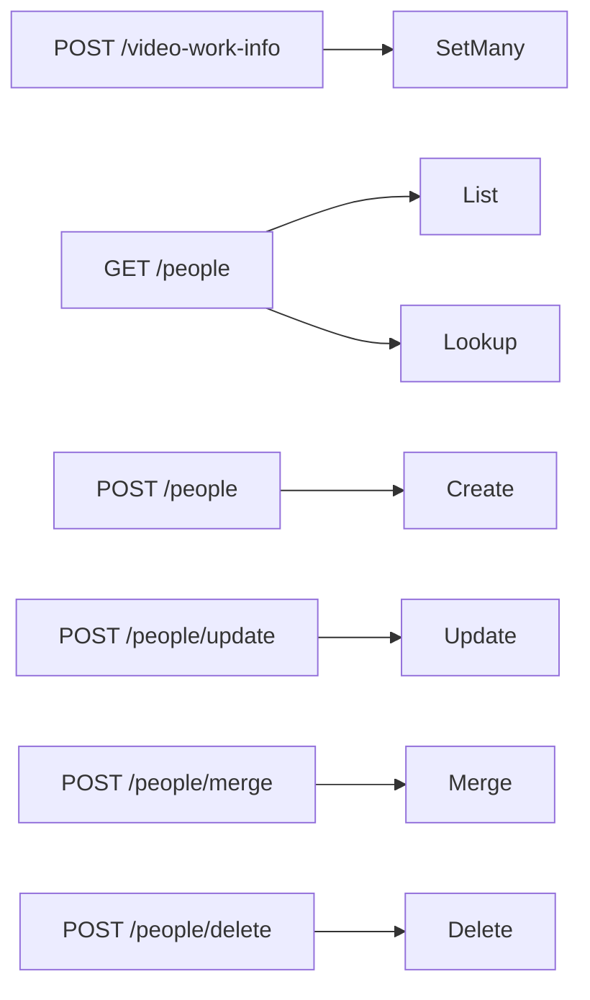

# Contract: Work information, people and organizations in external API v1 and MCP

Source of truth: `api/external-v1.yaml`, the operation `updateVideoWorkInfo`,
the `workInfo` field of `ExternalVideo`, and the operations `listPeople`,
`createPerson`, `updatePerson`, `mergePeople`, `deletePeople` and their
`Organization` counterparts. This document covers only what this feature
adds; the common rules (Bearer, the error shape, `VideoRef`, `index`, the
32 MiB body) stay as in
[specs/026-external-api/contracts/external-api.md, Common rules](../../026-external-api/contracts/external-api.md#common-rules).
The decision is
[research.md R-9](../research.md#r-9-the-external-api-gets-one-bulk-replace-and-literal-post-routes-per-entity-kind-field-names-the-failing-property).
Following the compatibility policy, only fields, operations, reasons and an
error property are added. Each entity operation runs the `CreditStore`
operation the screen runs, so the rules of
[screen-api.md, People and organizations](screen-api.md#people-and-organizations)
hold for the state after each call.

The diagram shows which store operation each new operation reaches.



## `ExternalVideo` changes

| Field | Type | Rule |
| --- | --- | --- |
| `workInfo` | `WorkInfo` (`required`) | The seven fields of [screen-api.md, `WorkInfo` schema](screen-api.md#workinfo-schema); in this API `code` and `description` are `null` rather than absent when unset, and every list is `[]` when empty, so a client reads every property without checking for presence |
| `updatedAt` | date-time (existing) | Its description gains work information to the list of edits that advance it |

`VideoTagsItem.video` does not change.

## `POST /api/v1/video-work-info`

`operationId: updateVideoWorkInfo`.

```json
{ "items": [ { "video": { "path": "/media/a.mp4" },
               "workInfo": { "code": "ABC-123",
                             "dates": [ { "kind": "release", "date": "2024-06" } ],
                             "people": [ { "role": "performer", "person": { "id": 7 } } ],
                             "organizations": [ { "role": "maker", "organization": { "id": 2 } } ],
                             "urls": [ "https://example.com/abc-123" ],
                             "externalIds": [ { "source": "example", "value": "abc123" } ] } },
             { "video": { "id": 12 }, "workInfo": {} } ] }
```

Each item's `workInfo` is a
[`WorkInfoInput`](screen-api.md#workinfoinput-schema), shared with the screen
API's request body, and replaces the stored object: a field absent, `null` or
empty after trimming is cleared, and `{}` clears everything. All items are
applied in one transaction; if any item has an error, nothing is applied. A
later item for the same video wins.

| Situation | Response |
| --- | --- |
| Success | `200`: `{ items: [{ video: { id, contentKey }, workInfo }] }` in `items` order, with the applied values in the `ExternalVideo` shape |
| `items` has 0 or more than 20000 entries | `400 invalid_request` / `too_many_videos`, `limit` |
| `video` is not exactly one of id, content key or path | `400 invalid_request` |
| A field breaks its rule ([screen-api.md, `PUT /api/videos/{id}/work-info`](screen-api.md#put-apivideosidwork-info)) | `400 invalid_request` with the same `reason`, `field` and `limit`; `index` is the position in `items` |
| A person or organization id does not exist | `404 not_found` / `person_not_found` or `organization_not_found`, `field`, `index`. Nothing is applied |
| A video cannot be found | `404 not_found` / `video_not_found`, `index`. Nothing is applied |

Repeating a request leaves the state unchanged and returns `200`.

## People and organizations

The five operations below exist under `/api/v1/people` and
`/api/v1/organizations`; the organization forms add `parent` and `parentId`
and answer `organization_not_found`, `merge_same_organization` and
`organization_parent_cycle`. The schemas `Person`, `Organization`, `Alias`,
`ExternalId`, `CreditInput`, `CreditPatch` and `CreditList` are those of
[screen-api.md, People and organizations](screen-api.md#people-and-organizations);
in this API `parent` is `null` at the root and every list is `[]` when empty.

| Operation | Method and path | Body or parameters | Response |
| --- | --- | --- | --- |
| `listPeople` | `GET /api/v1/people` | `q`, `sort`, `cursor`, `limit` as on the screen; or `source` and `externalId` together for a lookup | `200 CreditList`; a lookup returns the one entity holding that external ID (an external ID names at most one entity of a kind) or an empty `items` |
| `createPerson` | `POST /api/v1/people` | `CreditInput` | `200 Person` |
| `updatePerson` | `POST /api/v1/people/update` | `{ id }` plus `CreditPatch` | `200 Person` |
| `mergePeople` | `POST /api/v1/people/merge` | `{ targetId, sourceIds }`, 1 to 20,000 sources | `200 { person: Person, notFoundIds }` |
| `deletePeople` | `POST /api/v1/people/delete` | `{ ids }`, 1 to 20,000 | `200 { deletedIds, notFoundIds }`, in `ids` order without duplicates |

| Status | `code` / `reason` | When |
| --- | --- | --- |
| `400` | `invalid_request` | `sort` outside the five values, `limit` outside 1 to 200, `q` over 100 characters, `source` without `externalId` or the reverse |
| `400` | `invalid_request` / `invalid_cursor` | `cursor` unreadable or made under another `sort` |
| `400` | `invalid_request` / `work_info_*`, `field`, `limit` | A name, alias, language, external ID or list breaks its rule ([data-model.md, Fields](../data-model.md#fields)); a name empty after trimming, or an external ID with exactly one empty half, is `work_info_empty` with `field` `name`, `externalIds[i].source` or `externalIds[i].value` |
| `400` | `invalid_request` / `work_info_too_many`, `field`, `limit` | `sourceIds` or `ids` empty or over 20,000 entries, or a merge that would leave the target with over 50 `aliases` or 20 `externalIds`. Nothing changes |
| `400` | `invalid_request` / `merge_same_person` | `sourceIds` contains `targetId`. Nothing changes |
| `400` | `invalid_request` / `organization_parent_cycle` | `parentId` is the organization or one of its descendants, or a merge source is an ancestor of `targetId`. Nothing changes |
| `409` | `conflict` / `external_id_taken`, `field` | `create` or `update` sends an external ID that another entity of the kind holds; `field` is `externalIds[i]`. A client that meant that entity looks it up and uses its id |
| `404` | `not_found` / `person_not_found` | `id` or `targetId` does not exist, or (`field: parentId`) the parent does not exist. Missing sources and missing `ids` of `delete` are listed, not errors |

Every operation returns a JSON body, so every MCP tool has a result
([039 R-5](../../039-external-tag-admin/research.md#r-5-every-operation-returns-a-json-body-so-every-tool-has-a-result)).
`createPerson` answers `200`, not `201`, for the same reason as the other
external writes.

`Error` gains the optional `field`, and `ErrorReason` gets the fourteen values
of [screen-api.md, Added `reason` values and `field`](screen-api.md#added-reason-values-and-field).

## MCP tools

Added to the table in
[specs/026-external-api/contracts/mcp.md, Tools](../../026-external-api/contracts/mcp.md#tools).
Input and output have the same shape as the request and the response of the
operation. The output of `list_videos` and `get_video` includes `workInfo` as
is. There are 26 tools after this feature.

| Tool | Operation | Hints |
| --- | --- | --- |
| `update_video_work_info` | `POST /api/v1/video-work-info` | `destructiveHint: true` (a cleared item is lost), `idempotentHint: true` |
| `list_people`, `list_organizations` | `GET /api/v1/people`, `GET /api/v1/organizations` | `readOnlyHint: true`; `limit` defaults to 100 in the tool, as in `list_tags` |
| `create_person`, `create_organization` | `POST …` | `destructiveHint: false`, `idempotentHint: false` (each call creates one) |
| `update_person`, `update_organization` | `POST …/update` | `destructiveHint: true` (a given list replaces the stored one), `idempotentHint: true` |
| `merge_people`, `merge_organizations` | `POST …/merge` | `destructiveHint: true`, `idempotentHint: true` (merged sources are gone) |
| `delete_people`, `delete_organizations` | `POST …/delete` | `destructiveHint: true`, `idempotentHint: true` |

The tool descriptions name the operation, its limits, that a video write
references people and organizations by id, and that a lookup by external ID
is the way to find the id before creating one.

## Client use

`docs/how-to/external-api.md` gains a section "Set work information" with
the request above, the field rules as a table, the lookup-create-write flow
for a scraper (look the performer up by `source` and `externalId`, create it
when `items` is empty, then write the video), and the eleven tools in the MCP
table.
