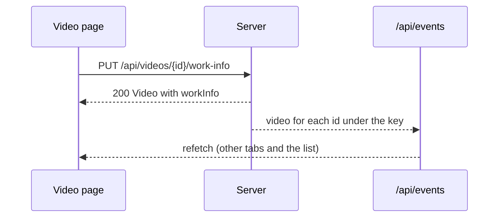

# Contract: Work information in the screen API

Source of truth: `api/openapi.yaml`, operation `setVideoWorkInfo` and the
`performer` and `maker` parameters of `listVideos`, `listLibrary` and
`listLibraryIds`. This document covers only what this feature adds. The
decisions are [research.md R-4](../research.md#r-4-performer-and-maker-list-parameters-matched-by-folded-value-library-only),
[R-5](../research.md#r-5-one-put-that-replaces-the-whole-object-a-cleared-field-is-absent-null-or-empty)
and [R-7](../research.md#r-7-guests-receive-no-work-information-in-responses-search-or-filters).

## `WorkInfo` schema

| Field | Type | Required | Rule |
| --- | --- | --- | --- |
| `code` | string | No | Absent when unset. [data-model.md, Fields](../data-model.md#fields) |
| `releaseDate` | string (`YYYY-MM-DD`) | No | Absent when unset |
| `maker` | string | No | Absent when unset |
| `performers` | string[] | Yes | In the order entered; empty when none |
| `description` | string | No | Absent when unset |
| `sourceUrl` | string (`uri`) | No | Absent when unset |

## `Video` changes

| Field | Type | Rule |
| --- | --- | --- |
| `workInfo` | `WorkInfo` | Only in `GET /api/videos/{id}` and in the responses of the owner's `PUT`s that return `Video`; absent for guests and absent when no field is set. List items, related videos and library items do not carry it |

## `PUT /api/videos/{id}/work-info`

`operationId: setVideoWorkInfo`. Owner only (the default class in
`accessRoutes`). The body is a `WorkInfo` in which every field is optional
(`performers` included) and `null` is accepted for each; a field absent, `null`
or empty after trimming is cleared. The object replaces what is stored.

| Situation | Response |
| --- | --- |
| Saved, including a save that cleared every field | `200` `Video` with `workInfo` (absent when every field cleared) |
| A control character in a field (a line feed outside `description` included) | `400 invalid_request` / `work_info_control_characters`, `field` |
| A field over its length limit | `400 invalid_request` / `work_info_too_long`, `field`, `limit` |
| More than 100 performers | `400 invalid_request` / `too_many_performers`, `field: performers`, `limit: 100` |
| `releaseDate` is not a calendar date in `YYYY-MM-DD` | `400 invalid_request` / `work_info_invalid_date`, `field: releaseDate` |
| `sourceUrl` is not an absolute `http` or `https` URL | `400 invalid_request` / `work_info_invalid_url`, `field: sourceUrl` |
| The video does not exist, or has no location under the media folders | `404 not_found` / `video_not_found` |
| Guest | `401 unauthenticated` (returned by the boundary) |

The first failing field in the order of the [`WorkInfo` schema](#workinfo-schema)
is reported and nothing is written. A write that changes nothing returns `200`
and does not advance `updatedAt`. After a change commits, `video` for every
video under the same user key is sent on `/api/events`.

## List parameters `performer` and `maker`

Added to `listVideos` (`GET /api/videos`), `listLibrary` (`GET /api/library`)
and `listLibraryIds` (`GET /api/library/ids`). Not added to
`listFolderVideos`.

| Name | Type | Default | Meaning |
| --- | --- | --- | --- |
| `performer` | string, 1 to 200 code points | None | Only videos with a performer whose folded name equals the folded value |
| `maker` | string, 1 to 200 code points | None | Only videos whose folded maker equals the folded value |

- Both AND with `query`, `tag`, `watch`, `playable` and `favorite`;
  `total` counts with them applied.
- A value with no match gives an empty list, not an error; nothing like
  `missingTagIds` is reported, because the value itself is the condition.
- Over 200 code points, or empty after trimming, returns `400 invalid_request`.
- From a guest, `400 invalid_request` / `guest_filter_not_allowed`.

In the library URL ([014 list-url.md](../../014-video-tags/contracts/list-url.md)),
`performer` and `maker` are written as given, trimmed; "Clear filters"
removes them with `q`, `watch`, `playable` and `tag`. The list snapshot key
includes both.

## Added `reason` values and `field`

`Error` gains the optional property `field`: the `WorkInfo` property name
(`code`, `releaseDate`, `maker`, `performers`, `description`, `sourceUrl`)
that a `work_info_*` or `too_many_performers` reason refers to.

`ErrorReason` gains `work_info_control_characters`, `work_info_too_long`,
`work_info_invalid_date`, `work_info_invalid_url` and `too_many_performers`,
and `web/src/i18n/errors.ts` gets an English message for each that names
the field.
