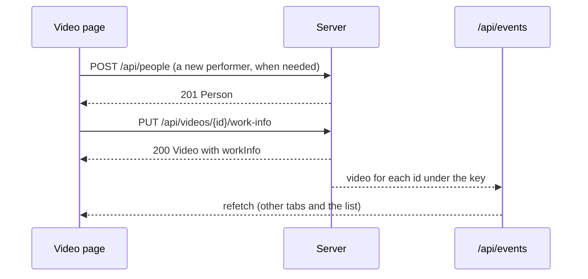
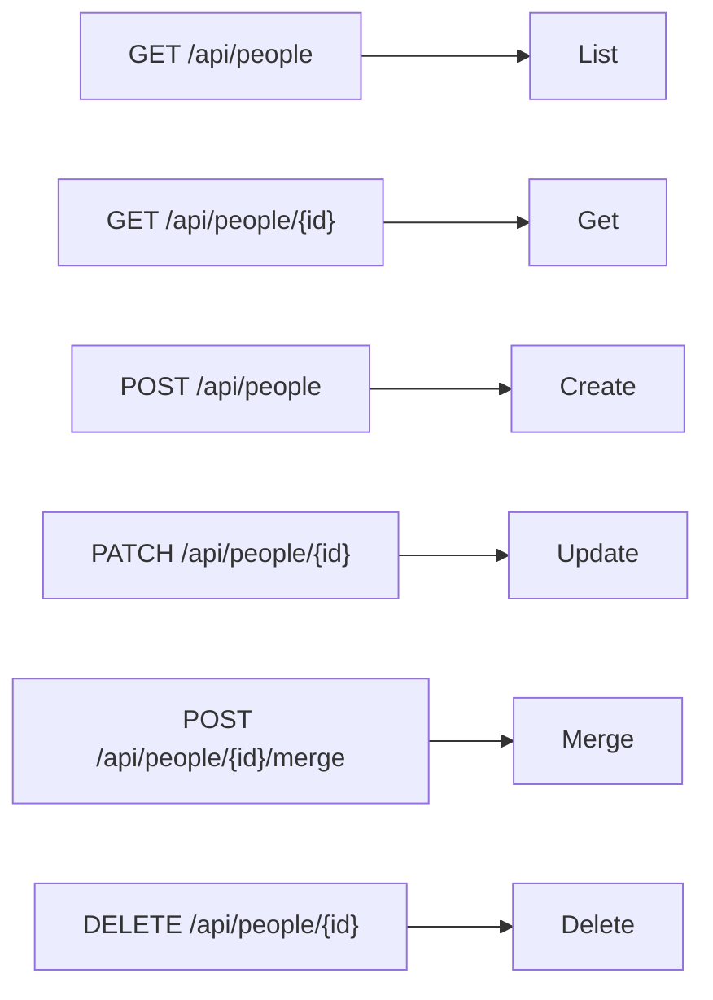

# Contract: Work information, people and organizations in the screen API

Source of truth: `api/openapi.yaml`, the operations `setVideoWorkInfo`,
`listPeople`, `getPerson`, `createPerson`, `updatePerson`, `deletePerson`,
`mergePeople` and their `Organization` counterparts, the schemas `WorkInfo`,
`WorkInfoInput`, `Person`, `Organization`, `CreditInput`, `CreditPatch`,
`CreditList`, and the `person` and `organization` parameters of `listVideos`,
`listLibrary` and `listLibraryIds`. This document covers only what this
feature adds. The decisions are
[research.md R-4](../research.md#r-4-a-video-write-references-people-and-organizations-by-id-creation-has-its-own-route),
[R-5](../research.md#r-5-one-put-that-replaces-the-whole-work-information-object),
[R-7](../research.md#r-7-person-and-organization-list-parameters-by-id-matching-every-role),
[R-8](../research.md#r-8-entity-edits-are-a-patch-of-optional-fields-a-merge-that-moves-links-and-a-delete-that-detaches)
and [R-10](../research.md#r-10-guests-receive-no-work-information-in-responses-search-or-filters).
Every route here is owner only (the default class in `accessRoutes`); routes
with a body join `requiresJSONBody` and the mapping in
`openapi_routes_test.go`.

## `WorkInfo` schema

The response shape. Every list is required and `[]` when empty; a single
value is absent when unset.

| Field | Type | Required | Rule |
| --- | --- | --- | --- |
| `code` | string | No | [data-model.md, Fields](../data-model.md#fields) |
| `description` | string | No | — |
| `dates` | `[{ kind, date }]` | Yes | `kind` enum `release`, `recorded`, `published`; `date` the text of R-12; in kind order |
| `people` | `[{ role, person: { id, name } }]` | Yes | `role` enum `performer`, `director`, `photographer`, `streamer`; in `(role, position)` order; `name` is the person's current name |
| `organizations` | `[{ role, organization: { id, name } }]` | Yes | `role` enum `maker`, `label`; in `(role, position)` order |
| `urls` | string[] | Yes | In the order entered |
| `externalIds` | `[{ source, value }]` | Yes | In `(source, value)` order |

## `WorkInfoInput` schema

The request body of `setVideoWorkInfo` and the `workInfo` of each item of the
external `updateVideoWorkInfo`. It has the seven properties of
[`WorkInfo`](#workinfo-schema), none required and each `nullable`, so `{}`
and `null` clear a field or a list. Its `people[].person` and
`organizations[].organization` carry `id` only (R-4). It is a separate schema
because `WorkInfo` describes a response, in which the lists are required and
the references carry a name.

## `Video` changes

| Field | Type | Rule |
| --- | --- | --- |
| `workInfo` | `WorkInfo` | Only in `GET /api/videos/{id}` and in the responses of the owner's `PUT`s that return `Video`; absent for guests and absent when the video has no rows. List items, related videos and library items do not carry it |

## `PUT /api/videos/{id}/work-info`

`operationId: setVideoWorkInfo`. The body is a
[`WorkInfoInput`](#workinfoinput-schema); the object replaces what is stored.

| Situation | Response |
| --- | --- |
| Saved, including a save that cleared everything | `200` `Video` with `workInfo` (absent when everything cleared) |
| A control character in a string (a line feed outside `description` included) | `400 invalid_request` / `work_info_control_characters`, `field` |
| A string over its length limit | `400 invalid_request` / `work_info_too_long`, `field`, `limit` |
| A list over its entry limit | `400 invalid_request` / `work_info_too_many`, `field`, `limit` |
| A `date` that is not `YYYY`, `YYYY-MM` or a calendar date `YYYY-MM-DD` | `400 invalid_request` / `work_info_invalid_date`, `field` |
| A `url` that is not an absolute `http` or `https` URL | `400 invalid_request` / `work_info_invalid_url`, `field` |
| A repeated date kind, URL, external ID, or person or organization within a role | `400 invalid_request` / `work_info_duplicate`, `field` |
| A `kind` or `role` outside its enum | `400 invalid_request` (the generated schema check) |
| A person id that does not exist | `404 not_found` / `person_not_found`, `field` |
| An organization id that does not exist | `404 not_found` / `organization_not_found`, `field` |
| The video does not exist, or has no location under the media folders | `404 not_found` / `video_not_found` |
| Guest | `401 unauthenticated` (returned by the boundary) |

The first failing field in the order of the [`WorkInfo` schema](#workinfo-schema)
is reported and nothing is written. A write that changes nothing returns `200`
and does not advance `updatedAt`. After a change commits, `video` for every
video under the same user key is sent on `/api/events`.



## List parameters `person` and `organization`

Added to `listVideos` (`GET /api/videos`), `listLibrary` (`GET /api/library`)
and `listLibraryIds` (`GET /api/library/ids`). Not added to
`listFolderVideos`.

| Name | Type | Default | Meaning |
| --- | --- | --- | --- |
| `person` | int64 | None | Only videos linked to that person in any role |
| `organization` | int64 | None | Only videos linked to that organization in any role |

- Both AND with `query`, `tag`, `watch`, `playable` and `favorite`;
  `total` counts with them applied.
- An id with no entity gives an empty list, not an error, and nothing like
  `missingTagIds` is reported; the screen learns that the entity is gone from
  the `404` of `GET /api/people/{id}` when it reads the name for the active
  filter, removes the parameter and reports it.
- A value that is not a positive integer returns `400 invalid_request`.
- From a guest, `400 invalid_request` / `guest_filter_not_allowed`.

In the library URL ([014 list-url.md](../../014-video-tags/contracts/list-url.md)),
`person` and `organization` are written as the id; "Clear filters" removes
them with `q`, `watch`, `playable` and `tag`. The list snapshot key includes
both.

## People and organizations

The same routes exist under `/api/people` and `/api/organizations`; the
organization routes add `parent`. The diagram shows which store operation
each route reaches.



```yaml
Alias:
  type: object
  required: [name]
  properties:
    name:     { type: string }
    language: { type: string }          # absent when not given

ExternalId:
  type: object
  required: [source, value]
  properties:
    source: { type: string }
    value:  { type: string }

Person:
  type: object
  required: [id, name, aliases, externalIds, videoCount, createdAt]
  properties:
    id:          { type: integer, format: int64 }
    name:        { type: string }
    aliases:     { type: array, items: { $ref: "#/components/schemas/Alias" } }
    externalIds: { type: array, items: { $ref: "#/components/schemas/ExternalId" } }
    videoCount:  { type: integer }      # shown videos linked in any role
    createdAt:   { type: string, format: date-time }

Organization:                           # Person plus
  properties:
    parent: { $ref: "#/components/schemas/CreditRef" }   # { id, name }; absent at the root

CreditInput:                            # POST body
  required: [name]
  properties: { name, aliases, externalIds, parentId }    # parentId: organizations only

CreditPatch:                            # PATCH body; every property optional, lists nullable
  properties: { name, aliases, externalIds, parentId }    # parentId null clears

CreditList:
  required: [items, total, totalAll]
  properties: { items, total, totalAll, nextCursor }
```

| Route | Body or parameters | Success | Errors |
| --- | --- | --- | --- |
| `GET /api/people` | `q` (at most 100 characters), `sort` (`name`, `countDesc`, `countAsc`, `createdDesc`, `createdAsc`; default `name`), `cursor`, `limit` (1 to 200; absent returns every entity) | `200 CreditList` of `Person` | `400` (`sort`, `limit`, `q` length), `400 invalid_cursor` |
| `GET /api/people/{id}` | — | `200 Person` | `404 person_not_found` |
| `POST /api/people` | `CreditInput` | `201 Person` | `400` (the field errors of [`PUT /api/videos/{id}/work-info`](#put-apivideosidwork-info) with `field` of `name`, `aliases[i].name`, `aliases[i].language` (`work_info_invalid_language`), `externalIds[i].source`, `externalIds[i].value`); `409 conflict` / `external_id_taken` with `field: externalIds[i]` when another person holds that `(source, value)` |
| `PATCH /api/people/{id}` | `CreditPatch` | `200 Person` (unchanged when nothing differs) | `400` as above, `404 person_not_found`, and the `409` of `POST` |
| `DELETE /api/people/{id}` | — | `204`; link rows are removed | `404 person_not_found` |
| `POST /api/people/{id}/merge` | `{ sourceIds: int64[] }`, 1 to 20,000 entries | `200 { person: Person, notFoundIds: int64[] }` | `400 work_info_too_many` with `field: sourceIds` and `limit`; `400 work_info_too_many` with `field: aliases` (limit 50) or `externalIds` (limit 20) when the merged entity would hold more; `400 merge_same_person`; `404 person_not_found` (the target). Nothing changes on an error |
| `GET /api/organizations` and the five others | As above, with `Organization`, `organization_not_found`, `merge_same_organization` | — | `POST` and `PATCH` add `404 organization_not_found` with `field: parentId` when the parent does not exist, and `400 organization_parent_cycle` when `parentId` is the organization or a descendant; merge adds `400 organization_parent_cycle` when a source is the target's parent or another ancestor, because its children would move under the target |

- The video page's combobox reads `GET /api/people?q=…&limit=…` for
  candidates (names and aliases match) and shows the id's current name; a
  pick sends the id, and `Create "…"` sends `POST /api/people { name }` first
  (R-4).
- The list screens read pages of 100 with `nextCursor`, as the tag page does
  ([036 screen-api.md, `GET /api/tags` parameters](../../036-tag-admin-scale/contracts/screen-api.md#get-apitags-parameters)).
- The delete and merge confirmations use `videoCount` from the list.

## Added `reason` values and `field`

`Error` gains the optional property `field`: the path of the property a
`work_info_*`, `person_not_found`, `organization_not_found` or
`external_id_taken` reason refers to, as the JSON property names joined by `.` with list positions in brackets:
`code`, `dates[1].date`, `people[0].person.id`, `aliases[2].language`,
`parentId`. In the external bulk operation `index` stays the position in
`items`, and `field` is the path inside that item's `workInfo`.

`ErrorReason` gains `work_info_control_characters`, `work_info_too_long`,
`work_info_too_many`, `work_info_invalid_date`, `work_info_invalid_url`,
`work_info_invalid_language`, `work_info_duplicate`, `person_not_found`,
`organization_not_found`, `organization_parent_cycle`, `merge_same_person`,
`merge_same_organization` and `external_id_taken`, and
`web/src/i18n/errors.ts` gets an English message for each that names the
field.
