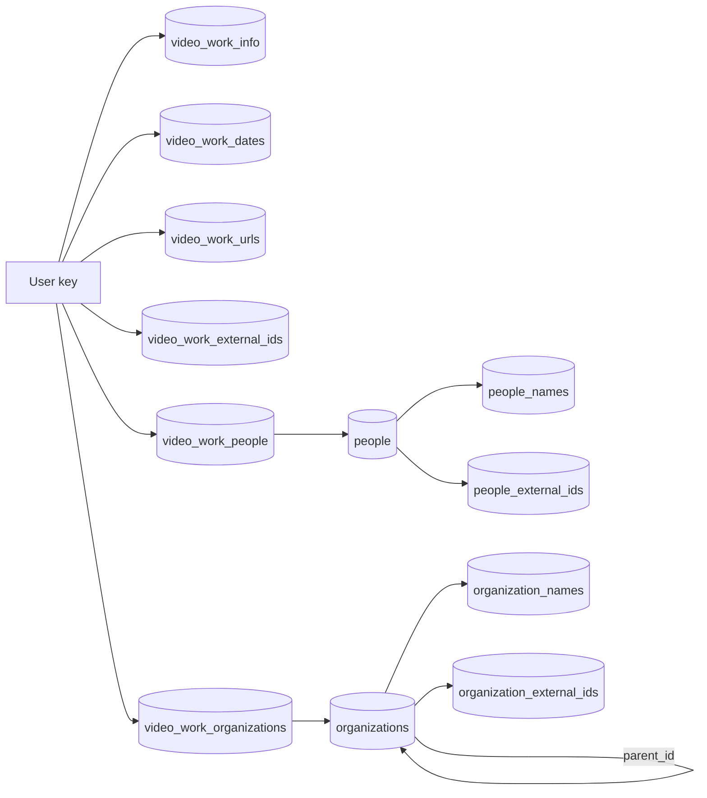
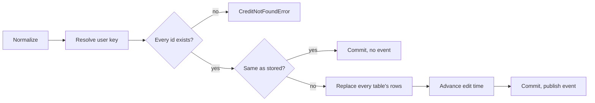

# Data model: Work information on videos

Parent Issue: #967.

The rest of the model is unchanged: the existing tables are defined by
[internal/store/migrations/](../../internal/store/migrations/), the split
between the rebuildable index and user data is in
[ARCHITECTURE.md](../../ARCHITECTURE.md), and the user key and the paths that
copy user data are in
[specs/030-video-versions/data-model.md, User key](../030-video-versions/data-model.md#user-key).
This file holds only the tables, values and rules this feature adds. No column
is added to `videos`, `video_locations`, `video_overrides` or `video_tags`.

The diagram shows the tables this feature adds and what links them.



## Migration

The last migration on `main` is `00041_thumbnail_image_sources.sql`. This
feature adds `00042_work_info.sql`; a migration that has landed is never
edited (`scripts/migrations-immutable.sh`).

```sql
-- Entities (research.md R-3). autoincrement keeps a deleted id from being reused.
create table people (
    id         integer primary key autoincrement,
    created_at integer not null
);
create table organizations (
    id         integer primary key autoincrement,
    parent_id  integer references organizations (id) on delete set null,
    created_at integer not null
);

-- Names and aliases: one row per spelling per entity; canonical = 1 is the name shown.
-- Two entities may share a spelling (same name, different people).
create table people_names (
    person_id      integer not null references people (id) on delete cascade,
    name           text    not null,
    canonical      integer not null check (canonical in (0, 1)),
    language       text,                            -- aliases only; null when not given
    search_key     text    not null default '',     -- domain.FoldForMatch(name)
    sort_key       text    not null default '',     -- domain.NaturalSortKey(name), canonical rows
    search_version integer not null default 0,
    primary key (person_id, name)
) without rowid;
create unique index people_names_canonical_idx on people_names (person_id) where canonical = 1;
create table organization_names (
    organization_id integer not null references organizations (id) on delete cascade,
    name            text    not null,
    canonical       integer not null check (canonical in (0, 1)),
    language        text,
    search_key      text    not null default '',
    sort_key        text    not null default '',
    search_version  integer not null default 0,
    primary key (organization_id, name)
) without rowid;
create unique index organization_names_canonical_idx on organization_names (organization_id) where canonical = 1;

create table people_external_ids (
    person_id integer not null references people (id) on delete cascade,
    source    text    not null,
    value     text    not null,
    primary key (person_id, source, value)
) without rowid;
-- An external ID names one entity of a kind, so Lookup has one answer.
create unique index people_external_ids_lookup_idx on people_external_ids (source, value);
create table organization_external_ids (
    organization_id integer not null references organizations (id) on delete cascade,
    source          text    not null,
    value           text    not null,
    primary key (organization_id, source, value)
) without rowid;
create unique index organization_external_ids_lookup_idx on organization_external_ids (source, value);

-- Per-video tables (research.md R-2). content_key holds the user key; no foreign key to videos
-- and none between these tables, so the bundle paths copy each one alone; succession moves the six together.
create table video_work_info (
    content_key    text    primary key,
    code           text,
    code_key       text    not null default '',     -- domain.FoldForMatch(code)
    description    text,
    search_version integer not null default 0
) without rowid;
create table video_work_dates (
    content_key text not null,
    kind        text not null check (kind in ('release', 'recorded', 'published')),
    date        text not null,                      -- YYYY, YYYY-MM or YYYY-MM-DD
    primary key (content_key, kind)
) without rowid;
create table video_work_urls (
    content_key text    not null,
    position    integer not null,
    url         text    not null,
    primary key (content_key, position),
    unique (content_key, url)
) without rowid;
create table video_work_external_ids (
    content_key text not null,
    source      text not null,
    value       text not null,
    primary key (content_key, source, value)
) without rowid;
create table video_work_people (
    content_key text    not null,
    role        text    not null check (role in ('performer', 'director', 'photographer', 'streamer')),
    position    integer not null,
    person_id   integer not null references people (id) on delete cascade,
    primary key (content_key, role, position),
    unique (content_key, role, person_id)
) without rowid;
create index video_work_people_person_idx on video_work_people (person_id, content_key);
create table video_work_organizations (
    content_key     text    not null,
    role            text    not null check (role in ('maker', 'label')),
    position        integer not null,
    organization_id integer not null references organizations (id) on delete cascade,
    primary key (content_key, role, position),
    unique (content_key, role, organization_id)
) without rowid;
create index video_work_organizations_org_idx on video_work_organizations (organization_id, content_key);
```

Down drops the twelve tables. All of them are user data: they join the user
data row of
[running-vv.md, Data and recovery](../../docs/how-to/running-vv.md#data-and-recovery)
and the list in ARCHITECTURE.md "User data survives a rebuild".

## Fields

Every string goes through the display name steps first: a control character
anywhere is an error (except the line feed in `description`), surrounding
whitespace is trimmed, and an empty result clears the field or drops the list
entry
([029 R-10](../029-video-overrides/research.md#r-10-display-name-rules-follow-tag-name-rules-with-a-200-code-point-limit)).
Two values may not be empty and are refused with the problem `Empty`
(`work_info_empty`) instead: an entity `name`, and one half of an external ID
whose other half is set. Stored spellings are not folded or normalized;
matching folds them (R-6).

Each entry of a list is checked in the order sent, and a `field` path names
the position in the list as sent, counting the entries that are dropped. A
list's entry limit counts the entries left after dropping. A repeated value
is reported at its second occurrence.

| Field | Table | Rule |
| --- | --- | --- |
| `code` | `video_work_info.code` | At most 100 code points; `code_key` is `FoldForMatch(code)` |
| `description` | `video_work_info.description` | At most 10,000 code points; line feeds allowed |
| `dates[].kind` | `video_work_dates.kind` | One of `release`, `recorded`, `published`; one entry per kind ([R-12](research.md#r-12-one-date-per-kind-in-yyyy-yyyy-mm-or-yyyy-mm-dd)) |
| `dates[].date` | `video_work_dates.date` | `YYYY`, `YYYY-MM` or `YYYY-MM-DD`; year 1 to 9999, month 1 to 12, a day that exists in that month |
| `urls[]` | `video_work_urls.url` | 0 to 20 entries, each at most 2,048 code points, an absolute `http` or `https` URL with a host; `position` is the index; a repeated URL is an error |
| `externalIds[]` | `video_work_external_ids` | 0 to 20 entries; `source` 1 to 50 code points, `value` 1 to 200; an entry with both halves empty is dropped, and one with exactly one empty half is `Empty` with `field` `externalIds[i].source` or `externalIds[i].value`; a repeated `(source, value)` is `Duplicate` with `field` `externalIds[i]` |
| `people[]` | `video_work_people` | 0 to 100 entries per role; `role` one of `performer`, `director`, `photographer`, `streamer`; `id` an existing person; `position` is the index within the role; the same person twice in one role is an error |
| `organizations[]` | `video_work_organizations` | 0 to 20 entries per role; `role` one of `maker`, `label`; `id` an existing organization; the same organization twice in one role is an error |
| Entity `name` | `*_names` with `canonical = 1` | 1 to 200 code points; empty after trimming is `Empty` with `field: name`, as `tag_name_empty` is for a tag |
| Entity `aliases[]` | `*_names` with `canonical = 0` | 0 to 50 entries, each `name` 1 to 200 code points; an alias whose name is empty after trimming is dropped, even when it has a `language`; an alias equal to the name or to another alias (compared exactly, not folded) is `Duplicate` with `field` `aliases[i].name` |
| Entity `aliases[].language` | `*_names.language` | Optional, empty after trimming means none; at most 35 characters (`TooLong`), and otherwise the syntax of a BCP 47 tag, `^[A-Za-z]{2,3}(-[A-Za-z0-9-]*)?$`: ASCII letters, digits and `-`, starting with a subtag of 2 or 3 letters (`InvalidLanguage`); not otherwise validated |
| Entity `externalIds[]` | `*_external_ids` | 0 to 20 entries, the rules of `externalIds[]` above; a `(source, value)` that another entity of the same kind holds is an error (`CreditExternalIDTakenError`) |
| Organization `parentId` | `organizations.parent_id` | An existing organization that is neither the organization itself nor one of its descendants; `null` clears. A person has no parent, and `CreditStore` does not read `parentId` for one |

A cleared single-value field is `null`; a `video_work_info` row exists only
while `code` or `description` is set.

## Entities

A person or organization is read as `domain.Credit`: the canonical name,
the aliases in natural order of their names, the external IDs in `(source,
value)` order, the count of shown videos linked in any role, and for an
organization its parent's id and name. `CreditStore` is one role type that
takes `domain.CreditKind` (`person` or `organization`) and resolves it to the
table names; the SQL is written once.

| Operation | Behaviour |
| --- | --- |
| `List(kind, CreditQuery)` | `q` folded and matched with `instr` on `search_key` of every name row (names and aliases); `sort` one of `name`, `countDesc`, `countAsc`, `createdDesc`, `createdAsc` with the tie-break of [036 R-1](../036-tag-admin-scale/research.md#r-1-the-server-pages-the-list-and-applies-search-filters-and-sort-to-every-tag); keyset `cursor` and `limit` 1 to 200, every entity when `limit` is absent; `total` counts the matches and `totalAll` every entity |
| `Get(kind, id)` | The entity, or `domain.ErrNotFound` |
| `Lookup(kind, source, value)` | The entity holding exactly that external ID, or `domain.ErrNotFound` |
| `Create(kind, CreditInput)` | One transaction: normalize, refuse an external ID another entity of the kind holds, insert the entity, its canonical row, its alias rows and its external IDs; for an organization check the parent |
| `Update(kind, id, CreditPatch)` | One transaction: the present fields are laid over the stored entity and the result is normalized; a list replaces the stored rows whole; a new `name` equal to an alias the patch keeps is `Duplicate` with `field: name`, as a tag rename onto its own synonym is refused; an external ID another entity of the kind holds is refused; the parent is checked for a cycle by walking `parent_id` from the new parent up to the root; a patch that changes nothing returns the entity unchanged |
| `Merge(kind, targetID, sourceIDs)` | One transaction: a source equal to the target is `ErrMergeSameCredit`; for an organization, walk `parent_id` from the target up to the root and refuse with `ErrCreditParentCycle` when a source is on the chain, since pointing that source's children at the target would close a loop. Then, for each source, move its link rows to the target (`update or ignore` re-points a source's row at the target in its position, so the target takes the source's place in the list; where the target is already in that `(content_key, role)` the unique index keeps the row, which is then deleted, and that `(content_key, role)` is renumbered densely), move its name rows as aliases (`insert or ignore`, so a spelling the target already has is dropped), re-point its external IDs at the target (`update`; the unique `(source, value)` index means the target cannot already hold one), point the children of a source organization at the target, delete the source. Last, count the target's aliases and external IDs: over 50 or 20 rolls the transaction back with `InvalidWorkInfoError{Field: "aliases" or "externalIds", Problem: TooMany, Limit}`, so a merge never leaves an entity that `NormalizeCredit` would refuse. Missing sources are listed in `NotFoundIDs` |
| `Delete(kind, id)` | Deletes the entity; names, external IDs and link rows cascade; the children of an organization get `parent_id = null`; the remaining positions of each `(content_key, role)` are renumbered |
| `RefreshSearchKeys` | At startup, after `TagStore.RefreshSearchKeys`: rewrites `search_key` and `sort_key` of name rows and `code_key` of `video_work_info` rows whose `search_version` is below `domain.SearchKeyVersion` |

## Values added to `domain`

| Value | Meaning |
| --- | --- |
| `WorkInfo{Code, Description string; Dates []WorkDate; People []WorkPerson; Organizations []WorkOrganization; URLs []string; ExternalIDs []ExternalID}` | The object of one video; an unset field is the empty string or an empty list |
| `WorkDate{Kind DateKind, Date string}`, `WorkPerson{Role PersonRole, Person CreditRef}`, `WorkOrganization{Role OrganizationRole, Organization CreditRef}`, `ExternalID{Source, Value string}` | The list entries; `CreditRef{ID int64, Name string}` carries the name for reads and only the id for writes |
| `DateKind`, `PersonRole`, `OrganizationRole` | The fixed sets of [Fields](#fields), as string constants |
| `NormalizeWorkInfo(input WorkInfo) (WorkInfo, empty bool, error)` | Applies [Fields](#fields) except the existence of the ids, which the store checks; `empty` is true when every field cleared |
| `WorkInfoLimits` | The limits above, read by the API for `limit` |
| `InvalidWorkInfoError{Field, Problem, Limit}` with `Problem` one of `ControlCharacters`, `TooLong`, `TooMany`, `InvalidDate`, `InvalidURL`, `InvalidLanguage`, `Duplicate`, `Empty` | Unwraps to `ErrInvalidWorkInfo`; `Field` is the path of [contracts/screen-api.md, Added `reason` values and `field`](contracts/screen-api.md#added-reason-values-and-field) |
| `CreditNotFoundError{Kind, ID, Field}` | A referenced id that does not exist; the API maps it to `404` with `person_not_found` or `organization_not_found` and `field` |
| `WorkInfoChange{Video VideoRef, WorkInfo WorkInfo}`, `WorkInfoAtError{Index int, Err error}` | The external bulk operation's item and its positioned error, shaped like `DisplayNameChange` and `DisplayNameAtError` |
| `Video.WorkInfo *WorkInfo` | Filled by the detail read and the external reads; `nil` in list reads and when the video has no rows |
| `CreditKind` (`person`, `organization`), `Credit{Kind, ID, Name, Aliases []Alias, ExternalIDs, Parent *CreditRef, VideoCount, CreatedAt}`, `Alias{Name, Language string}` | The entity ([Entities](#entities)) |
| `CreditInput{Name, Aliases, ExternalIDs, ParentID *int64}`, `CreditPatch` (the same fields, each optional), `CreditQuery{Q, Sort, Cursor, Limit}`, `CreditPage{Items, Total, TotalAll, NextCursor}`, `CreditMergeOutcome{Credit, NotFoundIDs}` | The inputs and outputs of `CreditStore` |
| `NormalizeCredit`, `ErrCreditParentCycle`, `ErrMergeSameCredit` | The entity rules of [Fields](#fields) and the two refusals |
| `CreditExternalIDTakenError{Kind, Field, HolderID}` | An entity external ID that another entity of the kind holds; the API maps it to `409 conflict` / `external_id_taken` with `field` |
| `VideoQuery.Person`, `VideoQuery.Organization` (int64) | The list filters of [R-7](research.md#r-7-person-and-organization-list-parameters-by-id-matching-every-role); zero means no filter |
| `VideoWorkInfoChanged{VideoIDs []int64}` | The event of [R-11](research.md#r-11-a-work-information-write-publishes-videoworkinfochanged-entity-edits-publish-nothing) |

`Audience.CheckVideoQuery` returns `ErrGuestQueryNotAllowed` when a guest sets
`Person` or `Organization`.

## Reads

| Read | Source | Behaviour |
| --- | --- | --- |
| `GET /api/videos/{id}` | `WorkInfoStore.ByUserKeys` after `getVideo`, keyed by `Video.UserKey` | The owner's response carries `workInfo`; `forAudience` removes it for guests |
| `GET /api/v1/videos`, `GET /api/v1/videos/lookup` | `WorkInfoStore.ByUserKeys` for the page's user keys, as `TagsByContentKeys` is read | Every item carries `workInfo` |
| Lists (`listColumns`) | Not read | Cards do not show work information |

`ByUserKeys` returns people and organizations in `(role, position)` order,
each with its canonical name, URLs in `position` order, dates in kind order
`release`, `recorded`, `published`, and external IDs in `(source, value)`
order.

## Writes (`WorkInfoStore`)

`WorkInfoStore` is a new role type holding the `sql` connection and the event
publisher, like `FavoriteStore`. It resolves video ids with
`userKeysForVideoIDs` (one key per bundle) and external references with
`resolveTaggableVideos`.



| Operation | Behaviour |
| --- | --- |
| `Set(videoID, WorkInfo)` | One transaction: normalize, resolve the key, check every referenced id, compare with the stored object, replace the rows of the six tables (no `video_work_info` row when `code` and `description` are both cleared), write `code_key` and `search_version`, call `touchEditedAtForUserKeys` when the object changed, return the video with `WorkInfo` |
| `SetMany([]WorkInfoChange)` | The same for every item in one transaction; a later item for the same video wins; the first error aborts with `WorkInfoAtError` or `VideoRefNotFoundError` |
| `SetDetails(videoID, displayName, WorkInfo)` | One transaction ([R-14](research.md#r-14-the-editor-saves-the-display-name-and-the-work-information-with-one-put-apivideosiddetails-in-one-transaction)): `NormalizeDisplayName` first, then `NormalizeWorkInfo`, either error returned before anything is written; resolve the content key (`registeredContentKeysForVideoIDs`) and the user key; check every referenced id; write the display name with `writeDisplayName` and `refreshSearchKeysForContentKeys` when it differs from `displayNamesOf`; replace the six tables' rows as `Set` does when the object differs; advance the edit time once with one `touchEditedAt` call over the deduplicated union of the edited video's content key when the name differs and every member content key of the user key (`contentKeysForUserKeys`, as `touchEditedAtForUserKeys` expands it) when the object differs, so every member of a bundle carries the edit time of the shared object; return the video with `WorkInfo`. After commit, publish `VideoOverrideChanged{VideoID}` when the name changed and `VideoWorkInfoChanged{VideoIDs}` when the object changed; a write that changes neither publishes nothing |
| `ByUserKeys(keys)` | The objects of [Reads](#reads) |

## Search

For the owner, the term condition of `searchExprCondition` gains three
branches beside the location key and the tag names, all on the user key of
the location's video:

```sql
exists (select 1 from video_work_info wi
        where wi.content_key = <userKeyExpr(v)> and instr(wi.code_key, ?) > 0)
or exists (select 1 from video_work_people vp join people_names pn on pn.person_id = vp.person_id
           where vp.content_key = <userKeyExpr(v)> and instr(pn.search_key, ?) > 0)
or exists (select 1 from video_work_organizations vo join organization_names onm on onm.organization_id = vo.organization_id
           where vo.content_key = <userKeyExpr(v)> and instr(onm.search_key, ?) > 0)
```

The same folded term is passed three more times. The guest condition does not
change. An excluded term negates the whole OR, as it does for tag names.

## Lists

`filteredFrom` and `libraryItemsCTE` gain, when `Person` or `Organization` is
set:

| Filter | Condition on the video |
| --- | --- |
| `Person` | `exists (select 1 from video_work_people vp where vp.content_key = <userKeyExpr(videos)> and vp.person_id = ?)` |
| `Organization` | `exists (select 1 from video_work_organizations vo where vo.content_key = <userKeyExpr(videos)> and vo.organization_id = ?)` |

Both apply to the matched members step of
[027 library-api.md, How `GET /api/library` builds items](../027-partial-group-search/contracts/library-api.md#how-get-apilibrary-builds-items),
where the tag AND applies, so a group matched only in part shows its matched
members as video items. `total` counts with the filters applied. An id with
no entity matches nothing and is not an error.

`VideoCount` of an entity counts the distinct user keys of shown videos
(`shownVideoCondition` as the owner) that a link row of any role names, computed
per page like the tag counts of
[014 data-model.md, Video counts](../014-video-tags/data-model.md#video-counts).

## Bundles and succession

| Path | Change |
| --- | --- |
| `userDataTables` | The six per-video tables are appended with their non-key columns, so bundling copies the representative's rows to the bundle key and unbundling leaves each member's own rows ([030 R-1](../030-video-versions/research.md#r-1-bundles-live-in-user-data-tables-and-bundle-values-sit-in-the-existing-tables-under-the-bundles-own-key)) |
| `moveUserData` | The six tables move as one object, not table by table: when the old key has a row in any of them, the new key's rows are deleted from all six, then the old key's rows are re-keyed. The per-table rule of the existing loop (the `playback_progress` rule) would keep a table the old key leaves empty, so the new key would end with one video's people and another video's dates. A store test covers a succession with people linked, with no work information under the new key, and with a new key holding a date and a URL the old key does not have, which the succession clears |

## Rules

| Rule | Enforced in |
| --- | --- |
| A `video_work_info` row has `code` or `description` set | `WorkInfoStore` (writes no row when both are cleared); `invariants_test.go` |
| `position` values of one `(content_key, role)` and of one key's URLs are `0..n-1` | `WorkInfoStore` writes lists whole; `CreditStore.Merge` and `Delete` renumber; `invariants_test.go` |
| Every entity has exactly one `canonical = 1` name row | `CreditStore`; `invariants_test.go` |
| `language` is null on a canonical row | `CreditStore`; `invariants_test.go` |
| `parent_id` chains end at a root (no cycle) | `CreditStore.Update` and `Create` walk the chain from the new parent, `Merge` from the target; `invariants_test.go` |
| An entity holds at most 50 aliases and 20 external IDs | `NormalizeCredit` on create and update, the count at the end of `Merge`; `invariants_test.go` |
| A `(source, value)` names at most one entity of a kind | The unique lookup indexes; `CreditStore.Create` and `Update` report `CreditExternalIDTakenError` |
| `code_key`, `search_key` and `sort_key` equal the fold of their values at `search_version = SearchKeyVersion` | Written in the same statement as the values; `RefreshSearchKeys` |
| The field rules of [Fields](#fields) | `domain.NormalizeWorkInfo` and `domain.NormalizeCredit`, called by every write |

## What does not change

- `video_overrides` and the display name stay per content key: the title
  follows the representative, work information follows the bundle (R-2).
  `SetDetails` writes each under its own key in one transaction and adds no
  table or column for the pair (R-14).
- The location `search_key` and `title_key`, and `SearchKeyVersion`, do not
  change; sorting by title does not read work information.
- Lists and cards do not carry work information; the detail read does.
- Tags, tag names and the tag filter are untouched; a person is not a tag.
