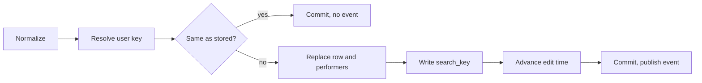

# Data model: Work information on videos

Parent Issue: #967.

The rest of the model is unchanged: the existing tables are defined by
[internal/store/migrations/](../../internal/store/migrations/), the split
between the rebuildable index and user data is in
[ARCHITECTURE.md](../../ARCHITECTURE.md), and the user key and the paths that
copy user data are in
[specs/030-video-versions/data-model.md, User key](../030-video-versions/data-model.md#user-key).
This file holds only the tables, values and rules this feature adds. No column
is added to `videos`, `video_locations`, `video_overrides` or `video_tags`.

## Migration

The last migration on `main` is `00041_thumbnail_image_sources.sql`. This
feature adds `00042_video_work_info.sql`; a migration that has landed is never
edited (`scripts/migrations-immutable.sh`).

```sql
create table video_work_info (
    content_key    text    primary key,
    code           text,
    release_date   text,
    maker          text,
    maker_key      text,
    description    text,
    source_url     text,
    search_key     text    not null default '',
    search_version integer not null default 0,
    updated_at     integer not null
) without rowid;
create index video_work_info_maker_idx on video_work_info (maker_key);

create table video_work_performers (
    content_key text    not null references video_work_info (content_key) on delete cascade,
    position    integer not null,
    name        text    not null,
    name_key    text    not null,
    primary key (content_key, position)
) without rowid;
create index video_work_performers_name_idx on video_work_performers (name_key, content_key);
```

Down drops both tables. `content_key` holds the user key, as it does in
`video_favorites`; the column keeps that name so that `userDataTables` and
`moveUserData` copy it with the same statement as the other tables. Both
tables are user data: they join the user data row of
[running-vv.md, Data and recovery](../../docs/how-to/running-vv.md#data-and-recovery)
and the list in ARCHITECTURE.md "User data survives a rebuild".

## Fields

| Field | Column | Type | Rule |
| --- | --- | --- | --- |
| `code` | `code` | string | At most 100 code points |
| `releaseDate` | `release_date` | string `YYYY-MM-DD` | A calendar date, year 1 to 9999 |
| `maker` | `maker` | string | At most 200 code points; `maker_key` is `FoldForMatch(maker)` |
| `performers` | `video_work_performers` rows | ordered list of strings | 0 to 100 names, each at most 200 code points; `position` is the index in the list; `name_key` is `FoldForMatch(name)` |
| `description` | `description` | string | At most 10,000 code points; line feeds are allowed, other control characters are not |
| `sourceUrl` | `source_url` | string | At most 2,048 code points; an absolute `http` or `https` URL with a host |

A cleared field is `null` in its column; a `video_work_info` row exists only
while at least one field is set or at least one performer exists. Every string
field goes through the display name steps first: a control character anywhere
is an error (except the line feed in `description`), surrounding whitespace is
trimmed, and an empty result clears the field
([029 R-10](../029-video-overrides/research.md#r-10-display-name-rules-follow-tag-name-rules-with-a-200-code-point-limit)).
Two performers with the same spelling after trimming keep the first.

## Values added to `domain`

| Value | Meaning |
| --- | --- |
| `WorkInfo{Code, ReleaseDate, Maker, Performers []string, Description, SourceURL string}` | The six fields; an unset field is the empty string, an unset list is empty |
| `NormalizeWorkInfo(input WorkInfo) (WorkInfo, empty bool, error)` | Applies [Fields](#fields); `empty` is true when every field cleared |
| `WorkInfoLimits` (`CodeMaxLength` 100, `MakerMaxLength` 200, `PerformerMaxLength` 200, `PerformersMaxCount` 100, `DescriptionMaxLength` 10000, `SourceURLMaxLength` 2048) | The limits above, read by the API for `limit` |
| `WorkInfoField` (`code`, `releaseDate`, `maker`, `performers`, `description`, `sourceUrl`) | The field an error names; the values are the JSON property names |
| `InvalidWorkInfoError{Field, Problem, Limit}` with `Problem` one of `ControlCharacters`, `TooLong`, `InvalidDate`, `InvalidURL`, `TooMany` | Unwraps to `ErrInvalidWorkInfo`; the API maps `Problem` to a reason ([contracts/screen-api.md, Added `reason` values and `field`](contracts/screen-api.md#added-reason-values-and-field)) |
| `WorkInfoChange{Video VideoRef, WorkInfo WorkInfo}`, `WorkInfoAtError{Index int, Err error}` | The external bulk operation's item and its positioned error, shaped like `DisplayNameChange` and `DisplayNameAtError` |
| `Video.WorkInfo *WorkInfo` | Filled by the detail read and the external reads; `nil` in list reads and when no row exists |
| `VideoQuery.Performer`, `VideoQuery.Maker` (string) | The list filters of [R-4](research.md#r-4-performer-and-maker-list-parameters-matched-by-folded-value-library-only); empty means no filter |
| `VideoWorkInfoChanged{VideoIDs []int64}` | The event of [R-8](research.md#r-8-a-change-publishes-domainvideoworkinfochanged-mapped-to-the-screens-video-notification) |

`Audience.CheckVideoQuery` returns `ErrGuestQueryNotAllowed` when a guest sets
`Performer` or `Maker`.

## Reads

| Read | Source | Behaviour |
| --- | --- | --- |
| `GET /api/videos/{id}` | `WorkInfoStore.ByUserKeys` after `getVideo`, keyed by `Video.UserKey` | The owner's response carries `workInfo`; `forAudience` removes it for guests |
| `GET /api/v1/videos`, `GET /api/v1/videos/lookup` | `WorkInfoStore.ByUserKeys` for the page's user keys, as `TagsByContentKeys` is read | Every item carries `workInfo` |
| Lists (`listColumns`) | Not read | Cards do not show work information |

`ByUserKeys` returns the performers in `position` order.

## Writes (`WorkInfoStore`)

`WorkInfoStore` is a new role type holding only the `sql` connection and the
event publisher, like `FavoriteStore`. It resolves video ids with
`userKeysForVideoIDs` (one key per bundle) and external references with
`resolveTaggableVideos`.



| Operation | Behaviour |
| --- | --- |
| `Set(videoID, WorkInfo)` | One transaction: normalize, resolve the key, compare with the stored object, replace the `video_work_info` row and its performers (delete the row when `empty`), write `search_key` and `search_version`, call `touchEditedAtForUserKeys` when the object changed, return the video with `WorkInfo` |
| `SetMany([]WorkInfoChange)` | The same for every item in one transaction; a later item for the same video wins; the first error aborts with `WorkInfoAtError` or `VideoRefNotFoundError` |
| `RefreshSearchKeys` | At startup, after `TagStore.RefreshSearchKeys`: rewrites `search_key`, `maker_key` and `name_key` of rows whose `search_version` is below `domain.SearchKeyVersion` |

`search_key` is the folded code, the folded maker and the folded performer
names joined by `\n`, each with its own newlines replaced by spaces, so no term
matches across two values.

## Search

For the owner, the term condition of `searchExprCondition` gains a third
branch beside the location key and the tag names:

```sql
exists (select 1 from videos v join video_work_info wi on wi.content_key = <userKeyExpr(v)>
        where v.id = <alias>.video_id and v.content_key <> '' and instr(wi.search_key, ?) > 0)
```

The same folded term is passed once more. The guest condition does not change.

## Lists

`filteredFrom` and `libraryItemsCTE` gain, when `Performer` or `Maker` is set:

| Filter | Condition on the video |
| --- | --- |
| `Performer` | `exists (select 1 from video_work_performers p where p.content_key = <userKeyExpr(videos)> and p.name_key = ?)` with `FoldForMatch(Performer)` |
| `Maker` | `exists (select 1 from video_work_info wi where wi.content_key = <userKeyExpr(videos)> and wi.maker_key = ?)` with `FoldForMatch(Maker)` |

Both apply to the matched members step of
[027 library-api.md, How `GET /api/library` builds items](../027-partial-group-search/contracts/library-api.md#how-get-apilibrary-builds-items),
where the tag AND applies, so a group matched only in part shows its matched
members as video items. `total` counts with the filters applied.

## Bundles and succession

| Path | Change |
| --- | --- |
| `userDataTables` | `video_work_info` and then `video_work_performers` are appended, so bundling copies the representative's row and names to the bundle key and unbundling leaves each member's own rows ([030 R-1](../030-video-versions/research.md#r-1-bundles-live-in-user-data-tables-and-bundle-values-sit-in-the-existing-tables-under-the-bundles-own-key)) |
| `moveUserData` | Both tables are re-keyed from the old key to the new one, replacing the new key's rows when the old key has any (the `playback_progress` rule) |

## Rules

| Rule | Enforced in |
| --- | --- |
| A `video_work_info` row has at least one non-null field or at least one performer | `WorkInfoStore` (deletes the row when `empty`); `invariants_test.go` |
| `position` values of one key are `0..n-1` | `WorkInfoStore` writes the list whole; `invariants_test.go` |
| `maker_key`, `name_key` and `search_key` equal the fold of their values at `search_version = SearchKeyVersion` | `WorkInfoStore` writes them in the same statement as the values; `RefreshSearchKeys` |
| The field rules of [Fields](#fields) | `domain.NormalizeWorkInfo`, called by every write |

## What does not change

- `video_overrides` and the display name stay per content key: the title
  follows the representative, work information follows the bundle (R-2).
- The location `search_key` and `title_key`, and `SearchKeyVersion`, do not
  change; sorting by title does not read work information.
- Lists and cards do not carry work information; the detail read does.
