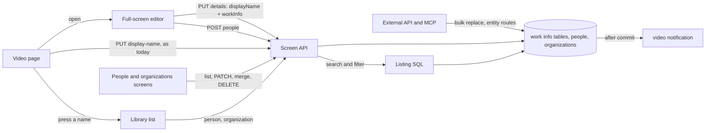
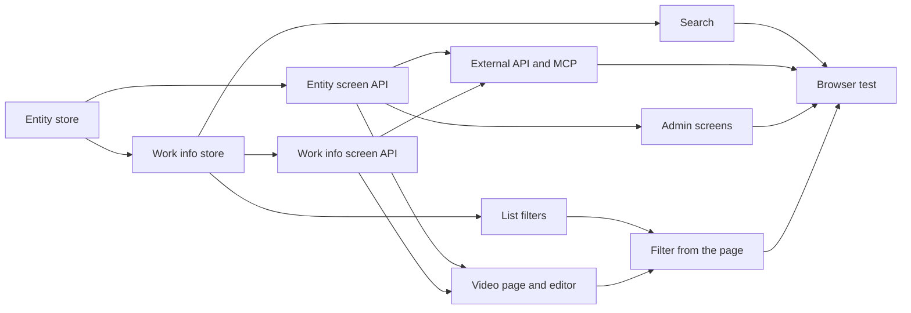

# Implementation Plan: Work information on videos (code, dates, people, organizations, URLs, external IDs)

**Branch**: `feature/047-video-work-info` | **Parent Issue**: #967

**Input**: The parent Issue. It is this feature's specification.

## Summary

The owner gives each video a code, a description, dated events of a fixed
kind set, URLs, external IDs, and people and organizations linked with a role
from a fixed set; enters, changes and clears them, together with the display
name, in a full-screen editor opened from the video page, whose save applies
both with one request in one transaction (the in-place title edit on the page
stays); sees only the set items in the information area; finds videos by code and by any
name or alias in the search box; lists the videos of a person or
organization from the page and filters the library by them; manages people
and organizations (rename, aliases, merge, delete, parent organization) on
two list screens built like the tag page; and reads and writes all of it
through the external API and MCP. People and organizations are id entities
whose names may repeat; the per-video values are user data keyed by the user
key, so a rescan, a move, a rename and bundling do not lose them. The first
plan for this Issue (six string fields, branch `archive/047-video-work-info-v1`)
is superseded by this one.

The diagram shows the parts this feature adds or changes and what each one
talks to.



| Concern | Approach |
| --- | --- |
| Shape | Typed tables per item kind, roles and kinds as fixed text sets; a later item is a new table or kind value ([R-1](research.md#r-1-typed-tables-per-item-kind-so-a-later-item-is-a-new-table-or-a-new-kind-value), [data-model.md, Migration](data-model.md#migration)) |
| Storage | Per-video tables keyed by the user key, each standalone, copied by the bundle and succession paths ([R-2](research.md#r-2-per-video-tables-keyed-by-the-user-key-each-standing-alone-copied-by-the-bundle-and-succession-paths)) |
| Entities | `people` and `organizations` with non-unique names, one `CreditStore` for both kinds ([R-3](research.md#r-3-people-and-organizations-are-id-entities-whose-names-are-not-unique-served-by-one-creditstore), [data-model.md, Entities](data-model.md#entities)) |
| Video writes | One `PUT` replacing the whole object, referencing entities by id; creation has its own route ([R-4](research.md#r-4-a-video-write-references-people-and-organizations-by-id-creation-has-its-own-route), [R-5](research.md#r-5-one-put-that-replaces-the-whole-work-information-object), [contracts/screen-api.md](contracts/screen-api.md#put-apivideosidwork-info)) |
| Editor save | `PUT /api/videos/{id}/details` takes the display name and the object and writes both in one transaction; the title-only and work-info-only routes stay ([R-14](research.md#r-14-the-editor-saves-the-display-name-and-the-work-information-with-one-put-apivideosiddetails-in-one-transaction), [contracts/screen-api.md](contracts/screen-api.md#put-apivideosiddetails)) |
| Search | `code_key` on the video row and `search_key` on every name row, matched with `instr` beside the tag names ([R-6](research.md#r-6-the-search-box-matches-the-code-and-every-name-and-alias-of-the-linked-people-and-organizations)) |
| Lists by entity | `person` and `organization` ids on the list API and in the library URL, any role ([R-7](research.md#r-7-person-and-organization-list-parameters-by-id-matching-every-role)) |
| Entity administration | `PATCH` of optional fields, merge moving links and names, delete detaching, parent cycles refused ([R-8](research.md#r-8-entity-edits-are-a-patch-of-optional-fields-a-merge-that-moves-links-and-a-delete-that-detaches)) |
| External API and MCP | One bulk replace, five literal routes per entity kind, `field` as a path ([R-9](research.md#r-9-the-external-api-gets-one-bulk-replace-and-literal-post-routes-per-entity-kind-field-names-the-failing-property), [contracts/external-api.md](contracts/external-api.md)) |
| Guests | No field, no search branch, filters return `400`, entity routes owner only ([R-10](research.md#r-10-guests-receive-no-work-information-in-responses-search-or-filters)) |
| Screens | `VideoWorkInfoChanged` mapped to the `video` notification; no event for entity edits ([R-11](research.md#r-11-a-work-information-write-publishes-videoworkinfochanged-entity-edits-publish-nothing)) |
| Dates | One per kind, `YYYY`, `YYYY-MM` or `YYYY-MM-DD` ([R-12](research.md#r-12-one-date-per-kind-in-yyyy-yyyy-mm-or-yyyy-mm-dd)) |
| Edit time | Video writes advance it, entity edits do not ([R-13](research.md#r-13-work-information-writes-advance-the-edit-time-entity-edits-do-not)) |

The Issue has the `ui` label, so the placement of the items in the
information area, the entry that opens the editor, the editor's layout and
its save, cancel and error states, the combobox that picks or creates a
person or organization, the folded description, the active-filter row for an
entity, and the two list screens are decided by `ui-design.md` in the next
`design` stage, judged against the parent Issue's `UI品質`. What the Plan
fixes about the editor is that it is one screen with the display name and
every work information item, saved by one request (R-14), and that it is a
route of its own (Structure decision).

## Technical Context

**Canonical definitions**:

| Topic | Source |
| --- | --- |
| Boundaries, dependency direction, user data, events after commit, the authentication boundary | [ARCHITECTURE.md](../../ARCHITECTURE.md), [.golangci.yml](../../.golangci.yml) (depguard) |
| User key, bundle copy and restore, succession | [specs/030-video-versions/data-model.md](../030-video-versions/data-model.md), [internal/store/user_keys.go](../../internal/store/user_keys.go), [internal/store/versions.go](../../internal/store/versions.go) (`userDataTables`), [internal/store/successions.go](../../internal/store/successions.go) (`moveUserData`) |
| Name rules, display name rules, edit time | [specs/014-video-tags/data-model.md](../014-video-tags/data-model.md), [specs/029-video-overrides/research.md](../029-video-overrides/research.md), [internal/store/video_edits.go](../../internal/store/video_edits.go) |
| Search keys and the search condition | [specs/013-library-search/data-model.md](../013-library-search/data-model.md), [internal/store/search.go](../../internal/store/search.go) (`searchExprCondition`, `tagNameMatchCondition`), [internal/store/tag_search_keys.go](../../internal/store/tag_search_keys.go) |
| Paged admin lists, counts, merge, natural order | [specs/036-tag-admin-scale/research.md](../036-tag-admin-scale/research.md), [internal/store/tag_listing.go](../../internal/store/tag_listing.go), [internal/store/tags.go](../../internal/store/tags.go) (`MergeTags`) |
| Lists, items and filters | [internal/store/listing.go](../../internal/store/listing.go) (`filteredFrom`), [internal/store/library_items.go](../../internal/store/library_items.go) (`libraryItemsCTE`), [internal/domain/library.go](../../internal/domain/library.go) (`VideoQuery`), [specs/027-partial-group-search/contracts/library-api.md](../027-partial-group-search/contracts/library-api.md) |
| Guests | [specs/016-single-account-auth/contracts/guest-api.md](../016-single-account-auth/contracts/guest-api.md), [internal/domain/auth.go](../../internal/domain/auth.go) (`CheckVideoQuery`), [internal/httpapi/videos.go](../../internal/httpapi/videos.go) (`forAudience`, `parseVideoQuery`) |
| Screen API, errors, generated code | [api/openapi.yaml](../../api/openapi.yaml), [specs/023-english-i18n/contracts/error-api.md](../023-english-i18n/contracts/error-api.md), [internal/httpapi/video_overrides.go](../../internal/httpapi/video_overrides.go), [internal/httpapi/tags.go](../../internal/httpapi/tags.go), [internal/httpapi/events.go](../../internal/httpapi/events.go) |
| External API and MCP | [api/external-v1.yaml](../../api/external-v1.yaml), [docs/how-to/external-api.md](../../docs/how-to/external-api.md), [specs/026-external-api/contracts/mcp.md](../026-external-api/contracts/mcp.md), [specs/039-external-tag-admin/contracts/external-api.md](../039-external-tag-admin/contracts/external-api.md), [internal/httpapi/external_video_overrides.go](../../internal/httpapi/external_video_overrides.go), [internal/httpapi/external_tags.go](../../internal/httpapi/external_tags.go), [internal/httpapi/mcp.go](../../internal/httpapi/mcp.go) |
| The video page, the tag page, the library's tag filter, screen rules and Web tests | [specs/012-video-detail-ia/ui-design.md](../012-video-detail-ia/ui-design.md), [specs/036-tag-admin-scale/ui-design.md](../036-tag-admin-scale/ui-design.md), [docs/design-docs/library-ui.md, Information rows](../../docs/design-docs/library-ui.md#information-rows), [web/src/player/VideoFacts.tsx](../../web/src/player/VideoFacts.tsx), [web/src/tags/TagsPage.tsx](../../web/src/tags/TagsPage.tsx), [web/src/library/tagCriteria.ts](../../web/src/library/tagCriteria.ts), [web/src/library/ActiveTagFilters.tsx](../../web/src/library/ActiveTagFilters.tsx), [design-system.md](../../docs/design-docs/design-system.md), [web-testing.md](../../docs/design-docs/web-testing.md), [i18n.md](../../docs/design-docs/i18n.md) |
| Browser tests | [web/e2e/search.e2e.ts](../../web/e2e/search.e2e.ts) |
| Checks | [Taskfile.yml](../../Taskfile.yml) (`task check`, `task check-docs`, `task generate`, `task test-e2e`) |

**Feature-specific context**:

- One migration, `00042_work_info.sql`, twelve user-data tables
  ([data-model.md, Migration](data-model.md#migration)); no new Go or Web
  dependency; `SearchKeyVersion` and `FolderIndexVersion` are not raised.
- A new domain event, `VideoWorkInfoChanged`, and no new `/api/events` kind
  (R-11).
- The error body gains `field` in both schemas and thirteen `reason` values
  ([contracts/screen-api.md, Added `reason` values and `field`](contracts/screen-api.md#added-reason-values-and-field));
  the two existing `display_name_*` reasons carry `field: displayName` from
  the details route only.
- Three new owner-only screens: the editor at `/videos/{id}/edit`, `/people`
  and `/organizations`; the sidebar placement of the last two is decided in
  `ui-design.md`.
- No `quickstart.md`: the store, httpapi, Vitest and browser tests verify the
  acceptance criteria, and there is no feature-specific manual step.

## Constitution Check

| Rule (source) | Verdict |
| --- | --- |
| Adapters import neither each other nor `internal/app`; `internal/domain` imports no adapter (ARCHITECTURE.md, depguard) | Pass: the field and name rules are pure functions in `internal/domain`; SQL stays in `internal/store`; `internal/httpapi` maps errors and parameters. `internal/app` is untouched |
| User data survives a rebuild (ARCHITECTURE.md) | Pass: every table is keyed by the user key or an entity id with no foreign key to `videos`, and the per-video tables join the paths that copy user data (R-2). Added to the list in ARCHITECTURE.md and running-vv.md |
| A role type does not call another role's public methods (ARCHITECTURE.md "Store roles") | Pass: `WorkInfoStore` and `CreditStore` use the package functions `userKeysForVideoIDs`, `resolveTaggableVideos`, `touchEditedAtForUserKeys`, `shownVideoCondition` and their own SQL; `SetDetails` writes the display name through the package functions `SetDisplayName` already uses, not through `OverrideStore` (R-14) |
| Events after commit (ARCHITECTURE.md) | Pass: `VideoWorkInfoChanged`, and `VideoOverrideChanged` from `SetDetails`, are published after the transaction commits (R-11, R-14) |
| Every read knows its viewer (ARCHITECTURE.md, guest-api.md) | Pass: `workInfo` is in owner responses only, the guest search condition is unchanged, `CheckVideoQuery` refuses the filters, and the entity routes are owner only (R-10); `openapi_routes_test.go` checks every new route's class |
| API source of truth and generated files (AGENTS.md) | Pass: `api/openapi.yaml` and `api/external-v1.yaml` change, then `task generate`; the compatibility policy allows the additions (R-9) |
| Complexity 25 or less; share code instead of copying it (AGENTS.md) | Pass: one `NormalizeWorkInfo` and one `NormalizeCredit` serve the screen and the external paths; one `CreditStore`, one handler set and one admin page component serve both entity kinds (R-3); the error mapping is one function every route calls |
| Read design-system.md before a screen; test at the lowest level (AGENTS.md, web-testing.md) | Pass: field rules get domain tests, writes and reads store tests, routes handler tests, the pages and the filter page tests, the flow one browser test |
| Documentation with the change (core-beliefs.md) | Pass: each unit names the document it updates |

No violation, so no complexity tracking. The verdicts hold after Phase 1.

## Project Structure

### Documentation (this feature)

```text
specs/047-video-work-info/
├── plan.md
├── research.md
├── data-model.md
└── contracts/
    ├── screen-api.md
    └── external-api.md
```

`ui-design.md` is written by the `design` stage (the Issue has the `ui`
label). There is no `quickstart.md` (see Technical Context).

### Source Code

**Affected boundaries**:

| Boundary | What it owns in this feature |
| --- | --- |
| `internal/domain` | `WorkInfo` and its entry types, the kind and role sets, `NormalizeWorkInfo`, `Credit`, `CreditKind`, `NormalizeCredit`, the errors, `Video.WorkInfo`, `VideoQuery.Person` and `Organization`, `CheckVideoQuery`, `VideoWorkInfoChanged`, `WorkInfoChange` |
| `internal/store` | The migration, `CreditStore`, `WorkInfoStore`, the search branches, the list filters, `userDataTables`, `moveUserData`, the startup key refresh, invariants |
| `internal/httpapi`, `api/openapi.yaml`, `api/external-v1.yaml` | `PUT /api/videos/{id}/work-info`, `PUT /api/videos/{id}/details`, `workInfo` on the detail read, the list parameters, the people and organization routes, the external operations, the MCP tools, the error mapping with `field`, the event mapping; wiring in `cmd/mdm` |
| `web/src/api`, `web/src/player`, `web/src/library`, `web/src/credits`, `web/src/app`, `web/src/i18n` | The client functions, the work information on the page, the full-screen editor and its route, the `person` and `organization` criteria and active filters, the two admin screens and their routes, the catalog and error text |
| `web/e2e` | The browser test |
| `docs/` | `ARCHITECTURE.md` (user data, role types, the `credits/` web directory), `running-vv.md` (user data row), `external-api.md` (the new section), `library-ui.md` (the information area, list conditions, the admin screens), `mcp.md` (the tools) |

**New paths**: `internal/store/migrations/00042_work_info.sql`,
`internal/store/credits.go`, `internal/store/credit_listing.go`,
`internal/store/work_info.go`, `internal/httpapi/credits.go`,
`internal/httpapi/video_work_info.go`,
`internal/httpapi/external_credits.go`,
`internal/httpapi/external_video_work_info.go`, `web/src/api/workInfo.ts`,
`web/src/api/credits.ts`, `web/src/player/WorkInfo.tsx` (the information
area; the component may be split or renamed to follow `ui-design.md`),
`web/src/player/VideoDetailsEditor.tsx` (the editor route),
`web/src/library/creditCriteria.ts`, `web/src/credits/` (the admin screens),
`web/e2e/work-info.e2e.ts`.

**Structure decision**: People and organizations share one implementation at
every layer, keyed by `domain.CreditKind`: one role type (`CreditStore`), one
handler set registered under two path prefixes, one `web/src/credits/`
directory whose admin page takes the kind as a prop, and one `web/src/api`
module. Two copies per layer were rejected under AGENTS.md's rule against
copied code, and one table with a kind column was rejected in R-3. Work
information gets its own role type, `WorkInfoStore`, rather than growing
`OverrideStore`: overrides are per content key and rewrite location search
keys, while work information is per user key and references entities, so the
two share no SQL. On screen the library's `person` and `organization`
criteria follow the shape of `tagCriteria.ts`, kept out of the shared
`ListCriteria` so that the folder screen's URL does not change (R-7).

The full-screen editor is a route of its own, `/videos/:id/edit`, loaded
with `deferredRoute` like the other owner screens and rendered without the
player, and it reads the video with `GET /api/videos/{id}` when opened
directly. An overlay inside `VideoPage` was rejected: the player would keep
running and holding its keyboard and Esc rules
([012 ui-design.md](../012-video-detail-ia/ui-design.md)) under a form with
up to a hundred rows, a reload would drop the half-edited form, and the
editor's code would load with the page that most visits never edit. Its
layout, entry, save and cancel are decided in `ui-design.md`.

## Implementation Work

The diagram shows which units have to land first. The three screen units
also wait for the `design` stage's `ui-design.md`.



### Store people and organizations with names, aliases, external IDs, merges and parents

**Scope**: `00042_work_info.sql` with every table and the invariants
([data-model.md, Migration](data-model.md#migration), [Rules](data-model.md#rules));
`Credit`, `CreditKind`, `Alias`, `ExternalID`, `NormalizeCredit`,
`CreditInput`, `CreditPatch`, `CreditQuery`, `CreditPage`,
`CreditMergeOutcome`, `ErrCreditParentCycle`, `ErrMergeSameCredit`,
`CreditExternalIDTakenError` and `InvalidWorkInfoError` in `domain`
([Values added to `domain`](data-model.md#values-added-to-domain));
`CreditStore` with `List`, `Get`, `Lookup`, `Create`, `Update`, `Merge`,
`Delete` and `RefreshSearchKeys` and `db.Credits()`
([Entities](data-model.md#entities)); the startup call next to
`TagStore.RefreshSearchKeys`. The user data list and the role type list in
ARCHITECTURE.md and the user data row in running-vv.md.

**Dependencies**: None

**Acceptance**: `task check` passes. Domain tests show each entity rule of
[data-model.md, Fields](data-model.md#fields) refusing its input with the
field path and problem named, an alias equal to the name refused, and a
malformed language refused. Store tests show: two people created with the
same name having different ids and both listed; a page of 100 with
`nextCursor` and `total` under `q` matching an alias; `Update` with only
`name` leaving the aliases; `Merge` moving a source's links, names and
external IDs to the target, dropping a spelling the target already has,
renumbering a `(content_key, role)` that held both, re-parenting a source
organization's children, and listing a missing source in `NotFoundIDs`;
`Merge` refused with `ErrCreditParentCycle` when a source is the target's
grandparent, and with `TooMany` on `aliases` when the merged aliases would
exceed 50, each leaving every row as it was; an external ID that another
person holds refused on `Create` and `Update` with
`CreditExternalIDTakenError`;
`Delete` removing the link rows and renumbering; a `parentId` of the
organization itself and of a grandchild refused; `Lookup` by external ID; a
row with `search_version = 0` refilled at startup.

### Store work information under the user key and validate its fields

**Scope**: `WorkInfo` and its entry types, the kind and role sets,
`NormalizeWorkInfo`, `WorkInfoLimits`, `CreditNotFoundError`,
`WorkInfoChange`, `Video.WorkInfo` and `VideoWorkInfoChanged` in `domain`
([Values added to `domain`](data-model.md#values-added-to-domain));
`WorkInfoStore` with `Set`, `SetMany`, `SetDetails` and `ByUserKeys` and
`db.WorkInfo()`
([Writes (`WorkInfoStore`)](data-model.md#writes-workinfostore), R-14);
`userDataTables` and `moveUserData`
([Bundles and succession](data-model.md#bundles-and-succession)); the edit
time call (R-13).

**Dependencies**: Store people and organizations with names, aliases,
external IDs, merges and parents

**Acceptance**: `task check` passes. Domain tests show each video rule of
[data-model.md, Fields](data-model.md#fields) refusing its input with the
field path and problem named (`dates[1].date`, `urls[0]`,
`people[2].person.id` among them), trimming, clearing on empty, line feeds
allowed in the description only, and a date of each of the three forms
accepted. Store tests show: a set object read back with people in role and
position order and each person's current name; a second set with the same
values leaving `updatedAt` unchanged and publishing no event; a set with an
unknown person id failing with `CreditNotFoundError` naming the field and
writing nothing; clearing everything leaving no row in any table; a video
with only a date surviving bundling; the values readable after the content
is re-indexed at another path and after a same-path succession, with people
linked, with no work information under the new key, and with a new key
holding a date and a URL the old key does not have, which the succession
clears; bundling
two videos showing the representative's values on the bundle, and unbundling
giving the member its own values back; `SetDetails` with a new display name
and a new object reading both back, advancing `updatedAt` once and publishing
`VideoOverrideChanged` and `VideoWorkInfoChanged`; `SetDetails` on a bundle
member with a new object advancing `updatedAt` of every member of the bundle,
and with only a new display name advancing it for that member alone;
`SetDetails` with a valid
display name and an invalid date leaving the stored display name and rows
unchanged and publishing nothing; `SetDetails` with a display name over the
limit and a valid object the same; `SetDetails` with both values unchanged
leaving `updatedAt` and publishing nothing.

### Manage people and organizations through the screen API

**Scope**: The six routes under `/api/people` and the six under
`/api/organizations`, the schemas `Person`, `Organization`, `Alias`,
`ExternalId`, `CreditInput`, `CreditPatch` and `CreditList`
([contracts/screen-api.md, People and organizations](contracts/screen-api.md#people-and-organizations));
`field` on `Error` and the thirteen reasons
([Added `reason` values and `field`](contracts/screen-api.md#added-reason-values-and-field))
with the one mapping function from `InvalidWorkInfoError`,
`CreditNotFoundError` and `CreditExternalIDTakenError`; the messages in `web/src/i18n/errors.ts`;
`api/openapi.yaml` and `task generate`; `requiresJSONBody` and the
`accessRoutes` class; one handler set registered under both prefixes.

**Dependencies**: Store people and organizations with names, aliases,
external IDs, merges and parents

**Acceptance**: `task check` passes. Handler tests show: `POST /api/people`
returning `201` with the person and `GET /api/people/{id}` returning it; a
`PATCH` with `aliases` replacing the list and leaving the name; an alias
`language` of `x` returning `400 work_info_invalid_language` with
`field: aliases[0].language`; a `PATCH /api/organizations/{id}` of an
existing organization with a `parentId` that is its child returning
`400 organization_parent_cycle`; a `POST /api/people` with an external ID
another person holds returning `409 external_id_taken` with
`field: externalIds[0]`; a merge returning the target with `notFoundIds`; `DELETE` returning `204` and the
later `GET` `404 person_not_found`; a guest receiving `401` from every route;
`GET /api/people?limit=2` returning `nextCursor` and `total`.

### Read and write work information through the screen API

**Scope**: `workInfo` on `Video`, `PUT /api/videos/{id}/work-info` and
`PUT /api/videos/{id}/details`
([contracts/screen-api.md, `Video` changes](contracts/screen-api.md#video-changes),
[`PUT /api/videos/{id}/work-info`](contracts/screen-api.md#put-apivideosidwork-info),
[`PUT /api/videos/{id}/details`](contracts/screen-api.md#put-apivideosiddetails));
the `WorkInfo`, `WorkInfoInput` and `VideoDetailsInput` schemas;
`field: displayName` on the two `display_name_*` reasons from the details
route; `forAudience`; the `VideoWorkInfoChanged` mapping in `Events.Handle`;
`api/openapi.yaml` and `task generate`; the `accessRoutes` class.

**Dependencies**: Store work information under the user key and validate its
fields; Manage people and organizations through the screen API (the error
mapping and `field`)

**Acceptance**: `task check` passes. Handler tests show: a `PUT` returning
`200` with the saved `workInfo`, people carrying their names, and
`GET /api/videos/{id}` returning the same object after it; a `PUT` with `{}`
returning `200` without `workInfo`; a description over 10,000 code points
returning `400 work_info_too_long` with `field: description` and
`limit: 10000`; `2024-02-30` returning `work_info_invalid_date` with
`field: dates[0].date`; the same person twice as `performer` returning
`work_info_duplicate`; an unknown person id returning
`404 person_not_found` with `field: people[0].person.id`; a guest receiving
`401` from the `PUT` and no `workInfo` from the `GET` of a public video; a
`video` notification for the id after a change. For the details route: a
`PUT` with a display name and an object returning `200` with `title`,
`displayName` and `workInfo` applied, and `GET /api/videos/{id}` showing
both; a `PUT` with a new display name and `2024-02-30` returning
`400 work_info_invalid_date` with `field: dates[0].date` and the `GET`
showing the old title; a `PUT` with a 201-character display name and a valid
object returning `400 display_name_too_long` with `field: displayName` and
`limit`, and the `GET` showing no work information; a body without
`displayName` or without `workInfo` returning `400 invalid_request`; a guest
receiving `401`.

### Match the code and the names of people and organizations in the library search

**Scope**: The three branches of the owner's term condition and the
unchanged guest condition ([data-model.md, Search](data-model.md#search));
`code_key` written on every `WorkInfoStore` write. The search paragraph of
library-ui.md "List conditions applied by the server".

**Dependencies**: Store work information under the user key and validate its
fields

**Acceptance**: `task check` passes. Store tests show: `GET /api/videos?query=`
with a code (`ab-12`, two to five characters), a person's name, a person's
alias in another kana form and an organization's name each returning the
video; a negated term excluding it; a word only in the description not
matching; the same query as a guest not returning a public video that
matches only by work information; a person renamed matching under the new
name and not the old one.

### Filter lists by person and organization in the list API

**Scope**: `VideoQuery.Person` and `Organization`, `CheckVideoQuery`, the two
conditions in `filteredFrom` and `libraryItemsCTE`
([data-model.md, Lists](data-model.md#lists)); the `person` and
`organization` parameters of `listVideos`, `listLibrary` and `listLibraryIds`
with their validation
([contracts/screen-api.md, List parameters `person` and `organization`](contracts/screen-api.md#list-parameters-person-and-organization));
`api/openapi.yaml` and `task generate`. The conditions table of library-ui.md
"List conditions applied by the server".

**Dependencies**: Store work information under the user key and validate its
fields

**Acceptance**: `task check` passes. Handler and store tests show:
`GET /api/library?person=<id>` returning only the videos linked to that
person in any role, with `total` counting them; `organization` the same; both
together ANDing; a group with one matching member listing that member as a
video item; an id with no entity returning an empty list with `200`; `0` or
`abc` returning `400`; a guest receiving `400 guest_filter_not_allowed`;
`GET /api/library/ids` returning the same ids.

### Read and write work information, people and organizations in the external API and MCP

**Scope**: `workInfo` on `ExternalVideo`, `POST /api/v1/video-work-info`, the
five operations under `/api/v1/people` and `/api/v1/organizations`, `field`
and the thirteen reasons in `api/external-v1.yaml`, the eleven MCP tools and
`workInfo` in `list_videos` and `get_video`
([contracts/external-api.md](contracts/external-api.md)); the error mapping
shared with the screen routes; `task generate`. The "Set work information"
section of external-api.md and the tool rows of mcp.md.

**Dependencies**: Manage people and organizations through the screen API;
Read and write work information through the screen API

**Acceptance**: `task check` passes. Handler and MCP tests show: a `POST`
with two items returning `200` with both objects and
`GET /api/v1/videos/lookup` returning them with `null` for the unset `code`;
an item with 101 performers returning `400 work_info_too_many` with
`field: people`, `limit: 100` and `index: 1`, and the first item not
applied; an item naming an unknown person returning `404 person_not_found`
with `field` and `index`; a repeated `POST` returning `200` and leaving
`updatedAt`; `GET /api/v1/people?source=example&externalId=42` returning the
one person and an empty `items` for an unknown ID; `POST /api/v1/people/delete`
returning `deletedIds` and `notFoundIds`; `update_video_work_info` and
`list_people` through `/mcp` returning the same structured content as the
routes, `list_people` with `limit` 100 by default.

### Show work information on the video page and edit it with the display name in a full-screen editor

**Scope**: `web/src/api/workInfo.ts` (`setVideoDetails`) and
`web/src/api/credits.ts` (`listCredits`, `createCredit`); the work
information in the information area of the video page and the entry that
opens the editor, as `ui-design.md` decides; the editor route
`/videos/:id/edit` (`web/src/player/VideoDetailsEditor.tsx`, registered in
`web/src/app` with `deferredRoute`, Structure decision) holding the display
name and every work information item, with the combobox that picks an
existing person or organization or creates one (R-4), saving with one
`PUT /api/videos/{id}/details` (R-14) and returning to the page; the
`ownerOnlyPath` predicate of `web/src/auth/AuthGate.tsx` covering
`/videos/:id/edit`, so a guest opening it is redirected to `/login`; the
folded description; the error line naming the `field`; the catalog text; and
the `video` notification refreshing the page. The in-place title edit of
`VideoTitle.tsx` and its `PUT /api/videos/{id}/display-name` stay as they
are. The information-area and editor paragraphs of library-ui.md.

**Dependencies**: Manage people and organizations through the screen API;
Read and write work information through the screen API; `ui-design.md` from
the `design` stage

**Acceptance**: `task check` passes. Page tests show: the set items rendered
and the unset ones absent, a video without rows rendering the information
rows as before; the editor opened from the page showing the current display
name and items; entering a new display name, a code, a release date and two
performers (one picked, one created through `POST /api/people`) and saving
sends one `PUT /api/videos/{id}/details` carrying the display name and the
whole object, and the page then shows the new title and the items from the
response; clearing an item in the editor and saving removes it from the
area; a `400` with `field: dates[0].date` keeps the editor open with every
entered value, shows the message at that item, and the page's title is
unchanged when the editor is left; a `400` with `field: displayName` shows
the message at the display name; the in-place title edit on the page still
sends `PUT /api/videos/{id}/display-name`; a guest sees no items, no edit
entry, and opening `/videos/:id/edit` is redirected to `/login` by
`AuthGate`; a `video` notification
refetches the page and shows a value written elsewhere. The unit changes a
screen, so the implementation checks the visuals and the interaction at the
widths `ui-design.md` names.

### Manage people and organizations on their list screens

**Scope**: `web/src/credits/` with one admin page taking the kind, the routes
`/people` and `/organizations` in `web/src/app`, the sidebar entries as
`ui-design.md` decides, list pages of 100 with search and sort, and the
rename, aliases, parent, merge and delete dialogs calling
`web/src/api/credits.ts` (`getCredit`, `updateCredit`, `mergeCredits`,
`deleteCredit`); the catalog text. The admin screen paragraph of
library-ui.md and the `credits/` row of ARCHITECTURE.md's web layer table.

**Dependencies**: Manage people and organizations through the screen API;
`ui-design.md` from the `design` stage

**Acceptance**: `task check` passes. Page tests show: `/people` listing a
page with names, alias counts and video counts, loading more on scroll, and
`q` sent to the server; rename sending `PATCH` with `name` only; the alias
dialog sending the whole list with languages; merge confirming with the
summed `videoCount` and sending `sourceIds`; delete confirming with the count
and sending `DELETE`; `/organizations` showing the parent and a cycle error
at the parent field; a guest sent away from both routes. The unit changes a
screen, so the implementation checks the visuals and the interaction at the
widths `ui-design.md` names.

### Filter the library by a person or organization from the video page

**Scope**: `creditCriteria.ts` (`person` and `organization` in the library
URL, the list snapshot key, "Clear filters"), `person` and `organization` in
`VideosCriteria` and the list requests, the active-filter row showing the
entity's name read with `getCredit` and dropping the parameter on `404` as
`ui-design.md` decides, and the people and organizations on the video page as
links to `/?person=<id>` and `/?organization=<id>`
([contracts/screen-api.md, List parameters `person` and `organization`](contracts/screen-api.md#list-parameters-person-and-organization)).

**Dependencies**: Filter lists by person and organization in the list API;
Show work information on the video page and edit it with the display name in
a full-screen editor

**Acceptance**: `task check` passes. Page tests show: pressing a performer on
the video page opens the library with `person=<id>` in the URL, the request
carrying it and the active filter showing the name; a `404` for the id
removing the parameter and reporting it; removing the filter or "Clear
filters" dropping it from the URL; Back returning to the video page; the
snapshot of `/` not reused for `/?person=…`. The unit changes a screen, so
the implementation checks the visuals and the interaction.

### Cover work information in a browser test

**Scope**: `web/e2e/work-info.e2e.ts` against the e2e server, using the
external API with a token where the flow needs it.

**Dependencies**: Match the code and the names of people and organizations
in the library search; Read and write work information, people and
organizations in the external API and MCP; Manage people and organizations
on their list screens; Filter the library by a person or organization from
the video page

**Acceptance**: `task test-e2e -- e2e/work-info.e2e.ts` passes, showing: a
display name, a code, a release date and two performers entered in the
editor opened from the page are, after one save, the page's title and the
items of the information area, and stay after a reload (acceptance criterion
1 and requirement 8); clearing them in the editor leaves the information
rows as before (2); the code, a performer's name and
an alias each find the video in the library search (3); pressing the
performer lists only that person's videos, and the maker the same (4);
merging person A into person B on `/people` shows B as the performer and
finds the video by A's name (5); a recorded date and a photographer alone
show no other item (6); the values are still there after a full scan (7); an
object written through `POST /api/v1/video-work-info` appears on the open
page without a reload, and a value entered on the page is read back through
`GET /api/v1/videos/lookup` (8); a long description stays folded and the
page shows no horizontal scroll at 360px (Edge Case).
