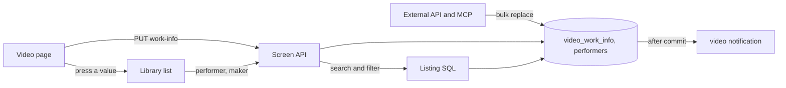
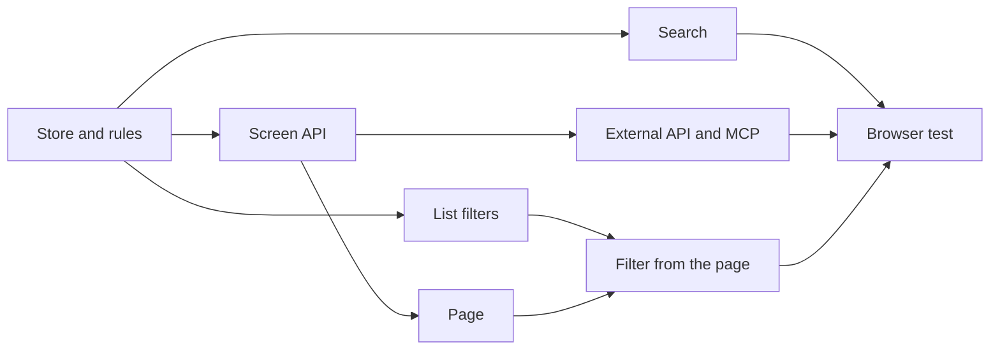

# Implementation Plan: Work information on videos (code, release date, maker, performers, description, source)

**Branch**: `feature/047-video-work-info` | **Parent Issue**: #967

**Input**: The parent Issue. It is this feature's specification.

## Summary

The owner gives each video a fixed set of work information fields (`code`,
`releaseDate`, `maker`, `performers`, `description`, `sourceUrl`), enters and
clears them on the video page, sees the set fields in the information area,
finds videos by code, maker or performer in the search box, opens the list of
videos with the same performer or maker by pressing the value, and reads and
writes the same fields through the external API and MCP. The values are user
data keyed by the user key, so a rescan, a move, a rename and bundling do not
lose them.

The diagram shows the parts this feature adds or changes and what each one
talks to.



| Concern | Approach |
| --- | --- |
| Fields | Six fixed fields; `performers` and `maker` get lists by value ([R-1](research.md#r-1-six-fixed-fields-performers-and-the-maker-get-lists), [data-model.md, Fields](data-model.md#fields)) |
| Storage | Two user-data tables keyed by the user key, copied by the bundle and succession paths ([R-2](research.md#r-2-two-user-data-tables-keyed-by-the-user-key-copied-by-the-bundle-and-succession-paths), [Migration](data-model.md#migration)) |
| Search | A per-key `search_key` of code, maker and performer names, matched with `instr` beside the tag names ([R-3](research.md#r-3-the-search-box-matches-the-code-the-maker-and-the-performer-names-through-a-per-key-search-key)) |
| Lists by value | `performer` and `maker` on the list API and in the library URL, matched by folded value ([R-4](research.md#r-4-performer-and-maker-list-parameters-matched-by-folded-value-library-only), [contracts/screen-api.md](contracts/screen-api.md#list-parameters-performer-and-maker)) |
| Screen API | One `PUT` that replaces the whole object; `workInfo` on the detail read ([R-5](research.md#r-5-one-put-that-replaces-the-whole-object-a-cleared-field-is-absent-null-or-empty), [contracts/screen-api.md](contracts/screen-api.md#put-apivideosidwork-info)) |
| External API and MCP | One bulk replace, `workInfo` on `ExternalVideo`, one tool; `field` in the error body ([R-6](research.md#r-6-the-external-api-gets-one-bulk-operation-and-mcp-one-tool-workinfo-joins-externalvideo), [contracts/external-api.md](contracts/external-api.md)) |
| Guests | No field, no search branch, filters return `400` ([R-7](research.md#r-7-guests-receive-no-work-information-in-responses-search-or-filters)) |
| Screens | `VideoWorkInfoChanged` mapped to the `video` notification ([R-8](research.md#r-8-a-change-publishes-domainvideoworkinfochanged-mapped-to-the-screens-video-notification)) |

The Issue has the `ui` label, so the placement of the fields in the
information area, the editing interaction, the folded description and the
active-filter row for a performer or maker are decided by `ui-design.md` in
the next `design` stage, judged against the parent Issue's `UI品質`.

## Technical Context

**Canonical definitions**:

| Topic | Source |
| --- | --- |
| Boundaries, dependency direction, user data, events after commit, the authentication boundary | [ARCHITECTURE.md](../../ARCHITECTURE.md), [.golangci.yml](../../.golangci.yml) (depguard) |
| User key, bundle copy and restore, succession | [specs/030-video-versions/data-model.md](../030-video-versions/data-model.md), [internal/store/user_keys.go](../../internal/store/user_keys.go), [internal/store/versions.go](../../internal/store/versions.go) (`userDataTables`), [internal/store/successions.go](../../internal/store/successions.go) (`moveUserData`) |
| Display name rules, overrides, edit time | [specs/029-video-overrides/research.md](../029-video-overrides/research.md), [internal/domain/video_override.go](../../internal/domain/video_override.go), [internal/store/video_edits.go](../../internal/store/video_edits.go) |
| Search keys and the search condition | [specs/013-library-search/data-model.md](../013-library-search/data-model.md), [internal/store/search.go](../../internal/store/search.go) (`searchExprCondition`, `tagNameMatchCondition`), [internal/store/tag_search_keys.go](../../internal/store/tag_search_keys.go) |
| Lists, items and filters | [internal/store/listing.go](../../internal/store/listing.go) (`filteredFrom`), [internal/store/library_items.go](../../internal/store/library_items.go) (`libraryItemsCTE`, `tagConditions`), [internal/domain/library.go](../../internal/domain/library.go) (`VideoQuery`), [specs/027-partial-group-search/contracts/library-api.md](../027-partial-group-search/contracts/library-api.md) |
| Guests | [specs/016-single-account-auth/contracts/guest-api.md](../016-single-account-auth/contracts/guest-api.md), [internal/domain/auth.go](../../internal/domain/auth.go) (`CheckVideoQuery`), [internal/httpapi/videos.go](../../internal/httpapi/videos.go) (`forAudience`, `parseVideoQuery`) |
| Screen API, errors, generated code | [api/openapi.yaml](../../api/openapi.yaml), [specs/023-english-i18n/contracts/error-api.md](../023-english-i18n/contracts/error-api.md), [internal/httpapi/video_overrides.go](../../internal/httpapi/video_overrides.go), [internal/httpapi/events.go](../../internal/httpapi/events.go) |
| External API and MCP | [api/external-v1.yaml](../../api/external-v1.yaml), [docs/how-to/external-api.md](../../docs/how-to/external-api.md), [specs/026-external-api/contracts/mcp.md](../026-external-api/contracts/mcp.md), [internal/httpapi/external_video_overrides.go](../../internal/httpapi/external_video_overrides.go), [internal/httpapi/mcp.go](../../internal/httpapi/mcp.go), [internal/store/overrides.go](../../internal/store/overrides.go) (`SetDisplayNames`, `resolveTaggableVideos`) |
| The video page, the library's tag filter, screen rules and Web tests | [specs/012-video-detail-ia/ui-design.md](../012-video-detail-ia/ui-design.md), [docs/design-docs/library-ui.md, Information rows](../../docs/design-docs/library-ui.md#information-rows), [web/src/player/VideoFacts.tsx](../../web/src/player/VideoFacts.tsx), [web/src/library/tagCriteria.ts](../../web/src/library/tagCriteria.ts), [web/src/library/ActiveTagFilters.tsx](../../web/src/library/ActiveTagFilters.tsx), [web/src/api/videosCriteria.ts](../../web/src/api/videosCriteria.ts), [design-system.md](../../docs/design-docs/design-system.md), [web-testing.md](../../docs/design-docs/web-testing.md), [i18n.md](../../docs/design-docs/i18n.md) |
| Browser tests | [web/e2e/search.e2e.ts](../../web/e2e/search.e2e.ts) |
| Checks | [Taskfile.yml](../../Taskfile.yml) (`task check`, `task check-docs`, `task generate`, `task test-e2e`) |

**Feature-specific context**:

- One migration, `00042_video_work_info.sql`
  ([data-model.md, Migration](data-model.md#migration)); no new Go or Web
  dependency; `SearchKeyVersion` and `FolderIndexVersion` are not raised.
- A new domain event, `VideoWorkInfoChanged`, and no new `/api/events` kind
  (R-8).
- The error body gains `field` in both schemas (R-6).
- No `quickstart.md`: the store, httpapi, Vitest and browser tests verify the
  acceptance criteria, and there is no feature-specific manual step.

## Constitution Check

| Rule (source) | Verdict |
| --- | --- |
| Adapters import neither each other nor `internal/app`; `internal/domain` imports no adapter (ARCHITECTURE.md, depguard) | Pass: the field rules are pure functions in `internal/domain`; SQL stays in `internal/store`; `internal/httpapi` maps errors and parameters. `internal/app` is untouched |
| User data survives a rebuild (ARCHITECTURE.md) | Pass: both tables are keyed by the user key with no foreign key to `videos`, and join the paths that copy user data (R-2). Added to the list in ARCHITECTURE.md and running-vv.md |
| A role type does not call another role's public methods (ARCHITECTURE.md "Store roles") | Pass: `WorkInfoStore` uses the package functions `userKeysForVideoIDs`, `resolveTaggableVideos`, `touchEditedAtForUserKeys` and its own SQL |
| Events after commit (ARCHITECTURE.md) | Pass: `VideoWorkInfoChanged` is published after the transaction commits (R-8) |
| Every read knows its viewer (ARCHITECTURE.md, guest-api.md) | Pass: `workInfo` is in owner responses only, the guest search condition is unchanged, and `CheckVideoQuery` refuses the filters (R-7); `openapi_routes_test.go` checks the new route's class |
| API source of truth and generated files (AGENTS.md) | Pass: `api/openapi.yaml` and `api/external-v1.yaml` change, then `task generate`; the compatibility policy allows the additions (R-6) |
| Complexity 25 or less; share code instead of copying it (AGENTS.md) | Pass: one `NormalizeWorkInfo` serves the screen and the external paths; `SetMany` is built like `SetDisplayNames`; the error mapping is one function both routes call |
| Read design-system.md before a screen; test at the lowest level (AGENTS.md, web-testing.md) | Pass: field rules get domain tests, writes and reads store tests, routes handler tests, the page and the filter page tests, the flow one browser test |
| Documentation with the change (core-beliefs.md) | Pass: each unit names the document it updates |

No violation, so no complexity tracking. The verdicts hold after Phase 1.

## Project Structure

### Documentation (this feature)

```text
specs/047-video-work-info/
├── plan.md
├── research.md
├── data-model.md
└── contracts/
    ├── screen-api.md
    └── external-api.md
```

`ui-design.md` is written by the `design` stage (the Issue has the `ui`
label). There is no `quickstart.md` (see Technical Context).

### Source Code

**Affected boundaries**:

| Boundary | What it owns in this feature |
| --- | --- |
| `internal/domain` | `WorkInfo`, `NormalizeWorkInfo` and its limits and error, `Video.WorkInfo`, `VideoQuery.Performer` and `Maker`, `CheckVideoQuery`, `VideoWorkInfoChanged`, `WorkInfoChange` |
| `internal/store` | The migration, `WorkInfoStore` (`Set`, `SetMany`, `ByUserKeys`, `RefreshSearchKeys`), the search branch, the list filters, `userDataTables`, `moveUserData`, invariants |
| `internal/httpapi`, `api/openapi.yaml`, `api/external-v1.yaml` | `PUT /api/videos/{id}/work-info`, `workInfo` on the detail read, the list parameters, `POST /api/v1/video-work-info`, `workInfo` on `ExternalVideo`, the MCP tool, the error mapping with `field`, the event mapping; wiring in `cmd/mdm` |
| `web/src/api`, `web/src/player`, `web/src/library`, `web/src/i18n` | The client functions, the work information on the page and its editing, the `performer` and `maker` criteria and active filters, the catalog and error text |
| `web/e2e` | The browser test |
| `docs/` | `ARCHITECTURE.md` (user data, role types), `running-vv.md` (user data row), `external-api.md` (the new section), `library-ui.md` (the information area, list conditions), `mcp.md` (the tool) |

**New paths**: `internal/store/migrations/00042_video_work_info.sql`,
`internal/store/work_info.go`, `internal/httpapi/video_work_info.go`,
`internal/httpapi/external_video_work_info.go`, `web/src/api/workInfo.ts`,
`web/src/player/WorkInfo.tsx` (the component may be split or renamed to
follow `ui-design.md`), `web/src/library/workInfoCriteria.ts`,
`web/e2e/work-info.e2e.ts`.

**Structure decision**: Work information gets its own role type,
`WorkInfoStore`, rather than growing `OverrideStore`: overrides are per
content key and rewrite location search keys, while work information is per
user key and has its own search key, so the two share no SQL
([R-2](research.md#r-2-two-user-data-tables-keyed-by-the-user-key-copied-by-the-bundle-and-succession-paths)).
On screen the library's `performer` and `maker` criteria follow the shape of
`tagCriteria.ts`, kept out of the shared `ListCriteria` so that the folder
screen's URL does not change ([R-4](research.md#r-4-performer-and-maker-list-parameters-matched-by-folded-value-library-only)).

## Implementation Work

The diagram shows which units have to land first. The two page units also
wait for the `design` stage's `ui-design.md`.



### Store work information under the user key and validate its fields

**Scope**: `00042_video_work_info.sql` and the invariants
([data-model.md, Migration](data-model.md#migration), [Rules](data-model.md#rules));
`WorkInfo`, `NormalizeWorkInfo`, its limits and `InvalidWorkInfoError`,
`WorkInfoChange`, `Video.WorkInfo` and `VideoWorkInfoChanged` in `domain`
([Values added to `domain`](data-model.md#values-added-to-domain));
`WorkInfoStore` with `Set`, `SetMany`, `ByUserKeys` and `RefreshSearchKeys`
and `db.WorkInfo()` ([Writes (`WorkInfoStore`)](data-model.md#writes-workinfostore));
`userDataTables` and `moveUserData`
([Bundles and succession](data-model.md#bundles-and-succession)); the startup
call next to `TagStore.RefreshSearchKeys`. The user data list and the role
type list in ARCHITECTURE.md and the user data row in running-vv.md.

**Dependencies**: None

**Acceptance**: `task check` passes. Domain tests show each rule of
[data-model.md, Fields](data-model.md#fields) refusing its input with the
field and problem named, trimming, clearing on empty, allowing line feeds in
the description only, and collapsing a repeated performer. Store tests show:
a set object read back in performer order; a second set with the same values
leaving `updatedAt` unchanged and publishing no event; clearing every field
deleting the row and its performers; the values readable after the content is
re-indexed at another path and after a same-path succession; bundling two
videos showing the representative's values on the bundle, and unbundling
giving the member its own values back.

### Read and write work information through the screen API

**Scope**: `workInfo` on `Video` and `PUT /api/videos/{id}/work-info`
([contracts/screen-api.md, `Video` changes](contracts/screen-api.md#video-changes),
[`PUT /api/videos/{id}/work-info`](contracts/screen-api.md#put-apivideosidwork-info));
`field` on `Error` and the five reasons
([Added `reason` values and `field`](contracts/screen-api.md#added-reason-values-and-field))
with the one mapping function from `InvalidWorkInfoError`; `forAudience`; the
`VideoWorkInfoChanged` mapping in `Events.Handle`; the messages in
`web/src/i18n/errors.ts`; `api/openapi.yaml` and `task generate`; the
`accessRoutes` class.

**Dependencies**: Store work information under the user key and validate its
fields

**Acceptance**: `task check` passes. Handler tests show: a `PUT` returning
`200` with the saved `workInfo` and `GET /api/videos/{id}` returning the same
object after it; a `PUT` with `{}` returning `200` without `workInfo`; a
description over 10,000 code points returning `400` `work_info_too_long` with
`field: description` and `limit: 10000`; `2024-02-30` returning
`work_info_invalid_date`; `ftp://…` returning `work_info_invalid_url`; a guest
receiving `401` from the `PUT` and no `workInfo` from the `GET` of a public
video; a `video` notification for the id after a change.

### Match the code, the maker and the performer names in the library search

**Scope**: The third branch of the owner's term condition and the unchanged
guest condition ([data-model.md, Search](data-model.md#search)); `search_key`
written on every `WorkInfoStore` write and refilled by `RefreshSearchKeys`
at startup. The search paragraph of library-ui.md "List conditions applied by
the server".

**Dependencies**: Store work information under the user key and validate its
fields

**Acceptance**: `task check` passes. Store tests show: `GET /api/videos?query=`
with a code (`ab-12`, two to five characters), a maker and a performer name in
another kana form each returning the video; a negated term excluding it; a word
only in the description not matching; the same query as a guest not returning
a public video that matches only by work information; a row with
`search_version = 0` refilled at startup and matching afterwards.

### Filter lists by performer and maker in the list API

**Scope**: `VideoQuery.Performer` and `Maker`, `CheckVideoQuery`, the two
conditions in `filteredFrom` and `libraryItemsCTE`
([data-model.md, Lists](data-model.md#lists)); the `performer` and `maker`
parameters of `listVideos`, `listLibrary` and `listLibraryIds` with their
validation ([contracts/screen-api.md, List parameters](contracts/screen-api.md#list-parameters-performer-and-maker));
`api/openapi.yaml` and `task generate`. The conditions table of library-ui.md
"List conditions applied by the server".

**Dependencies**: Store work information under the user key and validate its
fields

**Acceptance**: `task check` passes. Handler and store tests show:
`GET /api/library?performer=…` returning only the videos with that performer,
matched across width and kana differences, with `total` counting them;
`maker` the same; both together ANDing; a group with one matching member
listing that member as a video item; a value with no match returning an empty
list with `200`; a value over 200 code points returning `400`; a guest
receiving `400` `guest_filter_not_allowed`; `GET /api/library/ids` returning
the same ids.

### Read and write work information in the external API and MCP

**Scope**: `workInfo` on `ExternalVideo` with `null` for unset fields,
`POST /api/v1/video-work-info`, `field` and the five reasons in
`api/external-v1.yaml`, the MCP tool `update_video_work_info` and `workInfo`
in `list_videos` and `get_video`
([contracts/external-api.md](contracts/external-api.md)); the error mapping
shared with the screen route; `task generate`. The "Set work information"
section of external-api.md and the tool row of mcp.md.

**Dependencies**: Read and write work information through the screen API

**Acceptance**: `task check` passes. Handler and MCP tests show: a `POST`
with two items returning `200` with both objects and `GET /api/v1/videos/lookup`
returning them; an item with 101 performers returning `400`
`too_many_performers` with `field: performers`, `limit: 100` and `index: 1`,
and the first item not applied; a repeated `POST` returning `200` and leaving
`updatedAt`; `update_video_work_info` through `/mcp` returning the same
structured content as the route; `GET /api/v1/videos` items carrying
`workInfo` with `null` fields for a video without a row.

### Show and edit work information on the video page

**Scope**: `web/src/api/workInfo.ts` (`setVideoWorkInfo`), the work
information in the information area and its editing on the video page as
`ui-design.md` decides, the folded description, the error line naming the
`field`, the catalog text, and the `video` notification refreshing the page.
The information-area paragraph of library-ui.md.

**Dependencies**: Read and write work information through the screen API, and
`ui-design.md` from the `design` stage

**Acceptance**: `task check` passes. Page tests show: the set fields rendered
and the unset ones absent; entering a code and a performer and saving sends
the `PUT` with the whole object and shows the response; clearing a field
removes it from the area; a `400` with `field` shows its message at the
field; a guest sees no fields and no edit entry; a `video` notification
refetches and shows a value written elsewhere. The unit changes a screen, so
the implementation checks the visuals and the interaction at the widths
`ui-design.md` names.

### Filter the library by a performer or maker from the video page

**Scope**: `workInfoCriteria.ts` (`performer` and `maker` in the library URL,
the list snapshot key, "Clear filters"), `performer` and `maker` in
`VideosCriteria` and the list requests, the active-filter row for a value as
`ui-design.md` decides, and the performer and maker values on the video page
as links to `/?performer=…` and `/?maker=…`
([contracts/screen-api.md, List parameters](contracts/screen-api.md#list-parameters-performer-and-maker)).

**Dependencies**: Filter lists by performer and maker in the list API; Show
and edit work information on the video page

**Acceptance**: `task check` passes. Page tests show: pressing a performer on
the video page opens the library with `performer=<name>` in the URL, the
request carrying it and the active filter shown; removing the filter or
"Clear filters" dropping it from the URL; Back returning to the video page;
the snapshot of `/` not reused for `/?performer=…`. The unit changes a
screen, so the implementation checks the visuals and the interaction.

### Cover work information in a browser test

**Scope**: `web/e2e/work-info.e2e.ts` against the e2e server, using the
external API with a token where the flow needs it.

**Dependencies**: Match the code, the maker and the performer names in the
library search; Read and write work information in the external API and MCP;
Filter the library by a performer or maker from the video page

**Acceptance**: `task test-e2e -- e2e/work-info.e2e.ts` passes, showing: a
code and a performer entered on the page are in the information area after a
reload (acceptance criterion 1); clearing the performer removes it (2); the
code and the performer name each find the video in the library search (3);
the values are still there after a full scan (4); an object written through
`POST /api/v1/video-work-info` appears on the open page without a reload, and
a value entered on the page is read back through `GET /api/v1/videos/lookup`
(5); pressing the performer lists the videos with the same performer (6); a
long description stays folded and the page shows no horizontal scroll at
360px (Edge Case).
