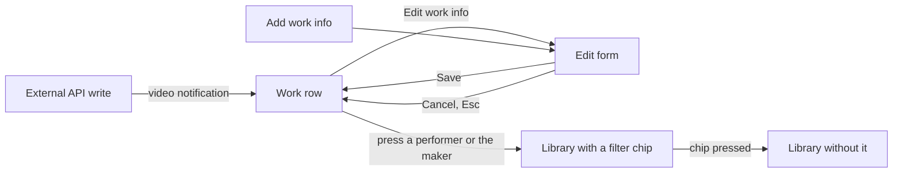
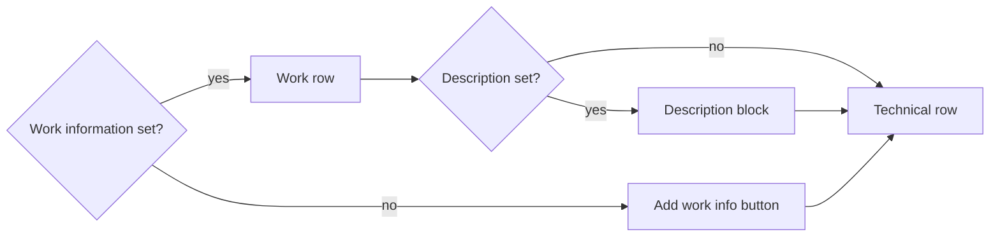
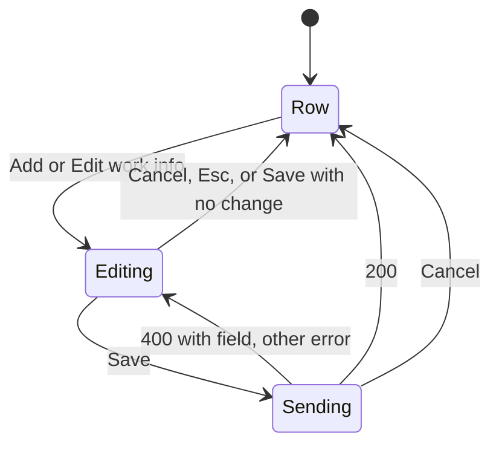
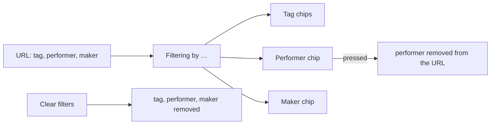

# UI design: Work information on the video page and in the library filter

**Feature**: [parent Issue #967](https://github.com/syudead/vv/issues/967) ·
[plan.md](plan.md) · [contracts/screen-api.md](contracts/screen-api.md) ·
[research.md R-1](research.md#r-1-six-fixed-fields-performers-and-the-maker-get-lists) ·
[R-4](research.md#r-4-performer-and-maker-list-parameters-matched-by-folded-value-library-only) ·
[R-5](research.md#r-5-one-put-that-replaces-the-whole-object-a-cleared-field-is-absent-null-or-empty) ·
[R-7](research.md#r-7-guests-receive-no-work-information-in-responses-search-or-filters) ·
[R-8](research.md#r-8-a-change-publishes-domainvideoworkinfochanged-mapped-to-the-screens-video-notification)

Sources that already decide things, linked rather than repeated here:

| Topic | Source |
| --- | --- |
| Tokens, closed scales, video-page density | [design-system.md, Foundations](../../docs/design-docs/design-system.md#foundations); the values in `@theme` of [`web/src/ui/tokens.css`](../../web/src/ui/tokens.css), named here and never copied |
| `Button`, `Input`, `Textarea`, `Field`, `Toggle`, `Tooltip` | [components.md](../../web/registry/rules/components.md) |
| `DetailPage` children, `ListPage` `band` | [patterns.md, Detail page](../../web/registry/rules/patterns.md#detail-page), [List page](../../web/registry/rules/patterns.md#list-page) |
| The video page's information rows, their right-hand actions and the one failure line | [library-ui.md, Information rows](../../docs/design-docs/library-ui.md#information-rows); [012 UI design, Video facts](../012-video-detail-ia/ui-design.md#video-facts) |
| Editing in place on the video page: entry, input, Save and Cancel, keys, failure, a refetch while editing | [029 UI design, Title editing](../029-video-overrides/ui-design.md#title-editing) |
| Values on the video page that open the library filtered by them | [014 UI design, Video page tags](../014-video-tags/ui-design.md#video-page-tags) |
| The row of applied filters above the library body | [014 UI design, Active tag filters](../014-video-tags/ui-design.md#active-tag-filters); [`ActiveTagFilters.tsx`](../../web/src/library/ActiveTagFilters.tsx) |
| Width breakpoints in CSS; layout checked by people | [library-ui.md, Width breakpoints](../../docs/design-docs/library-ui.md#width-breakpoints-in-css-and-the-sidebar-exception), [Layout verified by people](../../docs/design-docs/library-ui.md#layout-verified-by-people-not-machines) |
| Screen text | [`web/src/i18n/en.ts`](../../web/src/i18n/en.ts); this feature adds `player.workInfo`, changes `library.activeTags.label` and adds five error reasons |

This feature adds three things, all for the owner only
([R-7](research.md#r-7-guests-receive-no-work-information-in-responses-search-or-filters)):

1. A **work row** in the video page's information area, showing the fields
   that have a value, with the **description block** under it (requirements
   2 and 3, acceptance criteria 1 and 2).
2. An **edit form** that replaces the work row in place and saves the whole
   object (requirement 2).
3. **Performer and maker filters** in the library's row of applied filters,
   reached by pressing a performer or the maker on the video page
   (requirement 5, acceptance criterion 6).

The diagram shows the parts and where each action leads.

Unchanged: the player, the title, the tags, the visibility toggle, the first
information row with its actions, the technical row, the search box and the
cards. The search box finds a video by its code, maker or performer name
without any change to the box itself (requirement 4).

## Why this shape

The fields are **a third row of the information area, in the form of the
first row**, not a card, a table or a section of their own. The parent Issue's
`UI品質` asks for the same arrangement and spacing as the existing rows, with
labels in the secondary colour and values in the body colour, and for an area
that does not stretch when there are many fields. One wrapping row of
`label value` pairs is the existing row's form with words in place of icons,
and a video with no work information gets no row at all. A `FactList`
(term and value in two columns) was rejected: its term column takes a third of
the content width, which under a wide player leaves a gap of several hundred
pixels between `Code` and its value, and its stacked rows give six fields six
lines where one or two carry them. A `PageSection` card was rejected by 012:
the video page draws no frame around its details.

The six fields go into **one edit form in place**, opened from one entry, not
into six fields edited one by one. The screen API replaces the whole object in
one `PUT` ([R-5](research.md#r-5-one-put-that-replaces-the-whole-object-a-cleared-field-is-absent-null-or-empty)),
the owner usually fills several fields at once (a code, a date and the names
come from the same source), and a form whose fields are all visible is where
"empty means cleared" can be seen. Editing a value by pressing it was rejected:
the maker and the performers are links to the library, so pressing them
already does something, and a video with no values would have nothing to
press. A `FormDialog` was rejected as 029 rejected a dialog for the title: the
form belongs where the values are, and below `lg` a dialog hides the player.

The entry is **an icon button at the right end of the work row**, the form the
first row's actions take, so editing is quieter than reading (`UI品質`
"priority of actions"). When the video has no work information the row would
be empty, so the entry is the row: one `ghost` `sm` button with its icon and
the words `Add work info`, in the muted colour, the way the tag list keeps an
`Add tag` input where the chips will appear.

The maker and each performer are **links in the body colour with a muted
underline**, not chips. The Issue asks for values in the same type as the
existing rows (`text-sm`, body colour); a `Badge` is `text-xs` on a fill and
would read as a tag. The underline is the affordance, and the row's label says
what the name is.

The description is **folded to three lines** with a `Show more` under it,
because a description can run to 10,000 code points and the Issue asks that it
be folded. The fold is skipped when the text fits, so a one-line description
carries no control.

In the library the performer and maker filters **join the row of applied
tag filters**, as chips of the same `Toggle` form with their own icons, rather
than a second row or a page of their own
([R-4](research.md#r-4-performer-and-maker-list-parameters-matched-by-folded-value-library-only)).
One row reads as "what the list is narrowed by" whatever the kind of
condition; the row's label changes from `Filtering by tags` to `Filtering by`,
because the chips' icons name the kind.

## Words

The English is the draft the catalog takes; after implementation
[`web/src/i18n/en.ts`](../../web/src/i18n/en.ts) is canonical.

### Video page

| Place | Text | Notes |
| --- | --- | --- |
| Work row, accessible name | Work details | `player.workInfo.label`; the `ul`'s name, beside `File details` and `Technical details` |
| Labels, in the row and on the form's fields | Code · Released · Maker · Performers · Source · Description | One word each; `Released` rather than `Release date`, because the row reads `Released 2024/02/10` |
| Entry, no values | Add work info | `ghost` `sm` `Button` with the icon and the text |
| Entry, with values; name and tooltip | Edit work info | Icon-only `ActionButton` at the row's right end |
| Performers field, help | One name per line | `FieldDescription` |
| Released field, placeholder | YYYY-MM-DD | Shown by browsers that draw a text field for `type="date"` |
| Source field, placeholder | https:// | |
| Save | Save | As the title's |
| Cancel | Cancel | As the title's |
| Save failed, no field | Couldn't save the work info: {reason} | The form's one failure line; `{reason}` from [Error reasons](#error-reasons) |
| Description fold | Show more · Show less | `link` `Button` under the description |
| Source link, tooltip | The URL itself | `title`; the text is the URL truncated to one line |

### Library

| Place | Text | Notes |
| --- | --- | --- |
| Applied filters row, label | Filtering by | Was `Filtering by tags` (`library.activeTags.label`); the chips' icons now name the kind |
| Performer chip, name and `title` | Remove the filter for {name} | `library.activeTags.removeNamed`, shared with tags |
| Maker chip, name and `title` | Remove the filter for {name} | The same |

### Error reasons

Added to the `reason` table in `web/src/i18n/errors.ts`
([contracts/screen-api.md, Added `reason` values and `field`](contracts/screen-api.md#added-reason-values-and-field)).
Each text names the field, read from the error body's `field`, so the same
text serves `FieldError` under the field and the failure line.

| Reason | Text | Notes |
| --- | --- | --- |
| `work_info_control_characters` | {Field} can't contain control characters. | `{Field}` is `The code`, `The release date`, `The maker`, `A performer name`, `The description` or `The source URL` |
| `work_info_too_long` | {Field} is too long: up to {limit} characters. | `limit` from the body |
| `too_many_performers` | Too many performers: up to {limit}. | |
| `work_info_invalid_date` | The release date isn't a calendar date in YYYY-MM-DD. | |
| `work_info_invalid_url` | The source must be an http:// or https:// address. | |

## Changes to the design system

None. The row uses the information area's own list form, the entry uses
`ActionButton` as the row's other actions do, the form uses `Field`,
`FieldLabel`, `FieldDescription`, `FieldError`, `Input` and `Textarea` from
the registry, Save and Cancel are the title editor's `Button`s, and the
filter chips are the registry's `Toggle` in the form `ActiveTagFilters` already
gives them. No token is added and nothing is added to `pairs` in
`web/src/theme/tokens.test.ts`. The icons are lucide `NotebookPen` (both
entries), `User` (a performer chip), `Factory` (a maker chip) and
`ExternalLink` (the source link); the row's labels are words, not icons.

## Video page: work row

The work row is a `ul` named `Work details` placed after the first
information row and its failure line and before the technical row, inside the
same bordered block with the block's `gap-3`
([library-ui.md, Information rows](../../docs/design-docs/library-ui.md#information-rows)).
It exists for the owner only, and only while at least one field is set or the
form is open; a guest and a video with no work information get no row and no
space.

The diagram shows which parts of the area the owner sees.

The row has the first row's layout: `flex flex-wrap items-center gap-x-4
gap-y-2 text-sm sm:gap-x-5`, `min-w-0 flex-1`, with the entry in a `shrink-0`
group at the right end (`ml-auto`). Each item is one field: its label in
`text-muted-foreground`, then `gap-1.5`, then its value in `text-foreground`.
A field with no value has no item (requirement 3). The order is fixed:

| Item | Value | Rule |
| --- | --- | --- |
| Code | The code as entered | `tabular-nums`; `whitespace-nowrap` as the first row's items, because a code is short |
| Released | The date through `formatDate`, as the first row's dates | `title` holds the stored `YYYY-MM-DD`; no popover, because there is no time to show |
| Maker | A `Link` to `/?maker=<name>` | Body colour, `underline decoration-muted-foreground underline-offset-4`, `decoration-foreground` on hover; `wrap-anywhere` so a long name breaks instead of overflowing; accessible name `Videos by {name}` |
| Performers | One `Link` per name, in the entered order, to `/?performer=<name>` | The same link form; the names sit in an inner `flex flex-wrap gap-x-3 gap-y-1`, so a list of twenty names wraps inside the item and the item wraps inside the row; accessible name `Videos with {name}` |
| Source | A `Link` to the URL, `target="_blank"` `rel="noopener noreferrer"` | The URL's text, `max-w-full min-w-0 truncate`, with lucide `ExternalLink` (`size-3.5`, `aria-hidden`) after it; `title` is the full URL |

The labels are visible words because six free-text fields cannot be told
apart by icons the way length, size and dates can; they are the row's only
muted text, so the eye reads the values (`UI品質` "typography"). The description
is not an item of the row.

### Description block

When `description` is set, a block follows the row with the block's `gap-3`:
the label `Description` in `text-sm text-muted-foreground`, then the text in
`text-sm text-foreground whitespace-pre-line wrap-anywhere`, so the owner's
line feeds show and a long token breaks. The text is clamped to three lines
(`line-clamp-3`). When the clamp hides something (the element's scroll height
is greater than its client height), a `link` `Button`, `Show more`, sits
directly under the text at its left edge; pressing it removes the clamp and the
button reads `Show less`. The fold starts closed on every video and does not
persist. A description that fits in three lines has no button (Q-5: a control
with nothing behind it is not placed).

### Entry

| Case | The entry |
| --- | --- |
| No work information, owner | A `ghost` `sm` `Button` with lucide `NotebookPen` and `Add work info`, `text-muted-foreground`, at the left edge of the row's position (`-mx-2`, so the icon lines up with the first row's icons). It is the only thing in the row's position and takes one `h-8` line |
| Work information set, owner | An `ActionButton` (`ghost` `icon-sm`, `NotebookPen`, `text-muted-foreground`, tooltip `Edit work info`) in the right-end group of the work row, the first row's actions' form |
| Guest | No entry, no row |
| Form open | Neither entry; the form stands in their place |

Pressing either entry opens the form with the current values. The entry is
always visible, not only on hover, for the reason 029 gives.

## Video page: edit form

The form replaces the work row, the description block and the entry in place
(between the first row's failure line and the technical row), opened by
either entry. The first row, its actions, the title, the tags and the player
stay as they are and keep working while the form is open.

The diagram shows the form's states.

The form is a `form` of `Field`s in a `FieldGroup`, `max-w-2xl` so a wide
player does not stretch a ten-character code across the column, `gap-4`
between fields (the video page's gap). The fields, in the order of the
`WorkInfo` schema:

| Field | Control | Rule |
| --- | --- | --- |
| Code | `Input type="text"` | `autoComplete="off"`, `spellCheck={false}` |
| Released | `Input type="date"` | The browser's picker gives the day; the value is `YYYY-MM-DD` as the API takes it. The server's calendar check still decides, and its reason shows under the field |
| Maker | `Input type="text"` | `autoComplete="off"` |
| Performers | `Textarea`, three rows, growing with its content | One name per line (`FieldDescription`); on save the lines are trimmed, empty lines dropped and the rest sent in order, so a line feed never reaches the API as a control character. The current values open one per line |
| Source | `Input type="url"`, `inputMode="url"` | `placeholder` `https://` |
| Description | `Textarea`, four rows, growing with its content | Line feeds are kept |

From `sm`, Code, Released and Maker share one line in three columns of equal
width; Performers, Source and Description each take the full width. Below `sm`
every field stacks. Every field has a visible `FieldLabel` (the row's word)
above its control. No field has a `maxLength`, for the reason 029 gives: the
server counts code points and a cut paste would be silent.

Under the fields, `Save` (`default` `sm`) and `Cancel` (`ghost` `sm`) sit at
the left with `gap-2`, as the title editor's buttons. `Save` is the only
`default` button in the area, and it exists only while the form is open, so it
does not compete with playback (`UI品質` "priority of actions").

| Interaction | Behaviour |
| --- | --- |
| Open | The form shows the current values; the focus goes to the `Code` input without selecting it. The page keys (Space, arrows, F, M, C, 0, Esc) do not act while a field has the focus (`isEditable` in `keyboard.ts`) |
| Enter in an `Input` | Saves. Enter in a `Textarea` inserts a line |
| Esc in any field | Cancels |
| Cancel | Sends nothing, shows the row again with the values it had, returns the focus to the entry |
| Save, nothing changed | Acts as Cancel; nothing is sent (the title editor's rule) |
| Save | One `PUT /api/videos/{id}/work-info` with the whole object ([contracts/screen-api.md](contracts/screen-api.md#put-apivideosidwork-info)); a field that is empty after trimming is sent absent. While sending, every control is `readOnly`, `Save` is `aria-disabled` with lucide `LoaderCircle` spinning in place of its text's icon, and `Cancel` stays pressable and returns to the row without waiting |
| `200` | The response `Video` replaces the page's video; the row shows the saved fields, or the `Add work info` entry when every field was cleared (acceptance criterion 2); the focus returns to the entry. No toast: the row is the result |
| `400` with `field` | The form stays open with its values; the named field gets `aria-invalid` and a `FieldError` with the reason's text under it, and the focus moves to that field. The other fields show nothing |
| Other failure | The form stays open; one line under the buttons, `role="alert"`, `text-sm text-destructive`, lucide `AlertCircle` (`size-4`) first, `Couldn't save the work info: {reason}`. On `404 video_not_found` the page also refetches the video, as 029 does |
| Refetch while editing | A `video` notification (another tab, the external API) refetches the video but does not overwrite the draft; Save makes the draft the last write, Cancel shows the refetched values (029's rule) |
| Another video opened | The form, its draft and its errors are not carried over (the page keys the component by the video id, as it keys the title) |

### States

| State | What the screen shows |
| --- | --- |
| Details loading | No row and no entry, inside the skeleton as the title and tags |
| No work information, owner | The `Add work info` button in the row's position |
| Work information set | The work row with its set fields, the entry at the right end, and the description block when the description is set |
| Description folded | Three lines of the description and `Show more` |
| Description unfolded | The whole description and `Show less` |
| Editing | The form in the row's position with `Save` and `Cancel` |
| Sending | The form's controls read-only, `Save` spinning and `aria-disabled` |
| Field refused | The form, the named field marked and its reason under it |
| Save failed | The form and the one failure line under the buttons |
| Written elsewhere | A value written through the external API appears in the row without a reload, through the `video` notification ([R-8](research.md#r-8-a-change-publishes-domainvideoworkinfochanged-mapped-to-the-screens-video-notification); acceptance criterion 5) |
| Guest | No row, no block, no entry, no form (R-7) |

## Library: performer and maker filters

Pressing a performer or the maker on the video page opens `/?performer=<name>`
or `/?maker=<name>`: the library with that one condition, as a tag chip opens
`/?tag=<id>` ([014, Video page tags](../014-video-tags/ui-design.md#video-page-tags)).
The list then holds the videos whose folded performer or maker equals the
folded value ([contracts/screen-api.md, List parameters](contracts/screen-api.md#list-parameters-performer-and-maker)),
the summary line's count includes the condition, and Back returns to the video
page.

The diagram shows the row of applied filters.

The row is the `ListPage`'s `band`, shown while any of `tag`, `performer` or
`maker` applies, in `ActiveTagFilters`' form: the label `Filtering by` in
`text-xs text-muted-foreground`, then one `ul` of chips. The chips are
`Toggle` `outline` `sm` `pressed`, in this order: the tag chips in the natural
order of their names (unchanged), then the performer chip, then the maker
chip.

| Chip | Leading icon | Text | On press |
| --- | --- | --- | --- |
| Tag | lucide `Tag` | The tag's name | Removes that tag (unchanged) |
| Performer | lucide `User` | The value as written in the URL, `max-w-chip-label min-w-0 truncate`, `title` the full value | Removes `performer` from the URL |
| Maker | lucide `Factory` | The same form | Removes `maker` from the URL |

Each chip ends with lucide `X` as the tag chips do. After a removal the focus
moves to the next chip, else the previous one, and to the search box when it
was the last (014's rule). `Clear filters` in the filter menu removes
`performer` and `maker` with the tags, the search term, the watch state and
the playability, and the filter button's count does not include them, as it
does not include tags. The no-match state keeps 014's form: no chips inside it;
the row above it is where the condition is removed.

The chip shows the value as written, not a name from a registry, because a
performer or a maker is a value and not an entity
([R-4](research.md#r-4-performer-and-maker-list-parameters-matched-by-folded-value-library-only));
there is nothing to load, so the chip never shows a `Skeleton`. One performer
and one maker apply at a time (the API takes one value each), and a value from
another video page replaces the one in the URL. Changing the performer or the
maker clears the selection, as changing a tag does, and the list snapshot of
`/` is not reused for `/?performer=…`.

A guest cannot reach the chips from the screen (no work row), and a URL typed
with `performer` or `maker` gets `400 guest_filter_not_allowed`, which the
library shows in its error state, as it does for a tag filter from a guest.

## Responsive behaviour

Only Tailwind's default breakpoints are used, switched in CSS. The widths
judged are 360px, 768px and 1280px.

| Width | Work row and description | Edit form | Filter row |
| --- | --- | --- | --- |
| 1280px | Code, Released, Maker, Performers and Source on one line under the first row when the names are few, the entry at the right end; a long performer list wraps the row to a second line before the entry; the description block under it at the player's width, folded to three lines | `max-w-2xl` at the column's left edge: Code, Released and Maker in one line of three columns, the three wide fields under them, Save and Cancel at the left | One line: the label, the tag chips, the performer chip, the maker chip |
| 768px | As 1280px; the row wraps to two lines with three or more performers; the description spans the content width | As 1280px, the form at the content width when narrower than `max-w-2xl` | As 1280px; wraps when the chips do not fit |
| 360px | Each field takes one or two lines of the wrapping row; a long maker or performer name breaks inside its link; the source URL truncates to the row's width; the entry sits at the end of the last line or alone on the next; the description's three clamped lines and `Show more` stay inside the viewport; no horizontal scroll (the Issue's Edge Case) | Every field stacks at the full width; the date input is the browser's; Save and Cancel stay on one line | The label on its own line, then the chips wrapping, each at most `max-w-chip-label` wide; no horizontal scroll |

## Review criteria

Judged by looking at the running screen in vv's one dark scheme
(library-ui.md, Layout verified by people). "It exists" alone does not pass
(Q-4).

1. **Visual hierarchy**: on the video page the eye still goes player → title →
   tags; the work row reads as part of the information area, at the first
   row's size and no stronger, and the technical row stays the weakest line.
   The only muted text in the row is its labels, so a glance reads
   `ABC-123`, `2024/02/10` and the names before the words `Code`, `Released`
   and `Maker`. The entry has no fill, no border and no `primary` colour; while
   the form is open, `Save` is the one filled button in the area.
2. **Information density**: a video with no work information gains one `h-8`
   line for the owner and nothing for a guest; a video with a code, a date, a
   maker and two performers shows them on one line at 1280px; a description of
   fifty lines takes three lines and one `Show more`. No frame, card, heading
   or divider is added inside the area, and the gap between the first row, the
   work row, the description block and the technical row is the block's
   `gap-3` everywhere.
3. **Spacing rhythm**: the row's items sit at the first row's `gap-x-4`
   (`gap-x-5` from `sm`) and wrap at its `gap-y-2`; a label and its value sit
   at `gap-1.5`, the first row's icon-to-value gap; performer names sit at
   `gap-x-3` so they read as a list, not as one name. The form's fields sit
   `gap-4` apart and its buttons at the title editor's `gap-2`.
4. **Typography**: labels and values are `text-sm` at the first row's size;
   labels are `text-muted-foreground`, values `text-foreground`; the code is
   `tabular-nums`; the date is in the first row's date format; the maker and
   the performers carry a muted underline that turns to the body colour on
   hover; the source URL is one truncated line with an ellipsis; the
   description keeps the owner's line breaks. The failure line and the field
   errors are `text-sm text-destructive`, as the other failure lines.
5. **Action priority**: reading needs nothing; editing is one press on a muted
   icon (or the one muted button when there is nothing yet), and saving is
   one press on `Save` or Enter in a one-line field (acceptance criterion 1);
   clearing a field is emptying it and saving (acceptance criterion 2);
   listing the videos with a performer is one press on the name (acceptance
   criterion 6). A link in the row opens the library in the same tab and can
   be opened in a new tab.
6. **Visible state**: while a save sends, the controls are read-only and
   `Save` spins; a refused field is marked and names its reason under the
   field, and the other fields keep their values; a `404` or a network error
   leaves the form open with one line under the buttons; a value written
   through the external API appears in the row without a reload (acceptance
   criterion 5).
7. **Library filter**: the chip for a performer sits in the same row as the
   tag chips, with the `User` icon, the name as written on the video page and
   the `X`; pressing it removes only that condition and the count changes;
   `Clear filters` removes it with the rest; the chip's text truncates at
   `max-w-chip-label` for a long name.
8. **Phone width**: at 360px nothing in the row, the description, the form or
   the filter row scrolls sideways; the form's fields stack and the date input
   opens the device's picker.
9. **Guest**: signed out, the same video page has no work row, no description
   block, no entry and no form, and the library shows no chip for a
   `performer` or `maker` URL, only its error state.
10. **Examples that do not meet the requirement**: the fields drawn in a card
    or under a heading of their own; labels drawn as icons without words, or
    values in the muted colour; a field with no value shown as `Code —`; a
    two-column term and value list with a wide empty gap between the label
    and the value; the description shown in full by default, or folded with
    no way to unfold; a dialog opened for editing; a `Save` button visible
    while the form is closed; a chip for a performer in a colour or size that
    differs from the tag chips; `Filtering by tags` left as the label when a
    performer chip is in the row.

## Accessibility

The parent Issue does not ask for screen reader or contrast design, so only
names and announcements are decided, as in 046.

- The work row is a `ul` named `Work details`; each item's label is visible
  text, so no hidden text is added. The links are named `Videos by {name}`
  (maker) and `Videos with {name}` (performer); the source link's name is the
  URL.
- The entries are named `Add work info` and `Edit work info`; the icon-only
  one has a tooltip with the same text.
- Every form control has a visible `FieldLabel` bound with `htmlFor`; a
  refused field has `aria-invalid` and its `FieldError`; the failure line is
  `role="alert"`.
- `Show more` and `Show less` are one button whose text changes; the
  description's clamped state is `aria-expanded` on it.
- The filter chips are `Toggle`s named `Remove the filter for {name}`, as the
  tag chips are; spinners are `aria-hidden`, and a sending `Save` is
  `aria-disabled`, not `disabled`, so the focus stays.
