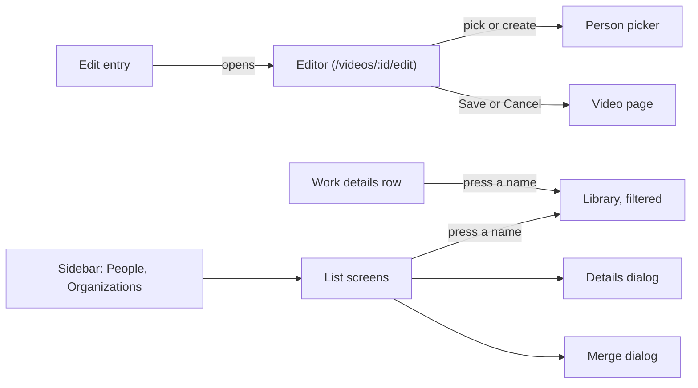
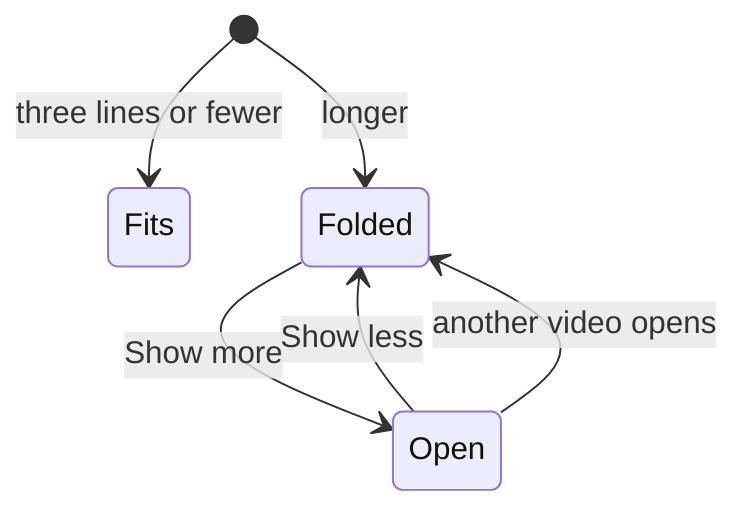
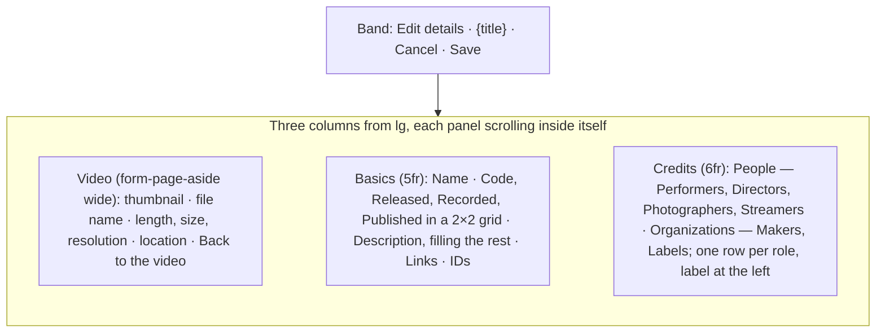
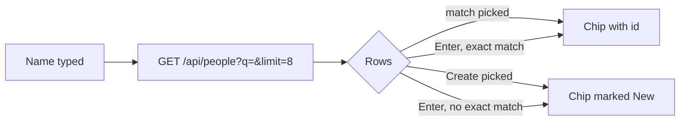
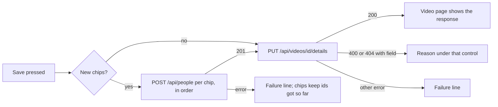
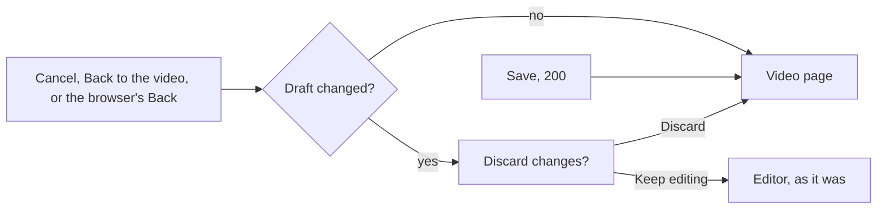
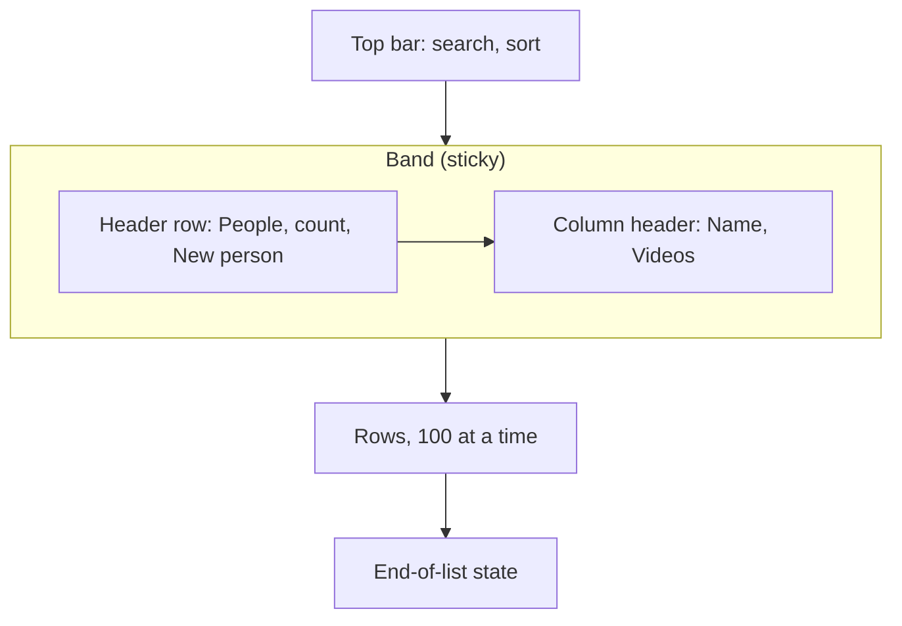

# UI design: Work information on videos (code, dates, people, organizations, URLs, external IDs)

**Feature**: [parent Issue #967](https://github.com/syudead/vv/issues/967) ·
[plan.md](plan.md) · [data-model.md, Fields](data-model.md#fields) ·
[contracts/screen-api.md](contracts/screen-api.md) ·
[research.md R-4](research.md#r-4-a-video-write-references-people-and-organizations-by-id-creation-has-its-own-route) ·
[R-5](research.md#r-5-one-put-that-replaces-the-whole-work-information-object) ·
[R-7](research.md#r-7-person-and-organization-list-parameters-by-id-matching-every-role) ·
[R-8](research.md#r-8-entity-edits-are-a-patch-of-optional-fields-a-merge-that-moves-links-and-a-delete-that-detaches) ·
[R-14](research.md#r-14-the-editor-saves-the-display-name-and-the-work-information-with-one-put-apivideosiddetails-in-one-transaction)

Sources that already decide things, linked rather than repeated here:

| Topic | Source |
| --- | --- |
| Tokens, closed scales, the two densities | [design-system.md, Foundations](../../docs/design-docs/design-system.md#foundations); the values in `@theme` of [`web/src/ui/tokens.css`](../../web/src/ui/tokens.css), named here and never copied |
| `Button`, `Input`, `Textarea`, `Field`, `Badge`, `Toggle`, `Combobox`, `DropdownMenu`, `Tooltip`, `Sidebar`, `TagCommand` | [components.md](../../web/registry/rules/components.md) |
| `DetailPage`, `AdminTablePage`, `FormDialog`, `ConfirmDialog`, `EditorDialog`, `DataTable`, the state blocks | [patterns.md](../../web/registry/rules/patterns.md) |
| The video page's band, information rows, their right-hand action group, the one failure line | [012 UI design, Video header](../012-video-detail-ia/ui-design.md#video-header); [library-ui.md, Information rows](../../docs/design-docs/library-ui.md#information-rows); [`VideoFacts.tsx`](../../web/src/player/VideoFacts.tsx) |
| The title's in-place editing on the video page (the pencil, Save, Cancel, the failure line, keys), which stays | [029 UI design, Title editing](../029-video-overrides/ui-design.md#title-editing); [`VideoTitle.tsx`](../../web/src/player/VideoTitle.tsx) |
| A full-window editor's band, its `Cancel` that asks before discarding work, and the page's keys not acting under it | [045 UI design, Thumbnail editor](../045-comfyui-thumbnails/ui-design.md#thumbnail-editor), [Closing](../045-comfyui-thumbnails/ui-design.md#closing) |
| Chips with a name link and `×`, and the add input with a dropdown list on the video page | [014 UI design, Video page tags](../014-video-tags/ui-design.md#video-page-tags); [`VideoTags.tsx`](../../web/src/player/VideoTags.tsx) |
| The library's active filter row and its chips | [014 UI design, Active tag filters](../014-video-tags/ui-design.md#active-tag-filters); [`ActiveTagFilters.tsx`](../../web/src/library/ActiveTagFilters.tsx) |
| The tag admin screen: top bar, band, rows, create and rename, merge dialog, delete, end-of-list states, touch and narrow-width actions, review widths | [036 UI design](../036-tag-admin-scale/ui-design.md); [014 UI design, Tag management page](../014-video-tags/ui-design.md#tag-management-page); [`web/src/tags/`](../../web/src/tags/) |
| Width breakpoints in CSS; layout checked by people; the sidebar's rail and drawer | [library-ui.md, Width breakpoints](../../docs/design-docs/library-ui.md#width-breakpoints-in-css-and-the-sidebar-exception), [Layout verified by people](../../docs/design-docs/library-ui.md#layout-verified-by-people-not-machines), [Shell and toolbar](../../docs/design-docs/library-ui.md#shell-and-toolbar) |
| Guests on owner-only screens | [016 UI design, Guest degradation](../016-single-account-auth/ui-design.md); [`AuthGate.tsx`](../../web/src/auth/AuthGate.tsx) (`ownerOnlyPath`) |
| Screen text | [`web/src/i18n/en.ts`](../../web/src/i18n/en.ts); this feature adds `player.workInfo`, `player.detailsEditor`, `credits`, two `shell.nav` entries, extends `library.activeTags` and the error reasons |

This feature adds four things, all for the owner only:

1. A **work details row** in the video page's information area, showing only
   the set items, with the description folded (requirements 9 and 11,
   acceptance criteria 1, 2 and 6).
2. An **edit entry** on the video page that opens a **full-screen editor** at
   `/videos/:id/edit`, holding the display name and every work information
   item, with a picker that finds or creates a person or organization, and
   one `Save` that writes both at once (requirement 8, acceptance criterion
   1). The title's in-place editing on the page stays.
3. A **person or organization filter** in the library, reached by pressing a
   name on the video page (requirement 11, acceptance criterion 4).
4. Two **list screens**, `/people` and `/organizations`, built like the tag
   screen: list, search, sort, create, rename, details (aliases, external
   IDs, parent), merge and delete (requirement 12, acceptance criterion 5).

The diagram shows the parts and where each action leads.

Unchanged: the player, the title and its in-place editor, the tags, the
visibility toggle, the file facts and the technical line, cards and list rows
(they carry no work information), the tag screen, and everything a guest sees.

## Why this shape

**The work details are one more wrapping row in the information area, under
the file facts and above the technical line.** The parent Issue asks for the
same arrangement and spacing as the existing information rows and for an area
that does not grow tall when many items are set. A row of `label value` items
that wrap at the row's gaps, in the file row's `text-sm` and gaps, reads a
code, a date and two performers on one line at 1280px and stays the file row's
shape at 360px. A `FactList` (one term and value per line) was rejected: a
video with a code, three dates, people in four roles, organizations in two
roles, links and IDs would be thirteen lines tall, and the Issue rules that
out. A card or framed block was rejected by
[012](../012-video-detail-ia/ui-design.md#screen-boundary), which draws no
frame around details. The row sits below the file row, not above it, so a
video without work information is pixel for pixel what it was (acceptance
criterion 2) and the action group keeps its place at the top of the area at
every width; the technical line stays last because it is the most subdued.

**Labels are words, not icons.** The file facts use icons because a clock
and a hard drive are unambiguous; "released" against "recorded", or
"director" against "photographer", are not. The label is
`text-muted-foreground` and the value `text-foreground`, as the Issue's
`UI品質` names, so the eye reads values first and labels only to tell them
apart.

**The description is folded to three lines.** A description may be 10,000
code points; shown whole it would push the technical line and, below `lg`,
the related videos off the screen. Three lines show what the video is, and
`Show more` opens the rest in place. A dialog for the full text was rejected:
reading is not a task that needs the page covered.

**Editing happens on a screen of its own, reached from one icon in the
information row's action group.** Requirement 8 asks for a full-screen
editor opened from the video page that holds the display name too and saves
both with one request, and the Plan makes it the route `/videos/:id/edit`
(Structure decision), so the player is not running under a form that may
hold a hundred chips, and the page that most visits never edit does not load
the editor's code. The entry stays one icon in the action group, the place
every per-video edit action on this page already lives
([046, Why this shape](../046-thumbnail-image-upload/ui-design.md#why-this-shape)),
so a video with nothing set shows no empty fields and no prompt, only the
entry (`UI品質`: `入力を前提にしない`). The title's pencil stays as the quick
way to rename: retitling is the one edit made in passing while watching, and
the editor is for sitting down with the work. A `FormDialog` was rejected:
thirteen fields and six pickers inside `max-w-lg` scroll in a dialog's body,
and the requirement names a full screen. An `EditorDialog` was rejected: its
stage is for an image, and the form would be squeezed into its aside.
`SettingsPage` was rejected because each of its rows saves itself and it has
no save button; `CenteredForm` because it is a card `max-w-sm` wide. No
skeleton fits a page of many values saved together, so one is added to the
design system first, as 045 added `EditorDialog`
([Changes to the design system](#changes-to-the-design-system)).

**The editor uses the screen's width: a narrow column that says which video
is being edited, a `Basics` panel and a `Credits` panel, side by side from
`lg`.** One centred column `max-w-2xl` was rejected by the maintainer as
wasting the screen: thirteen fields stacked in 42rem reach past 1280×820 at
`Dates`, so the owner scrolls to find the roles, and two thirds of the window
are empty. Three columns put every field on the screen at once for typical
content, and each panel scrolls inside itself when a list is long, so the
band and the other panels stay where they are. The split follows what the
fields are: `Basics` holds the texts and dates the owner types; `Credits`
holds the six roles, which are chips and a picker and need the width more
than a text field does, so the right panel is slightly wider. The left column
exists because the editor has no player: the thumbnail, the file name and the
file facts say which video is open, the way the video page's facts do, and
the link back is the same way out as `Cancel`. The columns stack below `lg`,
where side by side would squeeze a picker to nothing, and the page then
scrolls as one under the band, as the video page does below `lg`
([library-ui.md, Width breakpoints](../../docs/design-docs/library-ui.md#width-breakpoints-in-css-and-the-sidebar-exception)).

**`Cancel` and `Save` sit in the editor's band, not under the last field.**
A panel may hold a hundred chips; the band is sticky at every width, so
saving never needs a scroll to the bottom, and the top band is where the video
page has trained the eye to find the way out
([012, Video header](../012-video-detail-ia/ui-design.md#video-header)). The
band carries no logo, breadcrumb or `×`: the editor is a step inside the
video page, and the one way out is `Cancel`, which asks before discarding
changes (as [045's editor](../045-comfyui-thumbnails/ui-design.md#closing)),
because an owner who has typed a dozen values should not lose them to one
press. Esc never leaves the editor for the same reason.

**The name is the first field, holding the display name, with the file-name
title as its placeholder.** Requirement 8 puts the display name in the same
editor; it comes first because it is what the page shows first. Prefilling
it with the file-name title, as the in-place editor does
([029, Edit mode](../029-video-overrides/ui-design.md#edit-mode)), was
rejected here: an untouched field would then save a display name equal to
the file name, and the placeholder already shows what an empty name falls
back to.

**People and organizations are picked with the tag page's picker, generalised,
and a new entry is created on `Save`.** The video page's `Add tag` is a
`TagCommand` in `dropdown` layout: type, see matching entries, pick one or
create one. The same shape serves names, with the entity name rules in place
of the tag name rules ([Changes to the design system](#changes-to-the-design-system)).
A new name becomes a chip marked `New` and is sent as `POST /api/people`
only when `Save` runs, just before the `PUT` (R-4): `Cancel` then leaves
nothing behind, and a person typed into two roles is created once. Creating
at the moment of picking was rejected because a cancelled edit would leave a
person with no videos on `/people`. The `Create "…"` row is offered even when
a person of that exact name exists, listed after the matches, because the
Issue's edge case asks that a namesake can be made a separate person; the
match rows show their video counts so the owner can tell which is which.

**A name is a link to the library filtered by that entity, and the filter is a
chip in the library's active filter row.** R-7 puts `person=<id>` and
`organization=<id>` in the library URL, so pressing a name on the video page
or on a list screen opens `/?person=<id>`, as a tag chip opens `/?tag=<id>`.
The active filter row gains a chip per entity, with the entity's icon, so the
row's label becomes `Filtering by`. A page of its own per person was rejected
in R-7.

**The list screens are the tag screen without tentative tags and without bulk
selection.** The Issue asks for the tag page's manner (list, rename, merge),
and the owner already knows it. Rows have no checkbox and the header is never
replaced by a selection bar, because the Issue asks for no bulk action on
people. Aliases, external IDs and the parent organization are edited in one
`Edit details` dialog, saved with one `PATCH` (R-8); the tag page's one
synonyms dialog became this one because a person has three optional lists
where a tag has one. The sidebar gets two entries, `People` and
`Organizations`, after `Tags`: the Issue names two screens, and a tab inside
one screen would be a tab that changes the route, which the registry's `Tabs`
rule forbids.

## Words

The English is the draft the catalog takes; after implementation
[`web/src/i18n/en.ts`](../../web/src/i18n/en.ts) is canonical. Names, codes,
dates, URLs and IDs are user data and are embedded untranslated.

### Video page, work details row

| Place | Text | Notes |
| --- | --- | --- |
| Accessible name of the row (`ul`) | Work details | Beside `File details` and `Technical details` |
| Item labels | Code / Released / Recorded / Published / Performer, Performers / Director, Directors / Photographer, Photographers / Streamer, Streamers / Maker, Makers / Label, Labels / Links / IDs | A role's label is singular with one entry and plural with more (`selectPlural`) |
| Accessible name of a name link | Show videos with {name} | `aria-label`; the visible text is the name |
| Link item | {url without its scheme} | Full URL in `title`; opens in a new tab |
| ID item | {source}: {value} | |
| Description, fold control | Show more / Show less | `link` `sm` `Button` after the folded text |
| A list item's hidden entries | +{n} more / Show fewer | `link` `sm` `Button` after the first three entries; `aria-label` `Show all {count} {label}` (`Show all 12 performers`) |
| Entry, name and tooltip | Edit details | `player.workInfo.edit`; the name and the work information together |

### Editor

| Place | Text | Notes |
| --- | --- | --- |
| Band title (`h1`) and `document.title` | Edit details | `document.title` is `Edit details · {title}` |
| Band detail | {title} | The video's current title, muted, after the band title |
| Left column (`aside`) accessible name | Video | The thumbnail's `alt` is empty; the file name, `{length} · {size} · {resolution}` and the location are user data |
| Left column link | Back to the video | A router `Link`; acts as `Cancel` ([Leaving](#leaving)) |
| Panel legends | Basics / Credits | `FieldLegend`s of the two panels |
| Group labels in `Credits` | People / Organizations | `FieldLegend variant="label"` over each group of roles |
| Field labels | Name / Code / Description / Released / Recorded / Published / Performers / Directors / Photographers / Streamers / Makers / Labels / Links / IDs | Visible `FieldLabel`s; role labels are always plural in the editor |
| Name placeholder | The file-name title itself | User data; not translated. As the in-place editor's placeholder (029) |
| Date placeholder | YYYY-MM-DD | The three date fields; `YYYY` and `YYYY-MM` are accepted too, said in the description below the fields: `A year or a year and month is enough.` |
| Picker input, name and placeholder | Add a performer / Add a director / Add a photographer / Add a streamer / Add a maker / Add a label | One per role |
| Picker, create row | Create "{name}" | Last row; always offered for a non-empty name |
| Picker, match hint | Alias: {alias} | Under a match found through an alias, as the tag picker's `Synonym: …` |
| Picker, match count | {n} videos | At the row's right, the catalog's `videos(n)` |
| Picker, no name | Enter a name | The reason line under the input, as the tag picker's empty-name reason |
| Picker, name too long | Up to 200 characters | The reason line |
| Chip `×` | Remove {name} | |
| Chip mark for an unsaved new entry | New | `text-xs text-muted-foreground` after the name; read as `{name}, new` |
| Link rows | Link / Remove link / Add link | The row input's `aria-label`, its `×`, the button under the rows |
| ID rows | Source / Value / Remove ID / Add ID | |
| Band buttons | Cancel / Save | Save reads `Saving…` with a spinner while sending |
| Failure line | Couldn't save the details: {reason} | Under the band, above the columns; `{reason}` from [Error reasons](#error-reasons) |
| Created but not saved | {n} people were created, but the details weren't saved: {reason} | The failure line when a `POST` succeeded and the `PUT` failed; the chips keep their ids, so `Save` again sends only the `PUT` |
| Discard confirmation | Discard changes? / The changes to "{title}" haven't been saved. / Keep editing / Discard | `ConfirmDialog` title, text, cancel and action |
| Loading failed | Couldn't load the video: {reason} | `ErrorState` with `Retry` |
| Video gone | This video no longer exists. | `ErrorState` without `Retry` |

### Library

| Place | Text | Notes |
| --- | --- | --- |
| Active filter row label | Filtering by | Replaces `Filtering by tags`; the chips' icons say the kind |
| Accessible name of a person or organization chip | Remove the filter for {name} | Shared with tag chips |
| Chip before the name is known | Remove the person filter / Remove the organization filter | |
| Entity gone (`404` from the name read) | Removed a person who no longer exists from the filter / Removed an organization that no longer exists from the filter | Toast; the parameter leaves the URL |

### Sidebar

| Place | Text | Notes |
| --- | --- | --- |
| Entries | People / Organizations | `shell.nav.people`, `shell.nav.organizations`; after `Tags`, before `Duplicates` |

### People and organizations screens

`{kind}` stands for `person` or `organization`; each text exists for both
kinds in the catalog.

| Place | Text | Notes |
| --- | --- | --- |
| Heading | People / Organizations | `h1`, the tag page's format |
| Count | 1,000 people / 90 of 1,000 people; 1,000 organizations / 90 of 1,000 organizations | `total` of `totalAll` while a search applies |
| Create button | New person / New organization | |
| Search field | Search people / Search organizations | Accessible name and placeholder; `/` focuses it |
| Sort kinds | Name / Video count / Date created | The tag page's menu and direction toggle |
| Column header | Name / Videos | |
| Accessible name of a name link | Open the library filtered by {name} | |
| Second line of a row | Aliases: {a} · {b} ({language}) | A language follows its alias in parentheses when set; absent without aliases |
| Second line, organization with a parent | Part of {parent} · Aliases: … | The parent first |
| Row actions | Rename / Edit details / More actions | The `IconButton`s' names and the menu entry; `Actions` on touch and below `sm`, as 036 |
| Menu items | Merge into another person… / Merge into another organization… · Delete… | |
| Create row | Name / Create / Cancel | The input's `aria-label` and the two buttons |
| Rename | Rename / Save / Cancel | As the tag row |
| Details dialog title | Edit "{name}" | |
| Details dialog sections | Aliases / External IDs / Parent organization | `FieldLegend`s; the last for organizations only |
| Alias rows | Alias / Language / Remove alias / Add alias | `Language` placeholder `ja`; its description `Optional. A language tag such as ja or en-US.` |
| ID rows | Source / Value / Remove ID / Add ID | |
| Parent field | None / Search organizations / No matching organizations | The `Combobox`'s placeholder, search placeholder and empty text |
| Details dialog buttons | Cancel / Save | |
| Merge dialog title | Merge "{name}" | |
| Merge target label | Person to merge into / Organization to merge into | |
| Merge candidates empty | No matching people / No matching organizations | |
| Merge confirmation | The {videos(n)} with "{source}" get "{target}" instead. "{source}"'s name, aliases and IDs become aliases and IDs of "{target}", and "{source}" leaves the list. This can't be undone. | `n` is the source's `videoCount`; with 0 videos: `"{source}" isn't on any videos. Its name, aliases and IDs become aliases and IDs of "{target}", and it leaves the list. This can't be undone.` |
| Merge dialog buttons | Cancel / Merge | |
| Merge toast | Merged "{source}" into "{target}" | |
| Delete dialog title | Delete "{name}"? | |
| Delete text | "{name}" will be removed from {videos(n)}. This can't be undone. | With 0 videos: `"{name}" isn't on any videos. This can't be undone.` For an organization, a second sentence: `Organizations inside it stay and lose their parent.` |
| Delete dialog buttons | Cancel / Delete | `Deleting…` while sending |
| Delete toast | Deleted "{name}" | |
| Entity gone during an action | This person no longer exists, so the list was reloaded / This organization no longer exists, so the list was reloaded | Toast, as the tag page's `tag_not_found` |
| Empty list | No people yet / No organizations yet | `EmptyState` title; description `Add them from a video's details, or create one here.`; the create button |
| No search match | No people match "{q}" / No organizations match "{q}" | `EmptyState`; `Clear search` |
| Load failed | Couldn't load people: {reason} / Couldn't load organizations: {reason} | `ErrorState` with `Retry` |
| Loading more, failed, list changed | As 036: Loading more people… / Couldn't load more: {reason} / People were added or removed elsewhere, so the rest of this list may be out of date. | The organization texts likewise |

### Error reasons

Added to the `reason` table in `web/src/i18n/en.ts`, which `web/src/i18n/errors.ts` reads
([contracts/screen-api.md, Added `reason` values and `field`](contracts/screen-api.md#added-reason-values-and-field)).
The text names no field: the screen places it under the control that `field`
names, and when no control matches, the failure line shows the text followed
by the path in inline code. The two `display_name_*` reasons keep their 029
text and reach the editor with `field: displayName`.

| Reason | Text |
| --- | --- |
| `work_info_control_characters` | Contains characters that can't be used. |
| `work_info_too_long` | Too long: up to {limit} characters. |
| `work_info_too_many` | Too many: up to {limit}. |
| `work_info_invalid_date` | Enter a date as YYYY, YYYY-MM or YYYY-MM-DD. |
| `work_info_invalid_url` | Enter a full web address starting with http:// or https://. |
| `work_info_invalid_language` | Enter a language tag such as ja or en-US. |
| `work_info_duplicate` | Already listed. |
| `work_info_empty` | This can't be empty. |
| `person_not_found` | This person no longer exists. |
| `organization_not_found` | This organization no longer exists. |
| `organization_parent_cycle` | The parent can't be the organization itself or one inside it. |
| `merge_same_person` | A person can't be merged into themselves. |
| `merge_same_organization` | An organization can't be merged into itself. |
| `external_id_taken` | Another entry already has this ID. |

## Changes to the design system

Both additions land, with their rules in
[patterns.md](../../web/registry/rules/patterns.md) and
[components.md](../../web/registry/rules/components.md) and their row in
[design-system.md](../../docs/design-docs/design-system.md), before the video
page unit uses them, as 045 added `EditorDialog`.

| Change | What it is |
| --- | --- |
| `FormPage` skeleton, registry item `form-page`, block `form-page-example` | A page, not a dialog, that fills the window on `bg-background` for a form of many values saved together, which `FormDialog` (a few fields) and `SettingsPage` (each row saves itself) do not cover: a header band `navbar` high, `sticky top-0` at every width, with a bottom border and the video page band's `bg-background/90 backdrop-blur-md`, holding the `title` (the page's `h1`, `text-lg font-semibold`), a muted `detail` after it (`text-sm text-muted-foreground`, `truncate`, hidden below `sm`), and an `actions` slot at the right end for `Cancel` and the one `default` button; a `notice` slot under the band for the failure line; a body with `px-4` (`px-6` from `sm`) and `py-6` holding an optional `aside` and the `panels` (each a `FieldSet` with a `FieldLegend`, its fields `gap-4` apart), laid out by the named utility `grid-cols-form-page` from `lg`: the aside a column `form-page-aside` wide (16.25rem) at the left, then the panels in the ratio 5:6, the columns `gap-6` apart; from `lg` the page keeps the viewport's height and each panel scrolls inside itself (`min-h-0 overflow-y-auto`), below `lg` the aside and the panels stack in order and the page scrolls as one under the band; library density. It owns the band, the grid, the panel scrolling and the gaps, as every skeleton does; the screen passes content into the slots. Its row in patterns.md's skeleton table reads "Fills in many values saved together, on a screen of its own", and the Settings page rule's last sentence becomes `A group of values saved together belongs in a FormDialog, or in a FormPage when it is more than a few.` |
| `CreditCommand`, a vv component and registry item `credit-command` | `TagCommand`'s `Command` with the entity name rules (1 to 200 code points, no control characters, a paste with a line break refused with its reason) in place of the tag name rules, with the same `dropdown` and `inline` layouts and the same row content (name, hint line, count at the right, the create row last). The implementation makes it and `TagCommand` one base component that takes the name rules, so no code is copied (AGENTS.md). components.md's `TagCommand` section gains the sibling and its last sentence becomes `Do not use either for values other than tag names and the names of people and organizations.` |
| `Combobox`, first use on a screen | The parent organization field of the details dialog. No change to the component |

`tokens.css` gains one named step, `form-page-aside` (16.25rem, the editor's
left column), and one named utility, `grid-cols-form-page`
(`var(--spacing-form-page-aside) minmax(0, 5fr) minmax(0, 6fr)`), as
foundations.md asks for a width the scale lacks; both are listed in
foundations.md's named steps and utilities. No colour token is added, nothing
is added to `pairs` in `web/src/theme/tokens.test.ts` (`foreground` and
`muted-foreground` on `background`, `popover` and `card` are already listed),
and no section is added. Icons are lucide `Clapperboard` (the edit entry),
`ArrowLeft` (`Back to the video`), `User` (a person
chip), `Building2` (an organization chip and the `Organizations` sidebar
entry), `Users` (the `People` sidebar entry), `IdCard` (`Edit details` on the
list screens), and the tag screen's `Pencil`, `Ellipsis`, `Merge` and
`Trash2`.

## Video page: work details row

The row is a third block in the information area
([library-ui.md, Information rows](../../docs/design-docs/library-ui.md#information-rows)),
after the file row and its failure line and before the technical line, so
the area's `gap-3` separates it from both. It is drawn only when `workInfo`
has at least one set item; a video without any shows the area exactly as
before.

| Part | Form |
| --- | --- |
| Row | A `ul` with the file row's classes: `flex flex-wrap items-center gap-x-4 gap-y-2 text-sm sm:gap-x-5`. No divider, frame, heading or icon |
| Item | A `li` of a label and a value, `gap-1.5` apart; the label `text-muted-foreground`, the value `text-foreground`. Set items only, in the order of the labels table; an item whose list is empty is absent |
| Code | The code as stored. `tabular-nums` |
| Dates | The stored text (`2024-03-01`, `2024-03`, `2024`), `tabular-nums`, never passed through `formatDate`, because a year or a year and month has no locale form and three forms in one row read better alike |
| People, organizations | The names of one role, in position order, joined by `, `. Each name is a router `Link` to `/?person=<id>` or `/?organization=<id>` in the body colour, `hover:text-primary`, no underline at rest, as the name link of a tag chip. The item wraps after a comma; a name wraps with `wrap-anywhere` |
| Links | One link per URL, the text being the URL without its scheme, `truncate` at `max-w-xs`, the full URL in `title`, `target="_blank"` with `rel="noreferrer"`, lucide `ExternalLink` (`size-3`) after the text. Several are joined by `, ` |
| IDs | `{source}: {value}` pairs joined by `, `, `tabular-nums` |
| Long lists | A role, `Links` or `IDs` with more than three entries shows its first three and then `+{n} more`, a `link` `sm` `Button` in `text-muted-foreground`, `hover:text-primary`, inside the same item. Pressing it shows every entry of that item in place, followed by `Show fewer`, and moves the focus to the fourth entry. Not remembered, as the description. The limits allow 100 names per role and 20 links and IDs, so without this cap the row's height would grow with the counts, which the Issue's `UI品質` (`項目が多くても情報欄が縦に間延びしない`) rules out; folding each list rather than the whole row keeps every kind of item visible |
| Description | A `p` under the `ul`, `text-sm text-foreground whitespace-pre-line max-w-prose`, so line feeds show and a line stays readable in the wide left column; folded as below |

### Folded description

The diagram shows how the description unfolds.

| State | What the row shows |
| --- | --- |
| Fits | The whole text; no control |
| Folded | `line-clamp-3`, then `Show more` on its own line under the text: a `link` `sm` `Button`, `text-muted-foreground`, `hover:text-primary`. Whether the text overflows is measured on the element; a window resize re-measures |
| Open | The whole text, `Show less` under it. Not remembered: the next video, and a return to this one, start folded |

### States

The row has no loading state of its own: `workInfo` arrives with the video.
A `video` notification refetches the video and the row shows the new values,
including an object written through the external API (acceptance criterion
8).

| State | What the row shows |
| --- | --- |
| No item set | Nothing; the information area is the file row and the technical line, as before |
| Some items set | The set items only, in order, wrapping |
| Guest | Nothing, and no entry: the response has no `workInfo` |

## Video page: entry

An `ActionButton` (`ghost` `icon-sm`, lucide `Clapperboard`,
`text-muted-foreground`, named `Edit details`) in the information row's
action group, after `Add to playlist` and before
`Use current frame as thumbnail`, so the three thumbnail actions stay
together. It is a router `Link` (`Button asChild`) to `/videos/:id/edit`,
carrying the page's return target (`from`, `trail`) in the navigation state
so the editor can hand it back. It is placed for the owner whenever the page
is open, player or not, and never for a guest. It is the only entry for the
work information: the row carries no pencil, so a video with and without
work information has the same way in. The title's pencil
([029, Title editing](../029-video-overrides/ui-design.md#title-editing))
stays beside it as the quick way to rename; it edits the name alone, in
place, with `PUT /api/videos/{id}/display-name`.

Opening the editor leaves the video page, so playback stops; on return the
page opens as it does from the list, not playing.

## Editor

`/videos/:id/edit` is a `FormPage`
([Changes to the design system](#changes-to-the-design-system)) outside
`AppShell`, as the video page is: no sidebar, no top bar, no player. It is
loaded with `deferredRoute` and joins `ownerOnlyPath`, so a guest is sent to
sign in with `next` set to the editor (plan, Structure decision). Opened from
the entry it starts from the page's `Video`; opened by its URL it reads
`GET /api/videos/{id}` first ([States](#states-1)).

The diagram shows the screen's parts from `lg`: the band, then three columns
side by side.

Below `lg` the same three parts stack in that order and the page scrolls as
one under the band ([Responsive behaviour](#responsive-behaviour)).

### Screen

| Part | Form |
| --- | --- |
| Band | The skeleton's band: `Edit details` as the `h1`, the video's current title as the detail, and at the right end `Cancel` (`ghost` `sm`) then `Save` (`default` `sm`, the only `default` button on the screen). No logo, breadcrumb or `×` |
| Grid | The skeleton's `grid-cols-form-page` from `lg`: the left column `form-page-aside` wide, `Basics` and `Credits` in the ratio 5:6, `gap-6` apart. From `lg` the page is the viewport's height, so the band never leaves the top and each panel scrolls inside itself when its content is taller; below `lg` the three stack and the page scrolls as one. Controls are the skeleton's library density (`sm`) |
| Left column | An `aside` named `Video`, `text-sm`, its parts `gap-3` apart, top to bottom: the thumbnail (`rounded-md`, the column's width, `aspect-video`, `object-cover`, the video page's placeholder when there is none), the file name (`font-medium`, `wrap-anywhere`), one muted line `{length} · {size} · {resolution}` (`text-muted-foreground tabular-nums`; the resolution absent while the probe is pending or failed), the location (`text-muted-foreground`, `wrap-anywhere`, the folder and file as the video page's file row shows them), and `Back to the video`: a `link` `sm` `Button asChild` with lucide `ArrowLeft` first, `text-muted-foreground`, `hover:text-primary`. Nothing in the column is editable, and it never scrolls: its content is bounded |
| `Basics` panel | A `FieldSet` with the `FieldLegend` `Basics`, a flex column, its fields `gap-4` apart, in this order: `Name`; `Code`, `Released`, `Recorded` and `Published` in a `grid grid-cols-2 gap-4` from `sm` (`Code` and `Released` on the first row, `Recorded` and `Published` on the second; stacked below `sm`) with one `FieldDescription` under the grid; `Description`, which takes the height the other fields leave (`flex-1`); then `Links` and `IDs` |
| `Credits` panel | A `FieldSet` with the `FieldLegend` `Credits`, holding two groups `gap-6` apart: `People` with the four people roles and `Organizations` with the two organization roles, each a nested `FieldSet` whose `FieldLegend variant="label"` is the group name. The roles of a group are rows of a `grid grid-cols-term gap-x-4 gap-y-3 items-start`: the role's `FieldLabel` in the first column (one line, `pt-1.5` so it aligns with the first chip), the chips and the picker in the second |
| Failure line | The video page's failure line (`role="alert"`, `text-sm text-destructive`, lucide `AlertCircle` first) in the skeleton's `notice` slot under the band and above the columns, so it is visible under the band that holds `Save` at every scroll position of the panels. It clears on the next `Save` and on leaving |

### Fields

| Field | Control | Initial value |
| --- | --- | --- |
| Name | `Input`; the placeholder is the file-name title, so an empty field says in place what the page will show. No description: the placeholder is the explanation, as in 029 | The display name when one is set, else empty |
| Code | `Input`, the first cell of the 2×2 grid | The stored code |
| Released, Recorded, Published | Three `Input`s, the other cells of the 2×2 grid; placeholder `YYYY-MM-DD`; one `FieldDescription` under the grid: `A year or a year and month is enough.` | The stored text of each kind |
| Description | `Textarea` filling the panel's remaining height, at least three rows (`min-h-20`), its own text scrolling inside it; it does not grow with its content, so `Links` and `IDs` keep their place under it. When `Links` and `IDs` grow past the panel's height the panel scrolls and the `Textarea` stays at its minimum | The stored text |
| Performers, Directors, Photographers, Streamers | A chip row and a picker input on one wrapping line in the row's second column, the shape of the video page's tags: `secondary` `Badge` chips (the name, no link, and the `×` named `Remove {name}`), then the `CreditCommand` `dropdown` input (`w-combobox`) at the end of the line | The linked people of that role, in position order |
| Makers, Labels | The same, for organizations | |
| Links | One `Input` per URL with a `ghost` `icon-sm` `×` (`Remove link`) at its right, then `Add link` (`outline` `sm`, lucide `Plus`) under the rows; no row while the list is empty | The stored URLs in order |
| IDs | One row per external ID: `Source` and `Value` `Input`s side by side (`Source` a third of the row), the `×` (`Remove ID`), then `Add ID` | The stored IDs |

- The editor opens with the focus on `Name`, its text not selected: the
  owner usually came for the work information, and a selected name invites
  typing over it.
- `Add link` and `Add ID` append an empty row and focus it. An empty row is
  dropped on `Save`.
- A role's chips are in position order, and a new chip joins the end: the
  order is the order of adding, and moving a person means removing and
  adding again. Drag ordering was not asked for and would need a component
  the design system lacks.
- The chip's `×` removes it at once; the removal is sent with `Save`.
- A `video` notification that arrives while the editor is open does not
  touch the draft; `Save` makes the draft the last write.
- Keys: Esc closes an open picker list or the discard confirmation and
  otherwise does nothing; the editor is left only through `Cancel`, `Save` or
  the browser's Back ([Leaving](#leaving)). Enter in `Name`, `Code`, a date,
  a link or an ID input saves, as Enter saves in the in-place title editor;
  Enter in `Description` inserts a line break; Enter in a picker input acts on
  the picker. The video page's playback shortcuts do not exist here: there
  is no player.

### Picker

The `CreditCommand` in `dropdown` layout behaves as the video page's
`Add tag` ([014, Add input](../014-video-tags/ui-design.md#add-input)): the
list opens below the input on focus or typing, Esc, Tab and leaving close it,
and no row is selected until the arrow keys or the pointer select one. The
list is a popover on the page, so no dialog body clips it.

The diagram shows where each input leads.

| Aspect | Rule |
| --- | --- |
| Candidates | Every keystroke requests `GET /api/people?q={input}&limit=8` (or `/api/organizations`), the previous request aborted, with `q` cut to the input's first 100 characters, because the list contract accepts at most 100 while a name may have 200; every match of the full name contains that prefix, so the cut narrows nothing away and the name stays valid to create; the previous rows stay until the new ones arrive, with the small spinner at the input's right end, as the merge dialog's target list |
| Row content | The name; `Alias: {alias}` under it when the input matched an alias and not the name; `{n} videos` at the right. People already in this role's chips, and the editor's unsaved new chips, are not listed as matches |
| Exact match | A candidate whose name or alias equals the whole input under the search fold comes first. The eight rows are one page of substring matches in name order, so an exact match can be missing from them ([contracts/screen-api.md](contracts/screen-api.md#people-and-organizations) has no separate exact result); see Enter below |
| Create row | `Create "{name}"`, last, offered for every non-empty name that is not an unsaved new chip already, even when an exact match exists ([Why this shape](#why-this-shape)). Choosing it adds a chip marked `New`; nothing is sent yet. The same name typed into another role offers that unsaved chip as a match row (marked `New`, no count) instead of a second create row |
| Enter without arrows | The exact match when the rows hold one. When they do not and the response had a `nextCursor` (more matches than the rows), the picker first requests the same `q` without `limit`, which returns every match, with the input's spinner, and picks the exact match from that response if there is one; only when no exact match exists anywhere does Enter take the create row, so Enter never creates a namesake of an existing entry. A failure of that request shows the `Request failed` line and adds no chip. An empty name shows `Enter a name` under the input |
| Name rules | Checked as typed: over 200 code points, or a control character, shows the reason under the input and the picker does not act; a paste with a line break is refused with its reason, as the tag picker |
| Request failed | `Couldn't search people: {reason}` under the input in the picker's reason format; the last rows stay and the next keystroke searches again |

### Save

The diagram shows what `Save` sends.

The `PUT` carries `displayName` (the `Name` field, trimmed; empty clears the
display name) and `workInfo` (every other field, as one object), and the
server writes both or neither
([contracts/screen-api.md, `PUT /api/videos/{id}/details`](contracts/screen-api.md#put-apivideosiddetails)).

| Situation | What the editor shows |
| --- | --- |
| Sending | `Save` reads `Saving…` with a spinning `LoaderCircle`, `aria-disabled`; every field is `readOnly` and the pickers and `×`s do not act; `Cancel` is `aria-disabled` until the `POST`s and the `PUT` have all answered. A `POST` already sent cannot be withdrawn, so leaving under it would leave a person or organization linked to nothing, and leaving under the `PUT` would show the page with the old title and items until the notification arrives; waiting lets the save end on the page, or in the failure line below |
| Saved (`200`) | The editor returns to `/videos/:id` with the response `Video`, so the page shows the new title, the row with the saved items (none when everything was cleared) and `document.title` at once, with no flash of the old values, and the focus lands on the entry. No toast: the page is the result |
| `400` with `field` | The reason under the control the path names (`displayName` to `Name`, `code`, `description`, `dates[i].date` to the date field of that kind, `urls[i]`, `externalIds[i].source` or `.value` to that row's input, `people[i].person.id` to that chip's `×`), with `aria-invalid` on it, its panel (the page, below `lg`) scrolled so the control is in view, and the focus moved there; the editor stays open with every value kept, and nothing was written, the name included. A path with no control shows on the failure line with the path in inline code |
| `404 person_not_found` or `organization_not_found` with `field` | The same, at the chip, which the owner removes; another tab deleted that entry |
| A `POST` failed | The failure line `Couldn't save the details: {reason}`; chips whose `POST` succeeded lose their `New` mark and keep their ids, so a second `Save` creates nothing twice |
| The `PUT` failed after a `POST` succeeded | The failure line `{n} people were created, but the details weren't saved: {reason}`; a second `Save` sends only the `PUT`. `Cancel` from here leaves and keeps the created entries, which the line has just named and which the discard confirmation does not mention; they stay on the list screen with `0 videos`, where the owner can delete them |
| `404 video_not_found` | The editor shows [the gone state](#states-1) |
| Nothing changed | The `PUT` is still sent; the server returns `200` and leaves `updatedAt` ([contracts/screen-api.md](contracts/screen-api.md#put-apivideosiddetails)); the editor returns to the page |

### Leaving

The diagram shows the ways out.

| Aspect | Rule |
| --- | --- |
| Changed | The draft differs from the loaded values after trimming: a text that differs, a chip added or removed (an unsaved `New` chip counts), a link or ID row that differs, an empty added row not counted |
| `Cancel`, unchanged | Returns to the page at once, sending nothing |
| `Cancel`, changed | A `ConfirmDialog` `Discard changes?` ([Words](#editor)) with `Keep editing` and a `destructive` `Discard`; `Discard` returns to the page, sending nothing and leaving no new chip behind; `Keep editing` and Esc close the dialog and return the focus to `Cancel` |
| `Back to the video` | The same as `Cancel`, from the left column: the link's navigation is held until the draft is unchanged or `Discard` is chosen; `Keep editing` returns the focus to the link |
| The browser's Back | The same as `Cancel`: unchanged leaves, changed asks first and stays on the editor while the dialog is open |
| A reload or a closed tab | While the draft is changed, the browser's own leave prompt (`beforeunload`); otherwise nothing |
| Return target | `/videos/:id` with the `from` and `trail` the entry carried, so the page's `×` still returns to the list the owner came from; opened by its URL, the editor returns to `/videos/:id` without state, and the page then returns to `/` as it does when opened by its URL. The focus lands on the entry |

### States

| State | What the editor shows |
| --- | --- |
| Loading (opened by its URL) | The band with an empty detail, `Cancel` pressable and `Save` `aria-disabled`; the left column shows a `Skeleton` in the thumbnail's place and two text-line `Skeleton`s, and the panels show every field's label with a `Skeleton` the control's height (`h-8`, `w-full`) in its place, so nothing jumps when the values arrive. Opened from the entry there is no loading: the page's `Video` is the draft's source |
| Loaded | The fields with their initial values; the focus on `Name` |
| Load failed | An `ErrorState` in the body in place of the columns, `Couldn't load the video: {reason}`, with `Retry`; `Save` `aria-disabled` |
| Gone (`404 video_not_found`, on load or on `Save`) | An `ErrorState` `This video no longer exists.` without `Retry`; `Save` `aria-disabled`; `Cancel` returns to the page, which shows its own gone layer |
| Guest | Sent to `/login?next=/videos/:id/edit` before anything is drawn; after signing in the editor opens |

## Library: filter by a person or organization

Pressing a name on the video page or on a list screen opens
`/?person=<id>` or `/?organization=<id>`
([contracts/screen-api.md, List parameters](contracts/screen-api.md#list-parameters-person-and-organization)).
The library applies it as it applies `tag`: the request carries it, `total`
counts with it, the snapshot key includes it, the page scrolls to the top,
and Back returns to the video page.

The active filter row ([014, Active tag filters](../014-video-tags/ui-design.md#active-tag-filters))
shows one chip per entity after the tag chips, in the same `Toggle` form
(`outline` `sm`, pressed): lucide `User` or `Building2`, the name, `×`.
Its label reads `Filtering by` because the chips no longer are tags only. The
row is drawn while any tag, person or organization applies.

| Aspect | Rule |
| --- | --- |
| Name | Read with `GET /api/people/{id}` for a `person` chip and `GET /api/organizations/{id}` for an `organization` chip, because the two kinds have separate id spaces; a `Skeleton` (`w-12`) stands in the chip until it arrives, as a tag chip before the tag list loads |
| `404` (`person_not_found` or `organization_not_found` from that read) | The parameter leaves the URL, the chip goes, the list reloads, and a toast says the entity no longer exists ([Words](#library)); the tag and the other entity filter stay |
| Removing | Pressing the chip removes only that parameter; the focus moves to the next chip, else the previous, else the search field |
| `Clear filters` | Removes `person` and `organization` with `q`, `watch`, `playable` and `tag`; the sort stays. The filter button's count does not include them, as it does not include tags |
| Both set | One person and one organization at most; the chips sit in that order after the tags |
| Guest | A guest URL with `person` or `organization` is reset before the request and corrected, as `fav=1` is |

## Sidebar

Two entries join the upper group after `Tags` and before `Duplicates`:
`People` (lucide `Users`, `/people`) and `Organizations` (lucide `Building2`,
`/organizations`), owner only, in the rail's icon-above-label square and in
the drawer. The rail then holds eight entries, which fit above the footer at
the heights the showcase is judged at. `/people`, `/organizations` and
`/videos/:id/edit` join `ownerOnlyPath`, so a guest is sent to sign in, as
from `/tags`.

## People and organizations screens

One `AdminTablePage` component serves both kinds (plan, Structure decision),
laid out as the tag screen after 036 with these differences: no `Filter`
button, no tabs, no checkbox column, no selection bar, and the details
dialog in place of the synonyms dialog. Everything the table below does not
name follows [036 UI design](../036-tag-admin-scale/ui-design.md): the top
bar's search and sort, the sticky band, the header row's format and height,
the column header, rows of `py-2`, the create row, rename in place, loading
more on scroll, the end-of-list states, the stale list box, the empty and
error states, the `Actions` menu on touch and below `sm`, and the URL state
(`q`, `sort`).

| Part | Form |
| --- | --- |
| Row | Name column (`flex-1 min-w-0`): the name as a link to `/?person=<id>` (`text-sm font-medium`, `hover:text-primary`, one line, `truncate`, full name in `title`), and under it one `text-xs text-muted-foreground` line with the parent (organizations) and the aliases ([Words](#people-and-organizations-screens)), truncated with the full text in `title`; absent when there is neither. Then the count (`text-sm text-muted-foreground tabular-nums`, right-aligned `w-16`), then the actions |
| Row actions, mouse at `sm` and up | `Rename` (`Pencil`) and `Edit details` (`IdCard`) as `ghost` `icon-sm` buttons with tooltips, then `More actions` (`Ellipsis`) opening a `DropdownMenu` with `Merge into another person…` (`Merge`), a separator, and `Delete…` (`Trash2`, `destructive`) |
| Row actions, touch or below `sm` | One `Actions` menu with the four items in that order, as 036 |
| Create | `New person` inserts the create row at the top with the `Name` input focused; Enter or `Create` sends `POST { name }`; the row takes its sort position and the focus moves to its name. A name is not unique, so a second person with an existing name is created without a warning (the Issue's edge case); the row's count `0 videos` and empty second line tell it from the first |
| Rename | As the tag row: the name column becomes the input with the name selected; Enter sends `PATCH { name }`, Esc reverts, the focus returns to `Rename`. A reason from the server shows under the input |
| Sort | `Name` (default), `Video count`, `Date created`, the tag page's menu, direction toggle and compact form; stored in the URL and in `localStorage` per kind |
| Search | Names and aliases match, in the list search's matching form (full-width, half-width and kana variants), on every entry, loaded or not |

### Details dialog

`Edit details` opens a `FormDialog` `Edit "{name}"` whose one `Save` sends
`PATCH` with the lists it holds (every list whole, R-8). The name is not in
it: renaming stays on the row.

| Section | Form |
| --- | --- |
| Aliases | One row per alias: `Alias` `Input` (two thirds), `Language` `Input` (one third, placeholder `ja`), `×` (`Remove alias`); `Add alias` under the rows. The `FieldDescription` says the language is optional. At most 50 rows; the 51st `Add alias` is disabled |
| External IDs | One row per ID: `Source` and `Value` `Input`s, `×`, `Add ID`; at most 20 |
| Parent organization | Organizations only: the registry `Combobox`, `w-full`, whose options are every organization except this one, loaded with `GET /api/organizations` (no `limit`) when the dialog opens, with `None` as the first option. Its popover is positioned by Radix, so it is not clipped by the dialog's scrolling body |

- A `400` with `field` shows the reason as a `FieldError` under the row's
  input (`aliases[i].name`, `aliases[i].language`, `externalIds[i].source`,
  `externalIds[i].value`) or under the `Combobox` (`parentId`, including
  `organization_parent_cycle` and `organization_not_found`); a `409
  external_id_taken` under that ID row. The dialog stays open.
- `Save` closes the dialog on `200`, rewrites the row from the response (no
  reload), and returns the focus to `Edit details`.
- The dialog is at most `max-w-lg`; below `sm` it spans the screen with a
  16px margin, and the `Alias` and `Language` inputs stack.

### Merge and delete

`Merge into another person…` opens the tag merge dialog's shape with one
source ([036, Merge dialog](../036-tag-admin-scale/ui-design.md#merge-dialog)):
a `FormDialog` `Merge "{name}"`, the target label, a `CreditCommand` in
`inline` layout whose candidates come from `GET /api/people?q=&limit=8`
(`q` cut to 100 characters, as the [Picker](#picker))
without the source and without a create row, the chosen target marked in the
list, `source → target` in the footer, and the confirmation text with the
source's `videoCount` once a target is chosen. `Merge` is `default` and
disabled until then. On `200` the dialog closes, the source row leaves, the
toast reads `Merged "{source}" into "{target}"`, and the target follows
[036's merge result](../036-tag-admin-scale/ui-design.md#merge-dialog): it is
rewritten from the response and placed at its sort position when that
position falls inside the loaded rows (always, once no `nextCursor`
remains), and otherwise is not in the loaded rows (a loaded target row
leaves them), so the next page returns it once, in its order. The focus
moves to the target's name when its row is loaded, otherwise to the row
after the removed source, else the previous row, else the create button.
`organization_parent_cycle` and
`work_info_too_many` (over 50 aliases or 20 IDs) show as the dialog's failure
line, and nothing changes.

`Delete…` opens a `ConfirmDialog` `Delete "{name}"?` with the row's
`videoCount` in its text (the Issue's edge case) and a `destructive`
`Delete`. On `204` the row leaves, the toast reads `Deleted "{name}"`, and
the focus moves to the next row's `Rename`, else the previous row's, else
`New person`.

`person_not_found` from any of rename, details, merge or delete closes the
dialog, shows the toast of [Words](#people-and-organizations-screens) and
reloads the list from the top, as the tag page does for `tag_not_found`.

### States

| State | What the screen shows |
| --- | --- |
| Loading | The header with the count hidden; `LoadingState` `table` rows in the body |
| Loaded | The rows; `Loading more people…` and row `Skeleton`s at the end while the next page loads |
| Empty | `EmptyState` with `Users` or `Building2`, the title and description of [Words](#people-and-organizations-screens), and the create button; the search field is disabled |
| No search match | `EmptyState` with `SearchX`, `Clear search` |
| Load failed | `ErrorState` with `Retry` |
| Guest | Sent to sign in before anything is drawn |

## Responsive behaviour

Only Tailwind's default breakpoints are used, switched in CSS. The widths
judged are 360px, 768px and 1280px (the editor at 1280×820, the list screens
at 1280×800). The editor's columns switch at `lg`, as the video page's do.

| Width | Video page | Editor | Library | List screens |
| --- | --- | --- | --- | --- |
| 1280px | The file row on one line with the entry as one more icon in the action group; the work details row under it, a code, a date and two performers on one line; the description at `max-w-prose` | The band with the title, the detail and `Cancel` and `Save` at its right end; under it the left column (`form-page-aside`), `Basics` and `Credits` side by side, `gap-6` apart, filling the width; at 1280×820 every field is on the screen with typical content (a name, a code, three dates, a short description, two links, two IDs, a few names per role) and the page does not scroll; `Code` and the three dates in a 2×2 grid; the six role rows with their labels in one column at the left and the pickers at `w-combobox` at the end of their chip lines; `Source` and `Value` side by side; a long list scrolls its own panel while the band and the other columns stay | The active filter row centred above the count, tag chips then entity chips | As 036 at 1280px, without the `Filter` button and the checkbox column |
| 768px | As 1280px; the work details row may wrap to two lines before the description | Below `lg`: the left column, `Basics` and `Credits` stack in that order, each filling the width less its padding, and the page scrolls as one under the sticky band; no panel scrolls inside itself; the thumbnail keeps the left column's `form-page-aside` width rather than filling the row; the 2×2 grid and the role rows keep their shape | As 1280px | As 036 at 768px |
| 360px | The action group (favorite, playlist, details, capture, edit, upload, open, copy) stays on one line with the facts wrapping above it; the work details row wraps item by item, a long performer list after a comma and a long name within itself; links truncate; no horizontal scroll (the Issue's edge case, acceptance criterion in the browser test) | The band keeps the title and the two buttons on one line, the detail hidden; the three parts stack as at 768px; `Code` and the dates stack one per line; a role's label stays in its own column at the left with the chips wrapping beside it, and each picker input takes its own line under its chips; `Source` and `Value` stay side by side; no horizontal scroll with a 200-character name chip | The chips wrap | As 036 at 360px: the name column about 160px, one `Actions` menu, no horizontal scroll; the details dialog's alias rows stack `Alias` over `Language` |

## Review criteria

Judged by looking at the running screen in vv's one dark scheme
(library-ui.md, Layout verified by people). "It exists" alone does not pass
(Q-4).

1. **Visual hierarchy**: on the video page the eye still goes player → title
   → tags; the work details row is read after the file facts and before the
   technical line, in the same `text-sm`; labels are muted and values are the
   body colour, so a glance picks up `AB-123`, `2024-03-01` and the names
   before the words `Code` and `Released`. The entry is one muted icon among
   the action group's icons, with no fill, border or `primary` colour. In the
   editor the eye goes band title → `Name` → down `Basics` → across to
   `Credits`, and `Save` is the only filled button; the legends `Basics` and
   `Credits` read before their fields, and `People` and `Organizations`
   before their rows; the left column is read last, as muted facts under a
   thumbnail, and nothing in it looks editable. On the list screens the names
   are read first, then the heading and `New person`, then counts and
   aliases, as on the tag screen.
2. **Information density**: a video with a code, a release date and two
   performers adds one line to the information area at 1280px; a video with
   every item set adds a few wrapped lines and the folded description, and
   the row is as tall with 100 performers as with four, because each list
   shows three entries and `+{n} more`; a 10,000-character description is
   three lines and `Show more`.
   A video with nothing set is unchanged in every pixel of the rows, and the
   action group gains exactly one icon. At 1280×820 the editor shows every
   field, `Name` through `Labels`, `Links` and `IDs`, with typical content and
   no page scroll, the three columns filling the width with no empty band of
   background beside them; a role with twenty chips scrolls the `Credits`
   panel alone, and `Save` stays in view at every scroll position. About 12
   rows show under the band of a list screen at 1280×800.
3. **Spacing rhythm**: the work details row's gaps between items equal the
   file row's (`gap-x-4`, `gap-x-5` from `sm`), the gap between a label and
   its value equals the gap between a fact's icon and its value, and the
   area's `gap-3` separates the row from the file row above and the technical
   line below; no extra space appears around the description. In the editor
   the three columns are `gap-6` apart, the fields inside a panel `gap-4`,
   the two groups of `Credits` `gap-6` apart and their role rows `gap-y-3`,
   with every role label starting at the same x and its baseline level with
   the first chip; the band is the video page band's height, and the chips
   and picker sit on one line with the tag row's `gap-1.5`.
4. **Typography**: labels and values are the file row's `text-sm`; dates,
   codes and IDs are `tabular-nums`; the description is the same size, never
   larger or bolder than the facts, and the fold control reads as a link, not
   a button. The editor's band title is `text-lg font-semibold`, its detail
   muted `text-sm`, and its field labels the `FieldLabel` size; the `Name`
   field is the same `Input` as `Code`, not the title's `text-2xl`. On the
   list screens the row name is `text-sm font-medium` and the second line
   `text-xs` muted, as a tag row's synonyms.
5. **Action priority**: entering a name, a code, a release date and two
   performers is entry → type → pick or create → `Save`, one screen and one
   press to save, after which the page shows the new title and the row
   (acceptance criterion 1 and requirement 8); clearing an item is emptying
   its field or pressing a chip's `×`, then `Save`, and the item is gone from
   the row (acceptance criterion 2). `Save` is the only `default` button in
   the editor, `Cancel` beside it is `ghost`, and the viewing row has no
   control but the names, the links and `Show more`. The title's pencil
   still renames in place without opening the editor. On a list screen
   rename is one press, merge and delete are behind `More actions` and a
   confirmation.
6. **No prompt on an empty video**: a video without work information shows no
   empty field, placeholder, dashed box or sentence inviting input; only the
   entry's icon, which does nothing until pressed (`UI品質`:
   `入力を前提にしない`). The empty fields exist only in the editor.
7. **Picking and creating**: typing `ali` in `Add a performer` lists people
   named or aliased `ali…` with their video counts, with `Create "ali"` last;
   picking a match adds a chip, choosing create adds a chip marked `New`;
   typing the same new name under `Directors` offers that unsaved chip, and
   `Save` creates the person once and then the row shows them in both roles.
   A namesake can be created beside an existing person and the two rows on
   `/people` differ by count.
8. **Saving as one**: a new name and an invalid date saved together leave the
   editor open with the reason under `Recorded`, `Basics` scrolled to it,
   every value kept, and the page's title unchanged when the editor is left;
   a name over the limit with a valid object shows the reason under `Name`
   and writes no work information. `Cancel` with a changed draft asks
   `Discard changes?`, and `Discard` leaves no new person on `/people`;
   `Cancel` with nothing changed leaves at once.
9. **Navigation**: pressing a performer on the video page opens the library
   with `person=<id>` in the URL, the chip `User {name}` in the active filter
   row, and only that person's videos (acceptance criterion 4); pressing the
   maker does the same with `Building2`. Back returns to the video page.
   Pressing a name on `/people` does the same. Leaving the editor returns to
   the video page, whose `×` still returns to the list the owner came from.
10. **Merge**: merging `A` into `B` on `/people` removes `A`'s row, sums the
    counts on `B`, shows `B` as the performer on the video, and typing `A`'s
    name in the library search finds the video (acceptance criterion 5).
    Choosing a parent that is the organization's own label shows the cycle
    reason under the parent field and saves nothing.
11. **Phone width**: at 360px the video page shows no horizontal scroll with
    a long description, twenty performers and a 200-character name; the
    action group is one line; the editor's band keeps `Cancel` and `Save`
    in view with the three parts stacked, `Code` and the dates one per line
    and a 200-character chip wrapping beside its role label; on `/people`
    the row actions are one `Actions` menu.
12. **Guest**: signed out, the same video page shows no work details row and
    no entry; `/videos/:id/edit` redirects to sign in; the sidebar shows no
    `People` or `Organizations`; `/people` redirects to sign in;
    `/?person=<id>` is corrected to `/`.
13. **Examples that do not meet the requirement**: the work details are a
    framed card or a term-and-value list one item per line; labels are
    icons; the description is shown whole or opens in a dialog; an empty video
    shows empty fields, a placeholder row or a `No work details yet` line;
    editing opens a dialog or a form under the player; the editor shows the
    sidebar, the logo or a breadcrumb; the editor is one centred column with
    the background empty on both sides at 1280px, or the page scrolls at
    1280×820 with typical content, or a long role list scrolls the whole page
    instead of its panel; the role labels sit above their chips instead of
    beside them; `Save` is only at the bottom of a panel; the `Name` field is
    prefilled with the file name; the title is
    saved while the work information fails, or the other way round; `Cancel`
    with a changed draft leaves without asking, or Esc leaves the editor; a
    cancelled edit that sent no `Save` leaves a new person on `/people`;
    `Cancel` leaves the editor while a `POST` or the `PUT` is in flight; an
    existing name suppresses the create row; the entity chip in the library
    has the tag icon; the list screens have a checkbox column or a selection
    bar; the `Save` of the details dialog is red; `Merge` is pressable before
    a target is chosen; fewer than 12 rows show at 1280×800.

## Accessibility

The parent Issue does not ask for screen reader or contrast design, so only
names and announcements are decided, as in 036 and 046.

- The row's `ul` is `Work details`; each item's label is visible text, so no
  hidden name is needed; a name link is `Show videos with {name}`; a link
  item's `title` is the full URL.
- The entry is a link named `Edit details`. The editor's `h1` is the band
  title `Edit details`; every field has a visible `FieldLabel`, every `×` an
  `aria-label`; the picker input is named by its placeholder and the `New`
  mark is read after the name; a `FieldSet`'s `FieldLegend` names its panel
  or group, and the left column is an `aside` named `Video` whose thumbnail
  has an empty `alt`, because the file name beside it says the same thing.
  On open the focus is on `Name`; on return to the page it is on the entry.
- A field's reason uses `FieldError` with `aria-invalid` on the control; the
  failure line is `role="alert"`; the fold control's text says its action.
  The discard confirmation is an `AlertDialog`.
- The active filter chips keep the tag chips' names; the toast for a gone
  entity is the same `Sonner` notice as a gone tag.
- On the list screens the names, menus and dialogs carry the tag screen's
  roles and names with `person` and `organization` wording; the delete
  confirmation is an `AlertDialog`.
