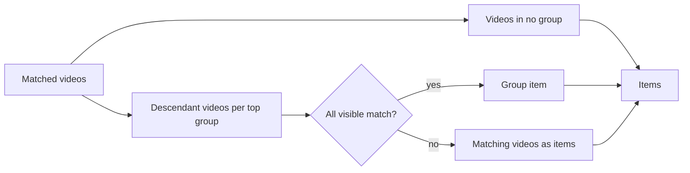

# Data model: Groups of any videos and groups

Parent Issue: #1040. The rest of the model is unchanged. Sources of truth:

| Topic | Source |
| --- | --- |
| Existing table definitions | [internal/store/migrations/](../../internal/store/migrations/) |
| Data classes | [running-vv.md, Data and recovery](../../docs/how-to/running-vv.md#data-and-recovery) |
| Folder grouping rule, folder key, folder-derived tags, rebuild points | [017 data-model](../017-folder-groups/data-model.md) |
| Partly matching groups | [027 library-api.md](../027-partial-group-search/contracts/library-api.md) |
| User key, bundles, succession | [030 data-model, User key](../030-video-versions/data-model.md#user-key), `moveUserData` in [internal/store/successions.go](../../internal/store/successions.go) |
| Favorites in the item query | [035 data-model, Library items](../035-favorites/data-model.md#library-items-libraryitemscte-listlibrary-libraryids) |
| Playlist items and playback | [044 data-model](../044-playlists/data-model.md) |

## Migration

Three migrations. `00042_groups.sql` adds the group tables and seeds them from
the current folder index. `00043_group_keys.sql` converts favorites and
playlist items to group ids. `00044_drop_folder_groups.sql` drops the folder
index group tables once nothing reads them. The last migration on `main` is
`00041_thumbnail_image_sources.sql`; confirm the numbers when implementing.

```sql
-- 00042_groups.sql. User data (research.md R-1). No foreign key to videos.
create table groups (
    id            integer primary key autoincrement,
    name          text    not null check (length(name) between 1 and 100),
    title_key     text    not null,          -- domain.NaturalSortKey(name)
    origin_folder text    unique,            -- domain.FolderKey of the folder; null for a hand-made group
    created_at    integer not null,          -- Unix ms
    updated_at    integer not null           -- Unix ms; any change of the name or the items
);

create table group_items (
    id          integer primary key autoincrement,
    group_id    integer not null references groups (id) on delete cascade,
    -- Exactly one of the two is set (R-2).
    content_key text,                        -- a video's user key
    child_id    integer references groups (id) on delete cascade,
    position    integer not null,            -- 0-based, dense within the group
    from_folder integer not null default 0 check (from_folder in (0, 1)),  -- added by the sync (R-3)
    check ((content_key is null) <> (child_id is null)),
    check (content_key is null or content_key <> ''),
    check (from_folder = 0 or content_key is not null),
    check (child_id is null or child_id <> group_id),
    unique (group_id, content_key),
    unique (group_id, child_id)
);
create index group_items_order_idx on group_items (group_id, position);
create index group_items_content_idx on group_items (content_key);
create index group_items_child_idx on group_items (child_id);

-- Folder members the owner removed from an automatic group (R-3).
create table group_exclusions (
    group_id    integer not null references groups (id) on delete cascade,
    content_key text    not null check (content_key <> ''),
    primary key (group_id, content_key)
) without rowid;
```

`00042` then copies every `folder_groups` row into `groups` (`name`,
`title_key`, `origin_folder = path_key`) and every `folder_group_members` row
into `group_items` with `from_folder = 1`, the member's user key (the
`userKeyExpr` of [030](../030-video-versions/data-model.md#user-key) inlined)
and its `position`. Each group's `created_at` and `updated_at` is the
migration time.

```sql
-- 00043_group_keys.sql (research.md R-10).
create table group_favorites (
    group_id     integer primary key references groups (id) on delete cascade,
    favorited_at integer not null
);
-- Copied from folder_favorites where path = groups.origin_folder; then:
drop table folder_favorites;

-- playlist_items is rebuilt with group_id integer references groups (id) on delete cascade
-- in place of folder_key, and unique (playlist_id, group_id).
-- Rows whose folder_key matches no groups.origin_folder are dropped; positions are renumbered.
```

```sql
-- 00044_drop_folder_groups.sql.
drop table folder_group_members;
drop table folder_groups;
```

Down of each restores the dropped tables empty; the next startup rebuilds
the folder index.

`groups`, `group_items`, `group_exclusions` and `group_favorites` are user
data: ARCHITECTURE.md ("User data survives a rebuild") and the table in
running-vv.md gain them, and `folder_groups`, `folder_group_members` and
`folder_favorites` leave. `RemoveContent`, `releaseContentIndex` and media
folder removal touch none of them.

Invariants (added to `internal/store/invariants_test.go`):

| Rule | Enforced in |
| --- | --- |
| The positions of one group are `0 … n-1` | `internal/store/invariants_test.go` |
| `origin_folder` equals `domain.FolderKey(origin_folder)` | `internal/store/invariants_test.go` |
| No group is its own descendant | `internal/store/invariants_test.go` |

## Automatic group sync

`syncFolderGroups(tx, index)` replaces `writeFolderIndex`'s writes to
`folder_groups` and `folder_group_members` (until `00044`, both are written). It runs at every rebuild point of
[017, When the index is rebuilt](../017-folder-groups/data-model.md#when-the-index-is-rebuilt),
in the same transaction, after `domain.BuildFolderIndex`, and
`domain.FolderIndexVersion` becomes 3 so the first startup syncs.
`video_folder_names` is still rewritten wholesale.

`domain.PlanFolderGroupSync` decides from the folder index (each folder the
rule groups, with its direct videos' user keys in natural order), every
automatic group (its `origin_folder`, its items and exclusions) and the
`ungroup` overrides; the store applies the result.

| Case | Change |
| --- | --- |
| The rule groups a folder, no group has it as `origin_folder`, no `ungroup` override | Create a group named by the folder name (cut to 100 characters) with the direct videos, `from_folder = 1`, in natural order |
| A group has the folder as `origin_folder` and a direct video is in neither its items nor its exclusions | Append it with `from_folder = 1`; several are appended in natural order |
| An item with `from_folder = 1` is no longer a direct video of its folder (moved, deleted, folder gone, media folder removed) | Delete the item and renumber |
| A video item with `from_folder = 0` | Never touched |
| The rule no longer groups a folder that has a group | No change; only the two rows above apply (Edge Case: one-member group) |
| A group left with no item | Kept, and hidden by [Visibility](#visibility) |

"Direct videos" counts every location of the folder index, so a folder whose
rule does not group it (one direct video, a child folder) still feeds an
existing group's additions and removals. Every changed group's id, and the id
of every ancestor of a changed group, goes into one `GroupsChanged` event
after commit.

## Succession and bundling

Every path below runs in the transaction that already re-keys the other user
data, through one package-private helper `rekeyGroupItems(tx, from, to)`,
which moves `group_items` and `group_exclusions` rows. In a group that ends up
with two items of key `to`, the one with the larger `position` is deleted and
the group renumbered; a merged item keeps `from_folder = 0` when either was 0.
The paths and their changes are those of
[044, Succession and bundling](../044-playlists/data-model.md#succession-and-bundling).

## Edits

`domain` decides; `GroupStore` reads the inputs in its write transaction.

| Operation | Rule |
| --- | --- |
| Create | `ValidateGroupName`; items from the request in order (videos, then groups); `origin_folder` null |
| Rename | `ValidateGroupName`; `title_key` follows |
| Add | Appends in request order; an item already in the group is skipped; a removed folder member's exclusion is deleted and it returns with `from_folder = 0` |
| Remove | Deletes the items; for a `from_folder = 1` item of an automatic group, writes its exclusion; renumbers. When no item is left, dissolves the group in the same transaction as the Dissolve row does (the maintainer's decision of 2026-10-14: an empty group does not exist), so the remove route answers `204` ([contracts/screen-api.md](contracts/screen-api.md#statuses)) |
| Move | Moves one item after another item or to the top; renumbers ([044 R-3](../044-playlists/research.md#r-3-dense-integer-positions-reordered-by-move-after)) |
| Dissolve | [R-4](research.md#r-4-dissolving-deletes-the-group-for-an-automatic-group-it-writes-ungroup); child groups and videos stay; parents lose the item and are renumbered. A parent left with no item is dissolved the same way in the same transaction, and so on up its ancestors, an automatic parent with its `ungroup` override (the maintainer's decision of 2026-10-14, the rule of the Remove row applied to parents). This holds for every dissolve: `DELETE`, the last item removed, Turn into a tag and the folder menu's `Don't group` |
| Turn into a tag | [R-11](research.md#r-11-turning-a-group-into-a-tag-attaches-the-tag-by-hand-then-dissolves) |
| Nest | `ValidateNesting(parent, child, edges)`: `ErrGroupCycle` when the child is the parent or one of its ancestors |
| Missing target | A video id, group id or item id that does not resolve is `ErrGroupTargetNotFound` and nothing is written ([R-12](research.md#r-12-edits-are-positional-and-fail-whole-when-a-target-is-gone)) |

A video id resolves to its user key through `userKeysForVideoIDs`, so adding
two versions of one bundle adds one item. Every edit sets `updated_at` on the
groups it changes and publishes `GroupsChanged` with them and every ancestor
of them, because a parent shows its child's name and its descendants' count
and length; for dissolve, the event also names every group the dissolve
removed, the former parents and their ancestors.

## Play order

`domain.GroupPlayOrder(items, children)` returns the video ids of a group:
its shown items in position order, a child group replaced by its own play
order, depth first, each video kept at its first appearance
([R-7](research.md#r-7-a-groups-values-come-from-its-distinct-descendant-videos-in-play-order)).
A video item resolves to the video shown to the viewer for its user key
(`shownVideosCTE`); an item that does not resolve is left out, not deleted.

| Read | Uses the play order of |
| --- | --- |
| `LibraryGroup` values (count, sums, dates, watch state, `previews`, `openVideoId`, `videoIds`) | The group |
| `Video.group`, `Up next`, the neighbours, the member window and `GET /api/videos/{id}/group-members` | The context group ([R-9](research.md#r-9-the-video-page-follows-the-group-it-was-opened-from)) |
| A playlist group item | The group, replacing the folder group's members in `PlaylistPlaybackOf` |
| `LibrarySelection` for a selected group | The group |

## Library items

`libraryItemsCTE` keeps 027's steps and replaces the group source:



| Step | Rule |
| --- | --- |
| Top groups | Groups with no `group_items.child_id` row pointing at them |
| Descendant videos | A recursive CTE from each top group over `child_id`, joined to the shown video of each `content_key` |
| Visible group | At least one descendant video the viewer may see; the minimum is 1 for the owner and guests ([R-6](research.md#r-6-the-library-top-level-and-partial-search-matches-over-descendants)) |
| Group item | Every visible descendant video matched |
| Single items | Matching descendant videos of partly matching top groups, and matching videos in no group, each video once |
| Favorites only | Every favorited visible group (any depth) is a group item; favorited videos not inside one of those are video items |
| Key and tie-breaker | Group items use `groups.id`; video items the video id. The cursor carries the kind |

Aggregates, watch state, sort values and `LibraryIDs` follow 017 and 027 over
the descendant videos. `LibrarySelection.Groups` carries the group id and its
play order's video ids.

## Visibility

A group is shown to a viewer when its play order for that viewer is not
empty. Guests read a group's items, values and play order from public videos
only; a child group with no public video is left out of its parent. A guest
gets `404` for a group that is not shown, the same as for a missing one.

## `domain` values added

| Value | Content |
| --- | --- |
| `Group` | `ID`, `Name`, `OriginFolder` (empty for a hand-made group), `UpdatedAt` |
| `GroupItem` | `ID`, and one of `Video *Video` or `Group *LibraryGroup` |
| `GroupPage` | `Group`, `LibraryGroup` values, `Items []GroupItem` (one page), `Trail []GroupRef`, `NextCursor` |
| `GroupRef` | `ID`, `Name` |
| `ValidateGroupName(string) (string, error)` | Trims; empty or over 100 characters is `*InvalidGroupNameError` |
| `ValidateNesting`, `GroupPlayOrder`, `PlanFolderGroupSync` | The rules above |
| `GroupsChanged` | `GroupIDs []int64`, published after commit |
| `ErrGroupNotFound`, `ErrGroupTargetNotFound`, `ErrGroupCycle` | `404 not_found`, `404 group_target_not_found`, `409 group_cycle` |

`LibraryGroup` gains `ID` and keeps `Path` only for an automatic group whose
folder is under a registered folder. `VideoGroup` (related videos) is
addressed by id.
