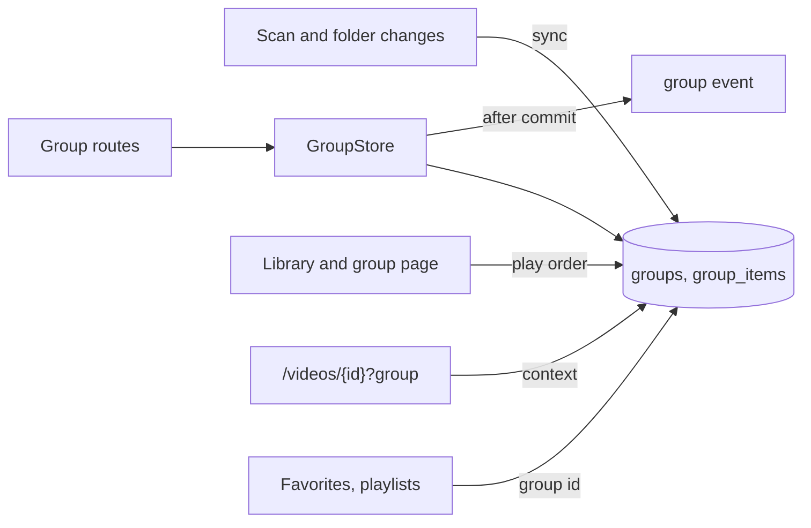
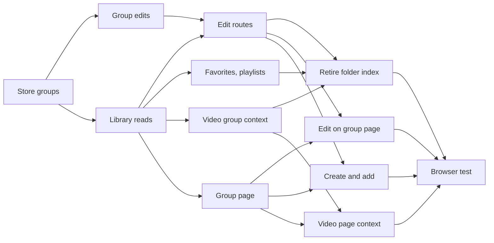

# Implementation Plan: Groups of any videos and groups, with several memberships and nesting

**Branch**: `feature/048-groups` | **Parent Issue**: #1040

**Input**: The parent Issue. It is this feature's specification.

## Summary

The owner builds groups from any videos and groups, names and orders them,
puts a video or a group in several groups and nests groups, and the folder
groups of 017 become the same kind of group, created by the scan and then
edited by hand. Groups move from the rebuilt folder index to user data with a
stable id; the scan only creates automatic groups and adds or removes their
folder members, and every group feature (favorites, playlists, tags, guests,
partial search matches, `Up next`) addresses a group by that id.

The diagram shows the parts this feature adds or changes and what each one
reads or writes.



| Concern | Approach |
| --- | --- |
| Storage | `groups`, `group_items`, `group_exclusions` as user data with a stable id ([R-1](research.md#r-1-groups-become-user-data-with-a-stable-id), [data-model.md, Migration](data-model.md#migration)) |
| Members | Videos by user key, child groups by id ([R-2](research.md#r-2-a-video-item-is-keyed-by-the-user-key-a-child-group-by-its-id)) |
| Automatic groups | Created once by the scan, then only folder members added and removed ([R-3](research.md#r-3-the-scan-creates-automatic-groups-once-then-only-adds-and-removes-folder-members)) |
| Dissolving | Deletes the group; `ungroup` for an automatic one ([R-4](research.md#r-4-dissolving-deletes-the-group-for-an-automatic-group-it-writes-ungroup)) |
| Nesting | A graph without cycles, checked on write ([R-5](research.md#r-5-nesting-is-a-graph-without-cycles-checked-in-the-write)) |
| Library | Top groups and ungrouped videos; partial matches over descendants ([R-6](research.md#r-6-the-library-top-level-and-partial-search-matches-over-descendants)) |
| Group values and playback | Distinct descendant videos, depth first ([R-7](research.md#r-7-a-groups-values-come-from-its-distinct-descendant-videos-in-play-order)) |
| Opening a group | `/groups/{id}` with `?trail` ([R-8](research.md#r-8-a-group-page-at-groupsid-with-a-trail-in-the-url)) |
| `Up next` | `?group` on the video page ([R-9](research.md#r-9-the-video-page-follows-the-group-it-was-opened-from)) |
| Favorites, playlists, tags | Group id; tags attached by hand ([R-10](research.md#r-10-favorites-and-playlist-items-name-a-group-by-its-id), [R-11](research.md#r-11-turning-a-group-into-a-tag-attaches-the-tag-by-hand-then-dissolves)) |
| Edits and concurrency | Positional moves, whole failure on a missing target, a `group` event ([R-12](research.md#r-12-edits-are-positional-and-fail-whole-when-a-target-is-gone), [R-13](research.md#r-13-a-group-event-tells-open-screens-to-read-again)) |

The Issue has the `ui` label, so the `design` stage writes `ui-design.md`
before the screen units: the group page and its trail, the group card's
press and play, the create and add flows from the selection bar, menus and
dialogs, rename, dissolve, removal and reordering, the cycle error, the mark
that tells an automatic group from a hand-made one, and the video page's group
line, judged against the parent Issue's `UI品質`.

## Technical Context

**Canonical definitions**:

| Topic | Source |
| --- | --- |
| Boundaries, dependency direction, user data, the authentication boundary | [ARCHITECTURE.md](../../ARCHITECTURE.md), [.golangci.yml](../../.golangci.yml) (depguard) |
| Folder grouping rule, folder-derived tags, rebuild points, group card and video page | [017 data-model](../017-folder-groups/data-model.md), [017 ui-design](../017-folder-groups/ui-design.md) |
| Partly matching groups | [027 library-api.md](../027-partial-group-search/contracts/library-api.md) |
| User key, bundles, succession | [030 data-model, User key](../030-video-versions/data-model.md#user-key) |
| Favorites, playlists | [035 data-model](../035-favorites/data-model.md), [044 data-model](../044-playlists/data-model.md) |
| Screen API and generated code | [api/openapi.yaml](../../api/openapi.yaml), `task generate` |
| Screens and Web tests | [design-system.md](../../docs/design-docs/design-system.md), [library-ui.md](../../docs/design-docs/library-ui.md), [web-testing.md](../../docs/design-docs/web-testing.md), [i18n.md](../../docs/design-docs/i18n.md) |
| Checks | [Taskfile.yml](../../Taskfile.yml) (`task check`, `task check-docs`, `task test-e2e`) |

**Feature-specific context**:

- Three migrations, `00042` to `00044`
  ([data-model.md, Migration](data-model.md#migration)); `FolderIndexVersion`
  becomes 3 so the first startup syncs.
- Nine routes added, several schemas changed and three routes removed, all in
  the screen API ([contracts/screen-api.md](contracts/screen-api.md)).
- A new route `/groups/{id}` in the SPA, and `?group` on the video page.
- One new domain event, `GroupsChanged`, and one new `/api/events` kind,
  `group`.

## Constitution Check

| Rule (source) | Verdict |
| --- | --- |
| Adapters import neither each other nor `internal/app` (ARCHITECTURE.md, depguard) | Pass: `internal/httpapi` declares a `Groups` interface that `GroupStore` satisfies; the sync is called inside the store's rebuild, which `app.Scans` already calls |
| The domain decides, the store enforces (ARCHITECTURE.md) | Pass: `ValidateGroupName`, `ValidateNesting`, `GroupPlayOrder` and `PlanFolderGroupSync` are in `internal/domain`; unique and check constraints guard the tables |
| Store roles (ARCHITECTURE.md) | Pass: `GroupStore` is new; succession, bundling and the rebuild reach groups through package-private helpers in their own transactions |
| Events after commit (ARCHITECTURE.md) | Pass: `GroupsChanged` is published after commit ([R-13](research.md#r-13-a-group-event-tells-open-screens-to-read-again)) |
| User data survives a rebuild (ARCHITECTURE.md) | Pass: groups are user data keyed by user key and group id, with no foreign key to `videos`; the invariant's list and the recovery table change with them |
| Every read knows its viewer (ARCHITECTURE.md) | Pass: every group read takes a `domain.Audience`; group reads join `accessRoutes` as guest-readable, writes stay owner only |
| Only a scan reads the media folders' files (ARCHITECTURE.md) | Pass: the sync reads the folder index in SQLite only |
| Do not hand-edit generated files (AGENTS.md) | Pass: `api/openapi.yaml` changes, then `task generate` |
| Complexity 25 or less, no copied code (AGENTS.md) | Pass: the move, renumber and re-key rules are shared with playlists rather than copied; the item query's group source is one CTE |
| Read design-system.md before a screen; test at the lowest level (AGENTS.md) | Pass: screens follow `ui-design.md`; the rules get domain tests, the store its tests, screens page tests, the acceptance criteria one browser test |

No violation, so no complexity tracking.

## Project Structure

### Documentation (this feature)

```text
specs/048-groups/
├── plan.md
├── research.md
├── data-model.md
└── contracts/
    └── screen-api.md
```

`ui-design.md` is written by the `design` stage. No `quickstart.md`: every
acceptance criterion and Edge Case is reachable in domain, store and page tests
or in the browser test below.

### Source Code

**Affected boundaries**:

| Boundary | What it owns in this feature |
| --- | --- |
| `internal/domain` | Group values, the name, nesting, play order and sync rules, `GroupsChanged` |
| `internal/store` | The migrations, `GroupStore`, the sync in the folder index rebuild, re-keying in succession and bundling, the item query, favorites and playlists by group id |
| `internal/httpapi`, `api/openapi.yaml`, `cmd/mdm` | The routes, the changed schemas, the `group` event, the wiring |
| `web/src/api` | `groups.ts`, and the changed clients for favorites, playlists and grouping |
| `web/src/groups` (new), `web/src/app`, `web/src/library`, `web/src/player`, `web/src/folders`, `web/src/i18n` | The group page and its route, the create and add flows, the card, the video page's group context, the folder menu |
| `web/e2e` | The browser test |

**New paths**: `internal/store/migrations/00042_groups.sql`,
`00043_group_keys.sql`, `00044_drop_folder_groups.sql`,
`internal/domain/group.go`, `internal/store/groups.go`,
`internal/httpapi/groups.go`, `web/src/api/groups.ts`, `web/src/groups/`,
`web/e2e/groups.e2e.ts`.

**Structure decision**: The old folder index group tables keep being written
until the last backend unit, so each unit switches one reader to groups and
the feature branch passes its checks after every merge.

## Implementation Work

The diagram shows which units have to land first. The screen units also wait
for the `design` stage's `ui-design.md`.



### Store groups as owner data and keep automatic groups in step with their folders

**Scope**: `00042_groups.sql` with its seed from the folder index, the group
values, `ValidateGroupName` and `PlanFolderGroupSync` in `internal/domain`,
`syncFolderGroups` at every rebuild point beside the existing index writes,
`FolderIndexVersion` 3, `rekeyGroupItems` in succession and bundling,
`GroupsChanged` from the sync, the invariants, and the user-data lists in
ARCHITECTURE.md and running-vv.md with their `translations/ja/` counterparts
([data-model.md, Migration](data-model.md#migration),
[Automatic group sync](data-model.md#automatic-group-sync),
[Succession and bundling](data-model.md#succession-and-bundling)).

**Dependencies**: None.

**Acceptance**: `task check` and `task check-docs` pass; a migration test
shows the seed gives each folder group one group with its name, its members by
user key and its order; domain and store tests show every row of the sync
table: a new folder that the rule groups gets a group in file-name order; a
file added to its folder is appended; a hand-added member, a removed member
(exclusion), a new name and a new order survive a rebuild; a file moved out
of the folder leaves the group; a folder that drops to one direct video keeps
its group; a removed media folder empties the group and adding it again fills
the same group; a folder with `ungroup` gets no group; same-path succession
and bundling re-key items and exclusions, and two versions in one group merge
into one item; positions are `0 … n-1` after each.

### Edit groups in the store with nesting, dissolving and tag conversion

**Scope**: `GroupStore` create, rename, add, remove, move, dissolve and turn
into a tag; `ValidateNesting` and `GroupPlayOrder` in `internal/domain`;
`PUT /api/folders/{rootId}/grouping` with `ungroup` dissolving the folder's
group through the same path; `GroupsChanged` from every edit
([data-model.md, Edits](data-model.md#edits),
[Play order](data-model.md#play-order),
[R-11](research.md#r-11-turning-a-group-into-a-tag-attaches-the-tag-by-hand-then-dissolves)).

**Dependencies**: Store groups as owner data and keep automatic groups in step
with their folders.

**Acceptance**: `task check` passes; domain tests cover nesting (self, child,
grandchild refused; sibling allowed) and play order (depth first, a video in
two child groups once, a hidden item left out); store tests show: one video
added to two groups is an item of both; adding group A to B then B to A is
`ErrGroupCycle` with nothing written; a missing video, group or item id is
`ErrGroupTargetNotFound` with nothing written; removing a folder member of an
automatic group writes its exclusion and a rebuild does not add it back, and
adding it again removes the exclusion; dissolving keeps the child group and
the videos, removes the item from its parents, and for an automatic group
writes `ungroup` so a rebuild does not create it again; `auto` on that folder
creates a new group; turning a group with a child group into a tag attaches
the tag by hand to every descendant video and dissolves it; names of 0 and 101
characters after trimming are rejected; each edit publishes `GroupsChanged`
after commit with the changed ids.

### Read the library and group pages from groups

**Scope**: The item query over groups (top groups, descendants, partial
matches, favorites only, guest minimum 1), `LibraryGroup.id` and optional
`folder`, `LibraryGroupIds.id`, `GET /api/groups/{id}` with `trail`,
`GET /api/groups/{id}/items`, the `group` kind on `/api/events`, and the SPA
following the changed schemas without a new screen: selection and card
refresh keyed by group id, the card refresh reading `GET /api/groups/{id}`;
`GET /api/folders/{rootId}/group` is removed
([data-model.md, Library items](data-model.md#library-items),
[Visibility](data-model.md#visibility),
[contracts/screen-api.md](contracts/screen-api.md)).

**Dependencies**: Store groups as owner data and keep automatic groups in step
with their folders.

**Acceptance**: `task check` passes with no diff from `task generate`; store
and handler tests show: three videos from three folders in one group list as
one group item and not as videos (acceptance criterion 1); with A inside B,
the top level lists B only and `GET /api/groups/{B}` lists A; a group whose
descendants all match a search is one item, a group with one matching
descendant lists that video once; a video in two partly matching groups is
listed once; a group with no visible video is not listed and its
`GET /api/groups/{id}` is `404`; a guest sees a group with one public video;
`?trail=` with a broken pair is cut there; a `group` event reaches an
`/api/events` subscriber; `TestAccessClassificationMatchesOpenAPISecurity`
passes; existing library page tests pass with the id-keyed selection.

### Add the group edit routes to the screen API

**Scope**: `POST /api/groups`, `PATCH` and `DELETE /api/groups/{id}`, add,
remove, move and tag, their schemas and handlers, `requiresJSONBody`, the
wiring in `cmd/mdm`, and their client functions in `web/src/api/groups.ts`
([contracts/screen-api.md, Statuses](contracts/screen-api.md#statuses)).

**Dependencies**: Edit groups in the store with nesting, dissolving and tag
conversion; Read the library and group pages from groups.

**Acceptance**: `task check` passes with no diff from `task generate`; handler
tests show each status of the contract's table, a guest gets `401` on every
write, and `TestAccessClassificationMatchesOpenAPISecurity` passes.

### Key favorites and playlist items by group id

**Scope**: `00043_group_keys.sql`, `group_favorites`, `playlist_items.group_id`,
`groupIds` in `PUT /api/favorites` and `POST /api/playlists/{id}/items`,
`appliedGroups`, `PlaylistPlaybackOf` over the group's play order, and the SPA
sending group ids from the card, the selection bar and the video page
([R-10](research.md#r-10-favorites-and-playlist-items-name-a-group-by-its-id),
[data-model.md, Play order](data-model.md#play-order)).

**Dependencies**: Read the library and group pages from groups.

**Acceptance**: `task check` passes with no diff from `task generate`; a
migration test shows a folder favorite and a playlist group item of a current
folder group become the group's, and those of a folder that is not a group are
dropped with the playlist renumbered; store tests show a hand-made group can be
favorited, is listed by the favorites filter and as a playlist item, and is
played in its play order (acceptance criterion 8); dissolving it removes the
favorite and the playlist item; existing favorite and playlist page tests pass.

### Answer the video page's group from the group it was opened from

**Scope**: The `group` query on `GET /api/videos/{id}`, `/related` and
`/group-members`, `Video.group`, `RelatedGroup` and the member page by group id
and play order, the fallback group, and the SPA's existing video page reading
them by id
([R-9](research.md#r-9-the-video-page-follows-the-group-it-was-opened-from)).

**Dependencies**: Read the library and group pages from groups.

**Acceptance**: `task check` passes with no diff from `task generate`; handler
tests show: for a video in groups G1 and G2, `nextId` follows G1 with
`group=G1` and G2 with `group=G2` (acceptance criterion 2); without `group`,
the group with the smaller id answers; a `group` that does not hold the video
falls back; inside a nested group, `nextId` follows the depth-first play
order; for a guest, the position counts public videos only.

### Retire the folder index group tables and folder-keyed group routes

**Scope**: `00044_drop_folder_groups.sql`, the end of the old index writes,
`FolderGrouping.groupId` in place of `grouped` and `taggable`, removing
`POST /api/folders/{rootId}/grouping/tag` and the three error codes, the
folder menu reading `groupId` and turning a group into a tag through
`POST /api/groups/{id}/tag`, and the references to the folder index groups in
ARCHITECTURE.md, running-vv.md and library-ui.md with their
`translations/ja/` counterparts.

**Dependencies**: Add the group edit routes to the screen API; Key favorites
and playlist items by group id; Answer the video page's group from the group it
was opened from.

**Acceptance**: This unit changes the folder menu, so it needs a visual review
against `ui-design.md`. `task check` and `task check-docs` pass with no diff
from `task generate`; no code reads `folder_groups`, `folder_group_members` or
`folder_favorites` (`rg` finds them only in migrations); folder page tests show
the menu offering the tag action for a folder with a group and not for one
without.

### Open a group onto its items on a group page

**Scope**: The `/groups/{id}` screen: the group's name, its trail with links
up, its items in order as cards and rows, paging, play from the group, the
group card and row opening it with `?trail`, a video opened from it carrying
`?group`, reading the group again on a `group` event, a gone group, guest
access, its route and the catalog text; layout follows `ui-design.md`
([R-8](research.md#r-8-a-group-page-at-groupsid-with-a-trail-in-the-url)).

**Dependencies**: Read the library and group pages from groups; the `design`
stage's `ui-design.md`.

**Acceptance**: This unit changes a screen, so it needs a visual and
interaction review against `ui-design.md` and the parent Issue's `UI品質`.
`task check` passes; page tests show: pressing a group card opens its page;
the page lists child groups and videos in the response's order; opening a
child group extends the trail and the trail's links go up; a video opened from
the page carries `?group`; a `group` event for the shown id reads it again; a
`404` shows the group as gone; a guest sees the page without edit actions; an
automatic group shows its folder mark and a hand-made one none.

### Edit a group's name, order and items on the group page

**Scope**: Rename, dissolve with a confirmation, turn into a tag, drag
reordering with the existing `@dnd-kit` packages, removing selected items, the
failure of an edit whose target is gone, and the catalog text
([R-12](research.md#r-12-edits-are-positional-and-fail-whole-when-a-target-is-gone)).

**Dependencies**: Open a group onto its items on a group page; Add the group
edit routes to the screen API.

**Acceptance**: This unit changes a screen, so it needs a visual and
interaction review against `ui-design.md` and the parent Issue's `UI品質`.
`task check` passes; page tests show: moving an item by keyboard sends `move`
with the item above its new place and a reload keeps the order (acceptance
criterion 4); removing two selected items sends both ids; renaming sends the
trimmed name and an empty one cannot be sent; dissolving asks first and then
leaves for the trail's parent or the library; a `404 group_target_not_found`
says the edit failed and reads the group again.

### Create groups and add videos and groups to groups from the selection bar and menus

**Scope**: `New group` from a selection (a name dialog) and `Add to group` (a
group picker, with a new group from the picker) in the selection bar, on the
card and row menus and on the video page; the `group_cycle` error; selections
of videos and groups sent as `videoIds` and `groupIds`; owner only.

**Dependencies**: Add the group edit routes to the screen API; Open a group
onto its items on a group page; the `design` stage's `ui-design.md`.

**Acceptance**: This unit changes a screen, so it needs a visual and
interaction review against `ui-design.md` and the parent Issue's `UI品質`.
`task check` passes; page tests show: three selected videos and a name create
a group and the library shows its card instead of the three (acceptance
criterion 1); adding a selected group to another sends its id; adding B to its
own child says it cannot be added (acceptance criterion 3); a guest sees no
create or add action.

### Play a video in the group it was opened from

**Scope**: The video page reading `?group`, passing it to the group reads,
keeping it on `Up next`, the arrows and the member list, and the group line
linking to the group page with the owner's group actions; the page without the
query keeps the fallback group
([R-9](research.md#r-9-the-video-page-follows-the-group-it-was-opened-from)).

**Dependencies**: Answer the video page's group from the group it was opened
from; Open a group onto its items on a group page; the `design` stage's
`ui-design.md`.

**Acceptance**: This unit changes a screen, so it needs a visual and
interaction review against `ui-design.md` and the parent Issue's `UI品質`.
`task check` passes; page tests show: with `?group=1` the reads carry
`group=1`, the autoplay notice names that group's next video, and advancing
keeps `?group=1`; the group line links to `/groups/1`; without the query the
reads carry no `group`; a playlist context still overrides the group.

### Cover groups in a browser test

**Scope**: `web/e2e/groups.e2e.ts` against the real server and media
([web-testing.md, Test levels](../../docs/design-docs/web-testing.md#test-levels)).

**Dependencies**: Edit a group's name, order and items on the group page;
Create groups and add videos and groups to groups from the selection bar and
menus; Play a video in the group it was opened from; Retire the folder index
group tables and folder-keyed group routes.

**Acceptance**: `task test-e2e -- e2e/groups.e2e.ts` passes and shows the
parent Issue's acceptance criteria 1 to 8: a group of three videos from three
folders is one card (1); one video in two groups appears in both and `Up next`
follows the group opened (2); B holding A is the only top-level card and A
cannot take B (3); a new order survives a reload (4); an automatic group's
added member, removed member and new name survive a rescan, and a new file in
its folder joins it (5); a dissolved automatic group stays gone after a rescan
(6); a member file moved to another folder stays in its hand-made group after
a rescan (7); a hand-made group can be favorited and added to a playlist and
stays listed there (8).
