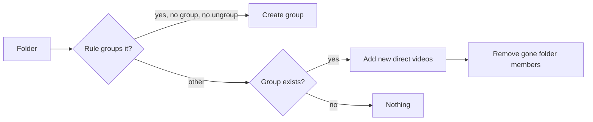

# Research: Groups of any videos and groups, with several memberships and nesting

Parent Issue: #1040. The stack, the layers and the store roles are inherited
from [ARCHITECTURE.md](../../ARCHITECTURE.md) and
[tech-stack-selection.md](../../docs/design-docs/tech-stack-selection.md). The
folder grouping rule this feature keeps is in
[017 data-model, Assignment rules](../017-folder-groups/data-model.md#assignment-rules).
This file records only the decisions this feature adds.

## R-1: Groups become user data with a stable id

**Decision**: A group is a row of a new user-data table `groups` with an
`integer` id that never changes. Its items live in `group_items`, and the
folder members the owner removed live in `group_exclusions`
([data-model.md, Migration](data-model.md#migration)). The index tables
`folder_groups` and `folder_group_members` are dropped once nothing reads
them; `video_folder_names` and `folder_index_state` stay.

| Option | Verdict |
| --- | --- |
| **User-data tables, stable id** | Chosen |
| Keep the rebuilt index and store the owner's edits as overrides on top | Rejected: the index is deleted and rewritten on every rebuild, so a name, an order or a hand-added member would need anchors that survive a rewrite, and membership would have two sources |
| Keep the folder path as the identity and add a separate table for hand-made groups | Rejected: requirement 10 asks for one kind of group, and a renamed folder would orphan every edit |

**Rationale**: Requirement 14 asks hand-made groups to survive rescans and
media folder changes, and requirement 11 asks the same for edits to automatic
groups. Only user data survives a rebuild
([ARCHITECTURE.md, Cross-cutting invariants](../../ARCHITECTURE.md#cross-cutting-invariants)).
The id is exposed in the API, which 017 rejected only because the index id was
reassigned on every rebuild
([017 library-api.md, `GET /api/library`](../017-folder-groups/contracts/library-api.md#get-apilibrary)).

## R-2: A video item is keyed by the user key; a child group by its id

**Decision**: A `group_items` row holds either a video's user key
(`'bundle:<id>'` for a bundle member, otherwise the content key) or a child
group's id. Bundling and same-path succession re-key video items in the
transaction that already re-keys the other user data, as `rekeyPlaylistItems`
does ([044 R-2](../044-playlists/research.md#r-2-bundling-and-succession-re-key-every-members-items-and-merge-duplicates)).
The same applies to `group_exclusions`.

| Option | Verdict |
| --- | --- |
| **User key** | Chosen |
| `videos.id` | Rejected: rebuilt on a rescan, so requirement 14 fails |
| Raw content key | Rejected: a bundle would show once per version, against the Edge Case on bundles |

**Rationale**: Tags already follow a moved or replaced file through the user
key (requirement 14 names tags as the model), and one key per bundle makes the
Edge Case "count it once" a unique constraint.

## R-3: The scan creates automatic groups once, then only adds and removes folder members

**Decision**: An automatic group is a group with an `origin_folder` (the
folder's `domain.FolderKey`). At every point that rebuilds the folder index
today, one sync in the same transaction does the following for each folder
([data-model.md, Automatic group sync](data-model.md#automatic-group-sync)):

The rule is 017's ("Becomes a group"). A group is created with the folder name
and its direct videos in natural file-name order. An existing group gains the
direct videos it does not hold and has not excluded, appended in natural
order, and loses the members that came from the folder and are no longer
direct. The sync never renames, reorders, deletes a group, or touches a member
the owner added by hand.

| Option | Verdict |
| --- | --- |
| **Create once, then add and remove folder members** | Chosen |
| Derive the group on every scan and replay the owner's edits as a diff | Rejected: an order or a removal recorded against a derived list has no stable anchor once files come and go |
| Keep applying the rule after creation (drop a group that falls under two videos) | Rejected: the Edge Case keeps a one-member group until the owner dissolves it |
| Insert new files at their file-name place | Rejected: after the owner reorders, a file name has no place in the order; the end is the only position that does not override a choice |

**Rationale**: Requirements 11 and 12 split the work: the scan owns which
files the folder holds, the owner owns everything else. A group whose folder
disappears keeps its hand-added members and stays (Edge Case); with none
left it is empty and hidden, not deleted, so a media folder removed and added
again gets its folder members back into the same group.

## R-4: Dissolving deletes the group; for an automatic group it writes `ungroup`

**Decision**: Dissolving deletes the `groups` row and its items, favorites and
playlist items. Dissolving an automatic group also writes the `ungroup`
override for its folder, in the same transaction. Choosing `Don't group` in the
folder menu dissolves the folder's group the same way. Choosing `Automatic` or
`Group this folder's videos` removes or writes the override and runs the sync,
which creates a new group when the rule holds.

| Option | Verdict |
| --- | --- |
| **Delete, plus `ungroup` for an automatic group** | Chosen |
| Keep a dissolved flag on the group | Rejected: two records would say "this folder is not a group", and they could disagree |

**Rationale**: Requirement 13 makes a dissolved automatic group the same as
`Don't group`, and the folder settings stay (requirement 13), so the existing
override is that record.

## R-5: Nesting is a graph without cycles, checked in the write

**Decision**: A group may hold other groups, and a group may sit in several
groups. Adding group X to group G is refused with `409 group_cycle` when G is
X or a descendant of X. `domain.ValidateNesting` decides from the edges the
store reads in the write transaction. Reads walk descendants with a recursive
CTE (`union`, so a group reached twice is visited once).

| Option | Verdict |
| --- | --- |
| **Check on write, walk on read** | Chosen |
| A closure table of every ancestor and descendant | Rejected: every add, remove, dissolve and sync would rewrite it, and a hand-built hierarchy holds hundreds of groups, which a recursive CTE walks within one query |
| A tree (one parent per group) | Rejected: requirement 4 lets a group be in several groups |

## R-6: The library top level and partial search matches over descendants

**Decision**: The library lists, as items, the groups that are no other
group's item and the videos that are in no group. A group is shown to a viewer
when it holds at least one video the viewer may see, directly or through child
groups; this holds for guests too. With a search or a tag filter, a top-level
group whose visible descendant videos all match is one group item; otherwise
each matching descendant video is a video item, once
([data-model.md, Library items](data-model.md#library-items)).

| Option | Verdict |
| --- | --- |
| **Whole group or its matching videos** | Chosen |
| Recurse: show a fully matching child group as a card inside a partly matching parent | Rejected: a card and the single videos of the same parent would then need one decision per level in the item query, for a case requirement 15 does not ask for |
| Keep the guest minimum of two public members | Rejected: the owner now keeps one-member groups (Edge Case), and a group holding only a child group has no direct members to count |

**Rationale**: Requirement 15 asks the 027 behaviour to keep working on nested
groups. A video in two groups can show inside one group's card and as a single
video from a partly matching other group; the list counts items, so it says
nothing wrong.

## R-7: A group's values come from its distinct descendant videos in play order

**Decision**: The play order of a group is its items in position order, with a
child group replaced by its own play order, depth first, keeping each video's
first appearance. `videoCount`, `videoIds`, the sums, the dates, the watch
state, `previews` and `openVideoId` (017's `GroupOpenIndex`) are computed over
that order.

| Option | Verdict |
| --- | --- |
| **Descendants, depth first** | Chosen |
| Direct videos only | Rejected: a group holding only child groups would show zero videos and could not be played |

## R-8: A group page at `/groups/{id}` with a trail in the URL

**Decision**: Pressing a group card or row opens `/groups/{id}`, which lists
the group's items (child groups and videos) in their saved order. The groups
the owner went through are carried as `?trail=<id>,<id>`; the server answers
the trail's names and cuts it at the first pair that is no longer a parent and
child ([contracts/screen-api.md](contracts/screen-api.md#get-apigroupsid)).

| Option | Verdict |
| --- | --- |
| **Group page with a URL trail** | Chosen |
| Keep the card opening its first unwatched member | Rejected: requirement 8 asks a group to open onto its items; this reverses 017's choice for that card |
| Carry the trail in `location.state` | Rejected: a reload or a shared URL loses it, and `UI品質` asks the way up to be always visible |
| Show one parent picked by the server | Rejected: a group with two parents would send the owner up a path they did not come down |

## R-9: The video page follows the group it was opened from

**Decision**: A video opened from a group carries `?group=<id>`. `Up next`,
the neighbour arrows, the member list and `Video.group` follow that group's
play order. Without the parameter, or when the video is no longer in that
group, they follow the group with the smallest id that holds the video
directly and is shown to the viewer.

| Option | Verdict |
| --- | --- |
| **One group in the URL, smallest id as the fallback** | Chosen |
| Carry the whole trail and continue into the parent at the end | Rejected: requirement 9 names the group the video was reached through, and continuing upward would play groups the owner did not open |
| No `Up next` when the video is in several groups and no context is given | Rejected: videos opened from the folder screen or search have no context, and every automatic group's members get `Up next` there today |

## R-10: Favorites and playlist items name a group by its id

**Decision**: `folder_favorites` becomes `group_favorites` keyed by group id,
and `playlist_items.folder_key` becomes `group_id`, both deleted with the
group. One migration converts the rows whose folder key is an automatic group's
`origin_folder` and drops the rest. The requests that named a group by
`VideoFolder` (`PUT /api/favorites`, `POST /api/playlists/{id}/items`) take
`groupIds` instead.

| Option | Verdict |
| --- | --- |
| **Key by group id, convert once** | Chosen |
| Keep folder keys and resolve them to groups at read time | Rejected: a hand-made group has no folder |
| Keep folder-key rows for folders that are not groups now, to adopt later | Rejected: such rows are already hidden today, and keeping them means a second key forever |

**Rationale**: A favorite or playlist item of a folder that is not a group at
the upgrade is the only data lost; 044 R-4 had kept it for a group that might
return, which a dissolved group no longer does (R-4).

## R-11: Turning a group into a tag attaches the tag by hand, then dissolves

**Decision**: The tag is found or created by the group's name
(`NormalizeTagName`), attached by hand (`video_tags`) to every descendant
video, and the group is dissolved (R-4), in one transaction. The `409` for a
registered folder's own group goes away.

| Option | Verdict |
| --- | --- |
| **Attach by hand to every video in the group** | Chosen |
| Keep the folder-name tag for automatic groups | Rejected: a renamed automatic group or one with hand-added members would not get the tag it names, and requirement 10 asks for one behaviour |

**Rationale**: An unrenamed automatic group's folder still matches the new tag
by name, so files added to that folder later get it as before.

## R-12: Edits are positional and fail whole when a target is gone

**Decision**: Items are reordered by "move after one item", positions are
dense, and adds append in request order, as playlists do
([044 R-3](../044-playlists/research.md#r-3-dense-integer-positions-reordered-by-move-after)).
Adding a video or group already in the group is a no-op. A request naming a
video, group or item that no longer exists fails with `404` and writes
nothing.

| Option | Verdict |
| --- | --- |
| **Fail whole on a missing target** | Chosen |
| Skip what does not resolve, as playlist adds do | Rejected: the Edge Case asks the owner to learn the operation failed |
| Replace the whole order from the screen | Rejected: a stale screen would undo another screen's move |

## R-13: A `group` event tells open screens to read again

**Decision**: Every group write and every sync that changes a group publishes
`domain.GroupsChanged{GroupIDs}` after commit, and `/api/events` sends
`group` with those ids. A group page, a group card and the video page's group
line read their group again on it.

| Option | Verdict |
| --- | --- |
| **`group` event** | Chosen |
| No event, as playlists | Rejected: the Edge Case asks the other screen to show the latest content |

## R-14: A group name is 1 to 100 characters after trimming; names may repeat

**Decision**: The playlist name rule applies
([044 R-11](../044-playlists/research.md#r-11-a-playlist-name-is-1-to-100-characters-after-trimming-names-may-repeat)).
An automatic group starts with the folder name, which may be longer; it is
cut to 100 characters.

| Option | Verdict |
| --- | --- |
| **Same rule as playlists** | Chosen |
| Unique names | Rejected: two folders named `Season 1` already make two automatic groups of that name |
