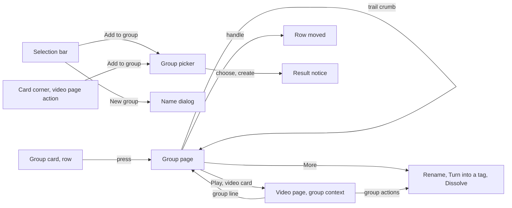
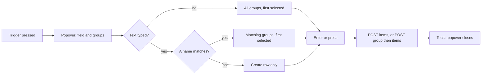
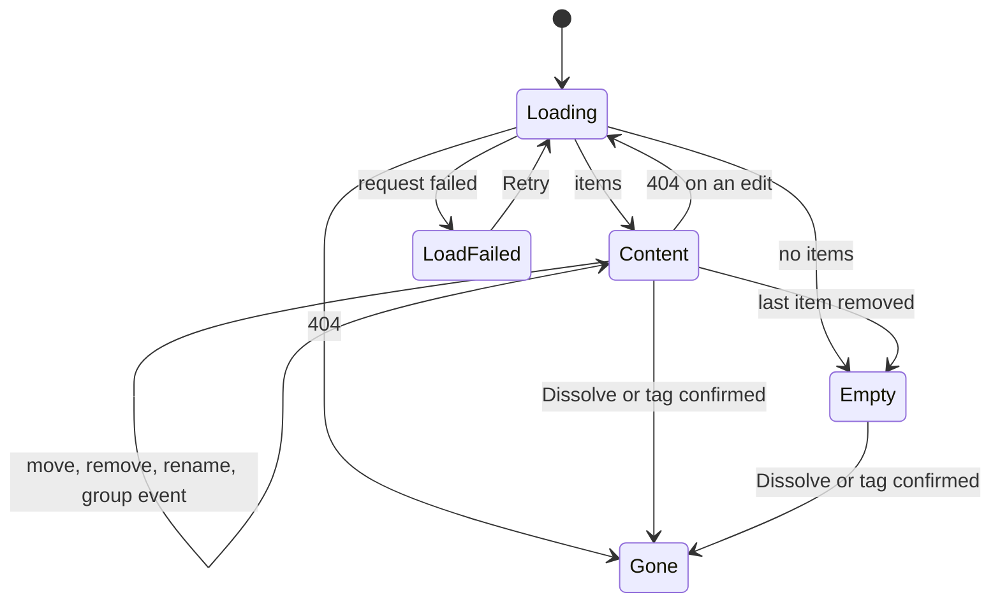

# UI design: Groups of any videos and groups, with several memberships and nesting

**Feature**: [parent Issue #1040](https://github.com/syudead/vv/issues/1040) ·
[plan.md](plan.md) ·
[research.md R-8](research.md#r-8-a-group-page-at-groupsid-with-a-trail-in-the-url) ·
[R-9](research.md#r-9-the-video-page-follows-the-group-it-was-opened-from) ·
[R-11](research.md#r-11-turning-a-group-into-a-tag-attaches-the-tag-by-hand-then-dissolves) ·
[R-12](research.md#r-12-edits-are-positional-and-fail-whole-when-a-target-is-gone) ·
[R-13](research.md#r-13-a-group-event-tells-open-screens-to-read-again) ·
[R-14](research.md#r-14-a-group-name-is-1-to-100-characters-after-trimming-names-may-repeat) ·
[data-model.md, Edits](data-model.md#edits) ·
[contracts/screen-api.md](contracts/screen-api.md)

Sources that already decide things, linked rather than repeated here:

| Topic | Source |
| --- | --- |
| Tokens, closed scales, library and viewing density | [design-system.md, Foundations](../../docs/design-docs/design-system.md#foundations); the values in `@theme` of [`web/src/ui/tokens.css`](../../web/src/ui/tokens.css), named here and never copied |
| `ListPage`, `PageHeader`, `CardGrid`, `DataTable`, `SelectionBar`, the state blocks | [patterns.md, List page](../../web/registry/rules/patterns.md#list-page), [Sections](../../web/registry/rules/patterns.md#sections) and [States](../../web/registry/rules/patterns.md#states) |
| `FormDialog`, `ConfirmDialog`: `pending`, the failure `Alert` inside them | [patterns.md, Form dialog](../../web/registry/rules/patterns.md#form-dialog) and [Confirm dialog](../../web/registry/rules/patterns.md#confirm-dialog) |
| `Button`, `Popover`, `Command`, `DropdownMenu`, `Breadcrumb`, `Tooltip`, `Sonner`, `VideoThumbnail`, `FavoriteToggle`: what each is for | [components.md](../../web/registry/rules/components.md) |
| The library's cards and rows, the group card and row, the selection bar's order and wrapping | [library-ui.md, Cards](../../docs/design-docs/library-ui.md#cards), [List view and selection](../../docs/design-docs/library-ui.md#list-view-and-selection), [Selection bar](../../docs/design-docs/library-ui.md#selection-bar); [017 UI design, Group card](../017-folder-groups/ui-design.md#group-card) |
| The group card's selection: members selected as videos, the group remembered for bulk actions | [017 UI design, Pressing and selection](../017-folder-groups/ui-design.md#pressing-and-selection), [035 UI design, Selection bar](../035-favorites/ui-design.md#selection-bar) |
| The corner marks on cards (heart, `Add to playlist`) and when they show | [044 UI design, Add to playlist](../044-playlists/ui-design.md#add-to-playlist), [035 UI design, When the mark is shown](../035-favorites/ui-design.md#when-the-mark-is-shown) |
| The playlist screen's row (handle, number, `×`), its reordering and its dialogs | [044 UI design, Playlist screen](../044-playlists/ui-design.md#playlist-screen), [Reordering](../044-playlists/ui-design.md#reordering), [Renaming](../044-playlists/ui-design.md#renaming), [Deleting](../044-playlists/ui-design.md#deleting) |
| The playlist picker: a `Command` in a popover whose first row creates | [044 UI design, Add to playlist](../044-playlists/ui-design.md#add-to-playlist) |
| The folder screen's breadcrumb band and how it collapses below `md` | [011 UI design, Breadcrumb bar](../011-folder-browser/ui-design.md#breadcrumb-bar), [`web/src/folders/Breadcrumbs.tsx`](../../web/src/folders/Breadcrumbs.tsx) |
| The video page: the group line, the `Up next` member list, the arrows, the autoplay notice; the facts row's action group | [library-ui.md, Group members](../../docs/design-docs/library-ui.md#group-members), [017 UI design, Video page](../017-folder-groups/ui-design.md#video-page), [044 UI design, Add to playlist](../044-playlists/ui-design.md#add-to-playlist) (the `page` trigger) |
| The folder grouping menu | [017 UI design, Folder grouping menu](../017-folder-groups/ui-design.md#folder-grouping-menu) |
| Guest degradation | [016 UI design, Guest degradation](../016-single-account-auth/ui-design.md#guest-degradation) |
| Width breakpoints in CSS; layout checked by people | [library-ui.md, Width breakpoints](../../docs/design-docs/library-ui.md#width-breakpoints-in-css-and-the-sidebar-exception), [Layout verified by people](../../docs/design-docs/library-ui.md#layout-verified-by-people-not-machines) |
| Screen text | [`web/src/i18n/en.ts`](../../web/src/i18n/en.ts) (`common`, `list.card`, `library.group`, `library.selection`, `player.group`, `folders.grouping`); this feature adds `groups` and the words below |

The diagram shows the parts this feature adds or changes and where each action
leads.

Unchanged: the library's toolbar, search and filters; the video card and the
group card apart from the one added mark and the group card's link target;
the favorite heart; `Add to playlist`; the playlists screens; the folder
screen apart from its grouping menu; the autoplay notice and the end-of-playback
layer; the sidebar. Every part below is a registry component or pattern, and
the contrast pairs in `web/src/theme/tokens.test.ts` gain nothing. No token
is added: the group page reuses the library's card widths and the playlist
screen's row, and the trail reuses the folder breadcrumb band.

## Why this shape

A group is the library's own kind of item, so its page is a library of its
items: a `ListPage` whose body is the library's grid or the library's list
view, switched by the toolbar's view toggle and sized by its zoom, with the
same cards, the same rows, the same selection and the same selection bar. The
owner then edits a group with the moves they already know (`UI品質`, the
first point): select, then act from the bar. A page in its own shape (a
table of names, a tree) was rejected because a video in a group would then
look different from the same video in the library, and the owner recognises
videos by their thumbnails and tags before their names (`情報密度`). The
library's list view is the order view: the handle, the number and the `×`
join its rows as they join the playlist screen's, and the grid keeps the
library's cards without a handle, because a row reads as an order and a card
does not ([044 UI design, Why this shape](../044-playlists/ui-design.md#why-this-shape)).

The way up is the folder screen's breadcrumb band, stuck under the top bar:
"Library › Season 1 › Extras". It stays while the items scroll, so which
group is open and how to go up are never off screen (`UI品質`, the second
point), and because the band is the folder screen's, a nested group reads as
"a place inside a place" the owner already knows. The page's title repeats
the name under the band, because the title is where the count, the folder
line and the actions belong; the band is not a second title but the path,
and it is what remains in view when the title has scrolled away. The trail
is the owner's own path (`?trail`, R-8), not a parent the server picks, so
going up returns the way the owner came down.

An automatic group and a hand-made group are told apart in one place: a line
under the group page's title, "From the folder {path}", linking to the
folder. Cards, rows, the selection bar and the dialogs treat both alike
(`UI品質`, the third point; requirement 10); the difference is read only
where the owner has stopped to look at the group itself, and the dissolve
dialog's extra sentence says what dissolving an automatic group means for its
folder (requirement 13). A mark on the card was rejected: it would add a
second class of card to the library for a difference that changes no
operation.

Creating and adding are the selection bar's and the card's existing moves.
"New group" is a `FormDialog` that asks the name, as "Bundle as versions"
asks the representative, and "Add to group" is the playlist picker's shape:
a popover with a `Command` that filters the groups and creates one from the
typed name. The two are separate because the Issue names both operations
(requirement 1 and 3) and because a dialog gives the new group's name the
owner's full attention while a picker is for reaching an existing one in
two keystrokes; the picker still creates, so a typo of a name that does not
exist is not a dead end. The card's "Add to group" sits with the heart and
"Add to playlist" in the thumbnail's corner, revealed with them, so the
resting card is unchanged. "Remove from group" is a selection-bar action on
the group page and a `×` on its rows, with no confirmation, because an item
removed by mistake is added back from any card (requirement 7's "nothing is
lost" applies to removal too). Dissolving and turning into a tag end the
group, so each takes a `ConfirmDialog`.

On the video page the group line becomes a link to the group page, and the
owner's group actions move from the line itself into a small menu after it,
so the line reads and opens as the playlist line does and the actions stay
one press away (`UI品質`, the second point: from a member, the group is the
way up). The line follows `?group` (R-9), so a video in two groups shows the
group it was opened from and `Up next` plays that group's order.

## Words

Text in `web/src/i18n/en.ts` under `groups`, except where a key is named.
User data (a group name, a title, a path) is embedded as an argument.
`videos` is the catalog's "1 video" / "N videos" helper and `items` its
"N items".

| Place | Text | Notes |
| --- | --- | --- |
| Selection bar actions | New group; Add to group | `library.selection.newGroup`, `library.selection.addToGroup` |
| Selection bar action, group page only | Remove from group | `library.selection.removeFromGroup` |
| New-group dialog title | New group | `groups.newDialog.title` |
| New-group dialog description | 3 videos become one group; 2 videos and 1 group become one group | `groups.newDialog.description(videos, groupCount)`; "1 group becomes one group" is never shown, because one group alone is not offered ([New group](#new-group)) |
| Name field label | Name | `groups.nameLabel` |
| Name field error | Use a name of 1 to 100 characters. | `groups.nameRule`; the playlist dialog's rule, counted in code points (R-14) |
| Create action; while sending | Create; Creating… | `groups.newDialog.submit`, `.submitting` |
| Create failed | Couldn't create the group: {reason} | `groups.newDialog.failed`; `destructive` `Alert` in the dialog |
| Created | Created "{name}" | `groups.created(name)`; a toast |
| Picker trigger, tooltip | Add to group | `groups.add.label` |
| Picker trigger accessible name on a video card, row or the video page | Add "{title}" to a group | `list.card.addToGroup(title)` |
| Picker trigger accessible name on a group card or row | Add group "{name}" to a group | `library.group.addToGroup(name)` |
| Picker field placeholder and accessible name | Search or create a group | `groups.add.search` |
| Picker list accessible name | Groups | `groups.add.list` |
| Create row | Create "{name}" | `groups.add.create(name)` |
| Picker with no groups and no text | No groups yet. Type a name to create one. | `groups.add.none` |
| Typed name too long | Use a name of up to 100 characters | `groups.add.nameTooLong`; the reason line under the field |
| Picker loading, load failed | Loading…, Couldn't load the groups | `groups.add.loading`, `groups.add.loadFailed`; `Retry` is `common.retry` |
| Added | Added to "{name}" | `groups.add.added(name)`; a toast. No count: an item already in the group is skipped by the server without a number ([data-model.md, Edits](data-model.md#edits)) |
| Add failed | Couldn't add to the group: {reason} | `groups.add.failed`; the reason line under the field |
| `group_cycle` | A group can't be put inside itself or inside a group it contains. | `errorCodes.group_cycle`; the `{reason}` of the add failed line |
| `group_target_not_found` | A video or group in the request no longer exists. | `errorCodes.group_target_not_found`; the `{reason}` of a failed create, add, remove or move |
| Trail band accessible name | Group path | `groups.trail` |
| First crumb | Library | `library.title` |
| Header count | 12 videos · 1:32:10 | `groups.detail.count(count, duration)`: `library.group.count`, then ` · ` and the sum through `formatDuration`; the duration part is omitted when `durationMs` is absent |
| Folder line | From the folder {path} | `groups.detail.fromFolder(path)`; `path` is the folder's display path as the folder screen's breadcrumb shows it |
| Play action, accessible name | Play; Play "{name}" | `groups.detail.play`, `groups.detail.playFor(name)` |
| More button, tooltip and accessible name | More | `common.more` |
| Menu items | Rename…, Turn the group into a tag…, Dissolve… | `groups.detail.rename`, `groups.detail.toTag`, `groups.detail.dissolve` |
| Items table accessible name | Items | `groups.detail.table` |
| Drag handle accessible name | Reorder "{title}" | `groups.item.reorder(title)` |
| Keyboard instructions, dnd-kit announcements | As the playlist screen's | `groups.item.reorderInstructions`, `.pickedUp`, `.movedTo`, `.dropped`, `.cancelled`, the same text as `playlists.item` |
| Remove button, tooltip | Remove from group | `groups.item.remove` |
| Remove button, accessible name | Remove "{title}" from the group | `groups.item.removeFor(title)` |
| Removed in bulk | Removed {N items} from "{name}" | `groups.removed(count, name)`; a toast after the selection bar's action |
| Move failed, remove failed | Couldn't move the item: {reason}; Couldn't remove from the group: {reason} | `groups.item.moveFailed`, `groups.item.removeFailed`; toasts |
| Target gone | The group changed in the meantime, so it was reloaded | `groups.reloaded`; a toast after a `404 group_target_not_found` ([Edits that fail](#edits-that-fail)) |
| Empty group title | No items yet | `groups.detail.empty.title` |
| Empty group description | Add videos and groups with Add to group on a card, on the video page, or in the selection bar. | `groups.detail.empty.description` |
| Empty group action | Open library | `groups.detail.empty.action`; a link to `/` |
| Gone title | This group no longer exists | `groups.detail.gone.title` |
| Gone description | It was dissolved, maybe in another tab. | `groups.detail.gone.description` |
| Gone action | Back to library | `groups.detail.gone.action`; a link to `/` |
| Group load failed | Couldn't load the group | `groups.detail.loadFailed` |
| Load more failed | Couldn't load more of the group | `player.related.moreFailed`, the member list's text |
| Rename dialog title; action; while sending | Rename group; Save; Saving… | `groups.renameDialog.title`, `.submit`, `.submitting` |
| Rename failed | Couldn't rename the group: {reason} | `groups.renameDialog.failed` |
| Dissolve dialog title | Dissolve "{name}"? | `groups.dissolveDialog.title(name)` |
| Dissolve dialog description | The group is dissolved. Its videos and groups stay in the library. | `groups.dissolveDialog.description` |
| Dissolve dialog, automatic group | Its folder is no longer grouped automatically. Choose Automatic on the folder page to group it again. | `groups.dissolveDialog.folder`; a second sentence after the description |
| Dissolve action; while sending | Dissolve; Dissolving… | `groups.dissolveDialog.submit`, `.submitting`; `destructive` |
| Dissolve failed | Couldn't dissolve the group: {reason} | `groups.dissolveDialog.failed` |
| Dissolved | Dissolved "{name}" | `groups.dissolved(name)`; a toast |
| Tag dialog title | Turn "{name}" into a tag? | `groups.tagDialog.title(name)` |
| Tag dialog description | The tag "{name}" is added to every video in the group, and the group is dissolved. | `groups.tagDialog.description(name)` |
| Tag action; while sending | Turn into a tag; Turning into a tag… | `groups.tagDialog.submit`, `.submitting`; `destructive` |
| Tag failed | Couldn't turn the group into a tag: {reason} | `groups.tagDialog.failed`; a `400` names the tag-name rule as its reason, as today |
| Turned into a tag | Created the tag "{name}" and dissolved the group; Added the tag "{name}" and dissolved the group | `groups.tagged(name, created)`; replaces `folderGrouping.tagged`, whose "ungrouped" no longer names what happens |
| Group line accessible name | Group "{name}", video 3 of 12. Open the group | `player.group.line(name, position, count)` |
| Group actions button, tooltip and accessible name | Group actions | `player.group.actions` |
| Group actions menu items | Remove from this group, Turn the group into a tag…, Dissolve… | `player.group.remove`, `player.group.toTag`, `player.group.dissolve`; `player.group.ungroup` and `player.group.menu` go |
| Removed from the group on the video page | Removed from "{name}" | `player.group.removed(name)`; a toast |
| Folder menu item | Turn the group into a tag… | `folders.grouping.toTag`, with the ellipsis, because it now opens the tag dialog |

"Group" keeps its meaning of a library item that holds videos; a hand-made
group is still "a group", never "a collection" or "a set", so the folder
menu, the cards and the new screens say one word. "Dissolve" replaces
"Ungroup" for ending a group: "Ungroup" named the folder setting, and the
parent Issue's `解散` applies to hand-made groups that have no folder.
"Item" is a video or a group inside a group, as in a playlist.

## Library

### Group card and row

The group card and row keep their box, their folder art, their count face,
their name and their marks. Two things change:

| Part | Change |
| --- | --- |
| Link | The card and the row's name open `/groups/{id}` with `state.from` the list URL; from the library the trail is empty. The accessible name stays "{name}, group of 12 videos" |
| Corner marks | A third mark, "Add to group" (lucide `FolderPlus`), left of "Add to playlist", in the same `size-8` hit area with `drop-shadow-mark`, revealed and kept open with the same rule; `aria-label` "Add group "{name}" to a group". In the list view it is a `w-8` column right after the "Add to playlist" column, drawn from `sm` as that column is |

The video card and row gain the same mark, left of "Add to playlist", with
`aria-label` "Add "{title}" to a group". The corner now holds three marks,
heart nearest the corner, then "Add to playlist", then "Add to group": the
heart carries a state and is scanned for, and the two add controls have no
state. At `card-0` the three marks and the selection check fit on one line
of the thumbnail with room between the two groups.

A group card is read again, without a skeleton, on a `group` event that
carries its id (R-13), and on the `video` events it follows today; a `404`
removes it, as [017 UI design, Refresh and removal](../017-folder-groups/ui-design.md#refresh-and-removal)
says.

### Selection bar

Two actions join the bar after "Add to playlist" and before "Visibility":
"New group" (lucide `Group` + text) and "Add to group"
(lucide `FolderPlus` + text), both `ghost` `sm` with their text whole at every width. The order
is count → Add tag → Remove tag → Favorite → Add to playlist → New group →
Add to group → Visibility → Bundle as versions → divider → Select all. On
the group page, "Remove from group" (lucide `FolderMinus` + text) follows
"Add to group". The three wrap with the bar's rules in the group from
"Favorite" onward.

Both send what "Favorite" sends ([035 UI design, Selection bar](../035-favorites/ui-design.md#selection-bar)):
`groupIds` the selected groups and `videoIds` the selected ids that are not
members of a selected group. They are `disabled` with the same reason as
"Favorite" when the two counts together are over 20000. "New group" is also
`disabled`, with the tooltip "Select at least one video, or a group and
something else" (`library.selection.newGroupNeedsMore`), when the selection
is exactly one group: a group of one group adds a level and nothing else.
The selection stays after "Add to group" and is cleared after "New group"
([New group](#new-group)).

### New group

"New group" opens a `FormDialog` titled "New group" whose description says
what becomes the group ("3 videos become one group", "2 videos and 1 group
become one group") and whose one `Field` is the playlist dialog's name field
([044 UI design, New playlist](../044-playlists/ui-design.md#new-playlist)):
the `Label` "Name", an `Input` without `maxLength`, the code-point count,
the focus on open. The footer is `Cancel` and the `default` "Create".

| Event | Behaviour |
| --- | --- |
| Name empty after trimming, or over 100 code points | As the playlist dialog: nothing is sent, "Use a name of 1 to 100 characters." is the field's `FieldError` |
| Submit | `pending`; the trimmed name, `videoIds` and `groupIds` go to `POST /api/groups` |
| `201` | The dialog closes, the toast "Created "{name}"" shows, the selection is cleared and the list is read again, so the new group's card stands where the sort puts it and its members are no longer single cards (acceptance criterion 1). On the group page the same, and the new group is now an item of the list only when it was added to this group, which it was not; it is a top-level group |
| `404 group_target_not_found` | A `destructive` `Alert` "Couldn't create the group: A video or group in the request no longer exists." under the field; the dialog stays open, and closing it reads the list again |
| Other failure | The `Alert` "Couldn't create the group: {reason}"; the dialog stays open |
| Cancel, Esc | The dialog closes; the typed name is dropped |

### Add to group

One picker, used from the selection bar, the card and row marks and the
video page, in the playlist picker's shape ([044 UI design, Add to playlist](../044-playlists/ui-design.md#add-to-playlist)):
a `Popover` of `w-popover`, below the trigger on cards, rows and the video
page and above it in the selection bar, with a `CommandInput` "Search or
create a group" and a `CommandList` "Groups". The diagram shows one add.

| Part | Form |
| --- | --- |
| List | Every group the owner has, in natural name order, each with lucide `Folder`; the groups whose name contains the trimmed text, ignoring case, while text is typed. The selected groups themselves are left out, because a group cannot hold itself; a descendant of a selected group is listed and refused by the server ([Cycle](#cycle)). The groups come from a list read of the screen API (`GET /api/groups` with a name filter and a cursor, followed to the last page; [contracts/screen-api.md](contracts/screen-api.md#statuses)) |
| Create row | First while the trimmed text is not empty and no group's name equals it, "Create "{name}"" with lucide `Plus`; with no match it is the only row |
| Typed name over 100 code points | The reason line "Use a name of up to 100 characters"; neither Enter nor a press acts |
| No groups and no text | "No groups yet. Type a name to create one." in place of the list |
| Loading, load failed | "Loading…", or "Couldn't load the groups" with a `ghost` `sm` "Retry"; the field still takes a name and Enter on one creates |
| Choosing a group | `POST /api/groups/{id}/items` with the place's `videoIds` and `groupIds`; the row shows a `Spinner` until the response |
| Creating | `POST /api/groups` with the trimmed name and the same members |
| Result | The popover closes and one toast reads "Added to "{name}"" or, for the create row, "Created "{name}"". The list the trigger sits in is read again when the add changed what it shows: in the library, a video or top-level group added to a group leaves the top level (acceptance criterion 3); on a group page, nothing changes unless the target is this group, which then gains the items at its end |
| Failure | The popover stays open with the reason line "Couldn't add to the group: {reason}" under the field, so the owner can pick another; a `404` for a group dissolved meanwhile reads the groups again quietly |

Where the trigger sits, and what it sends:

| Place | Trigger | Sends |
| --- | --- | --- |
| Video card and row | The corner mark and the row column of [Group card and row](#group-card-and-row) | `videoIds: [id]` |
| Group card and row | The same mark, `aria-label` "Add group "{name}" to a group" | `groupIds: [id]` |
| Video page | In the facts row's action group, right after "Add to playlist": the `ghost` `icon-sm` button with lucide `FolderPlus` and the tooltip "Add to group"; drawn for the owner whenever "Add to playlist" is | `videoIds: [id]` |
| Selection bar | "Add to group" ([Selection bar](#selection-bar)) | `groupIds` and `videoIds` as "Favorite" |

#### Cycle

Adding group B to a group that is B or sits inside B is `409 group_cycle`.
The picker shows it as the failure line "Couldn't add to the group: A group
can't be put inside itself or inside a group it contains." and stays open,
so the owner picks another group (acceptance criterion 3). Nothing on the
screen marks which groups would be refused before the press: the answer
needs the whole hierarchy, and the one line names the rule in full.

## Group page

`/groups/{id}` is a `ListPage` inside `AppShell`, loaded when used, for the
owner and for guests. `document.title` is the group's name. The query
`trail=1,5` carries the groups the viewer came through, outermost first
(R-8); the response's `trail` is what the band draws.

### Trail band

The first thing in the header slot, in the folder screen's breadcrumb band
(`Breadcrumbs`, shared, not copied): sticky under the top bar, `h-10`, a
`Breadcrumb` named "Group path" whose crumbs are "Library" (a link to `/`),
each group of the response's `trail` (a link to `/groups/{thatId}` with the
trail cut before it), and the open group's name as the current crumb, not a
link. Below `md` the band collapses to "… › {parent} › {name}" from four
crumbs on, as the folder band does, so the way up is always the crumb before
the name. A trail the server cut short (a pair that is no longer parent and
child) is drawn as answered, with nothing said about the cut: the crumbs
shown are all true.

### Header

Under the band, the `PageHeader`:

| Part | Form |
| --- | --- |
| Title | The group's name, `text-xl font-semibold`, on up to two lines with the full name in `title`, as the playlist screen's |
| Count | "12 videos · 1:32:10", `text-xs text-muted-foreground`, from the response's `videoCount` and `durationMs` (the descendants' values, R-7) |
| Description | For an automatic group whose folder is under a registered folder (`folder` present): one `text-xs text-muted-foreground` line, lucide `Folder` (`size-3`) and "From the folder {path}", the path a `link`-variant link to that folder's page. A hand-made group, and an automatic group whose folder is gone, have no line |
| Actions | The `default` `sm` "Play" (lucide `Play`) and the `ghost` `icon-sm` "More" (lucide `Ellipsis`) opening a `DropdownMenu` with "Rename…" (lucide `Pencil`), "Turn the group into a tag…" (lucide `Tag`), a `DropdownMenuSeparator` and "Dissolve…" (lucide `Trash2`, `variant="destructive"`). A guest sees "Play" only |

"Play" opens `/videos/{openVideoId}?group={id}` with
`state: { from: <this page's URL>, autoplay: true }`: the member to continue
with, by the group's play order. The name is the only `text-xl` on the
screen; "Play" is its one filled control (`UI品質`, `視覚的な階層`).

### Body

The toolbar is the library's in the top bar, reduced to the view toggle and
the zoom slider: no search, no filter and no sort, because the body is the
group's own order. The body is the library's grid or list view of the
response's `items`, in position order, followed by the `LoadMoreRow` or one
state block.

| View | Items |
| --- | --- |
| Grid | The library's `VideoCard` for a video item and `GroupCard` for a child group, with their marks, their tag rows and their selection check; the order is the reading order and no number is drawn |
| List | The playlist screen's row ([044 UI design, Rows](../044-playlists/ui-design.md#rows)) with the library's selection check first: check, handle and number, thumbnail, title (a child group shows its "12 videos" line), watched from `sm`, length, and the `×` "Remove from group". No heart, add or date columns: the row is an item in an order, and those actions are in the selection bar. The handle and the `×` are drawn for the owner only |

A video card or row opens `/videos/{videoId}?group={id}` with `state.from`
this page's URL, so the video page's `×` and Esc return here and `Up next`
follows this group ([Video page](#video-page)). A child group card or row
opens `/groups/{childId}?trail={trail},{id}`. A video in a child group and
also directly in this group appears twice: once as its own card and once
inside the child's art (Edge Case); selecting the child selects the video,
which also marks the direct card selected, as the library does.

Paging reads `GET /api/groups/{id}/items` from the response's `nextCursor`
when the sentinel after the grid comes within 600px of the viewport, as the
library grid does; a failed page shows the `LoadMoreRow` `Alert` "Couldn't
load more of the group" with `Retry`.

Selection is the library's: the check on a card or row, the group check
selecting the child's members and remembering the child as a selected group
(`LibrarySelection.groups`), "Select all" selecting the group's `videoIds`
(every descendant video) and, as selected groups, the child groups listed so
far, and the library's selection bar with the three group actions
([Selection bar](#selection-bar)). "Remove from group" splits the selection
as "Favorite" does: a child group item is removed when that child is a
selected group, and a video item when its video is selected and is not a
member of a selected group. A child group whose members happen to be all
selected through video checks is not removed, so checking only V, which is
both a direct item and the one video of child C, removes V's item and keeps C.
Selecting C removes C and keeps the direct V, although V's card shows
selected through C; removing both takes a second removal of V. The action
sends `POST /api/groups/{id}/items/remove` with the ids of those items among
the items listed so far (an item on a page not read yet has no id on the
screen and is not sent), then shows "Removed 3 items from "{name}"" and
clears the selection; the rows leave and the rest renumber.

### Reordering

In the list view a row is lifted by its handle, with the pointer, with touch
or with the keyboard, exactly as on the playlist screen
([044 UI design, Reordering](../044-playlists/ui-design.md#reordering)): the
rows renumber at once, one `POST /api/groups/{id}/items/{itemId}/move` is
sent with `after` the item now above it (absent at the top), a failure
restores the order the server last confirmed with the toast "Couldn't move
the item: {reason}", and a `404` re-reads the group
([Edits that fail](#edits-that-fail)). The new order is the result; no toast
(acceptance criterion 4). The grid has no handle: switching to the list view
is the way to reorder, and the toggle is in the top bar at every width.

### Removing one item

The row's `×` sends `POST /api/groups/{id}/items/remove` with that item at
once, with no confirmation and no success toast: the row leaving is the
result, and the video or group stays in the library (requirement 7). While
sending, the `×` is `disabled` with a `Spinner`; on `200` the row leaves,
the rest renumber, the count changes and focus moves to the next row's `×`,
else the previous row's, else the title. For a folder member of an
automatic group the server records the removal so a rescan does not bring it
back (requirement 11); the screen says nothing more, because the row leaving
is the same result either way.

### Renaming

"Rename…" opens a `FormDialog` "Rename group" with the name field of
[New group](#new-group), prefilled with the current name and the text
selected, and the `default` "Save", `submitDisabled` while the trimmed text
equals the current name. On `200` the dialog closes, the title, the band's
last crumb and `document.title` show the trimmed name, and focus returns to
"More". A `404` shows the gone state. A failure stays in the dialog as
"Couldn't rename the group: {reason}".

### Dissolving

"Dissolve…" opens a `ConfirmDialog`: the title "Dissolve "{name}"?", the
description "The group is dissolved. Its videos and groups stay in the
library.", followed for an automatic group (`folder` present) by "Its folder
is no longer grouped automatically. Choose Automatic on the folder page to
group it again.", then `Cancel` and the `destructive` "Dissolve". The
description names what stays, because losing the videos is the one fear
here (requirement 7), and the second sentence is the one place the
automatic group's difference is spoken (requirement 13).

| Event | Behaviour |
| --- | --- |
| Confirm | `pending`: both buttons disabled, "Dissolving…" with a `Spinner`; `DELETE /api/groups/{id}` |
| `204` | The dialog closes, the screen leaves for the trail's last group (`/groups/{parentId}?trail=` cut before it) or, with no trail, for `/`, and a toast there says "Dissolved "{name}"" |
| `404` | Already dissolved: the same as `204` without the toast |
| Other failure | A `destructive` `Alert` "Couldn't dissolve the group: {reason}" under the description; the dialog stays open |
| Cancel, Esc | Nothing changes |

### Turning into a tag

"Turn the group into a tag…" opens a `ConfirmDialog`: the title
"Turn "{name}" into a tag?", the description "The tag "{name}" is added to
every video in the group, and the group is dissolved.", `Cancel` and the
`destructive` "Turn into a tag". It confirms because the group ends with it
(R-11); the same dialog opens from the video page's group actions and from
the folder grouping menu, so the three entry points share one sentence.

| Event | Behaviour |
| --- | --- |
| Confirm | `pending`; `POST /api/groups/{id}/tag` |
| `200` | The dialog closes, the screen leaves as [Dissolving](#dissolving) does, and the toast reads "Created the tag "{name}" and dissolved the group" or "Added the tag "{name}" and dissolved the group" from `created` |
| `400 invalid_request` | The `Alert` "Couldn't turn the group into a tag: {reason}", the reason the tag-name rule's; the dialog stays open and nothing changed |
| `404` | The gone state, without a toast |
| Other failure | The `Alert` with the reason; the dialog stays open |

### Edits that fail

A move, a remove or an add whose target is gone answers
`404 group_target_not_found` and writes nothing (R-12). The screen keeps
what it shows, reads the group again, replaces the items when the response
arrives and shows the toast "The group changed in the meantime, so it was
reloaded"; a `404 not_found` on that read is the gone state. The selection
drops the ids no longer listed. A `group` event that carries this group's id
(R-13) reads the group again the same way, without the toast, keeping the
scroll position and the selection; the band, the title and the count follow
the response, so a rename or a reorder in another tab is on screen without a
reload (Edge Case).

### States

The diagram shows the body's states and what moves it between them.

| State | What the screen shows |
| --- | --- |
| Loading | The band with the crumbs known from `?trail` as skeletons and "Library"; `LoadingState` of the current view in the body; the header with a `Skeleton` line in the title's place and no count or actions |
| Load failed | `ErrorState` with "Couldn't load the group" and `Retry`; the band "Library" alone; the header without actions |
| Gone | `EmptyState` with lucide `FolderX`, "This group no longer exists", "It was dissolved, maybe in another tab." and the `default` `sm` "Back to library"; the band "Library" alone; the header's title is "Library" with no count or actions, so the screen names nothing it cannot show |
| Empty | `EmptyState` with lucide `Folder`, "No items yet", "Add videos and groups with Add to group on a card, on the video page, or in the selection bar." and the `default` `sm` "Open library"; the header shows the name, "0 videos" and "More" but no "Play". A guest never sees it: a group with no visible video is `404` for them |
| Content | The grid or the list; the header with the count, "Play" and "More"; the selection bar while something is selected |
| Loading more, load more failed | The `LoadMoreRow` after the items |
| Renaming, dissolving, turning into a tag | The dialog in its `pending` form over the unchanged body |

## Video page

With `?group=<id>` the page's reads carry `group`, and the group line, the
arrows, the `Up next` member list and the autoplay notice follow that
group's play order; without it they follow the fallback group (R-9), so a
video opened from the folder screen or a search looks as it does today. A
`group` that no longer holds the video falls back on the server, and the
line then names the fallback group. The member list's rows, the arrows and
the notice's advance keep `?group` on the URLs they open, and a playlist
context still overrides the group ([044 UI design, Video page in a playlist](../044-playlists/ui-design.md#video-page-in-a-playlist)).

| Part | Form |
| --- | --- |
| Group line | One line above the title, in its form (lucide `Folder` `size-4`, the name truncated, `·`, "3 / 12"; `text-xs`, `text-sm` from `sm`, `text-muted-foreground`). The line is a `Link` to `/groups/{id}` with `state.from` carried over and the accessible name "Group "{name}", video 3 of 12. Open the group"; from the video page the trail is empty, so the band there reads "Library › {name}". For a guest the line is the same link |
| Group actions | For the owner, after the line on the same row: a `ghost` `icon-sm` button (lucide `Ellipsis`, `text-muted-foreground`, tooltip "Group actions") opening a `DropdownMenu` with "Remove from this group" (lucide `FolderMinus`), "Turn the group into a tag…" (lucide `Tag`), a separator and "Dissolve…" (lucide `Trash2`, `variant="destructive"`). Esc closes only the menu, as today |
| Remove from this group | Drawn only when the video is a direct item of the line's group. For the owner the page reads that group's items (`GET /api/groups/{id}/items` with `limit` 200, following `nextCursor`) when the line is drawn, and the menu item appears once a `video` item whose `video.id` is this video's id is found; until then, and when the video is in the group only through a child group (the play order includes the child's videos, but the remove route takes only the group's own item ids), the menu holds the other two items. Pressing it sends `POST /api/groups/{id}/items/remove` with that item's id; on `200` the toast "Removed from "{name}"" shows and the video and related videos are read again without `group`, so the line, the list and the arrows follow the fallback group or go; a `404` reads again the same way with no toast |
| Dissolve…, Turn the group into a tag… | The group page's dialogs ([Dissolving](#dissolving), [Turning into a tag](#turning-into-a-tag)); on success the toast shows and the video and related videos are read again without `group`, and the page stays |
| Action group | "Add to group" after "Add to playlist" ([Add to group](#add-to-group)) |

The line's menu is a separate button rather than the line itself, because
the line now opens the group and one control must not both open and open a
menu; the button is as quiet as the line (`UI品質`, `操作の優先度`).

## Folder grouping menu

The menu keeps its label, its radio group and its hint. "Turn the group into
a tag…" is drawn when `grouping.groupId` is present and opens the
[tag dialog](#turning-into-a-tag) for that group; on `200` the trigger
reads "One by one in the library" from the response and the folder's video
list is read again, as today. A `404` from the dialog (the group was
dissolved meanwhile) closes it and reads the folder's `grouping` again. The
`409` for a registered folder's own group is gone (R-11), so the item is
drawn for the registered folder too.

## Guest degradation

When drawing as a guest, the following are not shown. They are neither
`disabled` nor `aria-disabled` (as in 016).

| Place | Not shown | Instead |
| --- | --- | --- |
| Cards and rows, the video page's action group, the selection bar | "Add to group", "New group", "Remove from group" | The response has no `favorite`, and the controls are drawn only where "Add to playlist" is; a guest has no selection |
| Group page | "More", the selection check, the handle, the number column's handle and the `×` | The band, the title, the count, the folder line, "Play" and the items as cards or plain rows with their number; a group with no public video is the gone state |
| Video page | The group actions button | The group line stays a link |

## Responsive behaviour

The widths below are the ones the implementation is judged at. The group
page's grid changes with the width and the zoom as the library's does; its
list view changes at `sm` (the watched column) as the playlist screen's; the
band collapses below `md`; the video page's line changes at `sm` as the
group line already does.

| Width | Layout |
| --- | --- |
| 360px | The sidebar is the drawer. Group page: the band is one line, "… › {parent} › {name}" when the trail has two or more groups, else the whole path; the header is the name on up to two lines, the count and the folder line under it, and "Play" with "More" at the row's end; the grid is one column of cards the body's width; a list row is the check, the handle and number, the `w-list-thumb` thumbnail, the title on up to two lines, the length and the `×`, with no watched column, and a long title never pushes the `×` out of the row. The selection bar's "New group", "Add to group" and "Remove from group" sit on the tier with "Favorite" or the tiers below, at the right end, with their text whole. The picker popover is `w-popover`, kept inside the viewport. Video page: the group line and its actions button share one row above the title; the line truncates before the button moves |
| 768px | The rail sidebar. Group page: the band shows the whole path, truncating long names rather than wrapping; the header's name, count and the two actions fit one row for a name of up to about 40 characters; the grid is two or three columns by the zoom; the list row has the watched column. The selection bar, with one item selected, holds the count and the first row of actions, and "Favorite" onward on the second row, as the bar's rules say. The dialogs are `max-w-lg` centred |
| 1280px | Group page: the grid is the library's columns at the chosen zoom, both edges on the header's; the list is the full row and a dragged row's shadow is visible against the rows it passes; the selection bar is one row. Video page: two columns; the line and the actions button sit above the title in the left column |

## Review criteria

Judged by looking at the screen at 360px, 768px and 1280px, signed in as the
owner, with a library of two automatic groups and three hand-made groups,
one of them holding a child group and eight videos including one video that
is also in another group, one watched video and one video in progress.

1. **Visual hierarchy (group page)**: the group's name is the strongest text
   on the screen and the only `text-xl`; the band above it is `text-sm` in
   the muted colour and reads as a path, not a second title; the count and
   the folder line are `text-xs` in the muted colour and do not catch the
   eye before a card's title. "Play" is the one filled control; "More", the
   handles and the `×` are drawn in the muted colour, and nothing in a row
   or on a card is drawn in `primary` except a selection ring and a
   progress bar's fill (`UI品質`, `視覚的な階層`, `タイポグラフィ`).
2. **Information density**: a video card on the group page is the library's
   card at the same zoom, with the same thumbnail, title size, tag row and
   corner marks, so a video looks the same in the library and inside its
   group; a list row is the playlist screen's row with the check in front,
   the same thumbnail width and height; at 1280×800 at least seven list rows
   are on screen under the header, and at 360×780 at least four
   (`UI品質`, `情報密度`).
3. **Spacing rhythm**: the band, the header, the gap to the body and the
   body's edges are those of the folder screen and the playlists screen,
   because `Breadcrumbs` and `ListPage` draw them; the grid has the
   library's columns and `gap-3`, with both edges on the header's; nothing
   on the page writes its own margin (`UI品質`, `余白のリズム`).
4. **Priority of actions**: on the group page Tab reaches "Play" before
   "More", and "More" holds "Rename…", "Turn the group into a tag…" and
   "Dissolve…" with "Dissolve…" last after a line. Pressing a video card
   opens it to play in the group; pressing a child group opens the child
   with the band one crumb longer. Removing an item is one press on `×`;
   dissolving takes "More", "Dissolve…" and "Dissolve", and Cancel or Esc
   changes nothing (`UI品質`, `操作の優先度`).
5. **The way up**: inside the child group the band reads "Library › {parent}
   › {child}" at 1280px and "… › {parent} › {child}" at 360px, stays under
   the top bar while the cards scroll, and pressing "{parent}" returns to
   the parent with the band "Library › {parent}"; a reload of the child's
   URL draws the same band; a video opened from the child and closed with
   `×` returns to the child with its band. Opening a group whose `?trail`
   names a group that no longer holds it draws the band without that crumb
   and without a message (`UI品質`, the second point; R-8).
6. **Create from the bar**: selecting three videos from three folders and
   pressing "New group" opens the dialog with "3 videos become one group";
   typing a name and Enter closes it, the toast "Created "{name}"" shows,
   and the library shows one group card where the three single cards were
   (acceptance criterion 1). Selecting one group card alone shows "New
   group" disabled with its reason; selecting it with one video enables it
   and the dialog reads "1 video and 1 group become one group". The dialog
   has the bundle dialog's size and footer, so the hand does not pause
   (`UI品質`, the first point).
7. **Add from the bar, the card and the page**: pressing "Add to group" on a
   card not pointed at reveals three marks in the corner with the heart
   nearest the corner, opens the picker without opening the video or
   changing the selection, and choosing a group closes it with the toast
   "Added to "{name}"" and the card gone from the library's top level. The
   same picker opens from the row's column, from the video page's action
   group third after the heart, and from the selection bar after "Add to
   playlist", opening upward there; typing part of a name narrows the list,
   and a name no group has shows "Create "{name}"" first (`UI品質`, the
   first point).
8. **Nesting and the cycle**: adding group A to group B from A's card leaves
   B as the only one of the two at the top level, and B's page lists A as a
   card with its art; on A's page, choosing B in the picker for one of A's
   videos works, and choosing A for B's card from B's page keeps the picker
   open with the line "Couldn't add to the group: A group can't be put
   inside itself or inside a group it contains." (acceptance criterion 3).
9. **Reordering**: in the list view, dragging a row by its handle moves it,
   the numbers renumber at once, and a reload shows the same order
   (acceptance criterion 4); Space, `↓`, Space on a focused handle does the
   same and Esc restores the order. The grid shows no handle, and the view
   toggle in the top bar switches to the list at 360px and at 1280px.
10. **Same look for both kinds**: the automatic group's card and the
    hand-made group's card beside it have the same box, art, count face and
    marks; both pages have the same band, title, "Play", "More" and menu;
    the only difference is the automatic group page's "From the folder
    {path}" line under the count, which opens the folder page, and the
    extra sentence in its dissolve dialog (`UI品質`, the third point;
    requirement 10).
11. **Video page in a group**: opening the shared video from group G1 shows
    the line "G1 · 2 / 8" above the title and the `Up next` list in G1's
    order; opening it from G2 shows G2's; without `?group` the line names
    the group with the smaller id (acceptance criterion 2). The line is as
    small and as muted as today and opens G1's page; the actions button
    after it is as muted, and "Remove from this group" removes the video
    with the toast and the line then names the other group. A video opened
    from the parent's page that is in the parent only through its child
    group shows the parent's line, and its actions menu has no "Remove from
    this group".
12. **Dissolving**: "Dissolve" on the child group's page leaves for the
    parent's page with the toast "Dissolved "{name}"", the parent's count
    lower by the child's videos and the child's videos still in the
    library; on the automatic group's page the dialog carries the folder
    sentence, and after "Dissolve" the folder page's menu reads "One by one
    in the library" (acceptance criterion 6). Opening a dissolved group's
    URL shows "This group no longer exists" with "Back to library".
13. **Another tab**: renaming the group and moving a row in a second tab
    puts the new name in the band and the title and the new order in the
    rows of the first tab without a reload; removing in the first tab an
    item the second tab already removed shows the toast "The group changed
    in the meantime, so it was reloaded" and the rows the second tab left
    (Edge Case).
14. **Guests**: signed in as a guest, a group with one public video opens
    its page with the band, the name, "1 video" and "Play" and plain rows
    without a check, a handle or a `×`; no card, row, video page or
    selection bar shows "Add to group" or "New group"; the video page's
    group line is a link with no actions button.
15. **Failing examples** (`UI品質`): a group page whose body is a table of
    names or a tree instead of the library's cards and rows; the band drawn
    as a second heading in the title's size, or the way up given only as a
    "Back" button; the name in the band and the title in the same size; a
    `default` button on every row; the handle revealed only on hover; a
    fourth corner mark, or the add marks drawn on a resting card; a
    folder icon or badge on the automatic group's card; a picker that is a
    menu of names with no field, or one that lists only the top-level
    groups; "New group" and "Add to group" shortened to icons in the bar;
    "Dissolve" without a dialog, or "Remove from group" with one; the
    group line turned into a button again with its menu inside; the cycle
    refused with a toast after the picker has closed.
